```{r setup-knitr, include=FALSE}
knitr::opts_chunk$set(
  echo = FALSE,
  warning = FALSE,
  message = FALSE,
  dev = "svg",         # Renders as crisp vector graphics
  fig.width = 7,       # Aspect ratio width
  fig.height = 4.2,    # Aspect ratio height
  out.width = "100%",  # Stretches plot to fit slide/column width
  dpi = 300            # Fallback high resolution
)
library(ggplot2)
library(showtext)

# 1. Download and register a Unicode/IPA-compatible font
font_add_google("Noto Sans", "noto")
showtext_auto()  # Enables showtext rendering for all ggplot objects

library(xaringanExtra)

# Enable xaringanExtra broadcasting


```

```{r xaringan-extra-setup, echo=FALSE}

xaringanExtra::use_xaringan_extra(c("tile_view", "animate_css", "broadcast"))

xaringanExtra::use_animate_all("fade")
xaringanExtra::use_banner(
  top_left = "Re-Evaluating Phonological Representation in the Early Bilingual Mind",
  top_right = "42 APL",
  bottom_left = "Gemma Repiso-Puigdelliura"
)

xaringanExtra::style_banner(
  text_color = "#F8FAFC",
  background_color = "#3B6978"
)

xaringanExtra::use_progress_bar(
  color = "#0051BA", 
  location = "top", 
  height = "10px")

xaringanExtra::use_search(show_icon = TRUE)


```


```{css, echo = FALSE, eval = TRUE}

/* Force xaringanExtra banner above sydney.css / xaringan-themer layers */
.xe-banner, div[class*="xe-banner"] {
  z-index: 9999 !important;
}

/* Increase top and bottom slide padding so content doesn't cover the banner */
.remark-slide-content {
  padding-top: 3.2em !important;
  padding-bottom: 3.2em !important;
}

/* Hide banner on title slide */
.title-slide .xe-banner, 
.title-slide div[class*="xe-banner"] {
  display: none !important;
}

.refs-two-column {
  font-size: 11px;
  line-height: 1.35;
  column-count: 2;
  column-gap: 20px;
}

.center2 {
  margin: 0;
  position: absolute;
  top: 50%;
  left: 50%;
  -ms-transform: translate(-50%, -50%);
  transform: translate(-50%, -50%);
}

.regression table {
  font-size: 12px;     
}

.caption {
  font-size: .6rem;
}

.center-text {
  text-align: center;
  font-size: 7rem;
}

@media print {
  body, html, .remark-slides-area, .remark-notes-area {
    height: 100% !important;
    width: 100% !important;
    overflow: visible;
    display: inline-block;
  }
    
  p1 { 
    color: red; 
    top: 15cm !important; 
    position: relative !important; 
    left: 1cm !important;
  }
}

.logo-container {
  background-color: #FFFFFF;
  padding: 6px 12px;
  border-radius: 8px;
  display: inline-block;
}

/* Custom Xaringan Card Hover Effect */
div[style*="box-shadow"] {
  transition: transform 0.2s ease, box-shadow 0.2s ease;
}
div[style*="box-shadow"]:hover {
  transform: translateY(-3px);
  box-shadow: 0 14px 28px rgba(0,0,0,0.1) !important;
}
/* Modern Callout Cards for Conclusions */
.conclusion-card {
  border-left: 6px solid #2563EB;
  background-color: #F8FAFC;
  padding: 14px 20px;
  margin-bottom: 18px;
  border-radius: 0 10px 10px 0;
  box-shadow: 0 3px 6px rgba(0, 0, 0, 0.05);
}

.conclusion-card.blue {
  border-left-color: #2563EB;
  background-color: #EFF6FF;
}

.conclusion-card.amber {
  border-left-color: #D97706;
  background-color: #FEF3C7;
}

.conclusion-card.green {
  border-left-color: #059669;
  background-color: #ECFDF5;
}

.card-title {
  font-weight: 700;
  font-size: 1.15em;
  color: #0F172A;
  margin-bottom: 6px;
}

```


```{r xaringan-themer, include=FALSE, warning=FALSE}
library(xaringanthemer)

style_duo(
  # Palette: Oxford Navy & Slate Steel (Formal / Academic)
  primary_color    = "#0A2540", # Oxford Navy
  secondary_color  = "#3B6978", # Muted Slate Steel
  text_color       = "#1F2937", # High-contrast Dark Charcoal
  background_color = "#FFFFFF", # Crisp Pure White
  
  # Typography: Unified Noto Sans font family matching ggplot figures
  header_font_google = google_font("Noto Sans", "700"),
  text_font_google   = google_font("Noto Sans", "400", "400i", "700"),
  code_font_google   = google_font("Noto Sans Mono", "400"),
  
  # Sizing & Hierarchical Ratios
  text_font_size      = "0.8rem",
  header_h1_font_size = "1.8em",
  header_h2_font_size = "1.2rem",
  header_h3_font_size = "1.1rem",
  
  # Custom CSS for Professional Structure
  extra_css = list(
    ".remark-slide-content" = list(
      "padding"     = "2.5em 4em 2.5em 4em",
      "line-height" = "1.6"
    ),
    "blockquote" = list(
      "border-left"   = "4px solid #0A2540",
      "background"    = "#F3F4F6",
      "padding"       = "0.8em 1.2em",
      "border-radius" = "0.5px", # Sharp lines look more formal than rounded edges
      "font-style"    = "italic",
      "color"         = "#374151"
    ),
    ".inverse" = list(
      "background-color" = "#0A2540",
      "color"            = "#FFFFFF"
    ),
    ".inverse h1, .inverse h2, .inverse h3" = list(
      "color" = "#FFFFFF"
    )
  )
)

# Global Theme Settings for Plots
theme_keynote <- function() {
  theme_minimal(base_size = 14, base_family = "noto") +
    theme(
      panel.border = element_rect(color = "grey80", fill = NA, linewidth = 0.5),
      panel.grid.minor = element_blank(),
      legend.position = "bottom",
      plot.title = element_text(face = "bold", size = 14),
      plot.subtitle = element_text(size = 11, color = "grey30")
    )
}

group_colors <- c("Catalan-dominant" = "#0072B2", "Spanish-dominant" = "#D55E00")

```


# .center[Presentation Roadmap]

<div style="display: flex; flex-direction: column; gap: 0.65rem; max-width: 750px; margin: 0 auto;">

  <!-- Card 01 -->
  <div style="background: #F8FAFC; border-left: 4px solid #0A2540; padding: 0.6em 1em; border-radius: 2px; box-shadow: 0 2px 5px rgba(0,0,0,0.03);">
    <div style="display: flex; align-items: center; margin-bottom: 0.15em;">
      <span style="background: #0A2540; color: #FFFFFF; font-weight: 700; border-radius: 50%; width: 20px; height: 20px; display: flex; align-items: center; justify-content: center; font-size: 0.65rem; margin-right: 8px; flex-shrink: 0;">01</span>
      <h3 style="margin: 0; color: #0A2540; font-size: 0.85rem; font-weight: 700; font-family: 'Merriweather';"></h3>
    </div>
    <p style="margin: 0; color: #1F2937; font-size: 0.74rem; line-height: 1.35;">
      <strong style="color: #0A2540;">How are sounds represented in the minds of early bilinguals raised in an environment of sustained societal bilingualism?</strong><br>
      <span style="font-size: 0.68rem; color: #4B5563;"></span>
    </p>
  </div>

  <!-- Card 02 -->
  <div style="background: #F8FAFC; border-left: 4px solid #3B6978; padding: 0.6em 1em; border-radius: 2px; box-shadow: 0 2px 5px rgba(0,0,0,0.03);">
    <div style="display: flex; align-items: center; margin-bottom: 0.15em;">
      <span style="background: #3B6978; color: #FFFFFF; font-weight: 700; border-radius: 50%; width: 20px; height: 20px; display: flex; align-items: center; justify-content: center; font-size: 0.65rem; margin-right: 8px; flex-shrink: 0;">02</span>
      <h3 style="margin: 0; color: #0A2540; font-size: 0.85rem; font-weight: 700; font-family: 'Merriweather';"></h3>
    </div>
    <p style="margin: 0; color: #1F2937; font-size: 0.74rem; line-height: 1.35;">
      <strong style="color: #0A2540;">How does a majority societal language affect prelexical perception and phonolexical encoding?</strong><br>
      <span style="font-size: 0.68rem; color: #4B5563;"></span>
    </p>
  </div>


  <!-- Card 03 -->
  <div style="background: #F8FAFC; border-left: 4px solid #1E40AF; padding: 0.6em 1em; border-radius: 2px; box-shadow: 0 2px 5px rgba(0,0,0,0.03);">
    <div style="display: flex; align-items: center; margin-bottom: 0.15em;">
      <span style="background: #1E40AF; color: #FFFFFF; font-weight: 700; border-radius: 50%; width: 20px; height: 20px; display: flex; align-items: center; justify-content: center; font-size: 0.65rem; margin-right: 8px; flex-shrink: 0;">03</span>
      <h3 style="margin: 0; color: #0A2540; font-size: 0.85rem; font-weight: 700; font-family: 'Merriweather';"></h3>
    </div>
    <p style="margin: 0; color: #1F2937; font-size: 0.74rem; line-height: 1.35;">
      <strong style="color: #0A2540;">Do bilinguals adapt to variability in the input?</strong><br>
      <span style="font-size: 0.68rem; color: #4B5563;"></span>
    </p>
  </div>

</div>
???


Bon dia, everyone. Before I begin, I want to express my warm thanks to the organizing committee—Jorge Baptista, Lucília Chacoto, Pedro Santos, Teresa Maló Sequeira, Sónia Reis, and Izabela Müller—and to the entire APL Board for inviting me to be here today.

It is an absolute pleasure to join you at the Universidade do Algarve for this year's Encontro Nacional. I am truly honored to share my work with such an active and welcoming community of linguists, and I’m looking forward to our discussions today. Thank you so much for having me.

Good morning, colleagues and members of the Association—of the Associação Portuguesa de Linguística. It is a true privilege to present here today at the Universidade do Algarve.

And today, what I want to do is to think about - maybe reexamine here is too ambitious - how early bilinguals perceive, represent, and store speech sounds using the test case of the Catalan mid vowel contrast e-E and two recent projects. For the second one, we are currently collecting data, so it is the first time I am presenting these results.

Alright so, more specifically, our goal today is to think about the following questions: 

How are sounds represented in the minds of early bilinguals raised in an environment of sustained societal bilingualism?

How does the majority societal language affect creation of phonetic categories and the encoding of these categories at the word level?

Do bilinguals adapt to variability in the input? (This is going to be a recurring theme."
---

## Early bilingual Grammars


* Early bilinguals are individuals who receive regular, continuous exposure to two languages during early childhood, acquiring them either simultaneously from birth or sequentially in their preschool years <small>(De Houwer, 2009; Kehoe, 2021; Mayr et al., 2021; Meisel, 2009)</small>.

* While the two grammars of early bilingual speakers **develop largely independently**, they also **influence each other** throughout life in both childhood and adulthood <small>(e.g., Genesee, 1989; Kehoe, 2021; Mayr et al., 2021; Paradis & Genesee, 1996; Sundara, 2021)</small>.

* This interaction often results in **crosslinguistic transfer patterns**, where speakers apply features or structures from one language when using the other <small>(e.g., Amengual, 2023, 2024; Bosch, 2021; Kehoe, 2021; Paradis & Genesee, 1996)</small>.


???

When we talk about early bilinguals, we refer to individuals who receive regular, continuous exposure to two languages from birth or early childhood. Classic research established that while their two grammars develop autonomously, they interact continuously throughout life. Crucially, early age of exposure alone does not guarantee balanced or static native-like competence. Instead, phonetic categories and lexical entries remain dynamic across the lifespan, and they are continuously shaped by shifts in language dominance, daily exposure, and community input.

---

## Modeling Early Bilingual Sound Systems


* An early bilingual’s sound system operates within a shared phonetic space, where cross-linguistic interaction is bidirectional, continuous, and dynamic across the lifespan—fluctuating continuously according to shifts in language dominance, additional language acquisition, and environmental input <small>(e.g., Amengual, 2024; Amengual & Simonet, 2020; Birdsong & Amengual, 2021; Flege & Bohn, 2021; Grosjean, 2008; Kupisch et al., 2021; Natvig, 2021; Repiso-Puigdelliura, 2025; Simonet & Amengual, 2020)</small>.


???

To understand this cross-linguistic interaction, we must probably reject the notion of two isolated mental compartments. Instead, an early bilingual sound system probably operates as an integrated, multi-level architecture sharing a single—as an integrated, multi-level architecture. Early speech models, such as the Speech Learning Model, for example, proposed that bilinguals have a single phonetic space.

Now, cross-linguistic interaction is bidirectional and continuous, and it dynamically fluctuates with real-time shifts in dominance in the environmental input. Crucially, this holds true even for sequential bilinguals. 


---

## Modeling Early Bilingual Sound Systems


* Crucially, empirical findings from early bilinguals demonstrate that underlying phonological contrasts are more likely to remain **stable**, while cross-linguistic interaction operates primarily at the **phonetic level of representation**<small>(e.g., Amengual, 2016, 2024; Amengual & Simonet, 2020; Natvig, 2021; Ramón-Casas et al., 2023; Repiso-Puigdelliura, 2025; Simonet & Amengual, 2020)</small>.


*Tap-trill distinction in Spanish heritage speakers* (Repiso-Puigdelliura & Perry, 2026)

```{r figure2a, echo=FALSE, out.width="100%", fig.align="center"}
# Insert Figure 2a / 2b here
 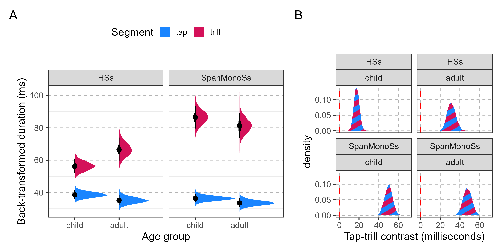

```


???

Now, the question that we can ask is: what is vulnerable to being transferred? Findings from early bilinguals demonstrate that underlying phonological contrasts seem to be more stable than the phonetic level of representation.

And to see how this operates in speech production, let's examine findings from my recent study with Scott Perry on the Spanish tap-trill contrast in intervocalic positions—so /ɾ/ and /r/, such as pero and perro. The tap is produced with one occlusion, while the trill is produced with two or more occlusions (/r/). In intervocalic rhotic positions, when primary canonical gestures (such as the number of tongue-tip occlusions) show surface variability under bilingual contact, adult heritage Spanish speakers do not collapse the two phonemes. Instead, they use secondary cues to show this contrast. So, they adaptively re-weight their mapping of cues, recruiting duration as a secondary acoustic cue to preserve a non-overlapping contrast between taps and trills.

We can see here in Figure A how child and adult bilinguals on the right show a reduction in the durational implementation of the contrast, but they nevertheless show a non-overlapping contrast between the /ɾ/ and the /r/.


---

## Modeling Early Bilingual Sound Systems


```{r ,  fig.width=9.5, fig.height=6.5, out.width="90%"}
library(ggplot2)
library(dplyr)
library(tidyverse)

# 1. Define L2LP / BiPhon Representational Levels
levels_l2lp <- tribble(
  ~xmin, ~xmax, ~ymin, ~ymax, ~title, ~spec, ~domain,
  2.3, 5.7, 5.2, 6.0, "Semantic Representation (SemR)", "Meaning & Morphemes", "Phonology",
  2.3, 5.7, 4.0, 4.8, "Underlying Representation (UR)", "| Lexical Categories / Target Forms |", "Phonology",
  2.3, 5.7, 2.8, 3.6, "Surface Representation (SR)", "/ Phonological Features & Segments /", "Phonology",
  2.3, 5.7, 1.6, 2.4, "Auditory Representation (AudR)", "[ Acoustic Cues & Continuous Distribution ]", "Phonetics",
  2.3, 5.7, 0.4, 1.2, "Articulatory Representation (ArtR)*", "[[ Motor Execution & Gestures ]] (BiPhon only; absent in L2LP)", "Phonetics"
)

# 2. Grammar Mappings & Acquisition Mechanisms
grammars_l2lp <- tribble(
  ~x, ~y, ~label,
  4.0, 4.9, "Lexical Mapping (UR ↔ SemR)",
  4.0, 3.7, "Phonological Grammar (Faithfulness & Structural Constraints)",
  4.0, 2.5, "Cue Integration Grammar (AudR ↔ SR Mapping / L2LP Optimal Perception)",
  4.0, 1.3, "Sensorimotor Grammar (Auditory-Articulatory Mapping)"
)

# 3. Learning Mechanisms Annotations
acq_mechanisms <- tribble(
  ~x, ~y, ~label,
  1.1, 2.5, "Perceptual Learning:\nCue Weighting Shift\n(Optimal Perception)",
  6.9, 2.5, "Grammar Plasticity:\nGradual Learning Algorithm\n(Stochastic OT / HG)",
  6.9, 3.7, "Category Formation:\nNew vs. Similar / Subset\nScenarios"
)

# 4. Render Diagram
ggplot() +
  # Blocks
  geom_rect(data = levels_l2lp, aes(xmin = xmin, xmax = xmax, ymin = ymin, ymax = ymax, fill = domain),
            color = "grey30", linewidth = 0.7, alpha = 0.85) +
  geom_text(data = levels_l2lp, aes(x = (xmin + xmax) / 2, y = (ymin + ymax) / 2 + 0.12, label = title),
            fontface = "bold", size = 3.8, color = "white") +
  geom_text(data = levels_l2lp, aes(x = (xmin + xmax) / 2, y = (ymin + ymax) / 2 - 0.15, label = spec),
            fontface = "italic", size = 2.8, color = "grey95") +
  
  # Grammar Mappings
  geom_label(data = grammars_l2lp, aes(x = x, y = y, label = label),
             fill = "white", color = "grey20", size = 2.9, fontface = "bold",
             label.padding = unit(0.2, "lines"), border.color = "grey70") +
             
  # Mechanisms Annotations
  geom_label(data = acq_mechanisms, aes(x = x, y = y, label = label),
             fill = "#FFF2CC", color = "#7F6000", size = 2.7, fontface = "bold",
             label.padding = unit(0.3, "lines"), border.color = "#D6B656") +

  # Manual Color Scales
  scale_fill_manual(values = c("Phonology" = "#0072B2", "Phonetics" = "#E69F00")) +
  scale_x_continuous(limits = c(0.2, 7.8)) +
  scale_y_continuous(limits = c(0.1, 6.6)) +
  
  labs(
    subtitle = "Based on Second Language Linguistic Perception Model (Escudero, 2005, 2009; Yazawa and Escudero, 2025) and BiPhon (Boersma, 2007, 2011)",
    caption = "Note: *Articulatory Representation (ArtR) and Sensorimotor Grammar are present in BiPhon but excluded in standard L2LP perceptual architecture.\nReferences:\n- Boersma, P. (2007, 2011). BiPhon Model. | Escudero, P. (2005, 2009). Second Language Linguistic Perception (L2LP) Model.\n- Boersma & Escudero (2008). Computational modeling of L2 perception in Stochastic OT / HG."
  ) +
  theme_void(base_size = 12) +
  theme(
    plot.title = element_text(face = "bold", size = 13, margin = margin(b = 3)),
    plot.subtitle = element_text(size = 9.5, color = "grey30", margin = margin(b = 8)),
    plot.caption = element_text(size = 7.5, color = "grey40", hjust = 0, margin = margin(t = 10)),
    legend.position = "none",
    plot.margin = margin(10, 10, 10, 10)
  )
```


???

To formalize how bilinguals map continuous speech onto lexical meanings in their two grammars, several models have been proposed, but we will today draw upon the Second Language Linguistic Perception Model (L2LP), which has co-evolved with the Bidirectional Phonetics and Phonology framework, or the Bi-Phon model.

Under these models, processing unfolds across four distinct hierarchical tiers:

Physical Entry Point: The continuous acoustic signal enters as an auditory form. This is where listeners receive formant structure, duration, and all other relevant acoustic signals.

Pre-lexical Cue Integration Grammar: This maps acoustic formants onto discrete surface forms. These surface forms encode language-specific phonetic categories, as well as allophonic detail.

Phonological Grammar: This matches these surface categories to canonical underlying forms that are already stored in the lexicon.

Lexical Constraints: These link underlying target representations to their semantic lexical forms.

Under the Second Language Linguistic Perception Model model, which draws on full access, when a second language learner learns a second language, they copy their L1 grammar. So, second language acquisition begins with a complete duplicate of the listener's L1 optimal perception grammar. Cue constraints are copied in full to form the L2 initial state. This transfer operates across two distinct mappings:

First, at the pre-lexical level, where L1 cue constraints filter the L2 acoustic input.

Second, at the lexical level, where merged surface categories fail to trigger lexical targets.


For example, take native Spanish speakers learning the Portuguese mid-vowel contrast in avô /a'vo/ versus avó /a'vɔ/. At the pre-lexical level, because the copied Spanish perception grammar lacks an open-mid vowel category /ɔ/ and contains only one back mid-vowel /o/, Spanish cue constraints map both Portuguese acoustic tokens of avô and avó onto the single surface category /o/. And at the lexical level, because surface perception outputs only /o/ for both items, the lexicon builder receives no phonological evidence to construct two separate targets, mapping both words onto a single underlying representation /a'vo/ and creating spurious homophony in memory.


---
## Modeling Early Bilingual Sound Systems

```{r}
library(ggplot2)
library(dplyr)

# Grammar 1: Activated (Language A)
g1_levels <- tribble(
  ~xmin, ~xmax, ~ymin, ~ymax, ~title, ~spec, ~domain,
  0.8, 3.8, 5.2, 6.0, "SemR (Lang A)", "Meaning", "Phonology",
  0.8, 3.8, 4.0, 4.8, "UR (Lang A)", "| Target Phonemes |", "Phonology",
  0.8, 3.8, 2.8, 3.6, "SR (Lang A)", "/ Surface Features /", "Phonology",
  0.8, 3.8, 1.6, 2.4, "AudR (Lang A)", "[ Acoustic Space ]", "Phonetics",
  0.8, 3.8, 0.4, 1.2, "ArtR (Lang A)", "[ Motor Gestures ]", "Phonetics"
)

# Grammar 2: Inhibited (Language B)
g2_levels <- tribble(
  ~xmin, ~xmax, ~ymin, ~ymax, ~title, ~spec, ~domain,
  4.8, 7.8, 5.2, 6.0, "SemR (Lang B)", "Meaning", "Phonology",
  4.8, 7.8, 4.0, 4.8, "UR (Lang B)", "| Target Phonemes |", "Phonology",
  4.8, 7.8, 2.8, 3.6, "SR (Lang B)", "/ Surface Features /", "Phonology",
  4.8, 7.8, 1.6, 2.4, "AudR (Lang B)", "[ Acoustic Space ]", "Phonetics",
  4.8, 7.8, 0.4, 1.2, "ArtR (Lang B)", "[ Motor Gestures ]", "Phonetics"
)

ggplot() +
  # Grammar A (ACTIVATED - High Opacity, Vibrant Borders)
  geom_rect(data = g1_levels, aes(xmin = xmin, xmax = xmax, ymin = ymin, ymax = ymax, fill = domain),
            color = "#009E73", linewidth = 1.0, alpha = 0.9) +
  geom_text(data = g1_levels, aes(x = (xmin + xmax) / 2, y = (ymin + ymax) / 2 + 0.12, label = title),
            fontface = "bold", size = 3.5, color = "white") +
  geom_text(data = g1_levels, aes(x = (xmin + xmax) / 2, y = (ymin + ymax) / 2 - 0.15, label = spec),
            fontface = "italic", size = 2.8, color = "grey95") +
            
  # Grammar B (INHIBITED - Lower Opacity, Faded Styling)
  geom_rect(data = g2_levels, aes(xmin = xmin, xmax = xmax, ymin = ymin, ymax = ymax),
            fill = "grey75", color = "grey50", linewidth = 0.5, alpha = 0.4) +
  geom_text(data = g2_levels, aes(x = (xmin + xmax) / 2, y = (ymin + ymax) / 2 + 0.12, label = title),
            fontface = "bold", size = 3.5, color = "grey30") +
  geom_text(data = g2_levels, aes(x = (xmin + xmax) / 2, y = (ymin + ymax) / 2 - 0.15, label = spec),
            fontface = "italic", size = 2.8, color = "grey40") +

  # Activation & Inhibition Annotations
  annotate("label", x = 2.3, y = 6.3, label = "GRAMMAR A: ACTIVATED\n(Selected Context)",
           fill = "#D4EDDA", color = "#155724", fontface = "bold", size = 3.2) +
  annotate("label", x = 6.3, y = 6.3, label = "GRAMMAR B: INHIBITED\n(Suppressed Context)",
           fill = "#F8D7DA", color = "#721C24", fontface = "bold", size = 3.2) +
           
  # Inter-Grammatical Inhibitory Connection
  annotate("segment", x = 3.9, y = 3.2, xend = 4.7, yend = 3.2,
           arrow = arrow(length = unit(0.25, "cm"), ends = "both"), linewidth = 1.0, color = "#D55E00", linetype = "dashed") +
  annotate("text", x = 4.3, y = 3.5, label = "Inhibitory\nControl", fontface = "bold.italic", size = 2.8, color = "#D55E00") +

  scale_fill_manual(values = c("Phonology" = "#0072B2", "Phonetics" = "#E69F00")) +
  scale_x_continuous(limits = c(0.2, 8.4)) +
  scale_y_continuous(limits = c(0.1, 6.7)) +
  
  labs(
    title = "Simultaneous Bilingual Grammars in L2LP / BiPhon Framework",
    subtitle = "Dual-Grammar Architecture with Executive Control (Activation vs. Inhibition)",
    caption = "References:\n- Escudero, P. (2005, 2009). Second Language Linguistic Perception (L2LP).\n- Boersma, P., & Escudero, P. (2008). Modeling bilingual perception in Stochastic OT."
  ) +
  theme_void(base_size = 12) +
  theme(
    plot.title = element_text(face = "bold", size = 13, margin = margin(b = 3)),
    plot.subtitle = element_text(size = 9.5, color = "grey30", margin = margin(b = 8)),
    plot.caption = element_text(size = 7.5, color = "grey40", hjust = 0, margin = margin(t = 10)),
    legend.position = "none",
    plot.margin = margin(10, 10, 10, 10)
  )
```


???
Now, early bilinguals develop the two grammars in parallel. So how is transfer modeled in this case?  The L2LP speech model leaves the explanation of transfer to cognitive constraints.

Depending on the communicative context, executive control mechanisms modulate the systems through activation and inhibition. For example, when a bilingual is in monolingual mode, Grammar A is fully activated, enabling rapid feed-forward comprehension and top-down production. Meanwhile, Grammar B is suppressed through mechanisms of inhibitory control, which prevents cross-linguistic interference and involuntary code-switching. The degree to which these languages are activated or inhibited may ultimately result in cross-linguistic transfer, but this is crucially not left to the grammar, but left to executive control.


---
##  Some Considerations of Current L2 Frameworks

-   In general, L2 models <small>(SLM-r, PAM-L2, L2LP)</small> explain how new L2 categories emerge from L1 categories or cue weightings, but do not offer grammar-integrated mechanisms for real-time language transfer in **simultaneous bilinguals**.


-  They presume stable, homogeneous input, ignoring how **community-level input variability** (e.g., regional/accented speech) continuously reshapes sound categorization.

-  They assume prelexical perception directly dictates phonolexical encoding. Distinction at the lexical level can arise without prelexical discrimination <small>(e.g., Cutler et al., 2005)</small> and lexical encoding is not guaranteed under prelexical discrimination <small>(Darcy et al., 2012, 2013; Darcy & Rothgerber, 2020)</small>.

<br>
<br>
<br>


<small>Distinction at the lexical level without prelexical discrimination can also be resolved through orthography, as multi-modal representations and written cues integrate directly into phonological categorization and lexical encoding (Zhou & Hamann, 2026).</small>

???
Now that we’ve reviewed the core architecture of these models, I’d like to highlight three critical limitations when applying them—specifically to early bilingual populations.

First, Model Scope. These frameworks succeed in explaining how new L2 categories emerge from an established L1 sound system. However, they lack integrated grammatical mechanisms to account for real-time language interaction in simultaneous bilinguals. When mechanisms like activation and inhibition are proposed, they are typically treated as external domain-general cognitive processes, leaving the question open as to whether cross-linguistic interaction can occur directly within the grammar itself.

Second, Input Assumptions. Classic models presume a stable, homogeneous acoustic input. In reality, sustained bilinguals navigate dynamic sociolinguistic environments with high community-level variability—such as regional variation or accented speech—which continuously reshapes sound categorization over time.

And third, Direct Mapping Assumptions. These models assume prelexical perception directly dictates phonolexical encoding. That is, surface representations are passed directly into underlying forms. This assumes a strict carry-over from surface-level perception to lexical representation—an assumption we will be evaluating today"


---

## Sociolinguistic context in Catalonia (I)

```{r my-image, echo=FALSE, out.width="50%", fig.align="center", fig.cap=""}
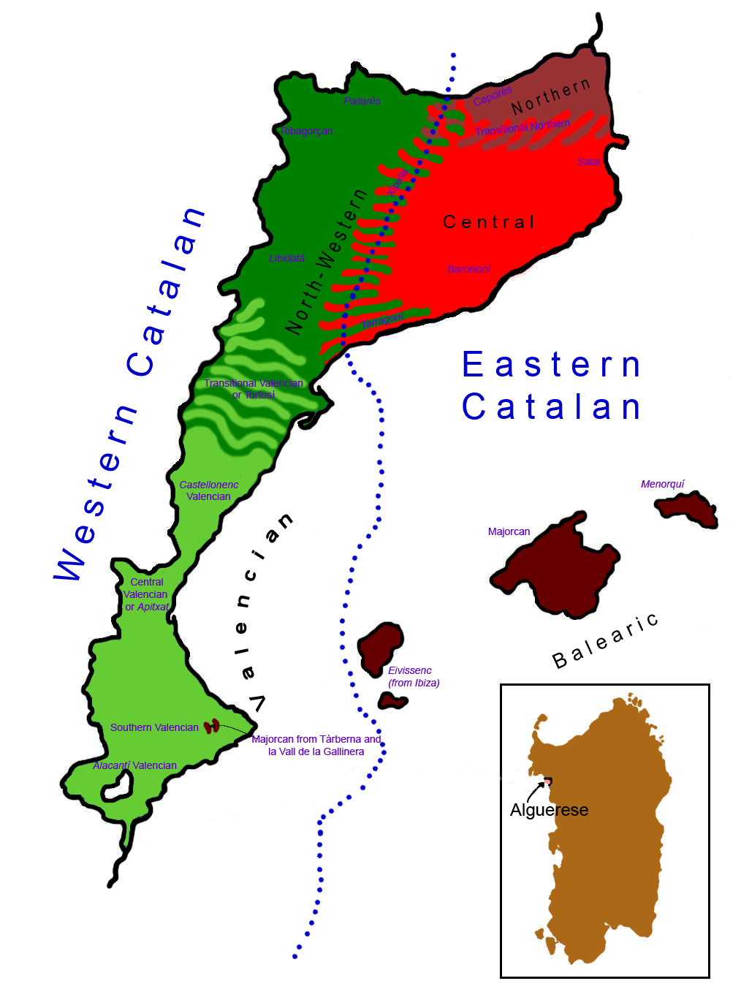

```

???

To evaluate these models empirically, we turn to the unique sociolinguistic context of Catalonia, where Catalan and Spanish are co-official languages in continuous contact. Since the 1980s, an educational immersion model ensures all children receive schooling in Catalan regardless of home language. This creates a highly bilingual population with rich, heterogeneous daily usage patterns spanning from strongly Catalan-dominant to strongly Spanish-dominant speakers.
---

## Sociolinguistic context in Catalonia (II)


```{r habitual, echo=FALSE, fig.width=9.5, fig.height=6.5, out.width="100%"}
# Option A: Embedding via knitr (Recommended for RMarkdown output rendering)
# Ensure the image file 'eulp_language_trends_2003_2023.png' is placed in your working directory.
#STREAMING_CHUNK:Loading required R packages...
library(tidyverse)
library(scales)
#STREAMING_CHUNK:Constructing longitudinal EULP dataset...
#1. Construct Longitudinal EULP Dataset (2003-2023)
eulp_data <- tibble(
Year = rep(c(2003, 2008, 2013, 2018, 2023), times = 5),
Category = factor(
rep(
c("Spanish", "Catalan", "Both (Catalan & Spanish)", "Other Languages", "Other Combinations"),
each = 5
),
levels = c("Spanish", "Catalan", "Both (Catalan & Spanish)", "Other Languages", "Other Combinations")
),
Percentage = c(
# Spanish
47.2, 45.9, 50.7, 48.6, 46.5,
# Catalan
46.0, 35.6, 36.3, 36.1, 32.6,
# Both (Catalan & Spanish)
4.7,  11.9,  6.9,  7.4,  9.4,
# Other Languages
2.0,   4.8,  4.7,  4.3,  4.5,
# Other Combinations (Recorded from 2018 onward)
NA,    NA,   NA,  3.0,  5.6
)
)
#STREAMING_CHUNK:Filtering data and defining color palette...
#Filter out NA rows for plotting continuous line paths
df_plot <- eulp_data %>% filter(!is.na(Percentage))
#Color palette mapping
language_colors <- c(
"Spanish"                  = "#D55E00", # Warm red-orange
"Catalan"                  = "#005580", # Deep navy/teal
"Both (Catalan & Spanish)" = "#009E73", # Bluish green
"Other Languages"          = "#E69F00", # Gold/Yellow
"Other Combinations"       = "#787C82"  # Neutral slate
)
#STREAMING_CHUNK:Building publication-quality ggplot graphic...
#2. Build Publication-Quality ggplot Graphic
p_eulp <- ggplot(df_plot, aes(x = Year, y = Percentage, color = Category, group = Category)) +
#Reference gridlines & zero line
geom_hline(yintercept = 0, color = "#cbd5e1", linewidth = 0.5) +
#Main Trend Lines & Markers
geom_line(linewidth = 1.3, alpha = 0.9) +
geom_point(size = 3.5) +
#Value Annotations on Data Points
geom_text(
aes(label = paste0(sprintf("%.1f", Percentage), "%")),
vjust = -0.9,
size = 3.6,
fontface = "bold",
show.legend = FALSE
) +
#Scales & Axis Configuration
scale_x_continuous(
breaks = c(2003, 2008, 2013, 2018, 2023),
limits = c(2002.5, 2023.5)
) +
scale_y_continuous(
limits = c(0, 60),
breaks = seq(0, 60, by = 10),
labels = function(x) paste0(x, "%")
) +
scale_color_manual(values = language_colors) +
#STREAMING_CHUNK:Configuring labels and theme...
labs(
title = "Evolution of Habitual Language Identification in Catalonia (2003-2023)",
subtitle = "Percentage of population aged 15+ by primary/habitual language (llengua habitual)",
x = "Survey Wave Year",
y = "Percentage of Population (%)",
color = "Language Category",
caption = "Source: Enquesta d'Usos Lingüístics de la Població (EULP 2003, 2008, 2013, 2018, 2023) | IDESCAT"
) +
#Modern Minimalist Styling
theme_minimal(base_size = 13) +
theme(
plot.title = element_text(face = "bold", size = 15, color = "#0f172a", margin = margin(b = 6)),
plot.subtitle = element_text(size = 11, color = "#475569", margin = margin(b = 18)),
plot.caption = element_text(size = 9, color = "#64748b", margin = margin(t = 16)),
axis.title.x = element_text(face = "bold", size = 11, color = "#1e293b", margin = margin(t = 10)),
axis.title.y = element_text(face = "bold", size = 11, color = "#1e293b", margin = margin(r = 10)),
axis.text = element_text(size = 11, color = "#334155"),
panel.grid.major.x = element_blank(),
panel.grid.minor = element_blank(),
panel.grid.major.y = element_line(color = "#f1f5f9", linewidth = 0.8),
legend.position = "top",
legend.title = element_text(face = "bold", size = 11),
legend.text = element_text(size = 10),
legend.key.width = unit(1.2, "cm"),
plot.margin = margin(20, 20, 20, 20)
)
#STREAMING_CHUNK:Displaying and exporting high-resolution graphic...
#3. Display plot in graphics device
print(p_eulp)
#Export High-Resolution PNG for Presentation/Slides
ggsave(
filename = "eulp_language_trends_2003_2023_english.png",
plot = p_eulp,
width = 11,
height = 6.5,
dpi = 300
)


```


???
Just to give you an idea, demographic survey data from the last 20 years regarding participants' habitual language of identification shows that Spanish remains the most common habitual language, representing approximately 46.5% of the population. Meanwhile, the proportion of speakers identifying Catalan as their habitual language has declined from 46% to 32%, alongside a slight increase in those reporting both languages as habitual.

So, we see that it is a complex reality, and young bilingual children grow up in an environment often characterized by non-canonical and accented community speech in Catalan.

---


## The Catalan Vowel System


```{r vowel-space-scheme, message=FALSE, warning=FALSE}
library(ggplot2)
library(dplyr)
library(ragg)
# 1. Coordinate data points (Recasens & Espinosa, 2006)
library(dplyr)
library(ggplot2)
library(ragg)

# 1. Coordinate data points (Recasens & Espinosa, 2006)
library(ggplot2)
library(dplyr)
library(showtext)

# 1. Load Noto Sans for full Unicode / IPA character support
font_add_google("Noto Sans", "noto")
showtext_auto()

# Data frames
catalan_vowels <- data.frame(
  vowel = c("i", "e", "ɛ", "a", "ɔ", "o", "u", "ə"),
  F1 = c(320, 480, 660, 740, 710, 540, 390, 560),
  F2 = c(2150, 1900, 1740, 1460, 1170, 1000, 900, 1400),
  sys = "Catalan"
)

spanish_vowels <- data.frame(
  vowel = c("i", "e", "a", "o", "u"),
  F1 = c(320, 560, 730, 490, 370),
  F2 = c(2130, 1820, 1400, 1060, 930),
  sys = "Spanish"
)

# Polygon paths (perimeter ordering)
cat_poly <- catalan_vowels %>% filter(vowel != "ə") %>% slice(c(1:7, 1))
sp_poly  <- spanish_vowels %>% slice(c(1:5, 1))

# 2. Render plot
ggplot() +
  # Polygon boundaries
  geom_path(data = cat_poly, aes(x = F2, y = F1), color = "#005f73", linewidth = 1.2, linetype = "solid") +
  geom_path(data = sp_poly, aes(x = F2, y = F1), color = "#ca6702", linewidth = 1.2, linetype = "dashed") +
  
  # Catalan Vowel Labels (family = "noto", adjusted size)
  geom_text(data = catalan_vowels, aes(x = F2, y = F1, label = vowel), 
            color = "#005f73", fontface = "bold", size = 7.5, family = "noto") +
  
  # Spanish Vowel Labels (family = "noto", adjusted size & offset)
  geom_text(data = spanish_vowels, aes(x = F2 - 45, y = F1 + 20, label = vowel), 
            color = "#ca6702", fontface = "bold", size = 6.0, family = "noto") +
  
  # Phonetic standard reversed axes (High/Front at top-left)
  scale_x_reverse(limits = c(2250, 850), name = "F2 (Hz)  [ Back  |  Front ]") +
  scale_y_reverse(limits = c(800, 280), name = "F1 (Hz)  [ High  |  Low ]") +
  
  labs(
    title = "Catalan vs. Spanish Acoustic Vowel Space",
    subtitle = "Solid line = Catalan | Dashed line = Spanish",
    caption = "Adapted from Recasens & Espinosa (2006)"
  ) +
  theme_minimal(base_size = 13, base_family = "noto") +
  theme(
    plot.title = element_text(face = "bold", size = 15),
    panel.grid.minor = element_blank(),
    panel.border = element_rect(color = "grey80", fill = NA, linewidth = 0.5)
  )
#ggsave("catalan_spanish_vowels.png", plot = p, device = ragg::agg_png, width = 8, height = 6, dpi = 300)

# Method A: Display in R Markdown / Quarto / RStudio Viewer
#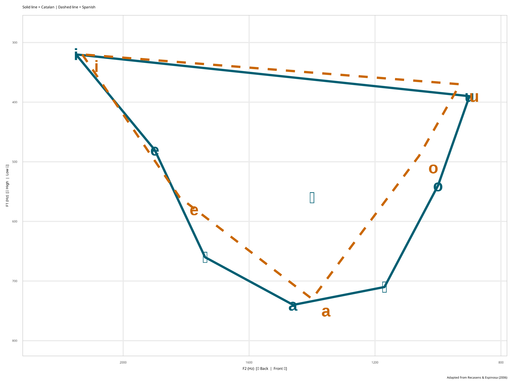


```
???


Phonetically, Catalan has a 7-vowel system contrasting close-mid /e/ and open-mid /ɛ/. Spanish possesses a 5-vowel system with a single mid-front vowel category /e/. For Spanish-dominant bilinguals, acquiring and maintaining the Catalan /e/–/ɛ/ contrast requires establishing a new perceptual boundary within a region where Spanish has only one category.


---
# Input variability

```{r}
# ==============================================================================
# Spanish-Accented Input Representation in Catalan (ggplot2)
# Illustrating vowel merger of Catalan /e/ - /ɛ/ into Spanish [e]
# Example: Catalan "gallɛda" (bucket) produced as "galleda" [ɡaˈʎeða]
# Using Noto Sans font family for IPA Unicode symbols (ɛ)
# ==============================================================================

library(ggplot2)
library(dplyr)
library(patchwork)

# ------------------------------------------------------------------------------
# Panel A: Acoustic Vowel Space (F2 vs F1)
# ------------------------------------------------------------------------------
df_vowels <- tribble(
  ~vowel, ~F1, ~F2, ~type,
  "/i/", 300, 2200, "Catalan System",
  "/e/", 450, 2000, "Catalan /e/ (close-mid)",
  "/ɛ/", 600, 1800, "Catalan /ɛ/ (open-mid)",
  "/a/", 750, 1400, "Catalan System",
  "/o/", 450, 900,  "Catalan System",
  "/ɔ/", 600, 1000, "Catalan System",
  "/u/", 300, 800,  "Catalan System"
)

p_vowel_space <- ggplot(df_vowels, aes(x = F2, y = F1, label = vowel, color = type)) +
  geom_point(size = 7, alpha = 0.85) +
  geom_text(color = "white", fontface = "bold", size = 4, family = "Noto Sans") +
  
  # Spanish Merger Arrow
  annotate("segment", x = 1820, xend = 1980, y = 580, yend = 470,
           arrow = arrow(length = unit(0.3, "cm"), type = "closed"),
           color = "#E69F00", linewidth = 1.3, linetype = "dashed") +
  annotate("label", x = 1900, y = 520, 
           label = "Spanish L1 Merger:\n/ɛ/ produced as [e]", 
           fill = "#FFF2CC", color = "#B8860B", fontface = "bold", size = 3.2, family = "Noto Sans") +
  
  # Reverse axes for traditional phonetics layout
  scale_x_reverse(limits = c(2400, 700), breaks = seq(2400, 700, -300)) +
  scale_y_reverse(limits = c(850, 200), breaks = seq(200, 850, 100)) +
  scale_color_manual(values = c(
    "Catalan System" = "#0072B2",
    "Catalan /e/ (close-mid)" = "#0072B2",
    "Catalan /ɛ/ (open-mid)" = "#D55E00"
  )) +
  labs(
    title = "A. Catalan Vowel Space vs. Spanish Accent Substitution",
    x = "F2 Frequency (Hz) [Back <---> Front]",
    y = "F1 Frequency (Hz) [Close / High <---> Open / Low]"
  ) +
  theme_minimal(base_size = 11, base_family = "Noto Sans") +
  theme(
    plot.title = element_text(face = "bold", size = 11, color = "#0A2540"),
    legend.position = "none",
    panel.grid.minor = element_blank()
  )

# ------------------------------------------------------------------------------
# Panel B: Lexical Example ("gallɛda" -> [ɡaˈʎeða])
# ------------------------------------------------------------------------------
df_boxes <- tribble(
  ~xmin, ~xmax, ~ymin, ~ymax, ~title, ~body, ~fill_col, ~border_col,
  
  # Box 1: Canonical Catalan
  0.05, 0.95, 0.60, 0.92,
  "CANONICAL CATALAN PRODUCTION",
  "Word Target: \"gallɛda\" (bucket)\nPhonetic Realization: [ɡəˈʎɛðə] (Open-Mid /ɛ/)",
  "#E6F2FF", "#0072B2",
  
  # Box 2: Spanish-Accented
  0.05, 0.95, 0.08, 0.40,
  "SPANISH-ACCENTED PRODUCTION",
  "Word Realization: \"galleda\"\nPhonetic Realization: [ɡaˈʎeða] (Close-Mid [e])",
  "#FFF0E6", "#D55E00"
)

p_example <- ggplot(df_boxes) +
  geom_rect(aes(xmin = xmin, xmax = xmax, ymin = ymin, ymax = ymax, fill = fill_col, color = border_col),
            linewidth = 1.1, alpha = 0.9) +
  geom_text(aes(x = (xmin + xmax)/2, y = ymax - 0.08, label = title, color = border_col),
            fontface = "bold", size = 3.8, family = "noto") +
  geom_text(aes(x = (xmin + xmax)/2, y = ymin + 0.14, label = body),
            color = "#1F2937", size = 3.2, lineheight = 1.1, family = "noto") +
  
  # Connector Arrow
  annotate("segment", x = 0.5, xend = 0.5, y = 0.60, yend = 0.40,
           arrow = arrow(length = unit(0.25, "cm"), type = "closed"), color = "#E69F00", linewidth = 1.2) +
  annotate("label", x = 0.5, y = 0.50, label = "Spanish-Accented Community Input", 
           fill = "#FFFFFF", color = "#B8860B", fontface = "bold", size = 3, family = "noto") +
  
  scale_fill_identity() +
  scale_color_identity() +
  coord_fixed(xlim = c(0, 1), ylim = c(0, 1)) +
  labs(
    ) +
  theme_void(base_family = "Noto") +
  theme(
    plot.title = element_text(face = "bold", size = 11, color = "#0A2540", hjust = 0.5),
    plot.caption = element_text(size = 8.5, color = "#4B5563", hjust = 0.5, face = "italic")
  )

# ------------------------------------------------------------------------------
# Combine Panels with patchwork
# ------------------------------------------------------------------------------
combined_plot <- (p_vowel_space | p_example) +
  plot_layout(widths = c(1.1, 1)) +
  plot_annotation(
    title = "Spanish-Accented Speech Input in Bilingual Catalan-Spanish Communities",
    subtitle = "Non-canonical production of open-mid /ɛ/ as close-mid [e] in words like \"gallɛda\" (bucket)",
    caption = "Based on Repiso Puigdelliura et al. (2025) & Ramón-Casas et al. (2023)"
  )

combined_plot <- combined_plot + theme(
  text = element_text(family = "Noto Sans"),
  plot.title = element_text(face = "bold", size = 13, color = "#0A2540", hjust = 0.5),
  plot.subtitle = element_text(size = 9.5, color = "#3B6978", hjust = 0.5),
  plot.caption = element_text(size = 8.5, color = "#6B7280", hjust = 0.5, face = "italic")
)

# Display Plot & Save
print(p_example)
ggsave("spanish_accented_input_galleda.png", plot = combined_plot, width = 12, height = 5.5, dpi = 300)

```


???

In real-world multilingual societies, bilinguals are rarely exposed solely to idealized monolingual input; instead, they are immersed in rich, variable input. For example, within the Catalan mid-vowel system, Spanish-dominant speakers may merge the Catalan /e/ and /ɛ/ vowels into a single close-mid vowel. Consequently, words canonically produced with an open-mid vowel—such as galeta—are realized with a close-mid vowel. Far from being isolated errors, these non-canonical realizations constitute an important portion of the input that new bilingual speakers receive.   


---

## Early exposure as a crucial factor for the mid vowel contrast
#### **Pallier, Bosch, & Sebastián-Gallés (1997)**


**Catalan-Dominant** (n = 20): Raised by Catalan-speaking parents; exposed to Catalan from birth.

**Spanish-Dominant** (n = 20): Raised by Spanish-speaking parents; early intensive Catalan immersion started between ages 1–6 (mean age = 4.35 years).


.pull-left[

**Experiment 1: Identification Task**


<small>TasK: Listeners categorized each token as Pere (/e/) or pera (/ɛ/). </small>


```{r identification_curves, echo=FALSE, fig.width=9.5, fig.height=6.5, out.width="80%"}

#<small>Task: 63 randomized trials (7 stimuli x 9 repetitions).F1: Increased from 404Hz (s1, [e]) to 584Hz (s7, [ɛ]) in 30Hz steps.</small>
df_exp1 <- data.frame(
  Stimulus = factor(rep(paste0("s", 1:7), 2), levels = paste0("s", 1:7)),
  Percent_Pera = c(15, 17, 17, 43, 68, 82, 82,
                   54, 55, 48, 52, 44, 47, 36),
  Group = factor(rep(c("Catalan-dominant", "Spanish-dominant"), each = 7))
)

ggplot(df_exp1, aes(x = Stimulus, y = Percent_Pera, group = Group, color = Group, shape = Group)) +
  geom_line(linewidth = 1.2) +
  geom_point(size = 3.5) +
  scale_color_manual(values = group_colors) +
  scale_y_continuous(limits = c(0, 100), labels = function(x) paste0(x, "%")) +
  labs(
    subtitle = "Percentage of 'pera' (/ɛ/) responses across F1 steps",
    x = "Continuum Step (F1: 404 Hz → 584 Hz)",
    y = "Identified as /ɛ/ (%)"
  ) +
  theme_keynote()


#ggsave("exp1_identification.png", plot = exp1_identification, device = ragg::agg_png, width = 8, height = 6, dpi = 300)

#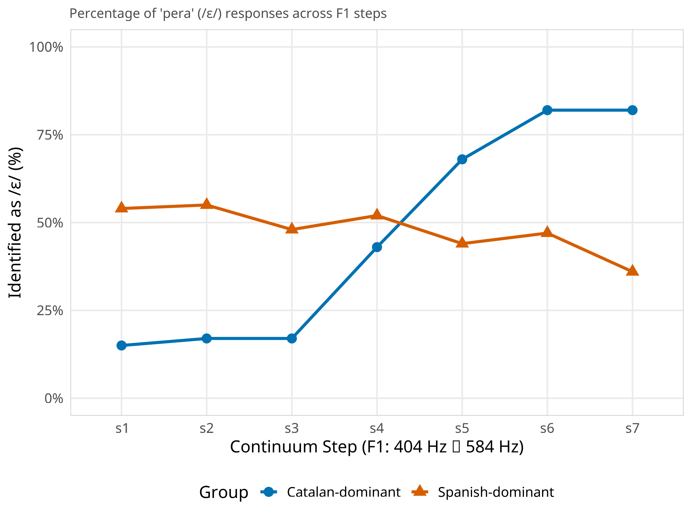

```


]


.pull-right[

**Experiment 2: AX Discrimination Task**


<small> Task: Button-press "Same / Different" discrimination.


```{r}
df_exp2 <- data.frame(
  Pair = factor(rep(c("s1-s3", "s2-s4", "s3-s5", "s4-s6", "s5-s7"), 2),
                levels = c("s1-s3", "s2-s4", "s3-s5", "s4-s6", "s5-s7")),
  Percent_Diff = c(20, 25, 65, 35, 15,
                   22, 24, 28, 25, 21),
  Group = factor(rep(c("Catalan-dominant", "Spanish-dominant"), each = 5))
)

ggplot(df_exp2, aes(x = Pair, y = Percent_Diff, group = Group, color = Group, shape = Group)) +
  geom_line(linewidth = 1.2) +
  geom_point(size = 3.5) +
  scale_color_manual(values = group_colors) +
  scale_y_continuous(limits = c(0, 100), labels = function(x) paste0(x, "%")) +
  labs(
    subtitle = "Percentage of 'Different' choices on 2-step pairs",
    x = "Stimulus Pair",
    y = "Discrimination Accuracy (%)"
  ) +
  theme_keynote()

```
]

???

In a 1997 study, Pallier and colleagues examined Catalan-dominant bilinguals (raised by Catalan-speaking parents) and Spanish-dominant bilinguals (raised by Spanish-speaking parents) using an identification task and an AX discrimination task.   In the identification task, participants listened to mid-vowel tokens (such as peta [peɾə] vs. peta [pɛɾə]) and classified them as containing either the high-mid /e/ or low-mid /ɛ/ vowel. Results revealed a sharp boundary for Catalan-dominant bilinguals, whereas Spanish-dominant bilinguals showed a flat, non-categorical response pattern.   In the AX discrimination task, participants listened to pairs of stimuli along an acoustic continuum and determined whether the two sounds were the same or different. Catalan-dominant speakers demonstrated a sharp boundary between stimuli 3 and 5, reflecting a clear categorical perceptual boundary between /e/ and /ɛ/. In contrast, Spanish-dominant bilinguals showed no such categorical boundary, exhibiting flat discrimination accuracy across the continuum.   

---

## Early exposure as a crucial factor for the mid vowel contrast

#### **Ramon-Casas et al. (2023)**


* **Sample Size:** $N = 36$ early bilingual preschoolers (M age = 4.5 years; range: 4;0–5;0).
* **Location:** 4 public immersion kindergartens in the Barcelona metropolitan area.
* **Catalan Exposure:** Intensive, continuous exposure (at least 5 days/week since age 3).


```{r ramon-casas-dissociation-plot, echo=FALSE, fig.width=6.5, fig.height=5.2, out.width="70%", message=FALSE, warning=FALSE}
library(ggplot2)
library(dplyr)
library(patchwork)

# 1. Perception Data Frame
df_perception <- tribble(
  ~Task, ~Group, ~Accuracy,
  "Control Words\n(/i/–/a/)", "Catalan-dominant", 96.0,
  "Control Words\n(/i/–/a/)", "Spanish-dominant", 95.0,
  "Target Words\n(/e/–/ɛ/)", "Catalan-dominant", 84.4,
  "Target Words\n(/e/–/ɛ/)", "Spanish-dominant", 60.8,
  "Non-Words\n(/e/–/ɛ/)",    "Catalan-dominant", 58.6,
  "Non-Words\n(/e/–/ɛ/)",    "Spanish-dominant", 51.6
)

# 2. Production Data Frame
df_production <- tribble(
  ~Target, ~Group, ~Accuracy,
  "Target /e/", "Catalan-dominant", 100.0,
  "Target /e/", "Spanish-dominant", 100.0,
  "Target /ɛ/", "Catalan-dominant", 91.0,
  "Target /ɛ/", "Spanish-dominant", 41.3
)


# Panel A: Perception Plot
p1 <- ggplot(df_perception, aes(x = Task, y = Accuracy, fill = Group)) +
  geom_col(position = position_dodge(width = 0.8), width = 0.7, alpha = 0.9) +
  geom_hline(yintercept = 50, linetype = "dashed", color = "grey50") +
  geom_text(
    aes(label = paste0(Accuracy, "%")), 
    position = position_dodge(width = 0.8), 
    vjust = -0.4, size = 2.8, fontface = "bold", family = "noto"
  ) +
  scale_fill_manual(values = c("Catalan-dominant" = "#0072B2", "Spanish-dominant" = "#D55E00")) +
  scale_y_continuous(limits = c(0, 110)) +
  labs(title = "A. Perception (XAB Task)", y = "Accuracy (%)", x = NULL) +
  theme_minimal(base_size = 10, base_family = "noto") +
  theme(legend.position = "none", plot.title = element_text(face = "bold", size = 11))

# Panel B: Production Plot
p2 <- ggplot(df_production, aes(x = Target, y = Accuracy, fill = Group)) +
  geom_col(position = position_dodge(width = 0.8), width = 0.7, alpha = 0.9) +
  geom_text(
    aes(label = paste0(Accuracy, "%")), 
    position = position_dodge(width = 0.8), 
    vjust = -0.4, size = 2.8, fontface = "bold", family = "noto"
  ) +
  scale_fill_manual(values = c("Catalan-dominant" = "#0072B2", "Spanish-dominant" = "#D55E00")) +
  scale_y_continuous(limits = c(0, 110)) +
  labs(title = "B. Production Accuracy", y = "Target-like %", x = NULL) +
  theme_minimal(base_size = 10, base_family = "noto") +
  theme(legend.position = "bottom", legend.title = element_blank(), plot.title = element_text(face = "bold", size = 11))

# Combine Panels with patchwork
# Combine Panels with patchwork
p1 / p2


```


]

???

A similar effect of language dominance was reported in a study by Ramon-Casas et al. (2023), who examined early bilingual preschoolers using an XAB discrimination task with control words, non-words, and real words, alongside assessing production accuracy.   In non-words, speakers performed at chance level, suggesting that the vowel contrast is more difficult to perceive in non-words than in real words. In real words, however, a clear dominance effect emerged, with Catalan-dominant bilinguals exhibiting higher perceptual accuracy than Spanish-dominant bilinguals. Regarding production, participants demonstrated higher accuracy for the high-mid vowel—which is present in the Spanish vowel system—alongside a dominance effect favoring Catalan-dominant bilinguals.

---

### Is contrast sensitivity reduced or enhanced depending on language mode?


* Spanish-dominant early bilinguals show reduced sensitivity to the /e/–/ɛ/ contrast in static XAB discrimination, whereas Catalan-dominant bilinguals exhibit robust category boundaries <small>(Pallier et al., 1997; Ramón-Casas et al., 2023)</small>.


* Is prelexical sensitivity fixed, or does operating in a **Spanish language mode** temporarily attenuate boundary sharpness ($s$) versus maintaining cooperative co-activation without boundary flattening?


???

These studies show discrimination of the contrast at the prelexical level using a statisc snapshot of the bilingual at one point in time. However, we have said that sound categories could be dynamically malleable. This leaves open a fundamental question, which we examine next: is this prelexical contrast fixed, or does it change depending on the communicative context? 

---
class: inverse, center, middle

# Language mode and dominance-related effects in the perception of the mid vowel Catalan contrast

<br>

### Joint work with

<div style="display: flex; justify-content: center; align-items: center; margin-top: 20px;">
  <div style="text-align: center;">
    
    <p style="margin-top: 12px; font-weight: bold; font-size: 1.2em; margin-bottom: 2px;">Chao Zhou</p>
    <p style="margin-top: 0; font-size: 0.9em; opacity: 0.85; font-style: italic;">Universidade de Lisboa</p>
  </div>
</div>

???

This brings us to Study 1, conducted in collaboration with Chao Zhou at the Universidade de Lisboa, where we directly test the role of real-time language mode and language dominance.
---
## Is contrast sensitivity modulated by language mode?


* **Language mode**: the state of activation and availability of a bilingual's languages and processing mechanisms at any given point in time (Grosjean; 1982, 1998, 2001, 2008)


 * Perceptual categories in early bilinguals are not static; they shift dynamically based on real-time activation levels across communicative contexts <small>(Grosjean, 1998, 2008, 2020; Green & Abutalebi, 2013)</small>.

* When a contrast exists in **both** languages (e.g., VOT in /p/-/d/), bilinguals shift category boundaries between monolingual sessions to match target-language phonetic norms <small>(Elman et al., 1977; Flege & Eefting, 1987; Garcia-Sierra et al., 2009; Gonzales & Lotto, 2013)</small>.

```{r, out.width = "55%"}
library(ggplot2)

# ==============================================================================
# COLOR PALETTE OPTIONS (Uncomment preferred pair)
# ==============================================================================
# Option 1: Modern Academic (Slate & Coral) - DEFAULT BELOW
english_color <- "#2B5C8F"  # Deep Slate Blue
spanish_color <- "#E05A47"  # Warm Coral

# Option 2: Colorblind-Friendly (Okabe-Ito inspired)
# english_color <- "#0072B2"  # Blue
# spanish_color <- "#D55E00"  # Vermilion / Orange

# Option 3: Jewel Tones (Emerald & Purple)
# english_color <- "#0F766E"  # Dark Teal / Emerald
# spanish_color <- "#8B5CF6"  # Royal Purple

# Option 4: High-Contrast Minimalist (Navy & Mustard Gold)
# english_color <- "#1E293B"  # Dark Navy
# spanish_color <- "#D97706"  # Warm Amber / Gold
# ==============================================================================

ggplot() +
  # ------------------ 1. Main Central Axis ------------------
  geom_segment(
    aes(x = -80, xend = 80, y = 0, yend = 0),
    linewidth = 0.8,
    arrow = arrow(ends = "both", length = unit(2.5, "mm"), type = "open")
  ) +
  # Central vertical tick mark at 0
  geom_segment(aes(x = 0, xend = 0, y = -0.15, yend = 0.15), linewidth = 1.2) +
  
  # Axis Labels (-80, 0, +80)
  annotate("text", x = -80, y = -0.32, label = "-80", size = 4.5) +
  annotate("text", x = 0,   y = -0.32, label = "0",   size = 4.5) +
  annotate("text", x = 80,  y = -0.32, label = "+80", size = 4.5) +
  
  # ------------------ 2. English VOT Continuum (Top) ------------------
  geom_segment(
    aes(x = 2, xend = 78, y = 1.0, yend = 1.0),
    color = english_color, linewidth = 1.0,
    arrow = arrow(ends = "both", length = unit(2.5, "mm"), type = "open")
  ) +
  # English boundary tick mark
  geom_segment(aes(x = 42, xend = 42, y = 0.9, yend = 1.1), color = english_color, linewidth = 1.2) +
  # English Category & Header Labels
  annotate("text", x = 22, y = 1.2, label = "voiced", fontface = "italic", color = english_color, size = 4.5) +
  annotate("text", x = 60, y = 1.2, label = "voiceless", fontface = "italic", color = english_color, size = 4.5) +
  annotate("text", x = 42, y = 0.72, label = "English VOT", fontface = "bold", color = english_color, size = 4.8) +
  
  # ------------------ 3. Spanish VOT Continuum (Bottom) ------------------
  geom_segment(
    aes(x = -42, xend = 42, y = -1.0, yend = -1.0),
    color = spanish_color, linewidth = 1.0,
    arrow = arrow(ends = "both", length = unit(2.5, "mm"), type = "open")
  ) +
  # Spanish boundary tick mark (at 0)
  geom_segment(aes(x = 0, xend = 0, y = -1.1, yend = -0.9), color = spanish_color, linewidth = 1.2) +
  # Spanish Category & Header Labels
  annotate("text", x = -21, y = -0.8, label = "voiced", fontface = "italic", color = spanish_color, size = 4.5) +
  annotate("text", x = 21,  y = -0.8, label = "voiceless", fontface = "italic", color = spanish_color, size = 4.5) +
  annotate("text", x = 0,   y = -1.28, label = "Spanish VOT", fontface = "bold", color = spanish_color, size = 4.8) +
  
  # ------------------ Coordinates & Formatting ------------------
  coord_cartesian(xlim = c(-88, 88), ylim = c(-1.6, 1.5)) +
  theme_void()
```


  * Prior studies evaluated contrasts present in **both** systems (where overlapping categories trigger competitive top-down inhibition).
  


???

Language mode represents the state of activation and availability of a bilingual's languages and processing mechanisms at any given point in time. Prior literature demonstrates that perceptual categories in early bilinguals dynamically adapt to language mode. For example, let's tak Voice Onset Time. In English, voiceless stops have long-lag VOT and voiced stops have short-lag VOT. In Spanish, however, voiceless stops have short-lag VOT and voiced stops have negative VOT. And, what the literature has found is that listeners are more lkely to parse short-lag VOT as a voiced stop in English mode, but a voiceless stop in Spanish mode. So listeners shift their boundaries depending on language mode. 
However, previous studies have focused exclusively on contrasts present in both languages, showing that bilinguals can inhibit the non-informative system. This raises a fundamental theoretical question: What happens when a contrast exists in only one language, such as the Catalan mid-vowel contrast /e/–/ɛ/? Do listeners in Spanish mode deactivate the Catalan grammar capable of perceiving this contrast, or does the perceptual grammar remain active when there is no direct competition? 


---

## Research Questions

> **RQ1**  
> Do bilinguals show a less robust $/e-ɛ/$ contrast (language-specific) than an $/i-e/$ contrast (shared cross-linguistically)?


> **RQ2**  
> Does language mode dynamically modulate perceptual sensitivity to $/e-ɛ/$?


???

We addressed two core research questions:Contrast Robustness: Do bilinguals exhibit less robust encoding for the language-specific mid-vowel contrast (/e/–/ɛ/) than for a cross-linguistically shared baseline contrast (/i/–/e/)?   Dynamic Modulation: Does language mode dynamically modulate sensitivity to the /e/–/ɛ/ contrast? 
---

## Methodology: Design

.pull-left[
* **Discrimination task:**
  * 4 blocks of 24 AXB trials (96 trials per language mode session).
  * Tested across 2 sessions spaced at least 7 days apart.

* **Picture-Naming task:**
  * Prior to each 24-trial block, participants name 10 non-cognate pictures (to maintains activation of the target language mode throughout testing).
]

.pull-right[

* **Continuous Predictors:**
  1. **Dominance Index (BLP):** Ranging from strongly Catalan-dominant (<0) to Spanish-dominant (>0).
  2. **Formant Acuity Task:** Bottom-up sensory threshold along continuous F1/F2 space <small>(Saito et al., 2022)</small>.
]

???

In this study, we tested bilinguals across two distinct sessions spaced at least seven days apart: one entirely in Catalan mode and one in Spanish mode. The primary experimental task was an AXB discrimination task, where participants listened to three stimuli and identified whether the middle stimulus was more similar to the first or the second. To maintain language mode activation throughout the session, participants completed a non-cognate picture-naming task prior to each block.   Language dominance was measured as a continuous metric via the Bilingual Language Profile (BLP). Additionally, formant acuity was assessed using a language-neutral psychoacoustic threshold task, measuring bottom-up sensory discrimination across continuous F1 and F2 acoustic space.


---

## Methodology: Design


 **Stimuli**  
 13-point vowel continuum between [i], [e], and [ɛ], generated as follows:

 **Endpoints:** recorded from a female Catalan-dominant bilingual speaker. F1 and F2 values defined the continuum endpoints.
 **Synthesis:** source-filter synthesis in Praat  
   
 


```{r}
# HTML5 Audio Player for the stimulus
htmltools::tagList(
  htmltools::tags$audio(
    src = "chain.wav",
    type = "audio/mpeg",
    controls = NA
  )
)
```


<div align="center">
  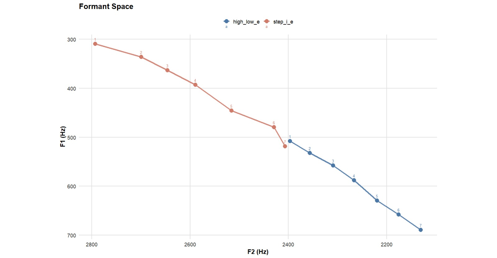
  <p style="font-size: 0.8em; color: gray;">Perceptual continuum used in the AXB task.</p>
</div>

???

The experimental stimuli consisted of 13-point acoustic continua generated through source-filter synthesis in Praat, based on natural recordings from a female native Catalan speaker. Two continua were constructed: one spanning from /i/ to /e/, and another from /e/ to /ɛ/. Task procedures across both language modes were identical, with instructions delivered exclusively in Catalan during the Catalan-mode session and in Spanish during the Spanish-mode session.


---

## Methodology: Design

<!-- Using CSS grid to neatly arrange the 4 images -->
<div style="display: grid; grid-template-columns: 1fr 1fr; gap: 15px; text-align: center;">
  <div>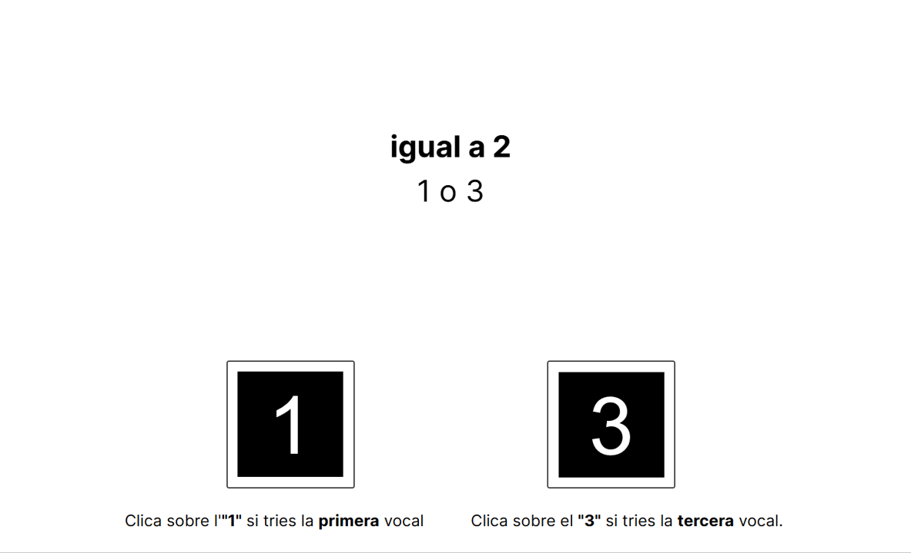</div>
  <div>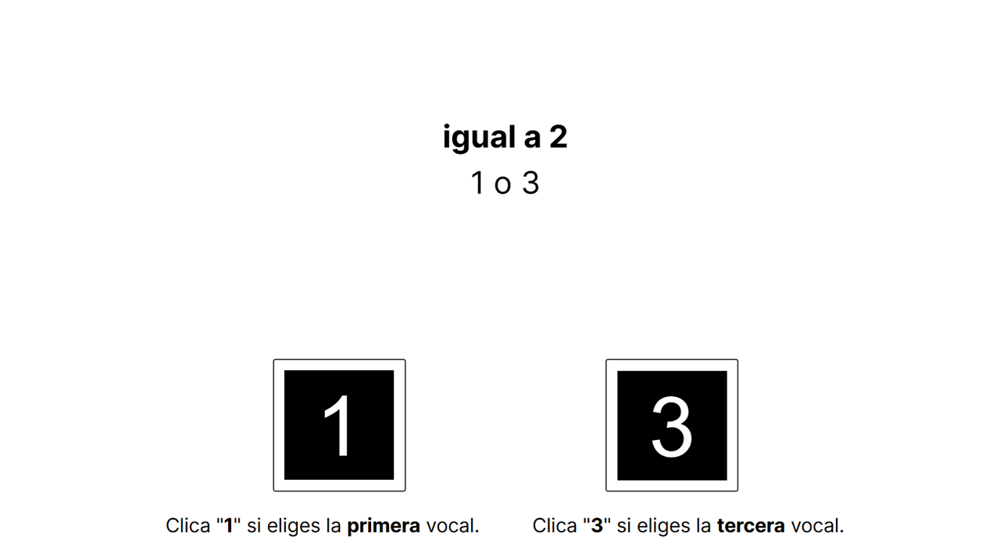</div>
  <div>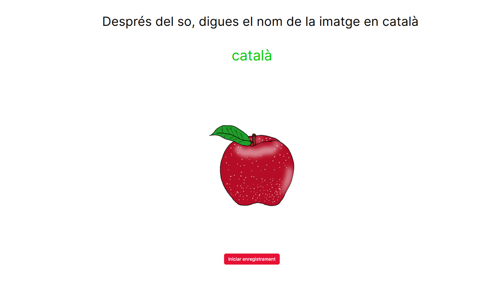</div>
  <div>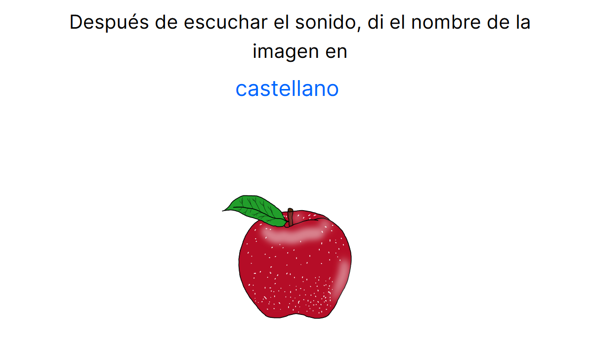</div>
</div>

<br>
<div align="center">
  <audio controls>
    <source src="chain1.mp3" type="audio/mpeg">
  </audio>
</div>


```{r, warning=FALSE, message=FALSE}
library(tidyverse)
library(lme4)
library(lmerTest)
library(mgcv)
library(minpack.lm)
library(broom)
library(viridis)

# Fix for potential macOS/R 4.0+ OpenMP library issues with minpack.lm
Sys.setenv(OMP_NUM_THREADS = 1)

# ── 2. Load & Clean Behavioural Data ─────────────────────────────────────────
data_all <- map_dfr(
  c("data/data_list1_2025_cat_26p.csv",
    "data/data_list1_2025_spa_29p.csv",
    "data/data_list2_2025_cat_24p.csv",
    "data/data_list2_2025_spa_20p.csv"),
  ~ read_csv(.x) %>% mutate(List = if_else(str_detect(.x, "list1"), "List1", "List2"))
) %>%
  rename(
    Keypress    = "Component Name",
    display     = "Spreadsheet: display",
    Participant = "Participant Public ID",
    Step        = "Spreadsheet: steps",
    Mid_step    = "Spreadsheet: step_mid_point",
    Contrast    = "Spreadsheet: contrast",
    Mode        = "Spreadsheet: Mode",
    audio_1     = "Spreadsheet: audio_1",
    audio_2     = "Spreadsheet: audio_2",
    audio_3     = "Spreadsheet: audio_3"
  ) %>%
  mutate(item = paste(audio_1, audio_2, audio_3, sep = "_")) %>%
  select(Keypress, display, Participant, Step, Mid_step, Contrast, Correct, Mode, item, List) %>%
  filter(
    Keypress == "Click Response",
    display %in% paste0("AXB_block", 1:4)
  ) %>%
  mutate(across(c(Step, Contrast, Participant, Mode, item, List), as.factor),
         Mid_step = as.numeric(Mid_step))

# ── 3. Load & Score BLP Questionnaire ────────────────────────────────────────
data_blp <- map_dfr(
  c("data/data_questionnaire_list1.csv", "data/data_questionnaire_list2.csv"),
  read_csv
) %>%
  rename(Question_Key = `Question Key`, Participant_Public_ID = `Participant Public ID`) %>%
  mutate(
    Question_Key = case_match(
      Question_Key,
      "Cantonese_Native_Think"          ~ "Castellà_Native_Think",
      "Cantonese_Native_Think-quantised" ~ "Castellà_Native_Think-quantised",
      "response-8"                        ~ "Català_Word",
      "Catellà_Speak"                     ~ "Castellà_Proficiency",
      .default = Question_Key
    ),
    Question_Key = str_replace_all(Question_Key, "Castella",  "Castellà"),
    Question_Key = str_replace_all(Question_Key, "Espanyol", "Castellà")
  )

reverse_20 <- function(x) ifelse(!is.na(as.numeric(x)), 20 - as.numeric(x), NA)

modules <- list(
  history     = c("AoA", "Comfort", "Ed", "Live", "Family_Years", "Work"),
  use         = c("Friends", "Family_Percent", "School_Percent", "TalkYourself", "Count_Percent"),
  proficiency = c("Proficiency", "Understand", "Read", "Write"),
  attitudes   = c("Speak_Feel", "Culture", "Native_Importance", "Native_Think")
)

score_language_per_participant <- function(data, lang = "Català") {
  hist_regex <- paste0("^", lang, "_(", paste(modules$history, collapse = "|"), "|_Comfort)")
  use_regex  <- paste0("^", lang, "_(", paste(modules$use, collapse = "|"), ")")
  prof_regex <- paste0("^", lang, "_(", paste(modules$proficiency, collapse = "|"), ")")
  att_regex  <- paste0("^", lang, "_(", paste(modules$attitudes, collapse = "|"), ")")

  data %>%
    group_by(Participant_Public_ID) %>%
    group_modify(~ {
      df <- .x

      hist_items <- df %>%
        filter(str_detect(Question_Key, hist_regex), !str_detect(Question_Key, "-quantised$")) %>%
        mutate(Score = case_when(
          str_detect(Question_Key, "AoA|_Comfort") ~ reverse_20(Response),
          TRUE ~ suppressWarnings(as.numeric(Response))
        ))
      hist_adjusted <- sum(hist_items$Score, na.rm = TRUE) * 0.454

      use_items <- df %>%
        filter(str_detect(Question_Key, use_regex), !str_detect(Question_Key, "-quantised$"))
      use_adjusted <- sum(as.numeric(use_items$Response) / 10, na.rm = TRUE) * 1.09

      prof_items <- df %>%
        filter(str_detect(Question_Key, prof_regex), !str_detect(Question_Key, "-quantised$"))
      prof_adjusted <- sum(as.numeric(prof_items$Response), na.rm = TRUE) * 2.27

      att_items <- df %>%
        filter(str_detect(Question_Key, att_regex), !str_detect(Question_Key, "-quantised$"))
      att_adjusted <- sum(as.numeric(att_items$Response), na.rm = TRUE) * 2.27

      tibble(adjusted_total = hist_adjusted + use_adjusted + prof_adjusted + att_adjusted)
    }) %>% 
    ungroup()
}

catalan_scores    <- score_language_per_participant(data_blp, lang = "Català")
castellano_scores <- score_language_per_participant(data_blp, lang = "Castellà")

combined_scores <- catalan_scores %>%
  rename(adjusted_total_cat = adjusted_total) %>%
  left_join(castellano_scores %>% rename(adjusted_total_cas = adjusted_total), by = "Participant_Public_ID") %>%
  mutate(
    Dominance_Index = adjusted_total_cas - adjusted_total_cat,
    Participant     = as.factor(Participant_Public_ID)
  )

demographics <- data_blp %>%
  filter(Question_Key %in% c("response-25", "response-26")) %>%
  select(Participant_Public_ID, Question_Key, Response) %>%
  pivot_wider(names_from = Question_Key, values_from = Response) %>%
  rename(Raw_Age = `response-25`, Raw_Gender = `response-26`) %>%
  mutate(
    Age = readr::parse_number(Raw_Age),
    Gender = factor(case_when(
      str_to_lower(str_trim(Raw_Gender)) %in% c("dona", "femení", "femeni", "fem") ~ "Female",
      str_to_lower(str_trim(Raw_Gender)) %in% c("masculí", "masculi", "home", "h", "m") ~ "Male",
      TRUE ~ "Other"
    ))
  )

combined_scores <- left_join(combined_scores, demographics, by = "Participant_Public_ID")

# ── 4. Acuity & LexTALE ──────────────────────────────────────────────────────
data_acuity <- map_dfr(c("data/Acuity_list1.csv", "data/Acuity_list2.csv"), read_csv) %>%
  rename(Participant = "Participant Public ID", Acuity = "current_step") %>%
  group_by(Participant) %>% slice_tail(n = 1) %>% select(Participant, Acuity)

scores <- map_dfr(c("data/lextale_sp_list1.csv", "data/lextale_sp_list2.csv"), read_csv) %>%
  rename(Participant = "Participant Public ID", type = "Spreadsheet: type") %>%
  filter(type %in% c("word", "non")) %>%
  group_by(Participant) %>%
  summarise(lextale_score = sum(Correct[type == "word"]) - 2 * sum(Correct[type == "non"] == 0))

# ── 5. Merge Data & Recode ───────────────────────────────────────────────────
data_clean <- data_all %>%
  left_join(combined_scores %>% select(Participant, Dominance_Index), by = "Participant") %>%
  left_join(data_acuity, by = "Participant") %>%
  left_join(scores, by = "Participant") %>%
  filter(!Participant %in% c("p108", "p161")) %>%
  mutate(
    Participant = as.factor(Participant),
    Mid_step = case_match(
      Mid_step,
      1.5 ~ 6.5, 6.5 ~ 1.5, 2.5 ~ 5.5, 5.5 ~ 2.5, 3.5 ~ 4.5, 4.5 ~ 3.5,
      12.5 ~ 7.5, 7.5 ~ 12.5, 11.5 ~ 8.5, 8.5 ~ 11.5, 10.5 ~ 9.5, 9.5 ~ 10.5,
      .default = Mid_step
    ),
    dominance_binary = case_when(
      Dominance_Index > 0 ~ "Spanish_dominant",
      Dominance_Index < 0 ~ "Catalan_dominant",
      TRUE ~ NA_character_
    ),
    Dominance_Index_raw = Dominance_Index,
    Dominance_Index = scale(Dominance_Index, scale = FALSE)
  ) %>%
  filter(!is.na(dominance_binary)) %>%
  droplevels() %>%
  mutate(
    dominance_binary = factor(dominance_binary),
    Acuity_z         = as.numeric(scale(Acuity)),
    Mid_step_z       = as.numeric(scale(Mid_step)),
    lextale_z        = as.numeric(scale(lextale_score))
  )

participants <- data_clean %>% distinct(Participant, .keep_all = TRUE)

# Accuracy Summaries
compute_props <- function(df) {
  df %>%
    group_by(Mid_step, Participant, Correct, Contrast, Mode, dominance_binary, Dominance_Index) %>%
    count() %>%
    group_by(Mid_step, Participant, Contrast, Mode, dominance_binary, Dominance_Index) %>%
    mutate(Prop = n / sum(n)) %>%
    filter(Correct == "1") %>%
    ungroup()
}

props_cat <- compute_props(filter(data_clean, Mode == "Catalan"))
props_spa <- compute_props(filter(data_clean, Mode == "Spanish"))
# ── 6. 4PL Nonlinear Fitting ─────────────────────────────────────────────────
data_summarized <- data_clean %>%
  group_by(Participant, Contrast, Mid_step) %>%
  summarise(y = mean(Correct, na.rm = TRUE), .groups = "drop")

fit_4pl_group <- function(df) {
  fit <- tryCatch({
    nlsLM(
      y ~ a1 + (a2 - a1) / (1 + exp(-s * (Mid_step - c))),
      data = df,
      start = list(a1 = min(df$y, na.rm = TRUE), a2 = max(df$y, na.rm = TRUE), 
                   c = mean(range(df$Mid_step, na.rm = TRUE)), s = 1.0),
      lower = c(a1 = 0, a2 = 0, c = min(df$Mid_step), s = -10),
      upper = c(a1 = 1, a2 = 1, c = max(df$Mid_step), s = 10),
      control = nls.lm.control(maxiter = 500)
    )
  }, error = function(e) NULL)
  
  if (!is.null(fit)) {
    pars <- coef(fit)
    tibble(a1 = pars[["a1"]], a2 = pars[["a2"]], c = pars[["c"]], s = pars[["s"]], converged = TRUE)
  } else {
    tibble(a1 = NA, a2 = NA, c = NA, s = NA, converged = FALSE)
  }
}

results_4pl_contrast <- data_summarized %>%
  group_by(Participant, Contrast) %>%
  group_modify(~ fit_4pl_group(.x)) %>%
  ungroup()

# Prepare LMM dataset
participant_metadata <- data_clean %>%
  mutate(Dominance_Index = as.numeric(Dominance_Index)) %>%
  group_by(Participant, Contrast, Mode) %>%
  summarise(Dominance_Index = mean(Dominance_Index, na.rm = TRUE),
            Acuity = mean(Acuity, na.rm = TRUE), .groups = "drop")

df_lmer <- results_4pl_contrast %>%
  filter(converged == TRUE) %>%
  inner_join(participant_metadata, by = c("Participant", "Contrast")) %>%
  mutate(Dominance_Index_z = as.numeric(scale(Dominance_Index)),
         Acuity_z = as.numeric(scale(Acuity)))

lmm_slope <- lmer(s ~ Dominance_Index_z * Contrast + Mode * Contrast + Acuity_z * Contrast + (1 | Participant), data = df_lmer)

# ── 7. GAMM Model ────────────────────────────────────────────────────────────
df_mid_low <- data_clean %>%
  filter(Contrast == "mid_low") %>%
  mutate(across(c(Participant, item, Mode, Contrast), as.factor),
         Dominance_Index_z = as.numeric(scale(Dominance_Index)),
         lextale_score_z   = as.numeric(scale(lextale_score)),
         Acuity_z          = as.numeric(scale(Acuity)))

contrasts(df_mid_low$Mode) <- matrix(c(0.5, -0.5), ncol = 1, dimnames = list(c("Catalan", "Spanish"), c("Catalan_vs_Spanish")))

gam_model_new2 <- gam(
  Correct ~ Mode + List + Dominance_Index_z * Mode + Acuity_z * Mode +
    s(Mid_step, by = Mode, k = 6, bs = "ts") +
    ti(Mid_step, Dominance_Index_z, by = Mode, k = c(6,6), bs = c("ts","ts")) +
    ti(Mid_step, Acuity_z, by = Mode, k = c(6,6), bs = c("ts","ts")) +
    s(Participant, bs = "re") + s(item, bs = "re"),
  family = binomial, method = "REML", select = TRUE, data = df_mid_low
)

# Helper function for GAMM plotting
make_pred_data <- function(df, mode_name, model) {
  newdat <- expand.grid(
    Mid_step = seq(min(df$Mid_step, na.rm = TRUE), max(df$Mid_step, na.rm = TRUE), length.out = 200),
    Acuity_z = c(-1, 0, 1),
    Dominance_Index_z = 0,
    Mode = factor(mode_name, levels = levels(df$Mode)),
    List = factor(levels(df$List)[1], levels = levels(df$List))
  )
  newdat$Participant <- df$Participant[1]
  newdat$item <- df$item[1]

  pred <- predict(model, newdata = newdat, type = "link", se.fit = TRUE, exclude = c("s(Participant)", "s(item)"))

  newdat %>%
    mutate(
      fit_link = pred$fit, se = pred$se.fit,
      fit = plogis(fit_link), lower = plogis(fit_link - 1.96 * se), upper = plogis(fit_link + 1.96 * se),
      Acuity = factor(Acuity_z, levels = c(-1, 0, 1), labels = c("High acuity", "Mean acuity", "Low acuity")),
      Mode = mode_name
    )
}

# ── 6. 4PL Nonlinear Fitting ─────────────────────────────────────────────────
data_summarized <- data_clean %>%
  group_by(Participant, Contrast, Mid_step) %>%
  summarise(y = mean(Correct, na.rm = TRUE), .groups = "drop")

fit_4pl_group <- function(df) {
  fit <- tryCatch({
    nlsLM(
      y ~ a1 + (a2 - a1) / (1 + exp(-s * (Mid_step - c))),
      data = df,
      start = list(a1 = min(df$y, na.rm = TRUE), a2 = max(df$y, na.rm = TRUE), 
                   c = mean(range(df$Mid_step, na.rm = TRUE)), s = 1.0),
      lower = c(a1 = 0, a2 = 0, c = min(df$Mid_step), s = -10),
      upper = c(a1 = 1, a2 = 1, c = max(df$Mid_step), s = 10),
      control = nls.lm.control(maxiter = 500)
    )
  }, error = function(e) NULL)
  
  if (!is.null(fit)) {
    pars <- coef(fit)
    tibble(a1 = pars[["a1"]], a2 = pars[["a2"]], c = pars[["c"]], s = pars[["s"]], converged = TRUE)
  } else {
    tibble(a1 = NA, a2 = NA, c = NA, s = NA, converged = FALSE)
  }
}

results_4pl_contrast <- data_summarized %>%
  group_by(Participant, Contrast) %>%
  group_modify(~ fit_4pl_group(.x)) %>%
  ungroup()

# Prepare LMM dataset
participant_metadata <- data_clean %>%
  mutate(Dominance_Index = as.numeric(Dominance_Index)) %>%
  group_by(Participant, Contrast, Mode) %>%
  summarise(Dominance_Index = mean(Dominance_Index, na.rm = TRUE),
            Acuity = mean(Acuity, na.rm = TRUE), .groups = "drop")

df_lmer <- results_4pl_contrast %>%
  filter(converged == TRUE) %>%
  inner_join(participant_metadata, by = c("Participant", "Contrast")) %>%
  mutate(Dominance_Index_z = as.numeric(scale(Dominance_Index)),
         Acuity_z = as.numeric(scale(Acuity)))

lmm_slope <- lmer(s ~ Dominance_Index_z * Contrast + Mode * Contrast + Acuity_z * Contrast + (1 | Participant), data = df_lmer)

# ── 7. GAMM Model ────────────────────────────────────────────────────────────
df_mid_low <- data_clean %>%
  filter(Contrast == "mid_low") %>%
  mutate(across(c(Participant, item, Mode, Contrast), as.factor),
         Dominance_Index_z = as.numeric(scale(Dominance_Index)),
         lextale_score_z   = as.numeric(scale(lextale_score)),
         Acuity_z          = as.numeric(scale(Acuity)))

contrasts(df_mid_low$Mode) <- matrix(c(0.5, -0.5), ncol = 1, dimnames = list(c("Catalan", "Spanish"), c("Catalan_vs_Spanish")))

gam_model_new2 <- gam(
  Correct ~ Mode + List + Dominance_Index_z * Mode + Acuity_z * Mode +
    s(Mid_step, by = Mode, k = 6, bs = "ts") +
    ti(Mid_step, Dominance_Index_z, by = Mode, k = c(6,6), bs = c("ts","ts")) +
    ti(Mid_step, Acuity_z, by = Mode, k = c(6,6), bs = c("ts","ts")) +
    s(Participant, bs = "re") + s(item, bs = "re"),
  family = binomial, method = "REML", select = TRUE, data = df_mid_low
)

# Helper function for GAMM plotting
make_pred_data <- function(df, mode_name, model) {
  newdat <- expand.grid(
    Mid_step = seq(min(df$Mid_step, na.rm = TRUE), max(df$Mid_step, na.rm = TRUE), length.out = 200),
    Acuity_z = c(-1, 0, 1),
    Dominance_Index_z = 0,
    Mode = factor(mode_name, levels = levels(df$Mode)),
    List = factor(levels(df$List)[1], levels = levels(df$List))
  )
  newdat$Participant <- df$Participant[1]
  newdat$item <- df$item[1]

  pred <- predict(model, newdata = newdat, type = "link", se.fit = TRUE, exclude = c("s(Participant)", "s(item)"))

  newdat %>%
    mutate(
      fit_link = pred$fit, se = pred$se.fit,
      fit = plogis(fit_link), lower = plogis(fit_link - 1.96 * se), upper = plogis(fit_link + 1.96 * se),
      Acuity = factor(Acuity_z, levels = c(-1, 0, 1), labels = c("High acuity", "Mean acuity", "Low acuity")),
      Mode = mode_name
    )
}
```


---

## Participant Profile & Dominance Distribution

* **Participants:** N = 44 early Catalan–Spanish adult bilinguals (29 female / 14 male / 1 other; Mean age = 22.0 years, SD = 5.26, range: 17–37 years).

```{r }

participant_dominance <- data_clean %>% distinct(Participant, Dominance_Index)

ggplot(participant_dominance, aes(x = Dominance_Index, y = "")) +
  geom_vline(xintercept = 0, linetype = "dashed", color = "grey40", linewidth = 0.8) +
  geom_boxplot(fill = "grey92", color = "grey30", alpha = 0.6, outlier.shape = NA, width = 0.3) +
  geom_jitter(color = "#0072B2", height = 0.08, size = 3, alpha = 0.8) +
  labs(
    title = "Language Dominance Index Distribution",
    subtitle = " Catalan-dominant (Negative) | Spanish-dominant (Positive) ",
    x = "Dominance Index", y = ""
  ) +
  theme_classic(base_size = 14) +
  theme(
    plot.title = element_text(face = "bold"),
    axis.text.y = element_blank(), 
    axis.ticks.y = element_blank(), 
    axis.line.y = element_blank()
  )
```

???

A total of 44 Catalan–Spanish bilingual adults participated in the study. Language dominance was mapped along a continuous spectrum ranging from strongly Catalan-dominant (negative index values) to strongly Spanish-dominant (positive index values), centered around balanced bilinguals (index value of 0).


---
# Results

```{r, out.width="80%"}
library(tidyverse)
library(showtext)

# ==============================================================================
# 1. SETUP NOTO SANS FOR IPA rendering
# ==============================================================================
font_add_google(name = "Noto Sans", family = "Noto Sans")
showtext_auto()

# ==============================================================================
# 2. DATA PREPARATION
# ==============================================================================
props_combined <- bind_rows(
  props_cat %>% mutate(Mode = "Catalan Mode"),
  props_spa %>% mutate(Mode = "Spanish Mode")
) %>%
  mutate(Mid_step = factor(Mid_step))

real_names <- unique(props_combined$dominance_binary)
my_colors  <- setNames(c("#0072B2", "#009E73"), real_names)

# ==============================================================================
# 3. PLOT WITH NOTO SANS IPA ANNOTATIONS
# ==============================================================================
ggplot(props_combined, aes(x = Mid_step, y = Prop, color = dominance_binary, fill = dominance_binary, group = dominance_binary)) +
  stat_summary(fun = mean, geom = "line", linewidth = 1.2) +
  stat_summary(fun = mean, geom = "point", size = 2.5) +
  stat_summary(fun.data = mean_se, geom = "ribbon", alpha = 0.2, color = NA) +
  
  # IPA annotations with family = "Noto Sans"
  annotate("text", x = 2.5,  y = 0.95, label = "[i]", fontface = "bold", size = 4.5, color = "black", family = "Noto Sans") +
  annotate("text", x = 7.5,  y = 0.95, label = "[e]", fontface = "bold", size = 4.5, color = "black", family = "Noto Sans") +
  annotate("text", x = 12.5, y = 0.95, label = "[ɛ]", fontface = "bold", size = 4.5, color = "black", family = "Noto Sans") +
  
  facet_wrap(~ Mode) +
  scale_y_continuous(limits = c(0, 1)) +
  scale_color_manual(values = my_colors) +
  scale_fill_manual(values = my_colors) +
  labs(
    x = "Continuum Step", 
    y = "Mean Proportion Correct",
    color = "Dominance Group", 
    fill = "Dominance Group"
  ) +
  theme_classic(base_size = 14, base_family = "Noto Sans") +
  theme(
    legend.position = "top", 
    strip.background = element_blank(), 
    strip.text = element_text(face = "bold", family = "Noto Sans")
  )
```
???

Here you can see the plot of mean proportion of correct answers across speakers for the Catalan dominants in green and the Spanish dominants in blue. What we see on the x-axis are the continuum steps. Step 1.5 is when listeners were presented with step 1 and 2; step 2.5 is when listeners were comparing step 2 and 3, and so on. The continuum starts with /i/, and then the first peak is the /i/–/e/ boundary that you can see here, and the second peak is the /e/–/ɛ/ boundary. So here we have /i/ in the first step and /ɛ/ in the 13th step. And we see two peaks, crucially, in both Catalan and Spanish mode.

---
# Results: Boundary Sharpness

Category boundary sharpness was significantly shallower for the target /e/–/ɛ/ contrast compared to the baseline /i/–/e/ contrast (b = -3.80, p < .001).

```{r, out.width="80%"}
slope_wide <- results_4pl_contrast %>%
  filter(converged == TRUE) %>%
  pivot_wider(id_cols = Participant, names_from = Contrast, values_from = s, names_prefix = "slope_") %>%
  mutate(diff_slope = slope_mid_low - slope_i_e) %>%
  drop_na(diff_slope)

slope_plot = ggplot(slope_wide, aes(x = reorder(Participant, diff_slope), y = diff_slope)) +
  geom_col(aes(fill = diff_slope > 0), show.legend = FALSE) +
  geom_hline(yintercept = 0, linetype = "dashed", color = "black", linewidth = 0.8) +
  coord_flip() +
  scale_fill_manual(values = c("TRUE" = "#0072B2", "FALSE" = "#D55E00")) +
  labs(
    title = "Individual Slope Differences (/e/–/ɛ/ minus /i/–/e/)",
    subtitle = "Positive = steeper for /e/–/ɛ/ | Negative = steeper for /i/–/e/",
    x = "Participant", y = "Difference in Slope (s)"
  ) +
  theme_keynote() +
  theme(axis.text.y = element_blank())


ggsave("slope_plot.png", plot = slope_plot, device = ragg::agg_png, width = 8, height = 6, dpi = 300)
slope_plot
#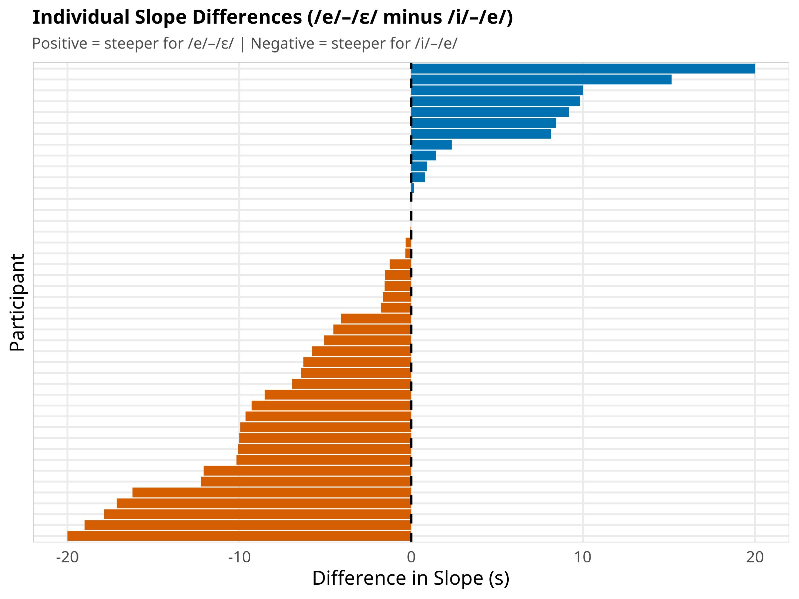


```
???
When comparing boundary sharpness between /i/–/e/ (the contrast shared between the two languages) and /e/–/ɛ/, we see that listeners have a sharper boundary for the shared contrast /i/–/e/. What you see in the graph here is an individual breakdown of slope differences calculated by subtracting the slope of the curve between /i/ and /e/ from /e/ and /ɛ/. The central dashed line represents zero, meaning identical boundary steepness for both contrasts. Notice how the plot is overwhelmingly dominated by orange bars extending to the left. This shows that bilinguals in our sample maintain a much sharper categorical contrast for the shared /i/–/e/ baseline than for the /e/–/ɛ/ mid-vowel.

---
# Results

```{r,out.width="80%"}
library(tidyverse)
library(showtext)

font_add_google(name = "Noto Sans", family = "Noto Sans")
showtext_auto()

# 1. Combine data (Keep Mid_step NUMERIC)
props_combined <- bind_rows(
  props_cat %>% mutate(Mode = "Catalan Mode"),
  props_spa %>% mutate(Mode = "Spanish Mode")
) # Removed factor conversion

real_names <- unique(props_combined$dominance_binary)
my_colors  <- setNames(c("#0072B2", "#009E73"), real_names)

# 2. Plot
ggplot(props_combined, aes(x = Mid_step, y = Prop, color = dominance_binary, fill = dominance_binary, group = dominance_binary)) +
  
  # Highlight Region (Steps 7.5 to 12.5)
  annotate("rect", xmin = 7.5, xmax = 12.5, ymin = -Inf, ymax = Inf,
           fill = "#F1F5F9", alpha = 0.7) +
  annotate("text", x = 10, y = 0.06, label = "Dominance Effect Region", 
           fontface = "italic", size = 3.5, color = "#475569", family = "Noto Sans") +

  # Data Layers
  stat_summary(fun = mean, geom = "line", linewidth = 1.2) +
  stat_summary(fun = mean, geom = "point", size = 2.5) +
  stat_summary(fun.data = mean_se, geom = "ribbon", alpha = 0.2, color = NA) +
  
  # IPA Annotations
  annotate("text", x = 2.5,  y = 0.95, label = "[i]", fontface = "bold", size = 4.5, color = "black", family = "Noto Sans") +
  annotate("text", x = 7.5,  y = 0.95, label = "[e]", fontface = "bold", size = 4.5, color = "black", family = "Noto Sans") +
  annotate("text", x = 12.5, y = 0.95, label = "[ɛ]", fontface = "bold", size = 4.5, color = "black", family = "Noto Sans") +
  
  facet_wrap(~ Mode) +
  scale_y_continuous(limits = c(0, 1)) +
  
  # Set explicit breaks for all continuum steps on a continuous axis
  scale_x_continuous(breaks = sort(unique(props_combined$Mid_step))) +
  
  scale_color_manual(values = my_colors) +
  scale_fill_manual(values = my_colors) +
  labs(
    x = "Continuum Step", 
    y = "Mean Proportion Correct",
    color = "Dominance Group", 
    fill = "Dominance Group"
  ) +
  theme_classic(base_size = 14, base_family = "Noto Sans") +
  theme(
    legend.position = "top", 
    strip.background = element_blank(), 
    strip.text = element_text(face = "bold", family = "Noto Sans")
  )
```

???

Going back to the plot, I also want to note a linear effect that we found when looking specifically at the e-E contrast, by which across the e-E continuum Catalan dominants showed enhanced discrimination than Spanish dominant speakers, as showing by a linear effect on the mid vowel contrast predicted by continuous dominance.


---

# Results: Individual Differences in Formant Acuity

Generalized Additive Mixed Models (GAMM) on raw trial-by-trial accuracy. Captures non-linear trajectories across continuum steps while controlling for item and participant variability.
```{r}
library(dplyr)
library(ggplot2)


newdat_cat <- make_pred_data(df_mid_low, "Catalan", gam_model_new2)
newdat_sp  <- make_pred_data(df_mid_low, "Spanish", gam_model_new2)

plotdat <- bind_rows(newdat_cat, newdat_sp)


ggplot(plotdat,
       aes(x = Mid_step,
           y = fit,
           colour = Acuity,
           fill = Acuity,
           group = Acuity)) +

  geom_ribbon(
    aes(ymin = lower, ymax = upper),
    alpha = 0.2,
    colour = NA
  ) +

  geom_line(linewidth = 1.2) +

  facet_wrap(~Mode) +

  scale_y_continuous(limits = c(0, 1)) +

  scale_colour_manual(values = c(
    "High acuity" = "#0072B2",
    "Mean acuity" = "#009E73",
    "Low acuity"  = "#D55E00"
  )) +

  scale_fill_manual(values = c(
    "High acuity" = "#0072B2",
    "Mean acuity" = "#009E73",
    "Low acuity"  = "#D55E00"
  )) +

  labs(
    x = "Mid step",
    y = "Predicted probability of correct response",
    colour = "Acuity",
    fill = "Acuity"
  ) +

  theme_classic(base_size = 14) +

  theme(
    legend.position = "top",
    strip.background = element_blank(),
    strip.text = element_text(face = "bold"),
    panel.spacing = unit(1.2, "lines")
  )
```


???

We also found an interaction with formant acuity and language mode, where high-acuity listeners showed enhanced accuracy in the ambiguous /e/ region. So what you can see here are the mid-steps only from /e/–/ɛ/, and around the peak (around step 8), higher accuracy listeners have greater perception in Catalan mode only, but not in Spanish mode

---

## Discussion 

* **Weakly encoded contrast:** Greatest boundary steepness (*s*) for /i/–/e/ than /e/–/ɛ/ → Mid-vowels are encoded less robustly encoded. 

**A universally weak contrast?** Mid-vowel distinctions rely on late-emerging tongue height features ([RTR]), representing the final vocalic contrasts specified in European Portuguese development (Fikkert, 2005; Fikkert & Freitas, 2004, 2006).

???

To Summarize our findings: boundary steepness confirmed that the /e/–/ɛ/ contrast is less robustly encoded than the /i/–/e/ contrast. And this suggests that mid-vowels are encoded less robustly in Catalan. But this raises the question: is this a weakly universally encoded contrast, specifically because of the smaller distance between the two mid-vowels when compared to other vowels? This lower robustness for mid-vowels also aligns with developmental findings in European Portuguese, where /e/–/ɛ/ is among the last vocalic contrasts to emerge because it relies on late-developing tongue height features. This suggests that mid-vowel perceptual complexity may be a broader property of vowel systems rather than an exclusive feature of bilingualism. This remains to be tested; a natural next step here could be to test Portuguese speakers that are not in contact with Spanish.


---

## Discussion 


* **Adaptive perceptual gradiency:** Catalan dominance exerts a linear main effect across the continuum → Reflects **heightened within-category sensitivity** rather than a shifted boundary, enabling flexible mapping of Spanish-accented community input.


```{r}
# ==============================================================================
# Gaussian Vowel Input Distributions & Surface Representation Updates
# Visualizing Overlapping Accent Input in F1 Acoustic Space
# Created with ggplot2 + patchwork for RStudio
# ==============================================================================

library(ggplot2)
library(dplyr)
library(patchwork)

# ------------------------------------------------------------------------------
# 1. Panel A: Three Gaussian Distributions for Vowel F1 Input
# ------------------------------------------------------------------------------
# Mean F1 parameters (Hz):
# - Canonical /e/ (Close-mid): Mean = 450 Hz, SD = 25
# - Canonical /E/ (Open-mid): Mean = 600 Hz, SD = 25
# - Spanish-Accented /E/ Input: Mean = 485 Hz, SD = 32 (Overlaps /e/ F1 range)

p_gaussian <- ggplot(data.frame(F1 = c(350, 700)), aes(x = F1)) +
  # 1. Canonical /e/
  stat_function(fun = dnorm, args = list(mean = 450, sd = 25), 
                geom = "polygon", aes(fill = "Canonical /e/ (Close-mid)"), alpha = 0.2) +
  stat_function(fun = dnorm, args = list(mean = 450, sd = 25), 
                aes(color = "Canonical /e/ (Close-mid)"), linewidth = 1.2) +
  
  # 2. Canonical /E/
  stat_function(fun = dnorm, args = list(mean = 600, sd = 25), 
                geom = "polygon", aes(fill = "Canonical /E/ (Open-mid)"), alpha = 0.2) +
  stat_function(fun = dnorm, args = list(mean = 600, sd = 25), 
                aes(color = "Canonical /E/ (Open-mid)"), linewidth = 1.2) +
  
  # 3. Spanish-Accented /E/ Input (Overlapping close F1)
  stat_function(fun = dnorm, args = list(mean = 485, sd = 32), 
                geom = "polygon", aes(fill = "Spanish-Accented /E/ Input"), alpha = 0.3) +
  stat_function(fun = dnorm, args = list(mean = 485, sd = 32), 
                aes(color = "Spanish-Accented /E/ Input"), linewidth = 1.2, linetype = "dashed") +
  
  # Annotation arrow pointing to overlap
  annotate("text", x = 400, y = 0.014, label = "Overlapping Input Range\n(low-mid vowel produced with close-vowel F1)", 
           fontface = "bold", size = 3.3, color = "#B8860B") +
  annotate("segment", x = 440, xend = 485, y = 0.013, yend = 0.011,
           arrow = arrow(length = unit(0.25, "cm")), color = "#E69F00", linewidth = 1) +
  
  # Manual Color & Fill Scales (Okabe-Ito Palette)
  scale_color_manual(values = c(
    "Canonical /e/ (Close-mid)" = "#0072B2",
    "Canonical /E/ (Open-mid)" = "#D55E00",
    "Spanish-Accented /E/ Input" = "#E69F00"
  )) +
  scale_fill_manual(values = c(
    "Canonical /e/ (Close-mid)" = "#0072B2",
    "Canonical /E/ (Open-mid)" = "#D55E00",
    "Spanish-Accented /E/ Input" = "#E69F00"
  )) +
  
  scale_x_continuous(breaks = seq(350, 700, 50), limits = c(350, 700)) +
  scale_y_continuous(limits = c(0, 0.018)) +
  
  labs(
    x = "F1 Frequency (Hz) [Lower F1 = Close Vowel / High  <--->  Higher F1 = Open Vowel / Low]",
    y = "Probability Density",
    color = "Distribution", fill = "Distribution"
  ) +
  theme_minimal(base_size = 11) +
  theme(
    plot.title = element_text(face = "bold", size = 11, color = "#0A2540"),
    legend.position = "bottom",
    legend.title = element_blank(),
    panel.grid.minor = element_blank()
  )

p_gaussian
```


???

Second, we found a Catalan dominance effect across the /e/–/ɛ/ continuum. This reflects heightened category sensitivity rather than a shifted boundary, because enhanced perception is observed across the entire continuum. What we think could be happening here is that because Catalan-dominant speakers are exposed to greater sources of Catalan, they are also exposed to an overlapping range in $F_1$—that is, Spanish-accented Catalan, where /ɛ/ vowels are produced more like /e/ (low-mid vowels produced like high-mid vowels). Therefore, some words canonically encoded with /ɛ/ are produced with high-mid /e/, resulting in an overlapping distribution. Catalan-dominant speakers need to develop a more gradient perception of the mid-vowel space to distinguish these overlapping ranges.


---

## Discussion 


* **Stability across language modes:** Boundary location and steepness remain invariant across Catalan and Spanish contexts → **Spanish mode does not suppress non-target categories**. But, in Catalan mode high acuity listeners have enhanced perception in [e]-like tokens (activating a denser mid-vowel space demands higher acoustic acuity.)


```{r}

library(ggplot2)
library(dplyr)

library(ggplot2)
library(dplyr)

# 1. Define Node Boxes (Coordinates & Text)
df_nodes <- tribble(
  ~xmin, ~xmax, ~ymin, ~ymax, ~label, ~subtext, ~grammar, ~fill_color, ~border_color,
  
  # Grammar 1: Catalan (Left Side)
  0.08, 0.44, 0.72, 0.86, "Lexical Entry <Lex-1> & Target |UF-1|", "Specified Targets: |e| vs. |E|\n[High Fidelity / Unmerged Target Storage]", "Grammar 1: Catalan", "#E6F2FF", "#0072B2",
  0.08, 0.44, 0.42, 0.64, "Surface Phonetic Form /SF-1/", "Categories: /e/ vs. /E/\nProbabilistic Cue Constraints:\n[AudF] <-> /SF-1/ Mapping", "Grammar 1: Catalan", "#E6F2FF", "#0072B2",
  
  # Grammar 2: Spanish (Right Side)
  0.56, 0.92, 0.72, 0.86, "Lexical Entry <Lex-2> & Target |UF-2|", "Specified Target: |e|\n[High Fidelity / Unmerged Target Storage]", "Grammar 2: Spanish", "#FFF0E6", "#D55E00",
  0.56, 0.92, 0.42, 0.64, "Surface Phonetic Form /SF-2/", "Category: /e/\nProbabilistic Cue Constraints:\n[AudF] <-> /SF-2/ Mapping", "Grammar 2: Spanish", "#FFF0E6", "#D55E00",
  
  # Shared Auditory Form (Bottom Center)
  0.12, 0.88, 0.06, 0.28, "Spanish Auditory Form [AudF]", "Continuous Acoustic Input Stream (F1, F2, Duration, VOT)\nParallel Evaluation: Acoustic cues simultaneously evaluated by /SF-1/ and /SF-2/ cue constraints", "Shared Interface", "#FFFFFF", "#0A2540"
)

# 2. Define Connecting Arrows
df_arrows <- tribble(
  ~x, ~y, ~xend, ~yend, ~label, ~color, ~linetype,
  # Vertical arrows Catalan
  0.26, 0.72, 0.26, 0.64, "", "#0072B2", "solid",
  0.26, 0.42, 0.26, 0.28, "", "#0072B2", "solid",
  
  # Vertical arrows Spanish
  0.74, 0.72, 0.74, 0.64, "", "#D55E00", "solid",
  0.74, 0.42, 0.74, 0.28, "", "#D55E00", "solid",
  
  # Horizontal arrow for Surface Competition
  0.44, 0.53, 0.56, 0.53, "Surface Competition\n& Mode Interaction", "#374151", "dashed"
)

# 3. Render ggplot2 Diagram
biphon_coactivated_plot <- ggplot() +
  # Node Box Rectangles
  geom_rect(data = df_nodes, aes(xmin = xmin, xmax = xmax, ymin = ymin, ymax = ymax, fill = fill_color, color = border_color),
            linewidth = 1.2, alpha = 0.9) +
  
  # Main Box Labels
  geom_text(data = df_nodes, aes(x = (xmin + xmax)/2, y = ymax - 0.035, label = label, color = border_color),
            fontface = "bold", size = 4.2) +
  
  # Subtext Descriptions
  geom_text(data = df_nodes, aes(x = (xmin + xmax)/2, y = ymin + 0.055, label = subtext),
            color = "#1F2937", size = 3.2, lineheight = 0.9) +
  
  # Connector Arrows
  geom_segment(data = df_arrows, aes(x = x, y = y, xend = xend, yend = yend, color = color, linetype = linetype),
               linewidth = 1.1, arrow = arrow(length = unit(0.25, "cm"), ends = "both", type = "closed")) +
  
  # Arrow Annotation Text
  geom_text(data = filter(df_arrows, label != ""), aes(x = (x + xend)/2, y = y + 0.04, label = label),
            color = "#374151", fontface = "bold", size = 3.5, lineheight = 0.9) +
  
  # Manual Color Scales
  scale_color_identity() +
  scale_fill_identity() +
  scale_linetype_identity() +
  
  # Coordinate & Limits Settings
  coord_fixed(ratio = 0.8, xlim = c(0, 1), ylim = c(0, 0.95)) +
  
  labs(
    subtitle = "Coactivated grammars",
    caption = "Based on the Bidirectional Phonology and Phonetics Model (BiPhon; Boersma, 2011; Zhou & Hamann, 2024)"
  ) +
  theme_minimal(base_size = 12) +
  theme(
    panel.grid = element_blank(),
    axis.title = element_blank(),
    axis.text = element_blank(),
    axis.ticks = element_blank(),
    plot.title = element_text(face = "bold", size = 13, color = "#0A2540", hjust = 0.5),
    plot.subtitle = element_text(size = 9.5, color = "#3B6978", hjust = 0.5, margin = margin(b = 10)),
    plot.caption = element_text(size = 8, color = "#6B7280", hjust = 0.5, margin = margin(t = 10)),
    plot.background = element_rect(fill = "#FFFFFF", color = NA)
  )

# Display Plot

# Save high-resolution PNG
ggsave("biphon_coactivated_ggplot2-v2.png", plot = biphon_coactivated_plot, width = 11, height = 8, dpi = 300)
```

```{r biphon-diagram, echo=FALSE, out.width='88%', fig.align='center'}
# Inserció directa del diagrama generat en ggplot2
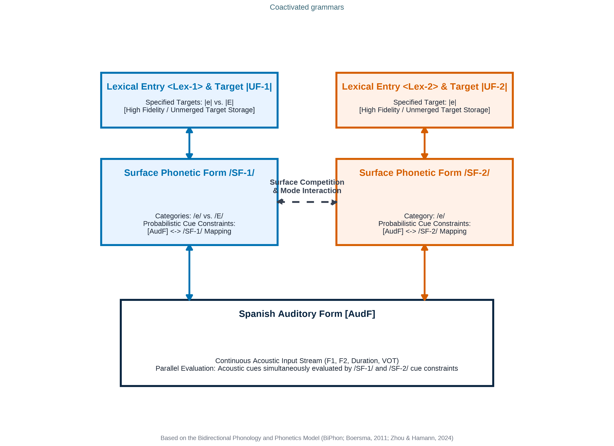
```
???

Regarding our core question on language mode effects, results demonstrate overall stability across language modes in both category boundary location and boundary sharpness. This indicates that operating in Spanish mode does not suppress non-target phonemic categories when a contrast exists in only one of the bilingual's languages. Rather than deactivating the non-target system, the Catalan perceptual grammar remains active to process mid-vowel distinctions. Because the Spanish mid-vowel system contains only a single mid-vowel category and presents no direct competition, the Catalan perceptual grammar can remain active without causing processing conflicts. Furthermore, listeners with high acoustic acuity exhibited enhanced perceptual resolution for /e/-like tokens specifically when tested in Catalan mode. This interaction suggests that higher language activation in Catalan mode engages a perceptual grammar designed for a denser acoustic space, which differentiates /e/ and /ɛ/. Consequently, high sensory acuity provides greater perceptual advantage in a crowded mid-vowel space than in a less dense system like Spanish

---

### Phonolexical Encoding in Early Bilinguals

* L1 phonological transfer extends beyond acoustic perception into **phonolexical encoding**. Non-native contrasts which may be mapped onto a single L1 category (single-category assimilation) produce "fuzzy" or imprecise lexical representations in long-term memory.

- **BiPhon / L2LP Architecture**
  - The *lexicon builder* processes perceived surface forms (`/SF/`) to create underlying forms (`|UF|`).
  - Continuous mapping to a single surface category (e.g., `/e/` for both vowels) provides **no input evidence** to establish separate `|UF|` entries.

* However, empirical work shows that perception and lexical encoding can decouple, accurate prelexical discrimination does not guarantee distinct lexical encoding  <small>(Darcy et al., 2012, 2013; Darcy & Rothgerber, 2020)</small> and lexical discrimination can exist without prelexical discrimination <small>(e.g., Cutler et al., 2005)</small>.


???

Within a multilayer framework, a crucial question arises regarding how prelexical perceptual representations feed into phonolexical encoding—specifically, how lexical entries are constructed from surface categories derived from acoustic-phonetic features. Theoretical models predict that mapping a non-native contrast onto a single non-target category (e.g., mapping $/ɛ/$ onto $/e/$) will yield fuzzy or imprecise lexical representations. This occurs because the lexical builder relies on surface forms as input to construct underlying representations; a perceptual grammar that maps both vowels to a single category like $/e/$ provides no evidence to establish a distinct contrast in the lexicon.However, recent research indicates that speakers may possess robust prelexical perception yet still fail to establish distinct phonolexical categories.

---
### Lexical Encoding in Early Bilinguals


**Sebastián-Gallés, Echeverría, & Bosch (2005)**


-/ɛ/ word: *galleda* ([gəʎɛðə], bucket) mispronounced as *[gəʎeðə]


-/e/ word: *ulleres* ([uʎeɾəs], glasses) mispronounced as *[uʎɛɾəs]

Control Condition: Distractors with non-problematic Spanish/Catalan sound changes (/e/ -> /o/).


```{r sebastian_galles, echo=FALSE, out.width="80%", fig.align="center"}


df_sg2005 <- data.frame(
  Group = factor(
    rep(c("Early Cat-Dom", "Simultaneous", "Early Spa-Dom"), each = 3),
    levels = c("Early Cat-Dom", "Simultaneous", "Early Spa-Dom")
  ),
  Condition = factor(
    rep(c("ɛ-type", "e-type", "Control"), 3),
    levels = c("ɛ-type", "e-type", "Control")
  ),
  A_prime = c(0.874, 0.953, 0.974,
              0.798, 0.813, 0.984,
              0.684, 0.687, 0.967),
  SD = c(0.058, 0.046, 0.013,
         0.112, 0.147, 0.015,
         0.103, 0.116, 0.014)
)
ggplot(df_sg2005, aes(x = Group, y = A_prime, fill = Condition)) +
  geom_bar(stat = "identity", position = position_dodge(width = 0.8), width = 0.7) +
  geom_errorbar(
    aes(ymin = A_prime - SD, ymax = pmin(1.0, A_prime + SD)),
    position = position_dodge(width = 0.8),
    width = 0.25,
    linewidth = 0.5
  ) +
  geom_hline(yintercept = 0.5, linetype = "dashed", color = "red", linewidth = 0.8) +
  annotate("text", x = 0.8, y = 0.53, label = "Chance (0.50)", color = "red", size = 3) +
  scale_fill_manual(values = c("#0072B2", "#D55E00", "#009E73")) +
  scale_y_continuous(limits = c(0, 1.1), breaks = seq(0, 1.0, 0.2)) +
  labs(
    title = "Sebastián-Gallés et al. (2005)",
    subtitle = "Lexical Sensitivity Index (A') with SD Error Bars",
    x = "Bilingual Population Group",
    y = "Sensitivity Index (A')",
    fill = "Stimulus Type"
  ) +
  theme_keynote() +
  theme(axis.text.x = element_text(angle = 15, hjust = 1), base_family = "noto")


#ggsave("sebastian_galles.png", plot = sebastian_galles, device = ragg::agg_png, width = 8, height = 6, dpi = 300)


#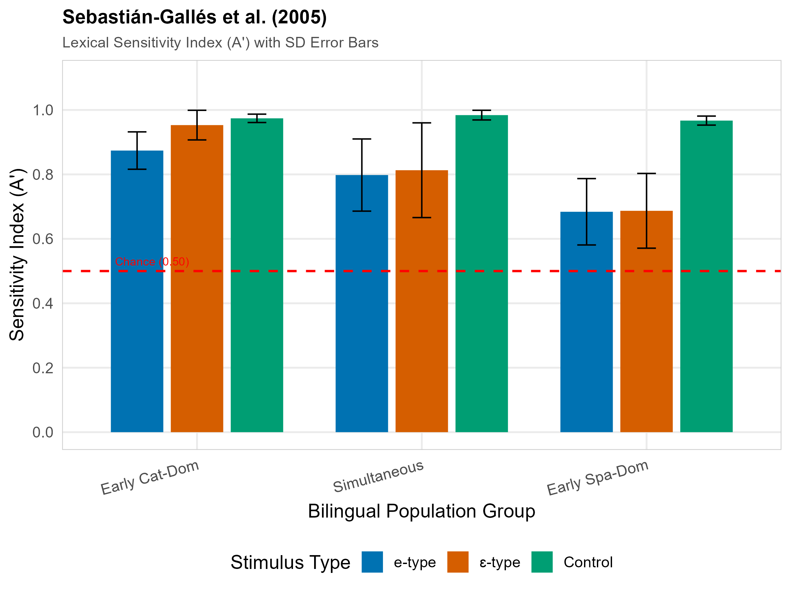

```

???

This question can be evaluated using a lexical decision task, which directly tests knowledge at the phonolexical level by requiring participants to judge whether an auditory stimulus is a real word in the target language. Accepting mispronounced items in this task typically indicates that underlying target encoding is imprecise.Prior research by Sebastián-Gallés and colleagues in Catalan demonstrated that Spanish-dominant bilinguals frequently accept mispronunciations of real Catalan target words. Surprisingly, native Catalan-dominant bilinguals also show acceptance of these mispronunciations, despite possessing robust prelexical discrimination for the $/e/\text{--}/ɛ/$ contrast.

Early Catalan-Dominant: Exposed to Catalan at birth; Spanish acquired early.

Early Spanish-Dominant: Exposed to Spanish at birth; intensive Catalan immersion ≤ 4 years.

Simultaneous Catalan-Dominant: Exposed to both from birth; Catalan-speaking mother.

Simultaneous Spanish-Dominant: Exposed to both from birth; Spanish-speaking mother.


---

### The lexical decision task bottleneck

```{r biphon-mod, echo=FALSE, fig.width=9.5, fig.height=6.5, out.width="100%"}


# 1. Define the 5 Core Levels of Representation
levels_df <- tribble(
  ~xmin, ~xmax, ~ymin, ~ymax, ~title, ~spec, ~domain,
  2.5, 5.5, 5.2, 6.0, "Semantic Representation (SemR)", "Meaning & Morphemes", "Phonology",
  2.5, 5.5, 4.0, 4.8, "Underlying Representation (UR)", "| Abstract Phonological Word |", "Phonology",
  2.5, 5.5, 2.8, 3.6, "Surface Representation (SR)", "/ Distinctive Phonological Features /", "Phonology",
  2.5, 5.5, 1.6, 2.4, "Auditory Representation (AudR)", "[ Continuous Acoustic / Formant Space ]", "Phonetics",
  2.5, 5.5, 0.4, 1.2, "Articulatory Representation (ArtR)", "[ Motor Gestures & Muscle Execution ]", "Phonetics"
)

# 2. Grammar Modules / Mapping Constraints
grammars_df <- tribble(
  ~x, ~y, ~label,
  4.0, 4.9, "Lexical Mapping (UR ↔ SemR)",
  4.0, 3.7, "Faithfulness & Lexical Mapping (SR ↔ UR)",
  4.0, 2.5, "Cue Constraints (AudR ↔ SR)",
  4.0, 1.3, "Sensorimotor Grammar (Effort Constraints)"
)

# 3. Competing Hypotheses Box (The LD Methodological Bottleneck)
hypotheses_df <- tribble(
  ~xmin, ~xmax, ~ymin, ~ymax,
  7.3, 10.3, 3.4, 5.3
)

# Render Diagram
ggplot() +
  # --- Core Representation Blocks ---
  geom_rect(data = levels_df, aes(xmin = xmin, xmax = xmax, ymin = ymin, ymax = ymax, fill = domain),
            color = "grey30", linewidth = 0.7, alpha = 0.85) +
  
  geom_text(data = levels_df, aes(x = (xmin + xmax) / 2, y = (ymin + ymax) / 2 + 0.12, label = title),
            fontface = "bold", size = 3.8, color = "white") +
  geom_text(data = levels_df, aes(x = (xmin + xmax) / 2, y = (ymin + ymax) / 2 - 0.15, label = spec),
            fontface = "italic", size = 3.0, color = "grey95") +
  
  # --- Grammar Mapping Labels ---
  geom_label(data = grammars_df, aes(x = x, y = y, label = label),
             fill = "white", color = "grey20", size = 2.9, fontface = "bold",
             label.padding = unit(0.2, "lines"), border.color = "grey70") +
  
  # --- Highlight Zone: LD Conflation Bottleneck ---
  geom_rect(aes(xmin = 2.3, xmax = 5.7, ymin = 3.6, ymax = 5.0),
            fill = NA, color = "#CC79A7", linetype = "dashed", linewidth = 1.1) +
  
  # --- Bottleneck Callout Panel (Right Side) ---
  geom_rect(data = hypotheses_df, aes(xmin = xmin, xmax = xmax, ymin = ymin, ymax = ymax),
            fill = "#F0E442", alpha = 0.15, color = "#CC79A7", linewidth = 0.9, linetype = "solid") +
  
  annotate("text", x = 8.8, y = 5.1, label = "THE LD BOTTLENECK", fontface = "bold", color = "#882255", size = 3.5) +
  annotate("text", x = 8.8, y = 4.65, label = "Hypothesis A: Dual mapping", 
           size = 3, hjust = 0.5, fontface = "italic") +
  annotate("text", x = 8.8, y = 3.9, label = "Hypothesis B: Flexible Strategy\n• Canonical UR: /gallɛda/\n•  UR tolerance accommodating\n  Spanish-accented Catalan", 
           size = 3, hjust = 0.5, fontface = "italic") +
  
  # Link Bottleneck Callout to UR Box
  geom_segment(aes(x = 5.7, y = 4.3, xend = 7.3, yend = 4.35),
               color = "#CC79A7", linewidth = 0.8, linetype = "dotted",
               arrow = arrow(length = unit(0.2, "cm"))) +

  # Color Manual Scales
  scale_fill_manual(values = c(
    "Phonology" = "#0072B2", 
    "Phonetics" = "#E69F00"
  )) +
  
  # Layout Settings
  scale_x_continuous(limits = c(1.8, 10.6)) +
  scale_y_continuous(limits = c(0.1, 6.5)) +
  labs(    
    subtitle = "Disambiguating non*target like underlying representations from mapping strategies in bilingual speech perception"
  ) +
  theme_void(base_size = 14, base_family = "noto") +
  theme(
    plot.title = element_text(face = "bold", size = 13, margin = margin(b = 3)),
    plot.subtitle = element_text(size = 9.5, color = "grey30", margin = margin(b = 10)),
    legend.position = "none",
    plot.margin = margin(10, 10, 10, 10)
    
  )


```


???
This finding introduces two competing theoretical accounts that cannot be disentangled by a standard lexical decision task alone:

Fuzzy / Dual-Target Storage: Bilinguals store two competing lexical representations for a word because they are uncertain of its true canonical vowel target.

Flexible / Surface Tolerance: Bilinguals store a single, fully specified canonical target in memory, but demonstrate online perceptual tolerance for non-canonical surface realizations due to ambient input variability in their speech community.


---

class: inverse, center, middle

# A multi-task approach to the mid-vowel contrast in Catalan-Spanish bilingual children and adults


### Joint work with

<div style="display: flex; justify-content: center; align-items: center; gap: 50px; margin-top: 25px;">

  <div style="text-align: center;">
    
    <p style="margin-top: 12px; font-weight: bold; font-size: 1.1em; margin-bottom: 2px;">Miquel Llompart (UPF)</p>
  </div>

  <div style="text-align: center;">
    
    <p style="margin-top: 12px; font-weight: bold; font-size: 1.1em; margin-bottom: 2px;">Scott Perry (UPF)</p>
  </div>

</div>

???

To disentangle these two theoretical possibilities, we implemented a novel task design in our next study—joint work with my colleagues at Universitat Pompeu Fabra, Miquel Llompart and Scott Perry.

---

## Multitask battery

```{r}

library(tidyverse)
library(showtext)
library(ragg)

# Setup Noto Sans Font
font_add_google("Noto Sans", "noto")
showtext_auto()
showtext_opts(dpi = 300)

# ==============================================================================
# 1. DECISION NODES (3 Tasks - Left Column: x = 4 to 44)
# ==============================================================================
nodes_df <- tribble(
  ~xmin, ~xmax, ~ymin, ~ymax, ~title, ~spec,
  4, 44, 84, 96, "1. Distinguish Vowels?",      "Task 3: XAB Discrimination",
  4, 44, 64, 76, "2. Prefer Canonical Forms?",  "Task 2: Lexical Preference (2AFC)",
  4, 44, 44, 56, "3. Reject Mispronunciations?","Task 1: Lexical Decision Task"
)

# ==============================================================================
# 2. TERMINAL OUTCOMES (4 Profiles - Right Column: x = 54 to 98)
# ==============================================================================
outcomes_df <- tribble(
  ~xmin, ~xmax, ~ymin, ~ymax, ~title, ~desc, ~fill_col, ~border_color,
  54, 98, 84, 96, "Profile A: Merged Vowel Categories",   "L1 perceptual filter collapses /e/–/ɛ/ ([AudF] -> /SF/).\nNo distinct stored target |UF|.",                 "#FEF2F2", "#DC2626",
  54, 98, 64, 76, "Profile B: Fuzzy Lexical Encoding",    "Stored entries |UF| remain underspecified\nor fuzzy in long-term memory.",                            "#FFF7ED", "#EA580C",
  54, 98, 44, 56, "Profile C: Flexible Word Recognition", "Perception & stored target |UF| intact. Online tolerance\nreflects adaptive strategy for variable input", "#ECFDF5", "#059669",
  54, 98, 24, 36, "Profile D: Non-flexible Word Recognition", "Accurate acoustic perception, stored target |UF|,\nand non-adaptive to variable input",       "#EFF6FF", "#2563EB"
)

# ==============================================================================
# 3. DIRECT PATH ARROWS (Horizontal "NO" & Vertical/Elbow "YES")
# ==============================================================================
arrows_df <- tribble(
  ~x, ~y, ~xend, ~yend, ~label, ~arrow_color,
  # Horizontal "NO" Paths to Right Column
  44, 90, 54, 90, "NO", "#DC2626",
  44, 70, 54, 70, "NO", "#DC2626",
  44, 50, 54, 50, "NO", "#DC2626",
  
  # Vertical "YES" Paths between Decision Nodes
  24, 84, 24, 76, "YES", "#059669",
  24, 64, 24, 56, "YES", "#059669"
)

# Elbow Path for Node 3 "YES" -> Profile E
elbow_vertical   <- tibble(x = 24, y = 44, xend = 24, yend = 30)
elbow_horizontal <- tibble(x = 24, y = 30, xend = 54, yend = 30)

# ==============================================================================
# 4. RENDER ggplot DIAGRAM
# ==============================================================================
diagram <- ggplot() +
  # --- Decision Node Boxes ---
  geom_rect(data = nodes_df, aes(xmin = xmin, xmax = xmax, ymin = ymin, ymax = ymax),
            fill = "#F8FAFC", color = "#0A2540", linewidth = 0.7) +
  geom_text(data = nodes_df, aes(x = (xmin + xmax)/2, y = ymax - 3.2, label = title),
            fontface = "bold", size = 3.6, color = "#0A2540", family = "noto") +
  geom_text(data = nodes_df, aes(x = (xmin + xmax)/2, y = ymin + 3.0, label = spec),
            size = 2.8, color = "#475569", family = "noto") +
  
  # --- Outcome Profile Boxes ---
  geom_rect(data = outcomes_df, aes(xmin = xmin, xmax = xmax, ymin = ymin, ymax = ymax, fill = fill_col, color = border_color),
            linewidth = 0.7, show.legend = FALSE) +
  geom_text(data = outcomes_df, aes(x = (xmin + xmax)/2, y = ymax - 3.2, label = title, color = border_color),
            fontface = "bold", size = 3.6, family = "noto", show.legend = FALSE) +
  geom_text(data = outcomes_df, aes(x = (xmin + xmax)/2, y = ymin + 3.5, label = desc),
            size = 2.7, color = "#1F2937", family = "noto", lineheight = 1.05) +
  
  # --- Direct Arrows (NO & YES) ---
  geom_segment(data = arrows_df, aes(x = x, y = y, xend = xend, yend = yend, color = arrow_color),
               arrow = arrow(length = unit(0.2, "cm"), type = "closed"), linewidth = 0.65, show.legend = FALSE) +
  geom_label(data = arrows_df, aes(x = (x + xend)/2, y = (y + yend)/2, label = label, color = arrow_color),
             fontface = "bold", size = 3.0, fill = "white", label.size = NA, label.padding = unit(0.12, "lines"), family = "noto", show.legend = FALSE) +
  
  # --- Elbow Arrow for Node 3 "YES" -> Profile E ---
  geom_segment(data = elbow_vertical, aes(x = x, y = y, xend = xend, yend = yend),
               color = "#059669", linewidth = 0.65) +
  geom_segment(data = elbow_horizontal, aes(x = x, y = y, xend = xend, yend = yend),
               color = "#059669", linewidth = 0.65, arrow = arrow(length = unit(0.2, "cm"), type = "closed")) +
  geom_label(aes(x = 24, y = 37, label = "YES"),
             color = "#059669", fontface = "bold", size = 3.0, fill = "white", label.size = NA, label.padding = unit(0.12, "lines"), family = "noto") +
  
  # --- Scales & Formatting ---
  scale_fill_identity() + 
  scale_color_identity() +
  scale_x_continuous(limits = c(0, 102)) + 
  scale_y_continuous(limits = c(20, 100)) +
  theme_void(base_family = "noto") +
  theme(plot.margin = margin(12, 12, 12, 12))

# Display or save plot
 ggsave("multitask_decision_tree.png", plot = diagram, device = ragg::agg_png, width = 8, height = 5.5, dpi = 300)

# Export with roomier proportions
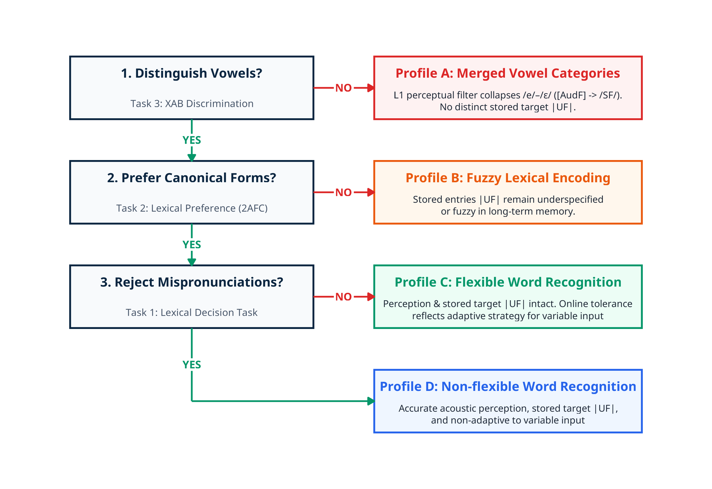

```

???


As we've seen, relying on a single experimental task to map how bilinguals process phonological contrasts creates a bottleneck and is simply insufficient. Instead, we implement a three-task decision tree designed to systematically isolate four distinct phonological representation profiles—ranging from low-level acoustic perception to fully integrated lexical processing.

First, we ask: can the listener acoustically distinguish the mid-vowel contrast using a pre-lexical discrimination task? If they can't, that places them in our first profile: a merged mid-vowel category. Here, a Spanish-like perceptual filter collapses the contrast, treating /e/ and /ɛ/ as phonetically identical with no underlying distinction.

If there is acoustic discrimination at the pre-lexical level, we move to the next step and ask whether listeners prefer canonical forms of the mid-vowel in real words. If they don't, the listener has fuzzy lexical encoding—meaning they can discriminate the contrast in isolation, but fail to systematically specify it within long-term lexical entries. If they do prefer canonical forms, they've established contrasting underlying representations in their lexicon.

Next, we evaluate whether listeners reject mispronunciations of these canonical vowels in a lexical decision task. If they tolerate mispronunciations, they fall into the profile of flexible word recognition. They have robust lexical representations, but demonstrate tolerance for non-canonical forms—an adaptive strategy for navigating variable input within the speech community. Crucially, here we observe a clear directional asymmetry: listeners show much greater acceptance of /e/ mispronunciations for /ɛ/ target words than vice versa, directly mirroring community input where /ɛ/ is frequently realized as /e/.

Finally, if listeners do reject mispronunciations, they display our top profile: a fully integrated contrast. They hold accurate acoustic perception, specified underlying target representations, and productively leverage the contrast across lexical tasks.

---

```{r , include=FALSE}


library(dplyr)
library(stringr)
library(tidyr)
library(ggplot2)
library(lme4)
library(sjPlot)
library(readr)
library(readxl)
library(scales)
library(ggeffects)
library(ggplot2)
library(dplyr)
library(xaringanthemer)
library(showtext)

# --- xaringan Plot Theme Extensions ---
# 1. Carregar la font Noto Sans per a un renderitzat Unicode/IPA impecable
font_add_google("Noto Sans", "noto")
showtext_auto()

# 2. Definició de theme_clean_task (integrat amb Noto Sans)
theme_clean_task <- theme_xaringan(background_color = "#FFFFFF") +
  theme(
    legend.position = "none",
    plot.title = element_text(face = "bold", size = 12),
    plot.subtitle = element_text(color = "gray30", size = 10, margin = margin(b = 6)),
    plot.caption = element_text(color = "gray40", size = 8, margin = margin(t = 6)),
    axis.title.x = element_text(margin = margin(t = 6)),
    axis.title.y = element_text(margin = margin(r = 6)),
    panel.grid.minor = element_blank(),
    strip.text = element_text(face = "bold", size = 10)
  )


theme_effect_plot <- theme_clean_task

# --- Data Loading & ID Cleaning ---
excluded_ids <- c("F012_CH", "F004_CH")

# Children Datasets
XAB_ch <- read.csv("combined_file_XAB_cols_ch.csv")
LD_ch  <- read.csv("combined_file_LD_ch.csv")
LP_ch  <- read.csv("combined_file_LP_ch.csv")
WL_ch  <- read.csv("combined_file_WL_ch.csv")

```

```{r , include=FALSE}

# Adult Datasets
XAB_ad <- read.csv("combined_file_XAB_cols.csv")
LD_ad  <- read.csv("combined_file_LD.csv")
LP_ad  <- read.csv("combined_file_LP_fixed.csv")
WL_ad  <- read.csv("combined_file_WL.csv")

# Adult Questionnaire Dataset
responses_adults <- read_excel("responses_adults.xlsx")

# ID Cleaning Function (Supports optional exclusion filtering)
clean_id <- function(df, col_name, filter_excluded = TRUE) {
  df_clean <- df %>%
    mutate(
      extracted_id = str_extract(.data[[col_name]], "[A-Za-z0-9]+_(CH|AD)"),
      number = ifelse(is.na(extracted_id), str_extract(.data[[col_name]], "[A-Za-z0-9_]+"), extracted_id),
      number = str_remove(number, "_def")
    ) %>%
    select(-extracted_id)
  
  if (filter_excluded) {
    df_clean <- df_clean %>% filter(!number %in% excluded_ids)
  }
  
  return(df_clean)
}

# Clean Children Datasets (excluding IDs)
XAB_ch_clean <- clean_id(XAB_ch, ifelse("participant" %in% names(XAB_ch), "participant", "source_file"), filter_excluded = TRUE) %>%
  filter(trial %in% c("experimental", "filler")) %>%
  mutate(trial = factor(trial, levels = c("filler", "experimental")))
LD_ch_clean  <- clean_id(LD_ch, "source_file", filter_excluded = TRUE)
LP_ch_clean  <- clean_id(LP_ch, "source_file", filter_excluded = TRUE)
WL_ch_clean  <- clean_id(WL_ch, "source_file", filter_excluded = TRUE)

# Clean Adult Datasets (retaining all adult IDs)
XAB_ad_clean <- clean_id(XAB_ad, ifelse("participant" %in% names(XAB_ad), "participant", "source_file"), filter_excluded = FALSE) %>%
  filter(trial %in% c("experimental", "filler")) %>%
  mutate(trial = factor(trial, levels = c("filler", "experimental")))
LD_ad_clean  <- clean_id(LD_ad, "source_file", filter_excluded = FALSE)
LP_ad_clean  <- clean_id(LP_ad, "source_file", filter_excluded = FALSE)
WL_ad_clean  <- clean_id(WL_ad, "source_file", filter_excluded = FALSE)

# Clean Adult Questionnaire Dataset (retaining all adult IDs and target column 'Codi estudi')
responses_adults_clean <- clean_id(responses_adults, "Participant", filter_excluded = FALSE)

# --- Covariates & Merging (Children Only) ---
participants <- read.csv("participants_Catalan_Spanish.csv")
participant_pc_scores <- read_csv("participant_pc_scores.csv")

participants_clean <- participants %>%
  mutate(number = str_remove(number, "_def")) %>%
  filter(!number %in% excluded_ids)

participants_calculated <- participants_clean %>%
  mutate(
    Exp_Home      = 100 * `home.current.exposure.Catalan` / (`home.current.exposure.Catalan` + `home.current.exposure.Spanish`),
    Exp_School    = 100 * `school.current.exposure.Catalan` / (`school.current.exposure.Catalan` + `school.current.exposure.Spanish`),
    Exp_Community = 100 * `community.current.exposure.Catalan` / (`community.current.exposure.Catalan` + `community.current.exposure.Spanish`),
    Exp_Holiday   = 100 * `holiday.current.exposure.Catalan` / (`holiday.current.exposure.Catalan` + `holiday.current.exposure.Spanish`),
    Use_Home      = 100 * `home.current.use.Catalan` / (`home.current.use.Catalan` + `home.current.use.Spanish`),
    Use_School    = 100 * `school.current.use.Catalan` / (`school.current.use.Catalan` + `school.current.use.Spanish`),
    Use_Community = 100 * `community.current.use.Catalan` / (`community.current.use.Catalan` + `community.current.use.Spanish`),
    Use_Holiday   = 100 * `holiday.current.use.Catalan` / (`holiday.current.use.Catalan` + `holiday.current.use.Spanish`)
  )

subject_covariates <- participants_calculated %>%
  inner_join(participant_pc_scores, by = "number") %>%
  mutate(
    Age_z           = scale(age_in_months)[,1],
    Exp_Home_z      = scale(Exp_Home)[,1],
    Exp_School_z    = scale(Exp_School)[,1],
    Exp_Community_z = scale(Exp_Community)[,1],
    Exp_Holiday_z   = scale(Exp_Holiday)[,1],
    Use_Home_z      = scale(Use_Home)[,1],
    Use_School_z    = scale(Use_School)[,1],
    Use_Community_z = scale(Use_Community)[,1],
    Use_Holiday_z   = scale(Use_Holiday)[,1]
  )

```

```{r , include=FALSE}

# Merge Full Datasets (Children)
XAB_ch_full <- inner_join(XAB_ch_clean, subject_covariates, by = "number")
LD_ch_full  <- inner_join(LD_ch_clean,  subject_covariates, by = "number")
LP_ch_full  <- inner_join(LP_ch_clean,  subject_covariates, by = "number")
WL_ch_full  <- inner_join(WL_ch_clean,  subject_covariates, by = "number")

# Merge Full Datasets (Adults with Questionnaire Data)
# If joining 'number' from task files to 'Participant' in responses_adults_clean:
XAB_ad_full <- inner_join(XAB_ad_clean, responses_adults_clean, by = c("number" = "Participant"))
library(stringr)

# 1. Clean the number column to retain only the base ID (e.g., "UPF_001")
LD_ad_clean <- LD_ad_clean %>%
  mutate(number = str_extract(number, "^[A-Za-z]+_\\d+"))

# 2. Re-run the inner join
LD_ad_full <- inner_join(LD_ad_clean, responses_adults_clean, by = c("number" = "Participant"))

# 3. Verify that rows are retained
nrow(LD_ad_full)
library(stringr)

# --- Lexical Preference (LP) ---
LP_ad_clean <- LP_ad_clean %>%
  mutate(number = str_extract(number, "^[A-Za-z]+_\\d+"))

LP_ad_full <- inner_join(LP_ad_clean, responses_adults_clean, by = c("number" = "Participant"))

# --- Word Learning (WL) ---
WL_ad_clean <- WL_ad_clean %>%
  mutate(number = str_extract(number, "^[A-Za-z]+_\\d+"))

WL_ad_full <- inner_join(WL_ad_clean, responses_adults_clean, by = c("number" = "Participant"))

# Verify retained rows
nrow(LP_ad_full)
nrow(WL_ad_full)


library(emmeans)


# --- Statistical Models: Children (with Covariates) ---

# ==============================================================================
# STATISTICAL ANALYSIS SCRIPT: CHILDREN MODELS (WITH COVARIATES & F002_CH EXCLUSION)
# ==============================================================================

library(dplyr)
library(lme4)
library(emmeans)

# ------------------------------------------------------------------------------
# TASK 1: XAB DISCRIMINATION (Experimental Trials Only)
# ------------------------------------------------------------------------------

# 1. Clean dataset: filter out subject F002_CH and filler trials
#XAB_ch_clean <- XAB_ch_full %>%
#  filter(number != "F002_CH", trial == "experimental")

# 2. Fit GLMM on critical experimental contrasts
#m_XAB_ch_exp <- glmer(
#  key_resp.corr ~ Age_z * Exp_Home_z + (1 | number) + (1 | Xfile),
 # data = XAB_ch_clean,
 # family = binomial(link = "logit"),
#  control = glmerControl(optimizer = "bobyqa")
#)

#summary(m_XAB_ch_exp)

# 3. Simple slopes of Age_z at -1 SD, Mean, and +1 SD of Exp_Home_z
#slopes_age_xab <- emtrends(
#  m_XAB_ch_exp,
#  specs = ~ Exp_Home_z,
#  var = "Age_z",
#  at = list(Exp_Home_z = c(-1, 0, 1))
#)

#summary(slopes_age_xab, infer = TRUE)

# ------------------------------------------------------------------------------
# TASK 2: LEXICAL DECISION (Target Items Only with 'difficult' Baseline)
# ------------------------------------------------------------------------------

# 1. Clean dataset: filter out non-targets, 'Same' condition, and F002_CH
#LD_ch_clean <- LD_ch_full %>%
#  filter(
#    number != "F002_CH",
#    Condition != "Same",
#    !Item_type %in% c("Word_filler", "Pseudoword")
 # ) %>%
 # mutate(
 #   response_trials.corr = as.numeric(as.character(response_trials.corr)),
#    Condition_ref        = factor(Condition, levels = c("difficult", "canonical", "easy"))
#  ) %>%
#  droplevels()

# 2. Fit GLMM evaluated at 'difficult' baseline
# m_LD_ch_clean <- glmer(
#   response_trials.corr ~ Condition_ref * Age_z * Exp_Home_z + (1 | number) + (1 | Word),
#   data = LD_ch_clean,
#   family = binomial(link = "logit"),
#   control = glmerControl(
#     optimizer = "nloptwrap",
#     optCtrl = list(maxfun = 200000)
#   )
# )

# summary(m_LD_ch_clean)

# 3. Simple slopes of Age_z across Condition and Exp_Home_z levels (-1, 0, +1 SD)
# slopes_age_ld <- emtrends(
#   m_LD_ch_clean,
#   specs = ~ Age_z | Condition_ref * Exp_Home_z,
#   var = "Age_z",
#   at = list(Exp_Home_z = c(-1, 0, 1))
# )

# summary(slopes_age_ld, infer = TRUE)

# 4. Pairwise slope comparisons: Low (-1 SD) vs. High (+1 SD) Exposure within Condition
# pairs(slopes_age_ld, by = "Condition_ref")

# ------------------------------------------------------------------------------
# TASK 3: LEXICAL PREFERENCE (Sum-Coded Target Vowel + 3-Way Covariate Interaction)
# ------------------------------------------------------------------------------

 #1. Clean dataset: filter out F002_CH and set centered sum contrast (-0.5 = close, +0.5 = open)
#LP_ch_clean <- LP_ch_full %>%
#  filter(number != "F002_CH") %>%
 # mutate(
#    vowel_c = ifelse(target_vowel == "close", -0.5, 0.5)
 # )

# 2. Fit 3-way interaction GLMM (Target Vowel x Age x Exposure)
 #m_LP_ch_clean <- glmer(
 #  key_resp.corr ~ vowel_c * Age_z * Exp_Home_z + (1 | number) + (1 | source_file),
 #  data = LP_ch_clean,
 #  family = binomial(link = "logit"),
 # #  control = glmerControl(optimizer = "bobyqa")
 #)

 #summary(m_LP_ch_clean)

# 3. Simple slopes of Age_z across Target Vowel and Exp_Home_z levels (-1, 0, +1 SD)
 #slopes_age_lp <- emtrends(
  # m_LP_ch_clean,
  # specs = ~ vowel_c * Exp_Home_z,
  # var = "Age_z",
  # at = list(vowel_c = c(-0.5, 0.5), Exp_Home_z = c(-1, 0, 1))
 #)

 #summary(slopes_age_lp, infer = TRUE)

# ------------------------------------------------------------------------------
# TASK 4: WORD LEARNING (Sum-Coded Factors + Covariates)
# ------------------------------------------------------------------------------

# 1. Clean dataset: filter block >= 3, exclude F002_CH, and set centered contrasts (-0.5 / +0.5)
 #WL_ch_clean <- WL_ch_full %>%
 #  filter(block >= 3, number != "F002_CH") %>%
  # mutate(
  #   trial_type_c = ifelse(trial_type == "minimal", -0.5, 0.5),
 #    item_type_c  = ifelse(item_type == "mid", 0.5, -0.5)
 #  )

# 2. Fit sum-coded GLMM with Age and Home Exposure
 #m_WL_ch_clean <- glmer(
 #  correct ~ trial_type_c * item_type_c + Age_z + Exp_Home_z + (1 | number) + (1 | source_file),
 # data = WL_ch_clean,
  # family = binomial(link = "logit"),
  # control = glmerControl(optimizer = "bobyqa")
 #)

 #summary(m_WL_ch_clean)

# 3. Main slope estimates for continuous covariates
#emtrends(m_WL_ch_clean, ~ 1, var = "Age_z") %>% summary(infer = TRUE)
#emtrends(m_WL_ch_clean, ~ 1, var = "Exp_Home_z") %>% summary(infer = TRUE)


library(dplyr)
library(lme4)

# ------------------------------------------------------------------------------
# OPTION A (RECOMMENDED): Experimental Trials Only
# ------------------------------------------------------------------------------
XAB_ad_exp <- XAB_ad_full %>%
  filter(trial == "experimental")

m_XAB_ad_exp <- glmer(
  key_resp.corr ~ Dominant + (1 | number) + (1 | Xfile),
  data = XAB_ad_exp,
  family = binomial(link = "logit"),
  control = glmerControl(optimizer = "bobyqa")
)

summary(m_XAB_ad_exp)

# ------------------------------------------------------------------------------
# OPTION B: Re-leveling trial ('experimental' as reference level)
# ------------------------------------------------------------------------------
XAB_ad_relevel <- XAB_ad_full %>%
  mutate(trial_ref = relevel(factor(trial), ref = "experimental"))

m_XAB_ad_relevel <- glmer(
  key_resp.corr ~ trial_ref * Dominant + (1 | number) + (1 | Xfile),
  data = XAB_ad_relevel,
  family = binomial(link = "logit"),
  control = glmerControl(optimizer = "bobyqa")
)

summary(m_XAB_ad_relevel)


# --- 1. XAB Dataset ---
XAB_all_full <- bind_rows(
  XAB_ch_full %>% select(number, trial, key_resp.corr, Xfile) %>% mutate(Group = "Children"),
  XAB_ad_full %>% select(number, trial, key_resp.corr, Xfile) %>% mutate(Group = "Adults")
) %>% mutate(Group = factor(Group, levels = c("Children", "Adults")))

# --- 2. Lexical Decision Dataset ---
LD_all_full <- bind_rows(
  LD_ch_full %>% select(number, Condition, Item_type, response_trials.corr, Word) %>% mutate(Group = "Children"),
  LD_ad_full %>% select(number, Condition, Item_type, response_trials.corr, Word) %>% mutate(Group = "Adults")
) %>% mutate(Group = factor(Group, levels = c("Children", "Adults")))

# --- 3. Lexical Preference Dataset ---
LP_all_full <- bind_rows(
  LP_ch_full %>% select(number, target_vowel, key_resp.corr, source_file) %>% mutate(Group = "Children"),
  LP_ad_full %>% select(number, target_vowel, key_resp.corr, source_file) %>% mutate(Group = "Adults")
) %>% mutate(Group = factor(Group, levels = c("Children", "Adults")))

# --- 4. Word Learning Dataset ---
WL_all_full <- bind_rows(
  WL_ch_full %>% select(number, block, trial_type, item_type, correct, source_file) %>% mutate(Group = "Children"),
  WL_ad_full %>% select(number, block, trial_type, item_type, correct, source_file) %>% mutate(Group = "Adults")
) %>% mutate(Group = factor(Group, levels = c("Children", "Adults")))

# ==============================================================================
# STATISTICAL ANALYSIS SCRIPT: TASKS 1–4 (GLMMs)
# ==============================================================================

library(dplyr)
library(lme4)

# ------------------------------------------------------------------------------
# TASK 1: XAB DISCRIMINATION (Experimental Trials Only)
# ------------------------------------------------------------------------------

XAB_exp_only <- XAB_all_full %>%
  filter(trial == "experimental")

m_XAB_exp_only <- glmer(
  key_resp.corr ~ Group + (1 | number) + (1 | Xfile),
  data = XAB_exp_only,
  family = binomial(link = "logit"),
  control = glmerControl(optimizer = "bobyqa")
)

summary(m_XAB_exp_only)

# ------------------------------------------------------------------------------
# TASK 2: LEXICAL DECISION (Target Items Only)
# ------------------------------------------------------------------------------

LD_clean <- LD_all_full %>%
  filter(!Item_type %in% c("Word_filler", "Pseudoword")) %>%
  mutate(
    response_trials.corr = as.numeric(as.character(response_trials.corr)),
    Condition = relevel(droplevels(factor(Condition)), ref = "difficult"),
    Item_type = relevel(droplevels(factor(Item_type)), ref = "Closed_e"),
    Group     = relevel(droplevels(factor(Group)), ref = "Children")
  )

m_LD_opt1 <- glmer(
  response_trials.corr ~ Condition * Item_type * Group + (1 | number) + (1 | Word),
  data = LD_clean,
  family = binomial(link = "logit"),
  control = glmerControl(
    optimizer = "nloptwrap",
    optCtrl = list(maxfun = 200000)
  )
)

summary(m_LD_opt1)

# ------------------------------------------------------------------------------
# TASK 3: LEXICAL PREFERENCE (LP)
# ------------------------------------------------------------------------------

# Option A: Simple Effects ('open' target vowel as reference category)
LP_all_open_ref <- LP_all_full %>%
  mutate(
    target_vowel_open_ref = relevel(factor(target_vowel), ref = "open"),
    Group                 = relevel(factor(Group), ref = "Children")
  )

m_LP_open_ref <- glmer(
  key_resp.corr ~ target_vowel_open_ref * Group + (1 | number) + (1 | source_file),
  data = LP_all_open_ref,
  family = binomial(link = "logit"),
  control = glmerControl(optimizer = "bobyqa")
)

summary(m_LP_open_ref)

# Option B: Main Effects (Centered Sum Coding: -0.5 vs +0.5)
LP_sum_data <- LP_all_full %>%
  mutate(
    vowel_c = ifelse(target_vowel == "close", -0.5, 0.5),
    group_c = ifelse(Group == "Children", -0.5, 0.5)
  )

m_LP_sum <- glmer(
  key_resp.corr ~ vowel_c * group_c + (1 | number) + (1 | source_file),
  data = LP_sum_data,
  family = binomial(link = "logit"),
  control = glmerControl(optimizer = "bobyqa")
)

summary(m_LP_sum)

# ------------------------------------------------------------------------------
# TASK 4: WORD LEARNING (WL - Centered Sum Coding, Blocks 3–8)
# ------------------------------------------------------------------------------

WL_sum_data <- WL_all_full %>%
  filter(block >= 3) %>%
  mutate(
    trial_type_c = ifelse(trial_type == "minimal", -0.5, 0.5),
    item_type_c  = ifelse(item_type == "mid", 0.5, -0.5),
    group_c      = ifelse(Group == "Children", -0.5, 0.5)
  )

m_WL_sum <- glmer(
  correct ~ trial_type_c * item_type_c * group_c + (1 | number) + (1 | source_file),
  data = WL_sum_data,
  family = binomial(link = "logit"),
  control = glmerControl(optimizer = "bobyqa")
)

summary(m_WL_sum)

#Main Factors: Learning is significantly hindered by phonological difficulty—Minimal pairs ($\beta = 2.2680, p < .001$) and Mid vowels ($\beta = -1.0191, p < .001$) both show strong accuracy penalties.Developmental Gap: Adults demonstrate higher overall accuracy than Children ($\beta = 1.3761, p < .001$).Adults significantly outperformed Children across both trial types. Specifically, Adults maintained a higher baseline accuracy on Minimal pairs ($\beta = +0.7684, p < .001$) and an even greater advantage on Non-minimal pairs ($\beta = +1.9838, p < .001$).

# ==============================================================================
# STATISTICAL ANALYSIS SCRIPT: TASKS 1–4 (ADULTS ONLY)
# Predictor / Covariate: Dominant
# ==============================================================================

library(dplyr)
library(lme4)
library(emmeans)

# ------------------------------------------------------------------------------
# PREPARATION: Clean and prepare Adult Datasets
# ------------------------------------------------------------------------------

# Task 1: XAB Discrimination (Experimental Trials Only)
XAB_ad_exp <- XAB_ad_full %>%
  filter(trial == "experimental") %>%
  mutate(Dominant = factor(Dominant))

# Task 2: Lexical Decision (Target Items Only)
LD_ad_clean <- LD_ad_full %>%
  filter(!Item_type %in% c("Word_filler", "Pseudoword")) %>%
  mutate(
    response_trials.corr = as.numeric(as.character(response_trials.corr)),
    Condition  = relevel(droplevels(factor(Condition)), ref = "difficult"),
    Item_type  = relevel(droplevels(factor(Item_type)), ref = "Closed_e"),
    Dominant   = factor(Dominant)
  )

# Task 3: Lexical Preference (LP)
LP_ad_clean <- LP_ad_full %>%
  mutate(
    vowel_c  = ifelse(target_vowel == "close", -0.5, 0.5), # Centered: close = -0.5, open = +0.5
    Dominant = factor(Dominant)
  )

# Task 4: Word Learning (WL - Blocks 3–8)
WL_ad_clean <- WL_ad_full %>%
  filter(block >= 3) %>%
  mutate(
    trial_type_c = ifelse(trial_type == "minimal", -0.5, 0.5), # Centered: minimal = -0.5, non-minimal = +0.5
    item_type_c  = ifelse(item_type == "mid", 0.5, -0.5),      # Centered: mid = +0.5, high = -0.5
    Dominant     = factor(Dominant)
  )


# ==============================================================================
# TASK 1: XAB DISCRIMINATION (ADULTS)
# Predictor: Dominant
# ==============================================================================

m_XAB_ad_exp <- glmer(
  key_resp.corr ~ Dominant + (1 | number) + (1 | Xfile),
  data = XAB_ad_exp,
  family = binomial(link = "logit"),
  control = glmerControl(optimizer = "bobyqa")
)

summary(m_XAB_ad_exp)

# Post-hoc pairwise comparisons for Dominant levels
emmeans(m_XAB_ad_exp, pairwise ~ Dominant, type = "response")


# ==============================================================================
# TASK 2: LEXICAL DECISION (ADULTS)
# Predictors: Condition * Item_type * Dominant
# ==============================================================================

m_LD_ad <- glmer(
  response_trials.corr ~ Condition * Item_type * Dominant + 
    (1 | number) + (1 | Word),
  data = LD_ad_clean,
  family = binomial(link = "logit"),
  control = glmerControl(
    optimizer = "nloptwrap",
    optCtrl = list(maxfun = 200000)
  )
)

summary(m_LD_ad)

# Post-hoc: Compare Dominance groups across Task Conditions
emmeans(m_LD_ad, pairwise ~ Dominant | Condition * Item_type, type = "response")


# ==============================================================================
# TASK 3: LEXICAL PREFERENCE (LP - ADULTS)
# Predictors: Target Vowel (Centered) * Dominant
# ==============================================================================

m_LP_ad <- glmer(
  key_resp.corr ~ vowel_c * Dominant + 
    (1 | number) + (1 | source_file),
  data = LP_ad_clean,
  family = binomial(link = "logit"),
  control = glmerControl(optimizer = "bobyqa")
)

summary(m_LP_ad)

# Post-hoc: Difference between Close and Open vowels by Dominance group
emmeans(m_LP_ad, pairwise ~ vowel_c | Dominant, type = "response")


# ==============================================================================
# TASK 4: WORD LEARNING (WL - ADULTS)
# Predictors: Trial Type (Centered) * Item Type (Centered) * Dominant
# ==============================================================================

m_WL_ad <- glmer(
  correct ~ trial_type_c * item_type_c * Dominant + 
    (1 | number) + (1 | source_file),
  data = WL_ad_clean,
  family = binomial(link = "logit"),
  control = glmerControl(optimizer = "bobyqa")
)

summary(m_WL_ad)

# Post-hoc: Minimal vs Non-minimal pair differences by Dominance group
emmeans(m_WL_ad, pairwise ~ trial_type_c | Dominant, type = "response")
library(dplyr)
library(tibble)
library(GGally)
library(corrplot)

# 1. Function to extract participant random intercepts from a model
#extract_participant_effects <- function(model, task_name) {
#  ranef(model)$number %>%
#     rownames_to_column("number") %>%
#     rename(!!task_name := `(Intercept)`)
# }

# 2. Extract random intercepts for Children
# ranef_ch <- extract_participant_effects(m_XAB_ch, "XAB") %>%
#   inner_join(extract_participant_effects(m_LD_ch, "LD"), by = "number") %>%
#   inner_join(extract_participant_effects(m_LP_ch, "LP"), by = "number") %>%
#   inner_join(extract_participant_effects(m_WL_ch, "WL"), by = "number") %>%
 #  mutate(Group = "Children")

# 3. Extract random intercepts for Adults
# ranef_ad <- extract_participant_effects(m_XAB_ad, "XAB") %>%
#   inner_join(extract_participant_effects(m_LD_ad, "LD"), by = "number") %>%
#   inner_join(extract_participant_effects(m_LP_ad, "LP"), by = "number") %>%
#   inner_join(extract_participant_effects(m_WL_ad, "WL"), by = "number") %>%
#   mutate(Group = "Adults")

# Combine both groups
# all_ranefs <- bind_rows(ranef_ch, ranef_ad)
# library(dplyr)
# library(purrr)

# 1. Compute participant mean accuracy per task
acc_XAB <- XAB_all_full %>%
  filter(trial == "experimental") %>%
  group_by(number, Group) %>%
  summarise(XAB = mean(key_resp.corr, na.rm = TRUE), .groups = "drop")

acc_LD <- LD_all_full %>%
    filter(Condition == "difficult") %>%
  group_by(number, Group) %>%
  summarise(LD = mean(response_trials.corr, na.rm = TRUE), .groups = "drop")

acc_LP <- LP_all_full %>%
  group_by(number, Group) %>%
  summarise(LP = mean(key_resp.corr, na.rm = TRUE), .groups = "drop")

acc_WL <- WL_all_full %>%
  filter(block >= 3) %>%
      filter(item_type == "mid") %>%
      filter(trial_type == "minimal") %>%

  group_by(number, Group) %>%
  summarise(WL = mean(correct, na.rm = TRUE), .groups = "drop")

# 2. Merge into a single wide dataset
task_performance <- list(acc_XAB, acc_LD, acc_LP, acc_WL) %>%
  reduce(full_join, by = c("number", "Group"))


library(GGally)
library(ggplot2)


# Separate by group
perf_children <- task_performance %>% filter(Group == "Children") %>% select(XAB, LD, LP, WL)
perf_adults   <- task_performance %>% filter(Group == "Adults")   %>% select(XAB, LD, LP, WL)

# Calculate Pearson correlation matrices
cor_ch <- cor(perf_children, use = "pairwise.complete.obs")
cor_ad <- cor(perf_adults,   use = "pairwise.complete.obs")

# Plot correlation matrices
par(mfrow = c(1, 2))
corrplot(cor_ch, method = "circle", type = "upper", title = "Children", mar = c(0,0,2,0), addCoef.col = "black")
corrplot(cor_ad, method = "circle", type = "upper", title = "Adults",   mar = c(0,0,2,0), addCoef.col = "black")
library(corrplot)

# 1. Compute correlation matrices AND p-value matrices
p_ch <- cor.mtest(perf_children, conf.level = 0.95)$p
p_ad <- cor.mtest(perf_adults, conf.level = 0.95)$p

# 2. Plot with Significance Overlays
par(mfrow = c(1, 2))

# Children: Cross out non-significant correlations (p > 0.05)
corrplot(
  cor_ch, 
  method = "circle", 
  type = "upper", 
  title = "Children", 
  mar = c(0, 0, 2, 0), 
  addCoef.col = "black",
  p.mat = p_ch, 
  sig.level = 0.05, 
  insig = "pch" # Options: "pch" (crosses out non-sig), "blank" (hides non-sig), or "label_sig" (shows stars)
)


# 1. Clean & Calculate Relative Catalan Metrics


# 2. Ordinal Conversion & Filtering
participants_ordinal <- participants_clean %>%
  filter(!number %in% c("F012_CH", "F004_CH")) %>%
  select(-child.s.birth.order, -language.concerns.before.age.4) %>%
  mutate(
    across(c(starts_with("frequency.of."), starts_with("pressure.on.caregiver")), ~ case_when(
      . %in% c("frequency-never", "never", "frequency-almost-never", "(almost) never") ~ 1,
      . %in% c("frequency-year", "a few times a year", "frequency-month", "once or twice a month") ~ 2,
      . %in% c("frequency-week", "once or twice a week") ~ 3,
      . %in% c("frequency-week-several", "several times a week") ~ 4,
      . %in% c("frequency-every-day", "every day") ~ 5,
      TRUE ~ suppressWarnings(as.numeric(.))
    )),
    across(starts_with("highest.education.of.caregiver"), ~ case_when(
      . %in% c("education-level-none", "none") ~ 1,
      . %in% c("education-level-primary", "primary school") ~ 2,
      . %in% c("education-level-secondary", "secondary school or equivalent") ~ 3,
      . %in% c("education-level-post-secondary", "post-secondary school training, but not a university degree") ~ 4,
      . %in% c("education-level-university", "university degree") ~ 5,
      TRUE ~ suppressWarnings(as.numeric(.))
    )),
    across(c(contains("number.of.speakers"), contains("speakers.with.high.proficiency")), ~ case_when(
      . %in% c("frequency-number-range-0", "0") ~ 1,
      . %in% c("frequency-number-range-1-2", "1-2") ~ 2,
      . %in% c("frequency-number-range-3-5", "3-5") ~ 3,
      . %in% c("frequency-number-range-6-10", "6-10") ~ 4,
      . %in% c("frequency-number-range-11-plus", "more than 10") ~ 5,
      TRUE ~ suppressWarnings(as.numeric(.))
    )),
    across(starts_with("satisfied.with"), ~ case_when(
      . %in% c("satisfaction-not-at-all", "not at all satisfied") ~ 1,
      . %in% c("satisfaction-not-very", "not very satisfied") ~ 2,
      . %in% c("satisfaction-pretty", "pretty satisfied") ~ 3,
      . %in% c("satisfaction-totally", "totally saisfied", "totally satisfied") ~ 4,
      TRUE ~ suppressWarnings(as.numeric(.))
    )),
    across(contains("child.s.willingness"), ~ case_when(
      . %in% c("frequency-willing-almost-never", "(almost) never willing") ~ 1,
      . %in% c("frequency-willing-rarely", "rarely willing") ~ 2,
      . %in% c("frequency-willing-half", "willing half of the time") ~ 3,
      . %in% c("frequency-willing-often", "often willing") ~ 4,
      . %in% c("frequency-willing-almost-always", "(almost) always willing") ~ 5,
      TRUE ~ suppressWarnings(as.numeric(.))
    ))
  )


# ==============================================================================
# STATISTICAL ANALYSIS SCRIPT: TASKS 1–4 (CHILDREN ONLY)
# Factors: Task Conditions * Age_z * Exp_Home_z
# ==============================================================================

library(dplyr)
library(lme4)
library(emmeans)

# ------------------------------------------------------------------------------
# PREPARATION: Clean and filter children-only datasets
# ------------------------------------------------------------------------------

# Task 1: XAB Discrimination (Experimental trials only)
XAB_ch_exp <- XAB_ch_full %>%
  filter(trial == "experimental") %>%
  mutate(
    Age_z      = as.numeric(Age_z),
    Exp_Home_z = as.numeric(Exp_Home_z)
  )

# Task 2: Lexical Decision (Target items only)
LD_ch_clean <- LD_ch_full %>%
  filter(!Item_type %in% c("Word_filler", "Pseudoword")) %>%
  mutate(
    response_trials.corr = as.numeric(as.character(response_trials.corr)),
    Condition  = relevel(droplevels(factor(Condition)), ref = "difficult"),
    Item_type  = relevel(droplevels(factor(Item_type)), ref = "Closed_e"),
    Age_z      = as.numeric(Age_z),
    Exp_Home_z = as.numeric(Exp_Home_z)
  )

# Task 3: Lexical Preference (LP)
LP_ch_clean <- LP_ch_full %>%
  mutate(
    vowel_c    = ifelse(target_vowel == "close", -0.5, 0.5), # Centered: close = -0.5, open = +0.5
    Age_z      = as.numeric(Age_z),
    Exp_Home_z = as.numeric(Exp_Home_z)
  )

# Task 4: Word Learning (WL - Blocks 3–8)
WL_ch_clean <- WL_ch_full %>%
  filter(block >= 3) %>%
  mutate(
    trial_type_c = ifelse(trial_type == "minimal", -0.5, 0.5), # Centered: minimal = -0.5, non-minimal = +0.5
    item_type_c  = ifelse(item_type == "mid", 0.5, -0.5),      # Centered: mid = +0.5, high = -0.5
    Age_z        = as.numeric(Age_z),
    Exp_Home_z   = as.numeric(Exp_Home_z)
  )


# ==============================================================================
# TASK 1: XAB DISCRIMINATION
# Predictors: Age_z * Exp_Home_z
# ==============================================================================

m_XAB_ch <- glmer(
  key_resp.corr ~ Age_z * Exp_Home_z + (1 | number) + (1 | Xfile),
  data = XAB_ch_exp,
  family = binomial(link = "logit"),
  control = glmerControl(optimizer = "bobyqa")
)

summary(m_XAB_ch)

# Test simple slopes of Home Exposure at mean age
emtrends(m_XAB_ch, ~ 1, var = "Exp_Home_z")


# ==============================================================================
# TASK 2: LEXICAL DECISION
# Predictors: Condition * Item_type * Age_z * Exp_Home_z
# ==============================================================================

m_LD_ch <- glmer(
  response_trials.corr ~ Condition * Item_type * Age_z * Exp_Home_z + 
    (1 | number) + (1 | Word),
  data = LD_ch_clean,
  family = binomial(link = "logit"),
  control = glmerControl(
    optimizer = "nloptwrap",
    optCtrl = list(maxfun = 200000)
  )
)

summary(m_LD_ch)

# Post-hoc: Age trends across Condition and Item Type
emtrends(m_LD_ch, ~ Condition * Item_type, var = "Age_z")


# ==============================================================================
# TASK 3: LEXICAL PREFERENCE (LP)
# Predictors: Target Vowel (Centered) * Age_z * Exp_Home_z
# ==============================================================================

m_LP_ch <- glmer(
  key_resp.corr ~ vowel_c * Age_z * Exp_Home_z + 
    (1 | number) + (1 | source_file),
  data = LP_ch_clean,
  family = binomial(link = "logit"),
  control = glmerControl(optimizer = "bobyqa")
)

summary(m_LP_ch)

# Simple slopes for Catalan Home Exposure across Vowel conditions
emtrends(m_LP_ch, ~ vowel_c, var = "Exp_Home_z")


# ==============================================================================
# TASK 4: WORD LEARNING (WL)
# Predictors: Trial Type (Centered) * Item Type (Centered) * Age_z * Exp_Home_z
# ==============================================================================

m_WL_ch <- glmer(
  correct ~ trial_type_c * item_type_c * Age_z * Exp_Home_z + 
    (1 | number) + (1 | source_file),
  data = WL_ch_clean,
  family = binomial(link = "logit"),
  control = glmerControl(optimizer = "bobyqa")
)

summary(m_WL_ch)

# Post-hoc: Age and Home Exposure simple slopes for Minimal vs. Non-minimal pairs
emtrends(m_WL_ch, ~ trial_type_c, var = "Age_z")
emtrends(m_WL_ch, ~ trial_type_c, var = "Exp_Home_z")

```


## Participants Profile


```{r participant-profile-summary, echo=FALSE, message=FALSE, warning=FALSE, results='asis'}
library(dplyr)
library(stringr)
library(knitr)
library(tibble)

# 1. Process Adult Cohort Data
adults_processed <- responses_adults %>%
  distinct(Participant, .keep_all = TRUE) %>%
  filter(!is.na(Participant) & Participant != "") %>%
  mutate(
    Age = suppressWarnings(as.numeric(str_extract(as.character(Edat), "\\d+"))),
    Age = ifelse(is.na(Age) & "Quin any vas néixer?" %in% names(.), 
                 2026 - as.numeric(str_extract(as.character(`Quin any vas néixer?`), "\\d{4}")), Age),
    Gender_raw = as.character(`Sexe/Gènere:`),
    Gender = case_when(
      str_detect(str_to_lower(Gender_raw), "dona|femení|female|f") ~ "Female",
      str_detect(str_to_lower(Gender_raw), "home|masculí|male|m") ~ "Male",
      TRUE ~ "Other"
    ),
    Dominance = as.character(Dominant)
  )

adult_stats <- adults_processed %>%
  summarise(
    Cohort = "Adults",
    `Target Population` = "Early Catalan–Spanish adult bilinguals (Barcelona Metro)",
    `N (Total)` = n(),
    `Gender (F/M)` = paste0(sum(Gender == "Female", na.rm = TRUE), " F / ", 
                            sum(Gender == "Male", na.rm = TRUE), " M"),
    `Age Range` = paste0(round(min(Age, na.rm = TRUE), 1), " – ", 
                         round(max(Age, na.rm = TRUE), 1), " yrs"),
    
    `Questionnaire Subset` = paste0(
      sum(str_detect(Dominance, "(?i)cat"), na.rm = TRUE), " Catalan-dom / ",
      sum(str_detect(Dominance, "(?i)cas|esp|spa"), na.rm = TRUE), " Spanish-dom"
    )
  )

# 2. Process Child Cohort Data
children_stats <- tibble(
  Cohort = "Children",
  `Target Population` = "Catalan–Spanish child bilinguals (Barcelona – Gràcia)",
  `N (Total)` = 40,
  `Gender (F/M)` = "20 F / 20 M",
  `Age Range` = "7.50 – 10.37 yrs",
  `Questionnaire Subset` = "(N = 28)* Exp. home 66.19% (25.68%)"
)

# 3. Combine into unified summary table
participant_summary <- bind_rows(adult_stats, children_stats)

# Render HTML table
print(knitr::kable(
  participant_summary, 
  format = "html", 
  align = "llccccc",
  col.names = c("Cohort", "Target Population", "N", "Gender", "Age Range", "Questionnaire / Language Profile*")
))

# 4. HTML Footnote Note
cat("<p style='font-size: 0.82em; color: #475569; margin-top: 6px; margin-bottom: 0px;'><sup>*</sup> Note: Individual differences for the child cohort are calculated with a subset of 28 participants with complete parental questionnaire data.</p>")

```


```{r}

library(tidyverse)
library(readr)
library(scales)

# 1. Load raw dataset and define exclusions
excluded_ids <- c("F004_CH")

participants <- read_csv("participants_Catalan_Spanish.csv")

# 2. Clean IDs and calculate relative Exposure and Use percentages
participants_calculated <- participants %>%
  mutate(number = str_remove(number, "_def")) %>%
  filter(!number %in% excluded_ids) %>%
  mutate(
    Exp_Home      = 100 * `home current exposure Catalan` / (`home current exposure Catalan` + `home current exposure Spanish`),
    Exp_School    = 100 * `school current exposure Catalan` / (`school current exposure Catalan` + `school current exposure Spanish`),
    Exp_Community = 100 * `community current exposure Catalan` / (`community current exposure Catalan` + `community current exposure Spanish`),
    Exp_Holiday   = 100 * `holiday current exposure Catalan` / (`holiday current exposure Catalan` + `holiday current exposure Spanish`),
    
    Use_Home      = 100 * `home current use Catalan` / (`home current use Catalan` + `home current use Spanish`),
    Use_School    = 100 * `school current use Catalan` / (`school current use Catalan` + `school current use Spanish`),
    Use_Community = 100 * `community current use Catalan` / (`community current use Catalan` + `community current use Spanish`),
    Use_Holiday   = 100 * `holiday current use Catalan` / (`holiday current use Catalan` + `holiday current use Spanish`)
  ) %>%
  filter(!is.na(Exp_Home))

# 3. Reshape into long format for ggplot visualization
context_df <- participants_calculated %>%
  select(
    number, 
    Exp_Home, Exp_School, Exp_Community, Exp_Holiday,
    Use_Home, Use_School, Use_Community, Use_Holiday
  ) %>%
  pivot_longer(
    cols = -number,
    names_to = c("Metric", "Context"),
    names_sep = "_",
    values_to = "Percentage"
  ) %>%
  mutate(
    Metric  = ifelse(Metric == "Exp", "Exposure", "Use"),
    Context = factor(Context, levels = c("Home", "School", "Community", "Holiday"))
  )

# 4. Generate ggplot: Multi-Setting Relative Catalan Profile Comparison
plot_relative_exposure <- ggplot(context_df, aes(x = Context, y = Percentage, fill = Metric)) +
  # 50% Balance Reference Line
  geom_hline(yintercept = 50, linetype = "dashed", color = "#64748B", linewidth = 0.8) +
  annotate("text", x = 0.6, y = 52, label = "Balanced Input (50%)", 
           color = "#64748B", fontface = "italic", size = 3.5, hjust = 0) +
  
  # Boxplots for distributions
  geom_boxplot(
    alpha = 0.7, 
    outlier.shape = NA, 
    position = position_dodge(width = 0.8),
    width = 0.6
  ) +
  
  # Individual Participant Points
  geom_point(
    aes(color = Metric),
    position = position_jitterdodge(dodge.width = 0.8, jitter.width = 0.15),
    size = 2,
    alpha = 0.7
  ) +
  
  # Color Palette & Scales
  scale_fill_manual(values = c("Exposure" = "#0072B2", "Use" = "#D55E00")) +
  scale_color_manual(values = c("Exposure" = "#004976", "Use" = "#9E4500")) +
  scale_y_continuous(
    limits = c(0, 105),
    breaks = seq(0, 100, by = 20),
    labels = function(x) paste0(x, "%")
  ) +
  
  # Styling & Labels
  labs(
    title = "Relative Catalan Exposure & Use Across Settings",
    subtitle = "Calculated as 100 × Catalan ",
    x = "Context Setting",
    y = "Relative Catalan Percentage (%)",
    fill = "Metric Type",
    color = "Metric Type"
  ) +
  theme_classic(base_size = 13) +
  theme(
    plot.title = element_text(face = "bold", size = 14, color = "#0A2540"),
    plot.subtitle = element_text(size = 11, color = "#475569", margin = margin(b = 12)),
    legend.position = "top",
    axis.title = element_text(face = "bold"),
    panel.grid.major.y = element_line(color = "grey90", linewidth = 0.4)
  )

# Display Plot
print(plot_relative_exposure)
plot_relative_exposure <- ggplot(context_df, aes(x = Context, y = Percentage, fill = Metric)) +
  # 50% Balance Reference Line
  geom_hline(yintercept = 50, linetype = "dashed", color = "#64748B", linewidth = 0.8) +
  annotate("text", x = 0.6, y = 52, label = "Balanced Input (50%)", 
           color = "#64748B", fontface = "italic", size = 3.5, hjust = 0) +
  
  # Boxplots for distributions
  geom_boxplot(
    alpha = 0.7, 
    outlier.shape = NA, 
    position = position_dodge(width = 0.8),
    width = 0.6
  ) +
  
  # Individual Participant Points
  geom_point(
    aes(color = Metric),
    position = position_jitterdodge(dodge.width = 0.8, jitter.width = 0.15),
    size = 2,
    alpha = 0.7
  ) +
  
  # Color Palette
  scale_fill_manual(values = c("Exposure" = "#0072B2", "Use" = "#D55E00")) +
  scale_color_manual(values = c("Exposure" = "#004976", "Use" = "#9E4500")) +
  
  # Discrete scaling for x-axis (Categories)
  scale_x_discrete(labels = c("Home", "School", "Community", "Holiday")) +
  
  # Continuous scaling for y-axis (Percentages)
  scale_y_continuous(
    limits = c(0, 105),
    breaks = seq(0, 100, by = 20),
    labels = function(x) paste0(x, "%")
  ) +
  
  # Styling & Labels
  labs(
    title = "Relative Catalan Exposure & Use Across Settings - Q Bex results",
    subtitle = "Calculated as 100 × Catalan / (Catalan + Spanish) for Child Cohort (N = 26)",
    x = "Context Setting",
    y = "Relative Catalan Percentage (%)",
    fill = "Metric Type",
    color = "Metric Type"
  ) +
  theme_classic(base_size = 13) +
  theme(
    plot.title = element_text(face = "bold", size = 14, color = "#0A2540"),
    plot.subtitle = element_text(size = 11, color = "#475569", margin = margin(b = 12)),
    legend.position = "top",
    axis.title = element_text(face = "bold"),
    panel.grid.major.y = element_line(color = "grey90", linewidth = 0.4)
  )

# Display Plot
print(plot_relative_exposure)
```


???
For these tasks, we recruited participants from the Barcelona Metropolitan Area across two cohorts: 19 adults and 40 primary school children aged 7 to 11. We were particularly interested in primary school children because they remain understudied compared to preschoolers. Investigating this age group is crucial because immersion in school-level Catalan can potentially override earlier home input patterns. For our individual difference analyses, we will report data for 28 participants due to incomplete parent questionnaires, as this is an ongoing three-year project.  

```{r participant-summary, echo=FALSE, message=FALSE}


library(dplyr)


# 1. Clean hidden spaces/formatting from all column names
names(participants) <- trimws(names(participants))

excluded_ids <- c("F012_CH", "F004_CH")

# 2. Clean data types and filter safely
p_clean <- participants %>%
  mutate(
    age_in_years = as.numeric(age_in_years),
    age_in_months = as.numeric(age_in_months),
    gender = as.character(gender)
  ) %>%
  dplyr::filter(!number %in% excluded_ids)

# 3. Create summary table
age_summary <- p_clean %>%
  summarise(
    N = n(),
    Gender = paste0(sum(gender == "gender-female", na.rm = TRUE), " F, ", 
                    sum(gender == "gender-male", na.rm = TRUE), " M"),
    `Age (Years)` = paste0(round(mean(age_in_years, na.rm = TRUE), 2), " \u00B1 ", 
                           round(sd(age_in_years, na.rm = TRUE), 2)),
    `Range (Years)` = paste0(round(min(age_in_years, na.rm = TRUE), 2), " - ", 
                             round(max(age_in_years, na.rm = TRUE), 2)),
    `Age (Months)` = paste0(round(mean(age_in_months, na.rm = TRUE), 1), " \u00B1 ", 
                            round(sd(age_in_months, na.rm = TRUE), 1)),
    `Range (Months)` = paste0(round(min(age_in_months, na.rm = TRUE), 1), " - ", 
                              round(max(age_in_months, na.rm = TRUE), 1))
  )

print(age_summary)
knitr::kable(age_summary, format = "html", align = "c")
```


```{r, warning =FALSE}
library(dplyr)
library(tidyr)
library(ggplot2)
participants_clean <- participants %>%
  mutate(number = str_remove(number, "_def")) %>%
  mutate(
    Exp_Home      = (home.current.exposure.Catalan / (home.current.exposure.Catalan + home.current.exposure.Spanish)) * 100,
    Use_Home      = (home.current.use.Catalan / (home.current.use.Catalan + home.current.use.Spanish)) * 100,
    Exp_School    = (school.current.exposure.Catalan / (school.current.exposure.Catalan + school.current.exposure.Spanish)) * 100,
    Use_School    = (school.current.use.Catalan / (school.current.use.Catalan + school.current.use.Spanish)) * 100,
    Exp_Community = (community.current.exposure.Catalan / (community.current.exposure.Catalan + community.current.exposure.Spanish)) * 100,
    Use_Community = (community.current.use.Catalan / (community.current.use.Catalan + community.current.use.Spanish)) * 100,
    Exp_Holiday   = (holiday.current.exposure.Catalan / (holiday.current.exposure.Catalan + holiday.current.exposure.Spanish)) * 100,
    Use_Holiday   = (holiday.current.use.Catalan / (holiday.current.use.Catalan + holiday.current.use.Spanish)) * 100
  ) %>%
  mutate(
    age.of.first.words.years = coalesce(as.numeric(age.of.first.words..years.), 0) + (coalesce(as.numeric(age.of.first.words..months.), 0) / 12),
    age.of.first.sentence.years = coalesce(as.numeric(age.of.first.sentence..years.), 0) + (coalesce(as.numeric(age.of.first.sentence..months.), 0) / 12),
    age.of.first.exposure.Catalan.years = coalesce(as.numeric(age.of.first.exposure.to.Catalan.years), 0) + (coalesce(as.numeric(age.of.first.exposure.to.Catalan.months), 0) / 12),
    age.of.first.exposure.Spanish.years = coalesce(as.numeric(age.of.first.exposure.to.Spanish.years), 0) + (coalesce(as.numeric(age.of.first.exposure.to.Spanish.months), 0) / 12)
  ) %>%
  select(
    number, respondent_id, gender, country.of.birth, country.of.residence,
    number.of.siblings, child.s.birth.order, language.concerns.before.age.4,
    age.of.first.exposure.Catalan.years, age.of.first.exposure.Spanish.years,
    Exp_Home, Use_Home, Exp_School, Use_School, Exp_Community, Use_Community, Exp_Holiday, Use_Holiday,
    starts_with("frequency.of."), starts_with("highest.education.of."), starts_with("number.of.speakers"),
    starts_with("speakers.with.high"), starts_with("satisfied.with"), starts_with("pressure.on.caregiver"),
    starts_with("child.s.willingness")
  )
# 1. Reshape exposure & use variables into long format
context_df <- participants_clean %>%
  select(
    number, 
    Exp_School, Use_School,
    Exp_Community, Use_Community,
    Exp_Holiday, Use_Holiday, Exp_Home, Use_Home
  ) %>%
  pivot_longer(
    cols = -number,
    names_to = c("Metric", "Context"),
    names_sep = "_",
    values_to = "Percentage"
  ) %>%
  mutate(
    Metric = ifelse(Metric == "Exp", "Exposure", "Use"),
    Context = factor(Context, levels = c("School", "Community", "Holiday", "Home"))
  )

# 2. Render distribution plot
context_df=ggplot(context_df, aes(x = Context, y = Percentage, fill = Metric)) +
  geom_boxplot(alpha = 0.7, outlier.shape = NA, position = position_dodge(width = 0.8)) +
  geom_point(
    aes(color = Metric),
    position = position_jitterdodge(dodge.width = 0.8, jitter.width = 0.15),
    size = 1.8,
    alpha = 0.6
  ) +
  scale_y_continuous(limits = c(0, 100), labels = function(x) paste0(x, "%")) +
  scale_fill_manual(values = c("Exposure" = "#23395b", "Use" = "#c87d55")) +
  scale_color_manual(values = c("Exposure" = "#14213d", "Use" = "#8c4422")) +
  labs(
    title = "Relative Catalan to Spanish Exposure vs. Use by Context",
    x = "Context Setting",
    y = "Relative Catalan (%)",
    fill = "Metric Type",
    color = "Metric Type"
  ) +
  theme_minimal(base_size = 13) +
  theme(
    legend.position = "top",
    plot.title = element_text(face = "bold", size = 14),
    panel.grid.minor = element_blank()
  )


context_df

ggsave("context_df.png", plot = context_df, device = ragg::agg_png, width = 8, height = 6, dpi = 300)


library(dplyr)
library(stringr)
library(tidyr)
library(ggplot2)
library(lme4)
library(sjPlot)
library(readr)
library(readxl)
library(scales)
library(ggeffects)

# --- xaringan Plot Theme Extensions ---
theme_clean_task <- theme_xaringan(background_color = "#FFFFFF") +
  theme(
    legend.position = "none",
    plot.title = element_text(face = "bold", size = 12),
    plot.subtitle = element_text(color = "gray30", size = 10, margin = margin(b = 6)),
    plot.caption = element_text(color = "gray40", size = 8, margin = margin(t = 6)),
    axis.title.x = element_text(margin = margin(t = 6)),
    axis.title.y = element_text(margin = margin(r = 6)),
    panel.grid.minor = element_blank(),
    strip.text = element_text(face = "bold", size = 10)
  )

theme_effect_plot <- theme_clean_task

# --- Data Loading & ID Cleaning ---
excluded_ids <- c("F012_CH", "F004_CH")

# Children Datasets
XAB_ch <- read.csv("combined_file_XAB_cols_ch.csv")
LD_ch  <- read.csv("combined_file_LD_ch.csv")
LP_ch  <- read.csv("combined_file_LP_ch.csv")
WL_ch  <- read.csv("combined_file_WL_ch.csv")

# Adult Datasets
XAB_ad <- read.csv("combined_file_XAB_cols.csv")
LD_ad  <- read.csv("combined_file_LD.csv")
LP_ad  <- read.csv("combined_file_LP.csv")
WL_ad  <- read.csv("combined_file_WL.csv")

# Adult Questionnaire Dataset
responses_adults <- read_excel("responses_adults.xlsx")

# ID Cleaning Function (Supports optional exclusion filtering)
clean_id <- function(df, col_name, filter_excluded = TRUE) {
  df_clean <- df %>%
    mutate(
      extracted_id = str_extract(.data[[col_name]], "[A-Za-z0-9]+_(CH|AD)"),
      number = ifelse(is.na(extracted_id), str_extract(.data[[col_name]], "[A-Za-z0-9_]+"), extracted_id),
      number = str_remove(number, "_def")
    ) %>%
    select(-extracted_id)
  
  if (filter_excluded) {
    df_clean <- df_clean %>% filter(!number %in% excluded_ids)
  }
  
  return(df_clean)
}

# Clean Children Datasets (excluding IDs)
XAB_ch_clean <- clean_id(XAB_ch, ifelse("participant" %in% names(XAB_ch), "participant", "source_file"), filter_excluded = TRUE) %>%
  filter(trial %in% c("experimental", "filler")) %>%
  mutate(trial = factor(trial, levels = c("filler", "experimental")))
LD_ch_clean  <- clean_id(LD_ch, "source_file", filter_excluded = TRUE)
LP_ch_clean  <- clean_id(LP_ch, "source_file", filter_excluded = TRUE)
WL_ch_clean  <- clean_id(WL_ch, "source_file", filter_excluded = TRUE)

# Clean Adult Datasets (retaining all adult IDs)
XAB_ad_clean <- clean_id(XAB_ad, ifelse("participant" %in% names(XAB_ad), "participant", "source_file"), filter_excluded = FALSE) %>%
  filter(trial %in% c("experimental", "filler")) %>%
  mutate(trial = factor(trial, levels = c("filler", "experimental")))
LD_ad_clean  <- clean_id(LD_ad, "source_file", filter_excluded = FALSE)
LP_ad_clean  <- clean_id(LP_ad, "source_file", filter_excluded = FALSE)
WL_ad_clean  <- clean_id(WL_ad, "source_file", filter_excluded = FALSE)

# Clean Adult Questionnaire Dataset (retaining all adult IDs and target column 'Codi estudi')
responses_adults_clean <- clean_id(responses_adults, "Participant", filter_excluded = FALSE)

# --- Covariates & Merging (Children Only) ---
participants <- read.csv("participants_Catalan_Spanish.csv")
participant_pc_scores <- read_csv("participant_pc_scores.csv")

participants_clean <- participants %>%
  mutate(number = str_remove(number, "_def")) %>%
  filter(!number %in% excluded_ids)

participants_calculated <- participants_clean %>%
  mutate(
    Exp_Home      = 100 * `home.current.exposure.Catalan` / (`home.current.exposure.Catalan` + `home.current.exposure.Spanish`),
    Exp_School    = 100 * `school.current.exposure.Catalan` / (`school.current.exposure.Catalan` + `school.current.exposure.Spanish`),
    Exp_Community = 100 * `community.current.exposure.Catalan` / (`community.current.exposure.Catalan` + `community.current.exposure.Spanish`),
    Exp_Holiday   = 100 * `holiday.current.exposure.Catalan` / (`holiday.current.exposure.Catalan` + `holiday.current.exposure.Spanish`),
    Use_Home      = 100 * `home.current.use.Catalan` / (`home.current.use.Catalan` + `home.current.use.Spanish`),
    Use_School    = 100 * `school.current.use.Catalan` / (`school.current.use.Catalan` + `school.current.use.Spanish`),
    Use_Community = 100 * `community.current.use.Catalan` / (`community.current.use.Catalan` + `community.current.use.Spanish`),
    Use_Holiday   = 100 * `holiday.current.use.Catalan` / (`holiday.current.use.Catalan` + `holiday.current.use.Spanish`)
  )

subject_covariates <- participants_calculated %>%
  inner_join(participant_pc_scores, by = "number") %>%
  mutate(
    Age_z           = scale(age_in_months)[,1],
    Exp_Home_z      = scale(Exp_Home)[,1],
    Exp_School_z    = scale(Exp_School)[,1],
    Exp_Community_z = scale(Exp_Community)[,1],
    Exp_Holiday_z   = scale(Exp_Holiday)[,1],
    Use_Home_z      = scale(Use_Home)[,1],
    Use_School_z    = scale(Use_School)[,1],
    Use_Community_z = scale(Use_Community)[,1],
    Use_Holiday_z   = scale(Use_Holiday)[,1]
  )

# Merge Full Datasets (Children)
XAB_ch_full <- inner_join(XAB_ch_clean, subject_covariates, by = "number")
LD_ch_full  <- inner_join(LD_ch_clean,  subject_covariates, by = "number")
LP_ch_full  <- inner_join(LP_ch_clean,  subject_covariates, by = "number")
WL_ch_full  <- inner_join(WL_ch_clean,  subject_covariates, by = "number")

# Merge Full Datasets (Adults with Questionnaire Data)
# If joining 'number' from task files to 'Participant' in responses_adults_clean:
XAB_ad_full <- inner_join(XAB_ad_clean, responses_adults_clean, by = c("number" = "Participant"))
library(stringr)

# 1. Clean the number column to retain only the base ID (e.g., "UPF_001")
LD_ad_clean <- LD_ad_clean %>%
  mutate(number = str_extract(number, "^[A-Za-z]+_\\d+"))

# 2. Re-run the inner join
LD_ad_full <- inner_join(LD_ad_clean, responses_adults_clean, by = c("number" = "Participant"))

# 3. Verify that rows are retained
nrow(LD_ad_full)
library(stringr)

# --- Lexical Preference (LP) ---
LP_ad_clean <- LP_ad_clean %>%
  mutate(number = str_extract(number, "^[A-Za-z]+_\\d+"))

LP_ad_full <- inner_join(LP_ad_clean, responses_adults_clean, by = c("number" = "Participant"))

# --- Word Learning (WL) ---
WL_ad_clean <- WL_ad_clean %>%
  mutate(number = str_extract(number, "^[A-Za-z]+_\\d+"))

WL_ad_full <- inner_join(WL_ad_clean, responses_adults_clean, by = c("number" = "Participant"))

# Verify retained rows
nrow(LP_ad_full)
nrow(WL_ad_full)


# ==============================================================================
# STATISTICAL ANALYSIS SCRIPT: TASKS 1–4 (GLMMs)
# ==============================================================================

library(dplyr)
library(lme4)


####New models


library(dplyr)
library(lme4)


# ------------------------------------------------------------------------------
# OPTION B: Re-leveling trial ('experimental' as reference level)
# ------------------------------------------------------------------------------
XAB_ch_relevel <- XAB_ch_full %>%
  mutate(trial_ref = relevel(factor(trial), ref = "experimental"))

m_XAB_ch_relevel <- glmer(
  key_resp.corr ~ Age_z * trial_ref + Exp_Home_z * trial_ref + (1 | number) + (1 | Xfile),
  data = XAB_ch_relevel,
  family = binomial(link = "logit"),
  control = glmerControl(optimizer = "bobyqa")
)

summary(m_XAB_ch_relevel)


# 1. Filter out fillers/pseudowords & 'Same' condition; set 'difficult' as reference level
LD_ch_clean <- LD_ch_full %>%
  filter(!Item_type %in% c("Word_filler", "Pseudoword"), Condition != "Same") %>%
  mutate(
    Condition_ref = factor(Condition, levels = c("difficult", "canonical", "easy")),
    Item_type = factor(Item_type)
  ) %>%
  droplevels()

# 2. Fit GLMM with 'difficult' reference baseline
m_LD_ch_clean <- glmer(
  response_trials.corr ~ Condition_ref * Age_z + Condition_ref * Exp_Home_z + (1 | number) + (1 | Word),
  data = LD_ch_clean,
  family = binomial(link = "logit"),
  control = glmerControl(optimizer = "bobyqa")
)

summary(m_LD_ch_clean)

# ------------------------------------------------------------------------------
# OPTION A: Re-level target_vowel with 'open' as Reference Level
# ------------------------------------------------------------------------------
LP_ch_open_ref <- LP_ch_full %>%
  mutate(target_vowel_ref = relevel(factor(target_vowel), ref = "open"))

m_LP_ch <- glmer(
  key_resp.corr ~ target_vowel * Age_z + target_vowel * Exp_Home_z + (1 | number) + (1 | source_file),
  data = LP_ch_open_ref,
  family = binomial(link = "logit"),
  control = glmerControl(optimizer = "bobyqa")
)

summary(m_LP_ch)

# ------------------------------------------------------------------------------
# OPTION B: Centered Contrast Coding (-0.5 = close, +0.5 = open)
# ------------------------------------------------------------------------------
LP_ch_sum <- LP_ch_full %>%
  mutate(vowel_c = ifelse(target_vowel == "close", -0.5, 0.5))

m_LP_ch_sum <- glmer(
  key_resp.corr ~ vowel_c * Age_z + vowel_c * Exp_Home_z + (1 | number) + (1 | source_file),
  data = LP_ch_sum,
  family = binomial(link = "logit"),
  control = glmerControl(optimizer = "bobyqa")
)

summary(m_LP_ch_sum)

# 1. Recode factors into centered contrasts (-0.5 vs +0.5)
WL_ch_sum <- WL_ch_full %>%
  filter(block >= 3) %>%
  mutate(
    trial_type_c = ifelse(trial_type == "minimal", -0.5, 0.5),
    item_type_c  = ifelse(item_type == "mid", 0.5, -0.5)
  )

# 2. Fit GLMM with centered factor contrasts
m_WL_ch_sum <- glmer(
  correct ~ trial_type_c * item_type_c + Age_z + Exp_Home_z + (1 | number) + (1 | source_file),
  data = WL_ch_sum,
  family = binomial(link = "logit"),
  control = glmerControl(optimizer = "bobyqa")
)

summary(m_WL_ch_sum)

```


```{r, eval = FALSE}
# ------------------------------------------------------------------------------
# TASK 1: XAB DISCRIMINATION (Experimental Trials Only)
# ------------------------------------------------------------------------------

XAB_exp_only <- XAB_all_full %>%
  filter(trial == "experimental")

m_XAB_exp_only <- glmer(
  key_resp.corr ~ Group + (1 | number) + (1 | Xfile),
  data = XAB_exp_only,
  family = binomial(link = "logit"),
  control = glmerControl(optimizer = "bobyqa")
)

summary(m_XAB_exp_only)

# ------------------------------------------------------------------------------
# TASK 2: LEXICAL DECISION (Target Items Only)
# ------------------------------------------------------------------------------

LD_clean <- LD_all_full %>%
  filter(!Item_type %in% c("Word_filler", "Pseudoword")) %>%
  mutate(
    response_trials.corr = as.numeric(as.character(response_trials.corr)),
    Condition = relevel(droplevels(factor(Condition)), ref = "difficult"),
    Item_type = relevel(droplevels(factor(Item_type)), ref = "Closed_e"),
    Group     = relevel(droplevels(factor(Group)), ref = "Children")
  )

m_LD_opt1 <- glmer(
  response_trials.corr ~ Condition * Item_type * Group + (1 | number) + (1 | Word),
  data = LD_clean,
  family = binomial(link = "logit"),
  control = glmerControl(
    optimizer = "nloptwrap",
    optCtrl = list(maxfun = 200000)
  )
)

summary(m_LD_opt1)

# ------------------------------------------------------------------------------
# TASK 3: LEXICAL PREFERENCE (LP)
# ------------------------------------------------------------------------------

# Option A: Simple Effects ('open' target vowel as reference category)
LP_all_open_ref <- LP_all_full %>%
  mutate(
    target_vowel_open_ref = relevel(factor(target_vowel), ref = "open"),
    Group                 = relevel(factor(Group), ref = "Children")
  )

m_LP_open_ref <- glmer(
  key_resp.corr ~ target_vowel_open_ref * Group + (1 | number) + (1 | source_file),
  data = LP_all_open_ref,
  family = binomial(link = "logit"),
  control = glmerControl(optimizer = "bobyqa")
)

summary(m_LP_open_ref)

# Option B: Main Effects (Centered Sum Coding: -0.5 vs +0.5)
LP_sum_data <- LP_all_full %>%
  mutate(
    vowel_c = ifelse(target_vowel == "close", -0.5, 0.5),
    group_c = ifelse(Group == "Children", -0.5, 0.5)
  )

m_LP_sum <- glmer(
  key_resp.corr ~ vowel_c * group_c + (1 | number) + (1 | source_file),
  data = LP_sum_data,
  family = binomial(link = "logit"),
  control = glmerControl(optimizer = "bobyqa")
)

summary(m_LP_sum)

# ------------------------------------------------------------------------------
# TASK 4: WORD LEARNING (WL - Centered Sum Coding, Blocks 3–8)
# ------------------------------------------------------------------------------

WL_sum_data <- WL_all_full %>%
  filter(block >= 3) %>%
  mutate(
    trial_type_c = ifelse(trial_type == "minimal", -0.5, 0.5),
    item_type_c  = ifelse(item_type == "mid", 0.5, -0.5),
    group_c      = ifelse(Group == "Children", -0.5, 0.5)
  )

m_WL_sum <- glmer(
  correct ~ trial_type_c * item_type_c * group_c + (1 | number) + (1 | source_file),
  data = WL_sum_data,
  family = binomial(link = "logit"),
  control = glmerControl(optimizer = "bobyqa")
)

summary(m_WL_sum)

```

m???


## Multitask battery

| Level | Experimental Paradigm | Core Question |
| :--- | :--- | :--- |
| **1. Acoustic-perceptual ** | XAB Discrimination | Evaluates bottom-up, prelexical acoustic-phonetic discrimination |
| **2.1 Lexical encoding** | Lexical Decision | Examines whether acoustic-phonetic differences are functionally encoded into real-word representations stored in long-term memory |
| **2.2 Lexical encoding** | Lexical Preference |Disentangles underlying phonolexical representations from functional tolerance for accented speech.|
| **3. Learning** | Novel Word Learning | Assesses whether acoustic detail is retained for lexical storage under higher referential and cognitive load. |


Our multi-task battery decouples processing tiers across 3 tasks: XAB measures bottom-up prelexical discrimination; Lexical Decision tests online mispronunciation acceptance; Lexical Preference forces a 2-alternative choice to directly measure stored target fidelity (|UF|)
---

## Task: XAB Discrimination Task

.pull-left[
- **Target Trials (30):** Catalan mid-vowel minimal pairs
  * `/e/` vs. `/ɛ/` (e.g., *pem* [pem] – *pɛm* [pɛm])
- **Control Fillers (16):** Non-mid vowel contrasts
  * (e.g., *tis* [tis] – *tas* [tas])
- **Recording:** High-quality audio recorded with a Zoom H4n by a native Central Catalan speaker.
- **Timing:** Equal Inter-Stimulus Intervals (ISIs) between all presented sounds.

### Presentation Sequence

```{r xab-sequence, echo=FALSE, out.width="100%", fig.width=6, fig.height=3.2, dpi=300}
library(ggplot2)
library(tibble)
library(showtext)

font_add_google("Noto Sans", "noto")
showtext_auto()

# Sequential workflow: Sound X -> Sound A -> Sound B -> Response
steps_df <- tribble(
  ~x, ~y, ~label, ~sub, ~color, ~fill,
  1, 2, "Sound X", "Target\n(e.g., [pɛm])", "#2563EB", "#EFF6FF",
  2, 2, "Sound A", "Option 1\n(e.g., [pem])", "#059669", "#ECFDF5",
  3, 2, "Sound B", "Option 2\n(e.g., [pɛm])", "#EA580C", "#FFF7ED",
  4, 2, "Response", "Match X to\nA or B", "#0A2540", "#F1F5F9"
)

arrows_df <- tribble(
  ~x, ~y, ~xend, ~yend, ~label,
  1.35, 2, 1.65, 2, " ISI",
  2.35, 2, 2.65, 2, " ISI",
  3.35, 2, 3.65, 2, "Decision"
)

ggplot() +
  # Step Boxes
  geom_tile(data = steps_df, aes(x = x, y = y, fill = fill, color = color),
            width = 0.65, height = 0.75, linewidth = 0.8, show.legend = FALSE) +
  geom_text(data = steps_df, aes(x = x, y = y + 0.12, label = label, color = color),
            fontface = "bold", size = 3.2, family = "noto", show.legend = FALSE) +
  geom_text(data = steps_df, aes(x = x, y = y - 0.14, label = sub),
            size = 2.4, color = "#334155", family = "noto", lineheight = 0.95) +
  # Sequence Arrows with Equal ISI labels
  geom_segment(data = arrows_df, aes(x = x, y = y, xend = xend, yend = yend),
               arrow = arrow(length = unit(0.15, "cm"), type = "closed"),
               color = "#0A2540", linewidth = 0.6) +
  geom_text(data = arrows_df, aes(x = (x + xend)/2, y = y + 0.12, label = label),
            size = 2.2, fontface = "bold", color = "#64748B", family = "noto") +
  scale_fill_identity() +
  scale_color_identity() +
  scale_x_continuous(limits = c(0.5, 4.5)) +
  scale_y_continuous(limits = c(1.2, 2.7)) +
  theme_void(base_family = "noto") +
  theme(plot.margin = margin(2, 2, 2, 2))
```
]

.pull-right[
```{r}
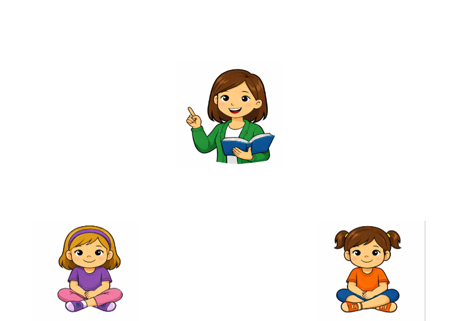

```

]

???
In our XAB task (Pre-lexical Discrimination), we tested whether bilinguals distinguish the /e/-/ɛ/ contrast using monosyllabic non-words like pem vs. pɛm, alongside filler controls like tis vs. tas. The task yielded 30 target trials and 16 fillers. To make it child-friendly, we gamified the setup: a teacher character produced a non-word, and children selected which of two prompt girls produced the sound most accurately

---
### Task 1: XAB Discrimination Performance


```{r xab_combined, echo=FALSE, out.width="100%", fig.align="center"}
library(tidyverse)
library(ragg)
library(scales)
library(showtext)

# ==============================================================================
# 1. SETUP NOTO FONT FOR UNICODE/SPECIAL CHARACTERS
# ==============================================================================
font_add_google(name = "Noto Sans", family = "Noto Sans")
showtext_auto()

# ==============================================================================
# 2. DATA PREPARATION & CLEANING (PARTICIPANT-LEVEL AGGREGATION)
# ==============================================================================
XAB_combined <- bind_rows(
  XAB_ch_full %>%
    group_by(number, trial) %>%
    summarise(accuracy = mean(key_resp.corr, na.rm = TRUE), .groups = "drop") %>%
    mutate(Group = "Children"),
  
  XAB_ad_full %>%
    group_by(number, trial) %>%
    summarise(accuracy = mean(key_resp.corr, na.rm = TRUE), .groups = "drop") %>%
    mutate(Group = "Adults")
) %>%
  mutate(
    Group = factor(Group, levels = c("Children", "Adults")),
    trial = factor(
      trial,
      levels = c("filler", "experimental"),
      labels = c("Filler", "Experimental")
    )
  )

# ==============================================================================
# 3. PUBLICATION THEME WITH NOTO SANS FONT
# ==============================================================================
theme_clean_publication <- theme_classic(base_family = "Noto Sans", base_size = 13) +
  theme(
    panel.grid.major.y = element_line(color = "grey92", linewidth = 0.4),
    strip.background = element_rect(fill = "grey95", color = NA),
    strip.text = element_text(face = "bold", size = 11, family = "Noto Sans"),
    axis.text = element_text(color = "black", size = 10, family = "Noto Sans"),
    axis.title = element_text(face = "bold", size = 11, family = "Noto Sans"),
    legend.position = "top",
    legend.title = element_text(face = "bold", size = 10, family = "Noto Sans"),
    legend.text = element_text(size = 10, family = "Noto Sans"),
    legend.background = element_rect(fill = "transparent", color = NA),
    plot.margin = margin(10, 15, 10, 10)
  )

# ==============================================================================
# 4. GROUPED BOXPLOT WITH INDIVIDUAL JITTER & MEAN DIAMONDS
# ==============================================================================
xab_combined_boxplot <- ggplot(XAB_combined, aes(x = trial, y = accuracy, fill = Group)) +
  # 50% Chance level line
  geom_hline(yintercept = 0.5, linetype = "dashed", color = "grey50", linewidth = 0.6) +
  
  # Boxplots (suppressing standard outlier dots to avoid duplication with jitter)
  geom_boxplot(
    alpha = 0.6,
    width = 0.5,
    position = position_dodge(0.6),
    outlier.shape = NA
  ) +
  
  # Mean markers (White Diamonds)
  stat_summary(
    fun = mean,
    geom = "point",
    shape = 23,
    size = 2.8,
    fill = "white",
    color = "black",
    position = position_dodge(0.6)
  ) +
  
  # Individual subject data points overlaid with dodge jitter
  geom_jitter(
    aes(color = Group),
    position = position_jitterdodge(jitter.width = 0.12, dodge.width = 0.6),
    size = 1.6,
    alpha = 0.4,
    show.legend = FALSE
  ) +
  
  # Y-axis formatted 0-100% without clipping low/high values
  scale_y_continuous(
    labels = percent_format(accuracy = 1),
    breaks = seq(0, 1, by = 0.2),
    expand = c(0, 0)
  ) +
  coord_cartesian(ylim = c(0, 1.05)) +
  
  # Color & Fill palettes matching Task 2 & Task 4 (Children: #D95F02, Adults: #7570B3)
  scale_fill_manual(values = c("Children" = "#D95F02", "Adults" = "#7570B3")) +
  scale_color_manual(values = c("Children" = "#D95F02", "Adults" = "#7570B3")) +
  
  # Labels
  labs(
    x = "Trial Type",
    y = "Accuracy (%)",
    fill = "Group:"
  ) +
  theme_clean_publication

# ==============================================================================
# 5. EXPORT HIGH-RES PLOT
# ==============================================================================
ggsave(
  "xab_combined_boxplot_noto.png",
  plot = xab_combined_boxplot,
  device = ragg::agg_png,
  width = 7.5,
  height = 5.5,
  dpi = 300
)

# Display plot
xab_combined_boxplot
#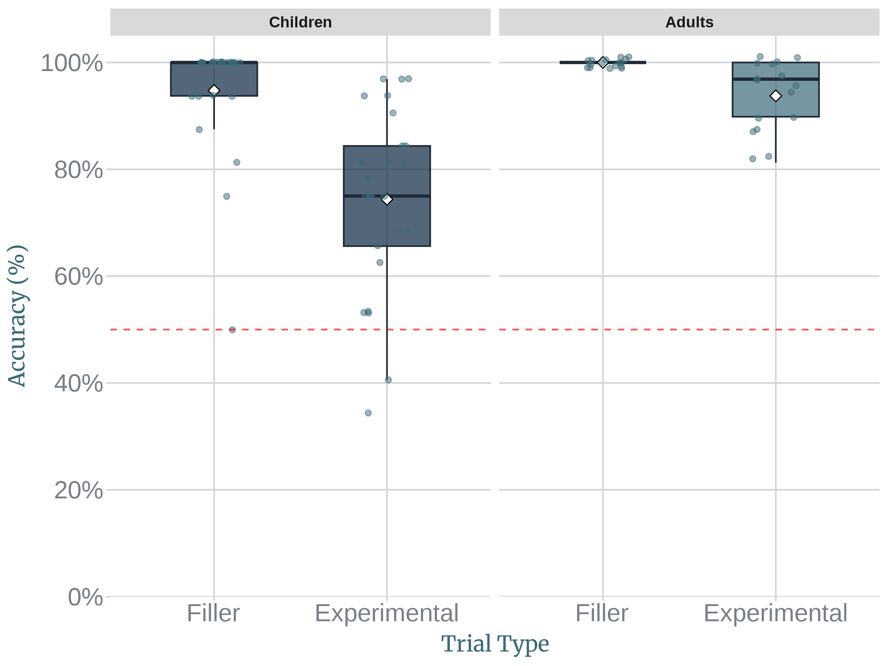
```

???

Moving on to the results for Task 1, the XAB Discrimination Task, this figure illustrates individual participant accuracy across Filler and Experimental trials for both Children—shown in orange—and Adults, in purple.Looking first at the Filler trials on the left, we observe a clear ceiling effect across both age groups. This confirms that both children and adults fully understood the task instructions and could do the task. Looking at our model for the experimental trials ($N = 1406$), we observe a significant intercept ($\beta = 1.28$, $z = 5.72$, $p < 0.001$), confirming that overall accuracy was significantly above chance. Crucially, there is a robust main effect of Group ($\beta = 1.73$, $z = 4.92$, $p < 0.001$), indicating that adults achieved significantly higher accuracy and lower individual dispersion than children, even though both groups performed above chance overall.


---
## Task: Lexical Decision Task

- Does this word sound like a word in Catalan?
- **Design:** Three conditions (canonical vowel, difficult vowel swap, easy vowel swap) using a Latin square with 3 counterbalanced lists.
- **Trials:** 
  * 24 targets
  * 48 fillers (28 words, 20 pseudowords)

.pull-left[

```{r, echo=FALSE}
library(htmltools)

tags$div(style = "display: flex; flex-direction: column; gap: 8px; margin-top: 10px;",
  tags$div(style = "background: #F8FAFC; padding: 8px 12px; border-radius: 6px; border-left: 4px solid #388E3C;",
    tags$p(tags$strong("Canonical: "), "barr[ɛ]ja", style = "margin: 0 0 4px 0; font-size: 0.85em; color: #1F2937;"),
    tags$audio(src = "barreja_canonical.wav", type = "audio/wav", controls = NA, style = "width: 100%; height: 30px;")
  ),
  tags$div(style = "background: #F8FAFC; padding: 8px 12px; border-radius: 6px; border-left: 4px solid #1976D2;",
    tags$p(tags$strong("Non-canonical easy: "), "barr[a]ja", style = "margin: 0 0 4px 0; font-size: 0.85em; color: #1F2937;"),
    tags$audio(src = "barreja_easy.wav", type = "audio/wav", controls = NA, style = "width: 100%; height: 30px;")
  ),
  tags$div(style = "background: #F8FAFC; padding: 8px 12px; border-radius: 6px; border-left: 4px solid #E65100;",
    tags$p(tags$strong("Non-canonical difficult: "), "barr[e]ja", style = "margin: 0 0 4px 0; font-size: 0.85em; color: #1F2937;"),
    tags$audio(src = "barreja_difficult.wav", type = "audio/wav", controls = NA, style = "width: 100%; height: 30px;")
  )
)
```
]

.pull-right[

```{r}
library(ggplot2)
library(dplyr)
library(patchwork)
library(showtext)

font_add_google("Noto Sans", "noto")
showtext_auto()

# 1. Target /e/ Words (x = 3 for /e/, x = 5 for /ɛ/)
e_words <- tribble(
  ~x, ~y, ~Vowel, ~Type, ~Color,
  1, 2, "/i/", "Easy Nonword\n(ocill [usiʎ])", "#1976D2",
  3, 2, "/e/", "Canonical Target\n(ocell [useʎ])", "#388E3C",
  5, 2, "/ɛ/", "Difficult Nonword\n(ocell [usɛʎ])", "#E65100"
)

# 2. Target /ɛ/ Words (aligned: x = 3 for /e/, x = 5 for /ɛ/, x = 7 for /a/)
eps_words <- tribble(
  ~x, ~y, ~Vowel, ~Type, ~Color,
  3, 2, "/e/", "Difficult Nonword\n(barreja [bə'reʒə])", "#E65100",
  5, 2, "/ɛ/", "Canonical Target\n(barreja [bə'rɛʒə])", "#388E3C",
  7, 2, "/a/", "Easy Nonword\n(barraja [bə'raʒə])", "#1976D2"
)

# Panel 1: Target /e/ Words
p1 <- ggplot(e_words, aes(x = x, y = y)) +
  geom_point(aes(color = Color), size = 20, show.legend = FALSE) +
  geom_text(aes(label = Vowel), color = "white", fontface = "bold", size = 4.8, family = "noto") +
  geom_text(aes(y = y - 0.55, label = Type), size = 3.2, fontface = "bold", color = "#1F2937", family = "noto") +
  annotate("segment", x = 2.4, xend = 1.6, y = 2, yend = 2, color = "#1976D2", arrow = arrow(length = unit(0.2, "cm")), linewidth = 0.9) +
  annotate("text", x = 2.0, y = 2.25, label = "Non-Mid Swap\n(Easy)", color = "#1976D2", fontface = "bold", size = 3.0, family = "noto") +
  annotate("segment", x = 3.6, xend = 4.4, y = 2, yend = 2, color = "#E65100", arrow = arrow(length = unit(0.2, "cm")), linewidth = 0.9) +
  annotate("text", x = 4.0, y = 2.25, label = "Mid-Vowel Swap\n(Difficult)", color = "#E65100", fontface = "bold", size = 3.0, family = "noto") +
  scale_color_identity() + scale_x_continuous(limits = c(0.2, 7.8)) + scale_y_continuous(limits = c(0.8, 2.7)) +
  labs(title = "Target /e/ Words (e.g., ocell [useʎ])") +
  theme_void(base_family = "noto") +
  theme(plot.title = element_text(face = "bold", size = 11, color = "#0A2540", hjust = 0.5, margin = margin(b = 6)))

# Panel 2: Target /ɛ/ Words
p2 <- ggplot(eps_words, aes(x = x, y = y)) +
  geom_point(aes(color = Color), size = 20, show.legend = FALSE) +
  geom_text(aes(label = Vowel), color = "white", fontface = "bold", size = 4.8, family = "noto") +
  geom_text(aes(y = y - 0.55, label = Type), size = 3.2, fontface = "bold", color = "#1F2937", family = "noto") +
  annotate("segment", x = 4.4, xend = 3.6, y = 2, yend = 2, color = "#E65100", arrow = arrow(length = unit(0.2, "cm")), linewidth = 0.9) +
  annotate("text", x = 4.0, y = 2.25, label = "Mid-Vowel Swap\n(Difficult)", color = "#E65100", fontface = "bold", size = 3.0, family = "noto") +
  annotate("segment", x = 5.6, xend = 6.4, y = 2, yend = 2, color = "#1976D2", arrow = arrow(length = unit(0.2, "cm")), linewidth = 0.9) +
  annotate("text", x = 6.0, y = 2.25, label = "Non-Mid Swap\n(Easy)", color = "#1976D2", fontface = "bold", size = 3.0, family = "noto") +
  scale_color_identity() + scale_x_continuous(limits = c(0.2, 7.8)) + scale_y_continuous(limits = c(0.8, 2.7)) +
  labs(title = "Target /ɛ/ Words (e.g., barreja [bə'rɛʒə])") +
  theme_void(base_family = "noto") +
  theme(plot.title = element_text(face = "bold", size = 11, color = "#0A2540", hjust = 0.5, margin = margin(b = 6)))

# Stack panels vertically using patchwork (p1 / p2)
p1 / p2 + plot_annotation(
  title = "Vowel Substitution",
  theme = theme(plot.title = element_text(face = "bold", size = 13, color = "#0A2540", hjust = 0.5))
)

```
]

???

In Experiment 2, we used an auditory lexical decision task to examine whether participants accept non-canonical vowel realizations in Catalan words. We manipulated three conditions: real words containing the canonical vowel, easy vowel swaps where we changed the high mid vowel for the high vowel /i/ and the low mid vowel for the low vowel /a/, and the difficult swaps where we change the canonical mid vowel for the non-canonical mid vowel. Across 24 targets and 48 fillers using a Latin square design

---

### Task 2: Lexical Decision Task Accuracy


```{r ld_combined, echo=FALSE, out.width="100%", fig.align="center"}
library(tidyverse)
library(ragg)
library(scales)
library(showtext)

# ==============================================================================
# 1. SETUP NOTO FONT FOR IPA SYMBOLS (/ɛ/, /e/)
# ==============================================================================
# Automatically downloads and registers Noto Sans for ggplot
font_add_google(name = "Noto Sans", family = "Noto Sans")
showtext_auto()

# ==============================================================================
# 2. DATA PREPARATION & CLEANING
# ==============================================================================
LD_combined <- bind_rows(
  LD_ch_full %>%
    filter(!Item_type %in% c("Word_filler", "Pseudoword"), Condition != "Same") %>%
    group_by(number, Condition, Item_type) %>%
    summarise(accuracy = mean(response_trials.corr, na.rm = TRUE), .groups = "drop") %>%
    mutate(Group = "Children"),
  
  LD_ad_full %>%
    filter(!Item_type %in% c("Word_filler", "Pseudoword"), Condition != "Same") %>%
    group_by(number, Condition, Item_type) %>%
    summarise(accuracy = mean(response_trials.corr, na.rm = TRUE), .groups = "drop") %>%
    mutate(Group = "Adults")
) %>%
  mutate(
    Group = factor(Group, levels = c("Children", "Adults")),
    Condition = factor(
      Condition, 
      levels = c("canonical", "easy", "difficult"),
      labels = c("Canonical", "Easy", "Difficult")
    ),
    Item_type = factor(
      Item_type, 
      levels = c("Open_E", "Closed_e"),
      labels = c("Open /ɛ/", "Closed /e/")
    )
  )

# ==============================================================================
# 3. COMPUTE SUMMARY STATISTICS (MEAN & 95% CONFIDENCE INTERVALS)
# ==============================================================================
LD_summary <- LD_combined %>%
  group_by(Condition, Item_type, Group) %>%
  summarise(
    n = n(),
    mean_acc = mean(accuracy, na.rm = TRUE),
    sd_acc = sd(accuracy, na.rm = TRUE),
    se_acc = sd_acc / sqrt(n),
    ci_lower = pmax(0, mean_acc - (1.96 * se_acc)), # Clamped to 0 min
    ci_upper = pmin(1, mean_acc + (1.96 * se_acc)), # Clamped to 1 max
    .groups = "drop"
  )

# ==============================================================================
# 4. PUBLICATION THEME WITH NOTO SANS FONT
# ==============================================================================
theme_clean_publication <- theme_classic(base_family = "Noto Sans", base_size = 13) +
  theme(
    panel.grid.major.y = element_line(color = "grey92", linewidth = 0.4),
    strip.background = element_rect(fill = "grey95", color = NA),
    strip.text = element_text(face = "bold", size = 11, family = "Noto Sans"),
    axis.text = element_text(color = "black", size = 10, family = "Noto Sans"),
    axis.title = element_text(face = "bold", size = 11, family = "Noto Sans"),
    legend.position = "top",
    legend.title = element_text(face = "bold", size = 10, family = "Noto Sans"),
    legend.text = element_text(size = 10, family = "Noto Sans"),
    legend.background = element_rect(fill = "transparent", color = NA),
    plot.margin = margin(10, 15, 10, 10)
  )

# ==============================================================================
# 5. POINT + LINE INTERACTION PLOT
# ==============================================================================
ld_combined_lineplot <- ggplot(LD_summary, aes(x = Condition, y = mean_acc, color = Group, group = Group)) +
  # 50% Chance level line
  geom_hline(yintercept = 0.5, linetype = "dashed", color = "grey50", linewidth = 0.6) +
  
  # Connecting lines between conditions
  geom_line(position = position_dodge(width = 0.25), linewidth = 0.9) +
  
  # Error bars (95% CI)
  geom_errorbar(
    aes(ymin = ci_lower, ymax = ci_upper),
    width = 0.12,
    position = position_dodge(width = 0.25),
    linewidth = 0.7
  ) +
  
  # Mean points
  geom_point(position = position_dodge(width = 0.25), size = 3) +
  
  # Facet by Vowel Type
  facet_wrap(~ Item_type) +
  
  # Y-axis formatted 0-100% without clipping low values in Difficult condition
  scale_y_continuous(
    labels = percent_format(accuracy = 1),
    breaks = seq(0, 1, by = 0.2),
    expand = c(0, 0)
  ) +
  coord_cartesian(ylim = c(0, 1.05)) +
  
  # Color palette (Colorblind friendly)
  scale_color_manual(values = c("Children" = "#D95F02", "Adults" = "#7570B3")) +
  
  # Labels
  labs(
    x = "Experimental Condition",
    y = "Mean Accuracy (95% CI)",
    color = "Group:"
  ) +
  theme_clean_publication

# ==============================================================================
# 6. EXPORT HIGH-RES PLOT
# ==============================================================================
ggsave(
  "ld_combined_lineplot_noto.png",
  plot = ld_combined_lineplot,
  device = ragg::agg_png,
  width = 8.5,
  height = 5.5,
  dpi = 300
)

# Display plot
ld_combined_lineplot
```


???
First, in the Canonical condition, participants were presented with correctly pronounced real words. As you can see, both children and adults perform near ceiling—hovering between 88% and 96% accuracy across both open /ɛ/ and closed /e/ words. This high performance confirms that participants know these vocabulary items and hold well-specified target entries in long-term memory.   Second, in the Easy condition, target vowels were swapped with a distant, non-mid vowel—such as replacing /ɛ/ with /a/. Here again, accuracy remains extremely high for both age groups. This tells us that participants understand the task demands and easily reject clear, unambiguous phonetic violations.   However, when we turn to the Difficult condition—where target vowels are swapped with their adjacent mid-vowel counterpart—performance drops precipitously. Accuracy plummets well below the 50% chance line, falling to roughly 8% to 25%. Rather than rejecting these mid-vowel mispronunciations, listeners routinely accept them as valid real words.   Crucially, while adults maintain slightly higher baseline accuracy overall, both adults and children display the exact same profile: strong lexical knowledge and robust non-mid rejection, paired with a shared, online tolerance for mid-vowel substitutions.  


---

## Task: Lexical Preference Task

.pull-left[

Which of the two words sound better to you?

- **Items:** 24 target words (from Lexical Decision Task)
- **Presentation:** 2 counterbalanced trial orders (AB and BA)
- **Task:** 2-Alternative Forced Choice preference

### Audio Examples

```{r, echo=FALSE}
library(htmltools)

tags$div(style = "display: flex; flex-direction: column; gap: 10px; margin-top: 10px;",
  tags$div(style = "background: #F8FAFC; padding: 10px 14px; border-radius: 6px; border-left: 4px solid #388E3C;",
    tags$p(tags$strong("Canonical: "), "barr[ɛ]ja", style = "margin: 0 0 4px 0; font-size: 0.88em; color: #1F2937;"),
    tags$audio(src = "barreja_canonical.wav", type = "audio/wav", controls = NA, style = "width: 100%; height: 32px;")
  ),
  tags$div(style = "background: #F8FAFC; padding: 10px 14px; border-radius: 6px; border-left: 4px solid #E65100;",
    tags$p(tags$strong("Non-canonical (Difficult): "), "barr[e]ja", style = "margin: 0 0 4px 0; font-size: 0.88em; color: #1F2937;"),
    tags$audio(src = "barreja_difficult.wav", type = "audio/wav", controls = NA, style = "width: 100%; height: 32px;")
  )
)

```

]

.pull-right[

```{r}

```
]

???

In the third experiment, a two-alternative forced-choice lexical preference task was conducted to determine whether participants demonstrate a systematic preference for canonical over non-canonical vowel realizations in Catalan words. On each trial, participants listened to two auditory variants of a word and indicated their preferred pronunciation.

To adapt the paradigm for children, the task was gamified: two animated female characters presented the two auditory tokens, and participants selected which character produced the Catalan word more faithfully.  The stimulus set comprised 24 target items, corresponding to the target words evaluated in the lexical decision experiment.
---
### Results Task 3: Lexical Preference Performance


```{r lp_combined, echo=FALSE, out.width="100%", fig.align="center"}
#GLMM Model:  /ɛ/ sig. lower performance compared to close /e/ (beta = -0.679, z = -4.541, p < 0.001). 
library(tidyverse)
library(ragg)
library(scales)
library(showtext)

# ==============================================================================
# 1. SETUP NOTO FONT FOR UNICODE/SPECIAL CHARACTERS
# ==============================================================================
font_add_google(name = "Noto Sans", family = "Noto Sans")
showtext_auto()

# ==============================================================================
# 2. DATA PREPARATION & CLEANING (PARTICIPANT MEANS)
# ==============================================================================
LP_combined <- bind_rows(
  LP_ch_full %>%
    group_by(number, target_vowel) %>%
    summarise(accuracy = mean(key_resp.corr, na.rm = TRUE), .groups = "drop") %>%
    mutate(Group = "Children"),
  
  LP_ad_full %>%
    group_by(number, target_vowel) %>%
    summarise(accuracy = mean(key_resp.corr, na.rm = TRUE), .groups = "drop") %>%
    mutate(Group = "Adults")
) %>%
  mutate(
    Group = factor(Group, levels = c("Children", "Adults")),
    target_vowel = factor(
      target_vowel,
      levels = c("close", "open"),
      labels = c("Close-mid (/e/)", "Open-mid (/ɛ/)")
    )
  )

# ==============================================================================
# 3. PUBLICATION THEME WITH NOTO SANS FONT
# ==============================================================================
theme_clean_publication <- theme_classic(base_family = "Noto Sans", base_size = 13) +
  theme(
    panel.grid.major.y = element_line(color = "grey92", linewidth = 0.4),
    strip.background = element_rect(fill = "grey95", color = NA),
    strip.text = element_text(face = "bold", size = 11, family = "Noto Sans"),
    axis.text = element_text(color = "black", size = 10, family = "Noto Sans"),
    axis.title = element_text(face = "bold", size = 11, family = "Noto Sans"),
    legend.position = "top",
    legend.title = element_text(face = "bold", size = 10, family = "Noto Sans"),
    legend.text = element_text(size = 10, family = "Noto Sans"),
    legend.background = element_rect(fill = "transparent", color = NA),
    plot.margin = margin(10, 15, 10, 10)
  )

# ==============================================================================
# 4. BOXPLOT WITH INDIVIDUAL PARTICIPANT POINTS
# ==============================================================================
lp_combined_boxplot <- ggplot(LP_combined, aes(x = target_vowel, y = accuracy, fill = Group)) +
  # 50% Chance level line
  geom_hline(yintercept = 0.5, linetype = "dashed", color = "grey50", linewidth = 0.6) +
  
  # Boxplot layer (outliers hidden as individual points are rendered below)
  geom_boxplot(
    position = position_dodge(width = 0.8),
    width = 0.6,
    outlier.shape = NA,
    alpha = 0.6,
    linewidth = 0.6
  ) +
  
  # Overlay individual participant data points
  geom_point(
    aes(color = Group),
    position = position_jitterdodge(jitter.width = 0.15, dodge.width = 0.8),
    alpha = 0.4,
    size = 1.8,
    show.legend = FALSE
  ) +
  
  # Y-axis formatted 0-100%
  scale_y_continuous(
    labels = percent_format(accuracy = 1),
    breaks = seq(0, 1, by = 0.2),
    expand = c(0, 0)
  ) +
  coord_cartesian(ylim = c(0, 1.05)) +
  
  # Color palettes matching other tasks
  scale_fill_manual(values = c("Children" = "#D95F02", "Adults" = "#7570B3")) +
  scale_color_manual(values = c("Children" = "#A63603", "Adults" = "#542788")) +
  
  # Labels
  labs(
    x = "Target Vowel Condition",
    y = "Participant Mean Accuracy",
    fill = "Group:"
  ) +
  theme_clean_publication

# ==============================================================================
# 5. EXPORT HIGH-RES PLOT
# ==============================================================================
ggsave(
  "lp_combined_boxplot_noto.png",
  plot = lp_combined_boxplot,
  device = ragg::agg_png,
  width = 7.5,
  height = 5.5,
  dpi = 300
)

# Display plot
```

```{r}

# Display & Save
#ggsave("lp_combined_boxplot.png", plot = lp_combined_boxplot, width = 12, height = 8, dpi = 300)

library(knitr)
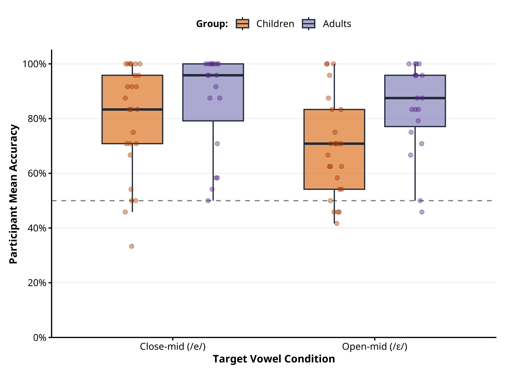
```


???

Here we have the results for the Lexical Preference task. On the $x$-axis, we see the target word condition—whether items contain the canonical close-mid vowel $/e/$ or the canonical open-mid vowel $/ɛ/$. The $y$-axis displays participant accuracy rates, with children represented in orange and adults in purple.At the group level, both children and adults perform above chance overall. However, notice the substantial individual variability specifically within the child cohort, where several children perform below the 50% chance line.Statistical modeling confirms two main effects:Effect of Group: Adults achieve significantly higher accuracy than children.Effect of Vowel Type: Words encoded with the close-mid vowel $/e/$ are processed with greater robustness than words containing the open-mid vowel $/ɛ/$.


---
## Results Task 3: Child Exposure Effects

```{r}
library(tidyverse)
library(ragg)
library(scales)
library(showtext)
library(patchwork)
library(ggeffects) # Used to extract model-predicted probabilities
# 1. Ensure subject_covariates creates the standardized z-scores
library(tidyverse)
library(ragg)
library(scales)
library(showtext)
library(patchwork)
library(ggeffects) # Used to extract model-predicted probabilities

# ==============================================================================
# 0. MERGE COVARIATES & AGGREGATE PARTICIPANT DATA
# ==============================================================================
subject_covariates <- participants_calculated %>%
  inner_join(participant_pc_scores, by = "number") %>%
  mutate(
    Age_z      = as.numeric(scale(age_in_months)),
    Exp_Home_z = as.numeric(scale(Exp_Home))
  )

# Merge covariates into the task data before grouping
LP_ch_full <- inner_join(LP_ch_clean, subject_covariates, by = "number")

# Perform grouping and create human-readable factor levels
LP_ch_summary <- LP_ch_full %>%
  dplyr::group_by(number, target_vowel, Age_z, Exp_Home_z) %>%
  summarise(accuracy = mean(key_resp.corr, na.rm = TRUE), .groups = "drop") %>%
  mutate(
    Vowel_Type = factor(
      target_vowel,
      levels = c("close", "open"),
      labels = c("Close-mid /e/", "Open-mid /ɛ/")
    )
  )

# ==============================================================================
# 1. SETUP NOTO FONT FOR IPA SYMBOLS (/e/, /ɛ/)
# ==============================================================================
font_add_google(name = "Noto Sans", family = "Noto Sans")
showtext_auto()

# ==============================================================================
# 2. GENERATE MODEL-PREDICTED EFFECTS FROM m_LP_ch
# ==============================================================================
# Fixed: terms argument changed from 'vowel_c' to 'target_vowel'
pred_age <- ggpredict(m_LP_ch, terms = c("Age_z [all]", "target_vowel")) %>%
  as_tibble() %>%
  mutate(
    Vowel_Type = factor(
      group,
      levels = c("close", "open"),
      labels = c("Close-mid /e/", "Open-mid /ɛ/")
    )
  )

pred_exp <- ggpredict(m_LP_ch, terms = c("Exp_Home_z [all]", "target_vowel")) %>%
  as_tibble() %>%
  mutate(
    Vowel_Type = factor(
      group,
      levels = c("close", "open"),
      labels = c("Close-mid /e/", "Open-mid /ɛ/")
    )
  )

# ==============================================================================
# 3. PUBLICATION THEME SETUP
# ==============================================================================
theme_covariate <- theme_classic(base_family = "Noto Sans", base_size = 12) +
  theme(
    panel.grid.major = element_line(color = "grey92", linewidth = 0.4),
    axis.text = element_text(color = "black", size = 10, family = "Noto Sans"),
    axis.title = element_text(face = "bold", size = 11, family = "Noto Sans"),
    plot.title = element_text(face = "bold", size = 12, family = "Noto Sans", hjust = 0.5),
    legend.position = "top",
    legend.title = element_text(face = "bold", size = 10, family = "Noto Sans"),
    legend.text = element_text(size = 10, family = "Noto Sans"),
    legend.background = element_rect(fill = "transparent", color = NA)
  )

# ==============================================================================
# 4. PANEL A: AGE EFFECT (MODEL PREDICTIONS + PARTICIPANT DATA)
# ==============================================================================
plot_age <- ggplot() +
  # Raw participant averages
  geom_point(
    data = LP_ch_summary,
    aes(x = Age_z, y = accuracy, color = Vowel_Type), # Fixed mapping to Vowel_Type
    size = 2.5, alpha = 0.5
  ) +
  # Model fit curve (logit-transformed prediction)
  geom_line(
    data = pred_age,
    aes(x = x, y = predicted, color = Vowel_Type), # Fixed mapping to Vowel_Type
    linewidth = 1.2
  ) +
  # Model 95% Confidence Intervals
  geom_ribbon(
    data = pred_age,
    aes(x = x, ymin = conf.low, ymax = conf.high, fill = Vowel_Type),
    alpha = 0.18
  ) +
  scale_y_continuous(
    labels = percent_format(accuracy = 1),
    limits = c(0, 1.05),
    breaks = seq(0, 1, by = 0.2),
    expand = c(0, 0)
  ) +
  scale_color_manual(values = c("Close-mid /e/" = "#2B5C8F", "Open-mid /ɛ/" = "#D95F02")) +
  scale_fill_manual(values = c("Close-mid /e/" = "#2B5C8F", "Open-mid /ɛ/" = "#D95F02")) +
  labs(
    title = "A) Model-Predicted Age Effect (p = .0001)",
    x = "Age (Standardized z-score)",
    y = "Predicted Accuracy (%)",
    color = "Target Vowel:",
    fill = "Target Vowel:"
  ) +
  theme_covariate

# ==============================================================================
# 5. PANEL B: HOME EXPOSURE EFFECT (MODEL PREDICTIONS + PARTICIPANT DATA)
# ==============================================================================
plot_exp <- ggplot() +
  # Raw participant averages
  geom_point(
    data = LP_ch_summary,
    aes(x = Exp_Home_z, y = accuracy, color = Vowel_Type), # Fixed mapping to Vowel_Type
    size = 2.5, alpha = 0.5
  ) +
  # Model fit curve (logit-transformed prediction)
  geom_line(
    data = pred_exp,
    aes(x = x, y = predicted, color = Vowel_Type), # Fixed mapping to Vowel_Type
    linewidth = 1.2
  ) +
  # Model 95% Confidence Intervals
  geom_ribbon(
    data = pred_exp,
    aes(x = x, ymin = conf.low, ymax = conf.high, fill = Vowel_Type), # Fixed mapping to Vowel_Type
    alpha = 0.18
  ) +
  scale_y_continuous(
    labels = percent_format(accuracy = 1),
    limits = c(0, 1.05),
    breaks = seq(0, 1, by = 0.2),
    expand = c(0, 0)
  ) +
  scale_color_manual(values = c("Close-mid /e/" = "#2B5C8F", "Open-mid /ɛ/" = "#D95F02")) +
  scale_fill_manual(values = c("Close-mid /e/" = "#2B5C8F", "Open-mid /ɛ/" = "#D95F02")) +
  labs(
    title = "B) Model-Predicted Home Exposure Effect (p = .0198)",
    x = "Home Exposure (Standardized z-score)",
    y = "Predicted Accuracy (%)",
    color = "Target Vowel:",
    fill = "Target Vowel:"
  ) +
  theme_covariate

# ==============================================================================
# 6. COMBINE PANELS AND EXPORT HIGH-RES PLOT
# ==============================================================================
lp_ch_covariates_plot <- plot_age + plot_exp + 
  plot_layout(guides = "collect") +
  theme(legend.position = "top")

ggsave(
  "lp_ch_model_predictions.png",
  plot = lp_ch_covariates_plot,
  device = ragg::agg_png,
  width = 9.5,
  height = 5.0,
  dpi = 300
)

# Display Plot
```

.pull-left[

```{r}
plot_age
```


]


.pull-right[

```{r}
plot_exp
```


]
---
## Results Task 3: Adult Dominance Effects


```{r, echo=FALSE}


library(tidyverse)
library(ragg)
library(scales)
library(showtext)
library(patchwork)
library(ggeffects) # Used to extract model-predicted probabilities

# ==============================================================================
# 1. SETUP NOTO FONT FOR IPA SYMBOLS (/e/, /ɛ/)
# ==============================================================================
font_add_google(name = "Noto Sans", family = "Noto Sans")
showtext_auto()

# ==============================================================================
# 2. AGGREGATE PARTICIPANT DATA FOR SCATTER POINTS
# ==============================================================================
LP_ad_summary <- LP_ad_full %>%
  group_by(number, target_vowel, Dominant) %>%
  summarise(accuracy = mean(key_resp.corr, na.rm = TRUE), .groups = "drop") %>%
  mutate(
    Vowel_Type = factor(
      target_vowel,
      levels = c("close", "open"),
      labels = c("Close-mid /e/", "Open-mid /ɛ/")
    ),
    Dominant = factor(Dominant, levels = c("Catalan", "Spanish"))
  )

# ==============================================================================
# 3. GENERATE MODEL-PREDICTED EFFECTS FROM m_LP_ad
# ==============================================================================
# Note: vowel_c is coded as -0.5 (close) and 0.5 (open)
pred_ad <- ggpredict(m_LP_ad, terms = c("Dominant", "vowel_c [-0.5, 0.5]")) %>%
  as_tibble() %>%
  mutate(
    Vowel_Type = factor(
      group,
      levels = c("-0.5", "0.5"),
      labels = c("Close-mid /e/", "Open-mid /ɛ/")
    ),
    Dominant = factor(x, levels = c("Catalan", "Spanish"))
  )

# ==============================================================================
# 4. PUBLICATION THEME SETUP
# ==============================================================================
theme_covariate <- theme_classic(base_family = "Noto Sans", base_size = 12) +
  theme(
    panel.grid.major = element_line(color = "grey92", linewidth = 0.4),
    axis.text = element_text(color = "black", size = 10, family = "Noto Sans"),
    axis.title = element_text(face = "bold", size = 11, family = "Noto Sans"),
    plot.title = element_text(face = "bold", size = 12, family = "Noto Sans", hjust = 0.5),
    legend.position = "top",
    legend.title = element_text(face = "bold", size = 10, family = "Noto Sans"),
    legend.text = element_text(size = 10, family = "Noto Sans"),
    legend.background = element_rect(fill = "transparent", color = NA)
  )

# ==============================================================================
# 5. CREATE PLOT FOR ADULT DOMINANCE EFFECT
# ==============================================================================
lp_ad_dominant_plot <- ggplot() +
  # Raw participant averages (jittered slightly horizontally)
  geom_jitter(
    data = LP_ad_summary,
    aes(x = Dominant, y = accuracy, color = Vowel_Type), # Fixed: mapped to Vowel_Type
    position = position_jitterdodge(jitter.width = 0.15, dodge.width = 0.4),
    size = 2.5,
    alpha = 0.45
  ) +
  # Model-predicted point estimate and 95% Confidence Intervals
  geom_pointrange(
    data = pred_ad,
    aes(x = Dominant, y = predicted, ymin = conf.low, ymax = conf.high, color = Vowel_Type), # Fixed: mapped to Vowel_Type
    position = position_dodge(width = 0.4),
    size = 0.8,
    linewidth = 1.1
  ) +
  scale_y_continuous(
    labels = percent_format(accuracy = 1),
    limits = c(0, 1.05),
    breaks = seq(0, 1, by = 0.2),
    expand = c(0, 0)
  ) +
  scale_color_manual(values = c("Close-mid /e/" = "#2B5C8F", "Open-mid /ɛ/" = "#D95F02")) +
  labs(
    title = "Adult Lexical Preference: Dominance Effect (p < .0001)",
    x = "Language Dominance",
    y = "Accuracy (%)",
    color = "Target Vowel:"
  ) +
  theme_covariate

# ==============================================================================
# 6. EXPORT HIGH-RES PLOT
# ==============================================================================
ggsave(
  "lp_ad_model_predictions.png",
  plot = lp_ad_dominant_plot,
  device = ragg::agg_png,
  width = 6.0,
  height = 5.0,
  dpi = 300
)

# Display Plot
lp_ad_dominant_plot

```


???

First, Lexical Decision (LD) shows no meaningful correlation with pre-lexical acoustic discrimination (XAB) in either group ($r = -0.01$ in children; $r = 0.08$ in adults). This demonstrates that individuals—whether children or adults—who reject more vowel swaps do not do so simply because they possess higher acoustic-perceptual acuity. The ability to reject mispronunciations in real words operates independently from raw perceptual sensitivity, pointing to distinct higher-level lexical and task-demand mechanisms.   Second, we observe a consistent moderate positive correlation between pre-lexical discrimination (XAB) and Lexical Preference (LP) in both children ($r = 0.52$) and adults ($r = 0.40$). This indicates that sharper acoustic distinction at the perceptual level directly supports the establishment of well-specified, canonical phonolexical targets in long-term memory across age groups.   

---

# Discussion


* **Input-driven tolerance**: High acceptance of vowel swaps in Lexical Decision coupled with above chance performance in Lexical Preference task reflects flexible online tolerance to variable community speech, rather than imprecise underlying representations. 

  - The directional asymmetry (accepting [e] for /ɛ/ targets) directly mirrors Spanish-accented input, demonstrating a parser/grammar that adapts to the variable input.
  - Caveat, our results show quite a lot of variation at th individual level.


* **Catalan home input and language dominance** directly consolidate URs against variable community speech across both mid-vowels. 

* URs develop with age (LP), but age is not a predictor of prelexical perception or input-driven tolerance.

 
- **Effects of age in lexical preference**:
While acoustic/prelexical discrimination of mid-vowels emerges early in infancy, encoding fine phonetic detail into stable, underlying lexical representations (URs) requires time and cumulative exposure.
  - LP specifically taps into established URs—which require extended time and experience to consolidate[cite: 4, 6]—whereas LD measures online perceptual tolerance.


???

Turning to our discussion on surface tolerance, coupling our lexical decision results with our lexical preference data demonstrates that the acceptance of vowel swaps—or mispronunciations—reflects online perceptual tolerance for Spanish-accented community input, rather than imprecise or "fuzzy" underlying representations in memory. Crucially, however, our data reveals substantial individual variation. In particular, children performed below chance in the lexical preference task, indicating that while these results reflect broad population trends, they do not apply identically across every individual speaker in our sample.Second, we observed a distinct directional asymmetry: speakers exhibit greater certainty regarding the phonolexical encoding of words containing the close-mid vowel $/e/$ compared to those with the open-mid vowel $/ɛ/$. This directional bias directly mirrors ambient Spanish-accented community input, where $/ɛ/$ tokens are frequently realized as $[e]$. Next, Catalan home exposure and language dominance serve to consolidate underlying representations against variable community speech. A Catalan-dominant profile combined with higher home exposure increases the cumulative probability of encountering canonical mid-vowel tokens, thereby stabilizing long-term memory targets across both $/e/$ and $/ɛ/$.Finally, our findings point toward a differential input threshold hypothesis between prelexical perception and phonolexical encoding. While prelexical acoustic discrimination can be established with lower overall input density, phonolexical target creation requires a significantly higher input threshold—demanding robust, word-by-word exposure across individual vocabulary items to fully consolidate fine-grained contrasts in long-term memory. And this is also supported by the fact that only the lexical preference task showed a significant effect of age, while prelexical perception and input-driven tolerance 


---

## Conclusions


.conclusion-card.amber[
Cooperative Parallel Co-Activation: Asymmetric contrasts (e.g., Catalan /e/–/ɛ/ vs. Spanish /e/) support parallel co-activation **without category merger** or top-down inhibition. Phonological frameworks must implement **phonologically conditioned activation levels**.
]

.conclusion-card.amber[
Surface Tolerance vs. Lexical Storage: Lexical decision taps **surface perceptual tolerance** driven by non-canonical community speech, whereas forced-choice preference tasks isolate **canonical underlying representations (URs)**. Models must incorporate dynamic weighting for non-canonical input in perceptual grammars.
]

.conclusion-card.amber[Tier-Specific Input Thresholds: Language dominance and exposure predict UR storage significantly better than pre-lexical sensitivity, **phono-lexical encoding demands higher input thresholds** than perceptual discrimination. Models must distinguish input effects across structural tiers.
]


???

To conclude, our findings offer three key insights for modeling bilingual phonetics and phonology:   Parallel Coactivation of Perceptual Grammars: Results from Study 1 demonstrate parallel coactivation of dual perceptual grammars. This occurs when a contrast is present in one language but absent in the other, avoiding direct cross-linguistic competition. This means that the the inhibitory process can be sensitive to the grammatical representation. Therefore, we believe that theoretical architectures must incorporate mechanisms that account for this coactivation.   

Our findings for study 2, comparing lexical decision with lexical preference tasks reveals that speakers exhibit tolerance to variable ambient input. First, this may mean that a standard lexical decision task alone is insufficient to reliably isolate underlying representations in bilinguals exposed to sustained variation. And our lexical preference task has been proved to be more informative to test vocalic preferences. Models of bilingual speech should thus account this flexible mapping at either level of the representation. 

Language dominance and cumulative exposure serve as stronger predictors of underlying phonolexical encoding than prelexical discrimination abilities alone. Crucially, future models must account for how differential input yields distinct effects across phonetic versus phonological levels of representation.


---
## Selected References


<div style="font-size: 0.6em; line-height: 1.2;">

.pull-left[
- **Boersma, P. (2011).** Generalizations and bidirectional phonology in Optimality Theory. *Phonology*, 28(1), 1–45.
- **Bosch, L., & Sebastián-Gallés, N. (2003).** Simultaneous bilinguals' failure to discriminate a native vowel contrast in early infancy. *Language and Speech*, 46(2-3), 217–243.
- **Casillas, J. V. (2024).** The speech production of bilingual adults. In *The Cambridge Handbook of Bilingual Phonetics and Phonology* (pp. 407–425). Cambridge University Press.
- **de Leeuw, E., & Chang, C. B. (2024).** Phonetic and phonological L1 attrition and drift in bilingual speech. In *The Cambridge Handbook of Bilingual Phonetics and Phonology* (pp. 721–745). Cambridge University Press.
- **Escudero, P., & Yazawa, K. (2024).** The Second Language Linguistic Perception (L2LP) model. In *The Cambridge Handbook of Bilingual Phonetics and Phonology* (pp. 165–188). Cambridge University Press.
- **Fikkert, P., & Freitas, M. J. (2006).** Allophony and allomorphy cue phonological acquisition: Evidence from the European Portuguese vowel system. *Catalan Journal of Linguistics*, 5, 83–108.
- **Flege, J. E., & Bohn, O. S. (2021).** The Revised Speech Learning Model (SLM-r). In *Second Language Speech Learning* (pp. 29–83). Cambridge University Press.
- **Green, D. W., & Abutalebi, J. (2013).** Language control in the bilingual brain: The Adaptive Control Hypothesis. *Journal of Cognitive Psychology*, 25(5), 515–530.
]

.pull-right[
- **Grosjean, F. (2001).** The bilingual's language modes. In *An Introduction to Bilingualism* (pp. 1–22).
- **Pallier, C., Bosch, L., & Sebastián-Gallés, N. (1997).** A limit on behavioral plasticity in speech perception in early bilinguals. *Cognition*, 64(3), B9–B17.
- **Ramón-Casas, M., Swingley, D., Sebastián-Gallés, N., & Bosch, L. (2013).** Vowels and words in early bilingual lexical acquisition. *Journal of Memory and Language*, 69(3), 312–323.
- **Repiso-Puigdelliura, G. (2025).** Development of vowel representation and sociolinguistic input tuning in Spanish-Catalan bilinguals. *Glossa: A Journal of General Linguistics*, 10(1).
- **Santos, A. L., & Freitas, M. J. (2021).** Unstressed mid-vowel reduction and lexical acquisition in European Portuguese. *Journal of Portuguese Linguistics*, 20(1).
- **Schwartz, B. D., & Sprouse, R. A. (1996).** L2 cognitive states and the Full Transfer/Full Access model. *Second Language Research*, 12(1), 40–72.
- **Sebastián-Gallés, N., Echeverría, S., & Bosch, L. (2005).** The locus of lexical interference in early bilinguals. *Journal of Memory and Language*, 52(3), 413–427.
- **Steele, J. (2024).** Acquisition of segmental phonology in adult bilingualism. In *The Cambridge Handbook of Bilingual Phonetics and Phonology* (pp. 448–470). Cambridge University Press.
- **van Leussen, J. W., & Escudero, P. (2015).** Learning to perceive and produce L2 vowels in Stochastic Optimality Theory and the Gradual Learning Algorithm. *Frontiers in Psychology*, 6, 659852.
- **Yazawa, K., & Escudero, P. (2025).** Combining phonetics and phonology in LX acquisition using current theoretical models. *Languages*, 10(1), 15.
- **Zhou, C., & Hamann, S. (2024).** Loci of cross-linguistic influence in BiPhon-HG. *Glossa: A Journal of General Linguistics*, 9(1).
]

</div>


---
class: inverse, center, middle

# Moltes gràcies! &nbsp;|&nbsp; Muito obrigada!

<p style="font-size: 1.1rem; color: #93C5FD; margin-top: -10px; font-family: 'Source Sans Pro';">
  <strong>Project Website:</strong> <a href="https://clt.uab.cat/bils/" style="color: #93C5FD; text-decoration: underline;" target="_blank">clt.uab.cat/bils</a>
</p>

<br>

<div style="max-width: 780px; margin: 0 auto; background: rgba(255, 255, 255, 0.08); border: 1px solid rgba(255, 255, 255, 0.15); padding: 1.2em 1.8em; border-radius: 4px; text-align: center;">
  <p style="margin: 0; font-size: 0.85rem; color: #E2E8F0; line-height: 1.6;">
    <strong>Acknowledgements & Research Support</strong><br>
    This research was supported by the Spanish Ministry of Science and Innovation (<em>Gobierno de España - Ministerio de Ciencia e Innovación / AEI</em>) under the BILS Project, hosted at the <strong>Centre de Lingüística Teòrica (CLT, UAB)</strong> in collaboration with <strong>Universitat Pompeu Fabra (UPF)</strong>.
  </p>
</div>

<br><br>

<!-- White Badge for Dark Logos -->
<div style="display: flex; justify-content: center; align-items: center; gap: 40px; background: #FFFFFF; padding: 12px 28px; border-radius: 4px; max-width: 720px; margin: 0 auto;">
  
  <!-- Gobierno de España Logo -->
  
  
  <!-- CLT Logo -->
  
  
  <!-- Universitat Pompeu Fabra Logo -->
  

</div>

---

```{r biphon-model, echo=FALSE, fig.width=9.5, fig.height=6.5, out.width="90%", eval = FALSE}

library(ggplot2)
library(dplyr)

# 1. Define the 5 Core Levels of Representation
levels_df <- tribble(
  ~xmin, ~xmax, ~ymin, ~ymax, ~title, ~spec, ~domain,
  2.3, 5.7, 5.2, 6.0, "Semantic Representation (SemR)", "Meaning & Morphemes", "Phonology",
  2.3, 5.7, 4.0, 4.8, "Underlying Representation (UR)", "| Abstract Phonological Word |", "Phonology",
  2.3, 5.7, 2.8, 3.6, "Surface Representation (SR)", "/ Distinctive Phonological Features /", "Phonology",
  2.3, 5.7, 1.6, 2.4, "Auditory Representation (AudR)", "[ Continuous Acoustic / Formant Space ]", "Phonetics",
  2.3, 5.7, 0.4, 1.2, "Articulatory Representation (ArtR)", "[[ Motor Gestures & Muscle Execution ]]", "Phonetics"
)

# 2. Grammar Modules / Mapping Constraints (Between Levels)
grammars_df <- tribble(
  ~x, ~y, ~label,
  4.0, 4.9, "Lexical Mapping (UR ↔ SemR)",
  4.0, 3.7, "Phonological Grammar (Faithfulness & Structural / Markedness)",
  4.0, 2.5, "Phonetic-Phonological Grammar (Cue Constraints: AudR ↔ SR)",
  4.0, 1.3, "Sensorimotor Grammar (Effort & Sensorimotor Constraints)"
)

# 3. Process Direction Flow (Comprehension vs. Production)
flow_arrows <- tribble(
  ~x, ~y, ~xend, ~yend, ~label, ~side,
  # Perception / Comprehension (Bottom-Up)
  1.5, 1.8, 1.5, 5.6, "COMPREHENSION / PERCEPTION\n(Bottom-Up Processing)", "Perception",
  # Production (Top-Down)
  6.5, 5.6, 6.5, 0.8, "PRODUCTION\n(Top-Down Processing)", "Production"
)

# Render Diagram
ggplot() +
  # Representation Blocks
  geom_rect(data = levels_df, aes(xmin = xmin, xmax = xmax, ymin = ymin, ymax = ymax, fill = domain),
            color = "grey30", linewidth = 0.7, alpha = 0.85) +
  
  # Text inside Blocks (Title + Specification)
  geom_text(data = levels_df, aes(x = (xmin + xmax) / 2, y = (ymin + ymax) / 2 + 0.12, label = title),
            fontface = "bold", size = 4, color = "white") +
  geom_text(data = levels_df, aes(x = (xmin + xmax) / 2, y = (ymin + ymax) / 2 - 0.15, label = spec),
            fontface = "italic", size = 3.2, color = "grey95") +
  
  # Grammar Mapping Labels (Between Levels)
  geom_label(data = grammars_df, aes(x = x, y = y, label = label),
             fill = "white", color = "grey20", size = 3.1, fontface = "bold",
             label.padding = unit(0.2, "lines"), border.color = "grey70") +
  
  # Vertical Directional Flow Arrows
  geom_segment(data = flow_arrows, aes(x = x, y = y, xend = xend, yend = yend, color = side),
               arrow = arrow(length = unit(0.35, "cm")), linewidth = 1.3) +
  geom_text(data = flow_arrows, aes(x = x, y = (y + yend) / 2, label = label, color = side),
            angle = ifelse(flow_arrows$side == "Perception", 90, -90),
            vjust = ifelse(flow_arrows$side == "Perception", -0.8, -0.8),
            fontface = "bold", size = 3.5) +
  
  # Auditory-Articulatory Loop (Feedback connection)
  geom_curve(aes(x = 5.7, y = 0.8, xend = 5.7, yend = 2.0),
             arrow = arrow(length = unit(0.25, "cm"), ends = "both"),
             color = "#D55E00", curvature = -0.5, linewidth = 0.8, linetype = "dashed") +
  annotate("text", x = 6.4, y = 1.4, label = "Auditory Feedback\n(Sensorimotor Loop)", 
           size = 2.8, color = "#D55E00", fontface = "italic") +

  # Color Manual Scales
  scale_fill_manual(values = c("Phonology" = "#0072B2", "Phonetics" = "#E69F00")) +
  scale_color_manual(values = c("Perception" = "#009E73", "Production" = "#D55E00")) +
  
  # Layout Settings
  scale_x_continuous(limits = c(0.5, 7.5)) +
  scale_y_continuous(limits = c(0.1, 6.5)) +
  labs(
       title = "BiPhon / L2LP"
  ) +
  theme_void(base_size = 12) +
  theme(
    plot.title = element_text(face = "bold", size = 14, margin = margin(b = 3)),
    plot.subtitle = element_text(size = 10.5, color = "grey30", margin = margin(b = 10)),
    legend.position = "none",
    plot.margin = margin(10, 10, 10, 10)
  )
```
## Modeling Early Bilingual Sound Systems

- Early-established L1 cue weights act as a perceptual filter, collapsing distinct acoustic inputs into a single phonetic category space <small>(Flege, 1995; Flege & Bohn, 2021)</small>. 

```{r slm, echo=FALSE}

#*BiPhon Implementation:In BiPhon <small>(Boersma & Hamann, 2008; Escudero & Boersma, 2004)</small>, this interaction is governed by Cue Constraints** mapping continuous Auditory Forms (\\([AudF]\\)) onto discrete Surface Forms (\\(/SF/\\)).

library(ggplot2)
library(dplyr)
library(stringr)

# Parametric ellipse coordinate generator
make_ellipse <- function(x_center, y_center, x_radius, y_radius, category, model) {
  theta <- seq(0, 2 * pi, length.out = 100)
  data.frame(
    F2 = x_center + x_radius * cos(theta),
    F1 = y_center + y_radius * sin(theta),
    Category = category,
    Model = model
  )
}

# 1. Category Assimilation: L2 /ɛ/ merged into L1 /e/ space -> Composite Diaphone
m1_assim <- make_ellipse(1850, 530, 160, 110, "Composite L1-L2 /e/", "1. Category Assimilation\n(Composite L1-L2 Diaphone)")

# 2. Equivalence Class Emergence: Goodness-of-fit difference detected
m2_l1e   <- make_ellipse(1900, 480, 110, 70, "L1 /e/", "2. Discerning Dissimilarity\n(Equivalence Class Emergence)")
m2_l2eps <- make_ellipse(1760, 620, 100, 70, "L2 /ɛ/ (Equivalence Class)", "2. Discerning Dissimilarity\n(Equivalence Class Emergence)")

# 3. New Category Formation: Distinct L2 category formed + phonetic deflection
m3_l1e   <- make_ellipse(1930, 450, 85, 55, "L1 /e/", "3. New Category Formation\n(Shared Space Deflection)")
m3_l2eps <- make_ellipse(1710, 650, 85, 55, "L2 /ɛ/", "3. New Category Formation\n(Shared Space Deflection)")

df_ellipses <- bind_rows(m1_assim, m2_l1e, m2_l2eps, m3_l1e, m3_l2eps)

# Centroid Labels
df_centers <- tribble(
  ~F2,  ~F1,  ~Label,                   ~Model,
  1850, 530, "L1-L2 [e]",               "1. Category Assimilation\n(Composite L1-L2 Diaphone)",
  1900, 480, "L1 /e/",                  "2. Discerning Dissimilarity\n(Equivalence Class Emergence)",
  1760, 620, "L2 [ɛ]?",                 "2. Discerning Dissimilarity\n(Equivalence Class Emergence)",
  1930, 450, "L1 /e/",                  "3. New Category Formation\n(Shared Space Deflection)",
  1710, 650, "L2 /ɛ/",                  "3. New Category Formation\n(Shared Space Deflection)"
)

# Reference anchors (/i/ and /a/)
df_anchors <- tribble(
  ~F2,  ~F1,  ~Label,
  2150, 320,  "/i/",
  1460, 740,  "/a/"
)

# Render Plot
slm <- ggplot() +
  # Anchor reference vowels
  geom_text(data = df_anchors, aes(x = F2, y = F1, label = Label), 
            color = "grey65", size = 5, fontface = "italic", family = "noto") +

  # Ellipse distributions
  geom_polygon(data = df_ellipses, aes(x = F2, y = F1, fill = Category, color = Category), 
               alpha = 0.35, linewidth = 0.8) +

  # Centroid text
  geom_text(data = df_centers, aes(x = F2, y = F1, label = Label), 
            color = "black", size = 4.2, fontface = "bold", family = "noto") +

  facet_wrap(~ Model) +

  # Standard Phonetic Reversed Axes
  scale_x_reverse(limits = c(2250, 1350), name = "F2 (Hz)  [<- Back  |  Front ->]") +
  scale_y_reverse(limits = c(800, 280),  name = "F1 (Hz)  [<- High  |  Low ->]") +

  scale_fill_manual(values = c("L1 /e/" = "#0072B2", "L2 /ɛ/" = "#D55E00", "L2 /ɛ/ (Equivalence Class)" = "#E69F00", "Composite L1-L2 /e/" = "#707070")) +
  scale_color_manual(values = c("L1 /e/" = "#0072B2", "L2 /ɛ/" = "#D55E00", "L2 /ɛ/ (Equivalence Class)" = "#E69F00", "Composite L1-L2 /e/" = "#333333")) +

  labs(
    title = "SLM-r Mechanisms of Cross-Linguistic Mapping & L1 Modification",
   
    caption = "Based on the Speech Learning Model (SLM / SLM-r; Flege, 1995; Flege & Bohn, 2021)"
  ) +
  theme_minimal(base_size = 12, base_family = "noto") +
  theme(
    panel.border = element_rect(color = "grey80", fill = NA, linewidth = 0.5),
    panel.grid.minor = element_blank(),
    strip.text = element_text(face = "bold", size = 10, family = "noto"),
    legend.position = "bottom"
  )

# Display plot in R Markdown
slm
#ggsave("slm.png", plot = slm, device = ragg::agg_png, width = 8, height = 6, dpi = 300)

# Method A: Display in R Markdown / Quarto / RStudio Viewer
#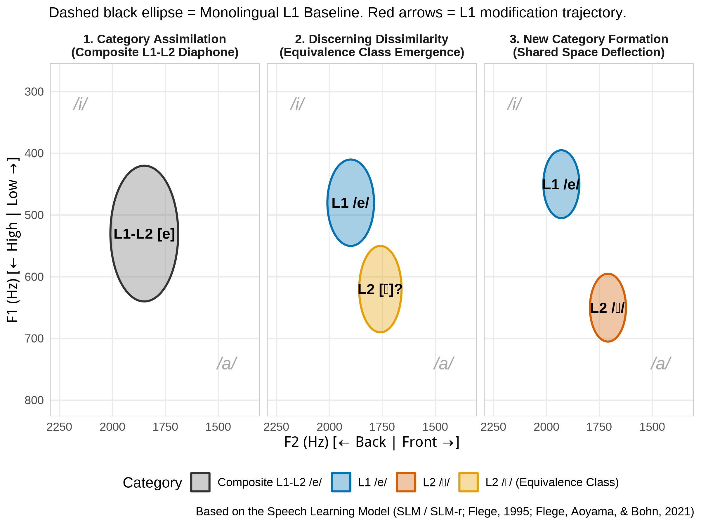


```

```{r, eval = FALSE}
library(ggplot2)
library(ggeffects)
library(patchwork)

# Custom Colors
COLOR_NAVY   <- "#0A2540"
COLOR_STEEL  <- "#3B6978"
COLOR_AMBER  <- "#D97706"
COLOR_RED    <- "#DC2626"

# Base Publication Theme with LARGE typography
theme_publication_large <- function() {
  theme_minimal(base_size = 14) +
    theme(
      panel.grid.minor = element_blank(),
      panel.border = element_rect(color = "grey80", fill = NA, linewidth = 0.6),
      plot.title = element_text(face = "bold", size = 15, color = COLOR_NAVY),
      plot.subtitle = element_text(size = 12, color = "grey30"),
      axis.title = element_text(face = "bold", size = 13),
      axis.text = element_text(size = 12, color = "black"),
      legend.title = element_text(face = "bold", size = 12),
      legend.text = element_text(size = 12),
      strip.text = element_text(face = "bold", size = 13),
      legend.position = "bottom"
    )
}

# 1. PANEL A: XAB Acoustic Discrimination
pred_xab <- ggpredict(m_XAB_ch, terms = c("Age_z [-2:2, by=0.1]", "trial", "Exp_Home_z [-1, 1]"))
pred_xab$facet <- factor(pred_xab$facet, levels = c(-1, 1), 
                         labels = c("Low Catalan Home Exp (-1 SD)", "High Catalan Home Exp (+1 SD)"))

plot_xab <- ggplot(pred_xab, aes(x = x, y = predicted, color = group, fill = group)) +
  geom_line(linewidth = 1.3) +
  geom_ribbon(aes(ymin = conf.low, ymax = conf.high), alpha = 0.15, color = NA) +
  facet_wrap(~ facet) +
  scale_color_manual(values = c("filler" = COLOR_NAVY, "experimental" = COLOR_AMBER), 
                     labels = c("filler" = "Control Filler", "experimental" = "Target /e/–/ɛ/")) +
  scale_fill_manual(values = c("filler" = COLOR_NAVY, "experimental" = COLOR_AMBER), 
                    labels = c("filler" = "Control Filler", "experimental" = "Target /e/–/ɛ/")) +
  scale_y_continuous(labels = scales::percent, limits = c(0.4, 1.0)) +
  labs(
    title = "A. Acoustic Discrimination (XAB)",
    subtitle = "Age_z × Trial (p = .0019); 3-Way Age_z × Trial × Exp_Home_z (p = .062)",
    x = "Age (z-score)", y = "Predicted Accuracy",
    color = "Trial Type", fill = "Trial Type"
  ) +
  theme_publication_large()

# 2. PANEL B: Auditory Lexical Decision
pred_ld <- ggpredict(m_LD_ch, terms = c("Condition"))

plot_ld <- ggplot(pred_ld, aes(x = x, y = predicted, fill = x)) +
  geom_col(width = 0.55, color = "black", linewidth = 0.4) +
  geom_errorbar(aes(ymin = conf.low, ymax = conf.high), width = 0.15, linewidth = 0.8) +
  scale_fill_manual(values = c("canonical" = COLOR_NAVY, "easy" = COLOR_STEEL, 
                               "mispron_e" = COLOR_AMBER, "mispron_open_e" = COLOR_RED)) +
  scale_y_continuous(labels = scales::percent, limits = c(0, 1.05)) +
  labs(
    title = "B. Auditory Lexical Decision (LD)",
    subtitle = "Difficult Mid-Vowel Swap Drop (p < .001)",
    x = "Condition", y = "Predicted Rejection Accuracy"
  ) +
  theme_publication_large() +
  theme(legend.position = "none")

# 3. PANEL C: Lexical Preference
pred_lp <- ggpredict(m_LP_ch, terms = c("Age_z [-2:2, by=0.1]", "target_vowel"))

plot_lp <- ggplot(pred_lp, aes(x = x, y = predicted, color = group, fill = group)) +
  geom_line(linewidth = 1.3) +
  geom_ribbon(aes(ymin = conf.low, ymax = conf.high), alpha = 0.15, color = NA) +
  scale_color_manual(values = c("close" = COLOR_NAVY, "open" = COLOR_STEEL), 
                     labels = c("close" = "Close-mid /e/ (β = +1.14)", "open" = "Open-mid /ɛ/ (β = +0.49)")) +
  scale_fill_manual(values = c("close" = COLOR_NAVY, "open" = COLOR_STEEL), 
                    labels = c("close" = "Close-mid /e/ (β = +1.14)", "open" = "Open-mid /ɛ/ (β = +0.49)")) +
  scale_y_continuous(labels = scales::percent, limits = c(0.4, 1.0)) +
  labs(
    title = "C. Lexical Preference (LP)",
    subtitle = "Significant Target Vowel × Age_z Interaction (p = .022)",
    x = "Age (z-score)", y = "Canonical Form Preference",
    color = "Target Vowel", fill = "Target Vowel"
  ) +
  theme_publication_large()

# 4. PANEL D: Novel Word Learning
pred_wl <- ggpredict(m_WL_ch, terms = c("trial_type", "item_type"))

plot_wl <- ggplot(pred_wl, aes(x = x, y = predicted, color = group, group = group)) +
  geom_line(linewidth = 1.2, position = position_dodge(width = 0.2)) +
  geom_point(size = 3.5, position = position_dodge(width = 0.2)) +
  geom_errorbar(aes(ymin = conf.low, ymax = conf.high), width = 0.15, 
                linewidth = 0.8, position = position_dodge(width = 0.2)) +
  scale_color_manual(values = c("control" = COLOR_NAVY, "mid" = COLOR_RED),
                     labels = c("control" = "Control Items", "mid" = "Mid-Vowel Items")) +
  scale_y_continuous(labels = scales::percent, limits = c(0.3, 1.0)) +
  labs(
    title = "D. Novel Word Learning (WL)",
    subtitle = "Significant Trial Type × Item Type Interaction (p = .0062)",
    x = "Trial Type", y = "Predicted Accuracy",
    color = "Item Type"
  ) +
  theme_publication_large()

# Combine Panels with Patchwork
combined_figure <- (plot_xab | plot_ld) / (plot_lp | plot_wl) +
  plot_annotation(
    title = "GLMM Model Interactions Across Multi-Task Battery in Child Bilinguals (N = 24)",
    subtitle = "Predicted probabilities with 95% confidence intervals from GLMM fits",
    theme = theme(
      plot.title = element_text(size = 18, face = "bold", color = COLOR_NAVY),
      plot.subtitle = element_text(size = 13, color = "grey30")
    )
  )

ggsave("ggplot_child_bilingual_interactions_large.png", combined_figure, width = 12, height = 9.5, dpi = 300)
```


# Results: 4PL Nonlinear Modeling


Perceptual categorization curves were evaluated by fitting a 4PL logistic function:

$$f(x) = a_1 + \frac{a_2 - a_1}{1 + e^{-s(x - c)}}$$

- $a_1, a_2$: Lower and upper asymptotes (constrained within $[0, 1]$).
- $c$: Crossover point (category boundary location).
- $s$: Boundary steepness/slope parameter (higher values = sharper perception).

```{r, out.width = "80%"}
library(ggplot2)

# 1. Define the 4PL Logistic Function
four_pl <- function(x, a1 = 0, a2 = 1, c = 4, s = 1.5) {
  a1 + (a2 - a1) / (1 + exp(-s * (x - c)))
}

# 2. Generate data points across a 7-step acoustic continuum
x_seq <- seq(1, 7, length.out = 300)

df_curves <- data.frame(
  Step = rep(x_seq, 3),
  Profile = factor(
    rep(c(
      "Sharp Boundary (s = 2.5, c = 4.0)",
      "Shallow Boundary (s = 0.7, c = 4.0)",
      "Shifted Boundary Group (s = 2.5, c = 4.8)"
    ), each = 300),
    levels = c(
      "Sharp Boundary (s = 2.5, c = 4.0)",
      "Shallow Boundary (s = 0.7, c = 4.0)",
      "Shifted Boundary Group (s = 2.5, c = 4.8)"
    )
  ),
  Probability = c(
    four_pl(x_seq, a1 = 0.02, a2 = 0.98, c = 4.0, s = 2.5),  # Sharp L1
    four_pl(x_seq, a1 = 0.10, a2 = 0.88, c = 4.0, s = 0.7),  # Shallow
    four_pl(x_seq, a1 = 0.02, a2 = 0.98, c = 4.8, s = 2.5)   # Shifted c
  )
)

# 3. Plot Categorization Curves
ggplot(df_curves, aes(x = Step, y = Probability, color = Profile, linetype = Profile)) +
  # Reference lines for 50% crossover and boundary locations
  geom_hline(yintercept = 0.50, linetype = "dashed", color = "grey70") +
  geom_vline(xintercept = 4.0, linetype = "dotted", color = "#0072B2", alpha = 0.7) +
  geom_vline(xintercept = 4.8, linetype = "dotted", color = "#D55E00", alpha = 0.7) +
  
  # 4PL Curves
  geom_line(linewidth = 1.2) +
  
  # Parameter annotations
  annotate("text", x = 4.1, y = 0.53, label = "c = 4.0", color = "#0072B2", hjust = 0, size = 3.5, fontface = "bold") +
  annotate("text", x = 4.9, y = 0.53, label = "c = 4.8", color = "#D55E00", hjust = 0, size = 3.5, fontface = "bold") +
  
  # Styling
  scale_color_manual(values = c("Native / Sharp Boundary (s = 2.5, c = 4.0)" = "#0072B2",
                                "Heritage / Shallow Boundary (s = 0.7, c = 4.0)" = "#009E73",
                                "Shifted Boundary Group (s = 2.5, c = 4.8)" = "#D55E00")) +
  scale_linetype_manual(values = c("solid", "longdash", "twodash")) +
  scale_x_continuous(breaks = 1:7, labels = paste0("s", 1:7)) +
  scale_y_continuous(limits = c(0, 1), labels = scales::percent) +
  labs(
    title = "4PL Logistic Fit of Perceptual Categorization",
    subtitle = "Modelling Category Boundary Location (c) and Boundary Sharpness (s)",
    x = "Acoustic Continuum Step (e.g., F1 Step 1 [e] → Step 7 [ɛ])",
    y = "Identified as Category B (%)",
    color = "Group Profile",
    linetype = "Group Profile"
  ) +
  theme_minimal(base_size = 12) +
  theme(
    plot.title = element_text(face = "bold", size = 14),
    legend.position = "bottom",
    legend.title = element_blank(),
    panel.grid.minor = element_blank()
  )
```

???
What we did to examine these results statistically is we calculated the crossover point—so where is the boundary for each speaker—and what is the boundary sharpness. To do this, we estimated floor and ceiling performance for each listener, which allowed us to mathematically isolate boundary location from boundary sharpness.


---

# Results: Crossover Point

```{r  echo=FALSE, fig.width=9.5, fig.height=6.5, out.width="100%"}
library(ggplot2)
library(dplyr)

# 1. Data preparation and factor labeling
df_plot <- df_lmer %>%
  filter(converged == TRUE) %>%
  mutate(
    Contrast_Label = case_when(
      Contrast %in% c("i_e", "i-e") ~ "/i/ – /e/ (Control Contrast)",
      Contrast %in% c("mid_low", "e_eps", "e-eps") ~ "/e/ – /ɛ/ (Target Contrast)",
      TRUE ~ as.character(Contrast)
    ),
    Mode = factor(Mode, levels = c("Catalan", "Spanish"))
  )

# 2. Render ggplot
category = ggplot(df_plot, aes(x = Dominance_Index, y = c, color = Mode, fill = Mode)) +
  # Zero-dominance boundary line (Catalan-dominant < 0 | Spanish-dominant > 0)
  geom_vline(xintercept = 0, linetype = "dashed", color = "grey60", linewidth = 0.6) +
  
  # Individual subject boundary parameter points
  geom_point(
    alpha = 0.75, 
    size = 2.8, 
    position = position_jitter(width = 1.2, height = 0, seed = 42)
  ) +
  
  # Linear trendlines with 95% confidence intervals per Mode
  geom_smooth(method = "lm", formula = y ~ x, alpha = 0.18, linewidth = 1.1) +
  
  # Facet by phonological contrast
  facet_wrap(~ Contrast_Label, scales = "free_y") +
  
  # Accessible color palette (Catalan = Blue | Spanish = Vermillion)
  scale_color_manual(values = c("Catalan" = "#0072B2", "Spanish" = "#D55E00")) +
  scale_fill_manual(values = c("Catalan" = "#0072B2", "Spanish" = "#D55E00")) +
  
  # Titles and axis formatting
  labs(
    title = "Category Boundary (c) Across Language Dominance & Mode",
    subtitle = "Tracking boundary crossover shifts across Catalan-dominant (<0) and Spanish-dominant (>0) bilinguals",
    x = "Dominance Index (BLP Score: Spanish - Catalan)",
    y = "Category Boundary Location (c Parameter)",
    color = "Language Mode",
    fill = "Language Mode",
    caption = "Calculated from 4PL logistic fits per participant. Dashed line indicates balanced dominance (0)."
  ) +
  
  # Minimal theme styling
  theme_keynote() +
  theme(
    plot.title = element_text(face = "bold", size = 14),
    plot.subtitle = element_text(color = "grey35", size = 11, margin = margin(b = 10)),
    strip.text = element_text(face = "bold", size = 11),
    strip.background = element_rect(fill = "grey95", color = NA),
    panel.grid.minor = element_blank(),
    panel.border = element_rect(color = "grey85", fill = NA, linewidth = 0.6),
    legend.position = "bottom",
    legend.title = element_text(face = "bold")
  )


ggsave("category.png", plot = category, device = ragg::agg_png, width = 8, height = 6, dpi = 300)
category
#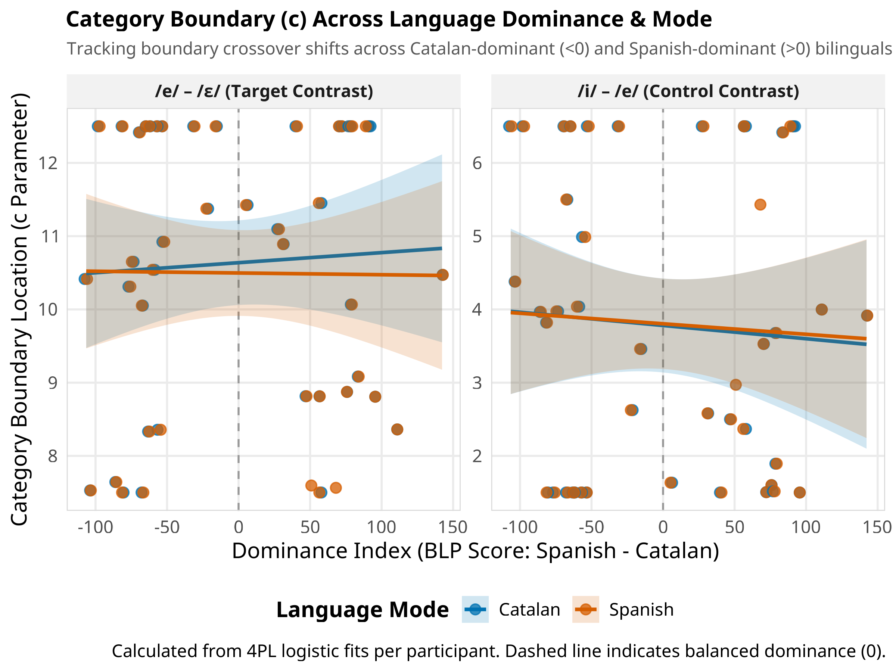

```

???
We will first look at the category boundary location. Linear mixed-effects modeling revealed that boundary position remained completely stable across language modes. So, when we compare the position across the steps, operating in Spanish mode did not shift the perceptual boundary, neither for /e/–/ɛ/ (which is the target contrast) nor /i/–/e/ (which is the control contrast).


---

# Results: Boundary Sharpness

Category boundary sharpness was significantly shallower for the target /e/–/ɛ/ contrast compared to the baseline /i/–/e/ contrast (b = -3.80, p < .001).

```{r, out.width="80%"}
slope_wide <- results_4pl_contrast %>%
  filter(converged == TRUE) %>%
  pivot_wider(id_cols = Participant, names_from = Contrast, values_from = s, names_prefix = "slope_") %>%
  mutate(diff_slope = slope_mid_low - slope_i_e) %>%
  drop_na(diff_slope)

slope_plot = ggplot(slope_wide, aes(x = reorder(Participant, diff_slope), y = diff_slope)) +
  geom_col(aes(fill = diff_slope > 0), show.legend = FALSE) +
  geom_hline(yintercept = 0, linetype = "dashed", color = "black", linewidth = 0.8) +
  coord_flip() +
  scale_fill_manual(values = c("TRUE" = "#0072B2", "FALSE" = "#D55E00")) +
  labs(
    title = "Individual Slope Differences (/e/–/ɛ/ minus /i/–/e/)",
    subtitle = "Positive = steeper for /e/–/ɛ/ | Negative = steeper for /i/–/e/",
    x = "Participant", y = "Difference in Slope (s)"
  ) +
  theme_keynote() +
  theme(axis.text.y = element_blank())


ggsave("slope_plot.png", plot = slope_plot, device = ragg::agg_png, width = 8, height = 6, dpi = 300)
slope_plot
#


```
???
What about boundary sharpness? What you see in this graph is an individual-level breakdown of slope differences, calculated by subtracting the slope of the curve between /i/–/e/ from /e/–/ɛ/. The central dashed line represents zero, meaning identical boundary steepness for both contrasts. Notice how the plot is overwhelmingly dominated by orange bars extending to the left. This shows that bilinguals in our sample maintain a much sharper categorical transition for the shared /i/–/e/ baseline than for the mid-vowel contrast. Crucially, when we examine these individual slopes across language modes, operating in a Spanish context does not flatten or attenuate this boundary steepness.


---
## Task: Novel Word Learning Task

.pull-left[

- **Training Structure:** 8 learning blocks pairing **8 novel words** with unfamiliar objects.
- **Presentation Conditions:**
  * **Minimal Pair:** `/pemu/` – `/pɛmu/` 
  * **Non-Minimal Pair:** `/tisu/` – `/pɛmu/` 
  * **Control Pair:** `/tisu/` – `/tasu/` 


```{r, echo=FALSE}
library(htmltools)

tags$div(style = "display: flex; flex-direction: column; gap: 8px; margin-top: 10px;",
  tags$div(style = "background: #F8FAFC; padding: 8px 12px; border-radius: 6px; border-left: 4px solid #388E3C;",
    tags$p(tags$strong("Target [e]: "), "/pemu/", style = "margin: 0 0 4px 0; font-size: 0.85em; color: #1F2937;"),
    tags$audio(src = "pemu_1.wav", type = "audio/wav", controls = NA, style = "width: 100%; height: 30px;")
  ),
  tags$div(style = "background: #F8FAFC; padding: 8px 12px; border-radius: 6px; border-left: 4px solid #E65100;",
    tags$p(tags$strong("Target [ɛ]: "), "/pɛmu/", style = "margin: 0 0 4px 0; font-size: 0.85em; color: #1F2937;"),
    tags$audio(src = "peemu_2.wav", type = "audio/wav", controls = NA, style = "width: 100%; height: 30px;")
  )
)
```
]

.pull-right[
```{r , echo=FALSE, out.width="100%", fig.align="center"}
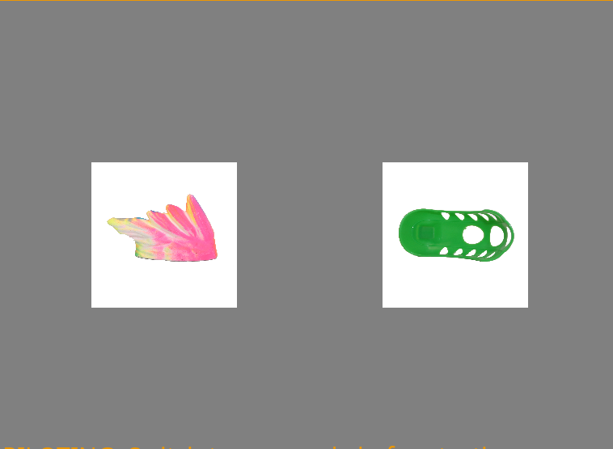
```


```{r}
library(ggplot2)
library(tibble)
library(showtext)

font_add_google("Noto Sans", "noto")
showtext_auto()

# 3 Condition Types Data
conditions_df <- tribble(
  ~y, ~w1, ~w2, ~title, ~desc, ~color, ~fill,
  3, "/pemu/", "/pɛmu/", "Minimal Pair", "Critical L2 Target (/e/–/ɛ/)", "#EA580C", "#FFF7ED",
  2, "/tisu/", "/pɛmu/", "Non-Minimal Pair", "Distinct Consonants & Vowels", "#9333EA", "#FAF5FF",
  1, "/tisu/", "/tasu/", "Control Pair", "Salient Control Contrast (/i/–/a/)", "#2563EB", "#EFF6FF"
)

ggplot(conditions_df) +
  # Word Box 1
  geom_tile(aes(x = 1.0, y = y), width = 0.85, height = 0.65, fill = "#F8FAFC", color = "#0A2540", linewidth = 0.7) +
  geom_text(aes(x = 1.0, y = y, label = w1), fontface = "bold", size = 3.6, color = "#0A2540", family = "noto") +
  
  # "VS" Connector
  geom_text(aes(x = 1.7, y = y), label = "vs", fontface = "bold.italic", size = 3.0, color = "#64748B", family = "noto") +
  
  # Word Box 2
  geom_tile(aes(x = 2.4, y = y), width = 0.85, height = 0.65, fill = "#F8FAFC", color = "#0A2540", linewidth = 0.7) +
  geom_text(aes(x = 2.4, y = y, label = w2), fontface = "bold", size = 3.6, color = "#0A2540", family = "noto") +
  
  # Condition Badge Box
  geom_tile(aes(x = 4.2, y = y, fill = fill, color = color), width = 2.2, height = 0.72, linewidth = 0.8, show.legend = FALSE) +
  geom_text(aes(x = 4.2, y = y + 0.12, label = title, color = color), fontface = "bold", size = 3.4, family = "noto") +
  geom_text(aes(x = 4.2, y = y - 0.14, label = desc), size = 2.4, color = "#475569", family = "noto") +
  
  scale_fill_identity() +
  scale_color_identity() +
  scale_x_continuous(limits = c(0.4, 5.5)) +
  scale_y_continuous(limits = c(0.4, 3.6)) +
  theme_void(base_family = "noto") +
  theme(plot.margin = margin(2, 2, 2, 2))
```
]

???

Finally, in Experiment 4, we evaluated novel word learning by pairing eight auditory pseudo-words with unfamiliar visual objects. Participants received immediate visual feedback on each trial. Visual pairings spanned three conditions: target minimal pairs (pemo / pɛmo), control minimal pairs (tisu / tasu), and non-minimal pairs (tisu / pemo)


Visual pairings are manipulated across three conditions:

Target Minimal Pair Condition: Objects with labels contrasting solely on Catalan mid-vowels (e.g., /pemu/ vs. /pɛmu/).

Control Minimal Pair Condition: Objects with labels contrasting on salient high/low vowels (e.g., /tisu/ vs. /tasu/).

Non-Minimal Pair Condition: Objects with phonologically distinct labels (e.g., /tisu/ vs. /pɛmu/).

Two Levels of Word Learning & Analytical Insights
Learning in this task operates on two distinct levels:

Coarse-Grained Mapping: Learning that a word form matches a specific visual referent rather than a phonologically distant distractor (e.g., distinguishing /pemu/ from /tisu/). Both children and adults master coarse mapping rapidly within a few blocks, performing well above chance.

Fine-Grained Phonological Encoding: Building robust representations capable of resolving minimal pair competition (distinguishing /pemu/ from /pɛmu/).

---

### Task 4: Novel Word Learning Task

```{r}

# ==============================================================================
# Task 4: 2-Cutoff Boxplot with Individual Participant Points (Slide 2)
# Levels: item_type = c("mid", "filler")
# ==============================================================================

library(tidyverse)
library(scales)
library(showtext)

# 1. SETUP NOTO FONT
font_add_google(name = "Noto Sans", family = "Noto Sans")
showtext_auto()

# 2. DATA PREPARATION (PARTICIPANT MEANS ACROSS BOTH CUTOFFS)
WL_c1 <- WL_all_full %>%
  filter(block >= 3) %>%
  mutate(Cutoff = "Blocks 3–8")

WL_c2 <- WL_all_full %>%
  filter(block >= 6) %>%
  mutate(Cutoff = "Blocks 6–8")

WL_two_cutoffs <- bind_rows(WL_c1, WL_c2) %>%
  mutate(
    Cutoff = factor(Cutoff, levels = c("Blocks 3–8", "Blocks 6–8")),
    Group = factor(Group, levels = c("Children", "Adults")),
    trial_type = factor(
      trial_type,
      levels = c("minimal", "nonminimal"),
      labels = c("Minimal Pair", "Non-minimal Pair")
    ),
    item_type = factor(
      item_type,
      levels = c("mid", "filler"),
      labels = c("Target (/e/–/ɛ/)", "Control (/i/–/a/)")
    )
  ) %>%
  group_by(number, Cutoff, Group, trial_type, item_type) %>%
  summarise(accuracy = mean(correct, na.rm = TRUE), .groups = "drop")

# 3. FACETED BOXPLOT (2 CUTOFFS x 2 GROUPS)
p2_cutoff_boxplot <- ggplot(
  WL_two_cutoffs, 
  aes(x = item_type, y = accuracy, fill = trial_type)
) +
  geom_hline(yintercept = 0.5, linetype = "dashed", color = "grey50", linewidth = 0.6) +
  geom_boxplot(
    position = position_dodge(width = 0.8),
    width = 0.6,
    outlier.shape = NA,
    alpha = 0.6,
    linewidth = 0.6
  ) +
  geom_point(
    aes(color = trial_type),
    position = position_jitterdodge(jitter.width = 0.15, dodge.width = 0.8),
    alpha = 0.35,
    size = 1.4,
    show.legend = FALSE
  ) +
  facet_grid(Cutoff ~ Group) +
  scale_y_continuous(labels = percent_format(accuracy = 1), breaks = seq(0, 1, by = 0.2)) +
  coord_cartesian(ylim = c(0, 1.05)) +
  scale_fill_manual(values = c("Minimal Pair" = "#D95F02", "Non-minimal Pair" = "#7570B3")) +
  scale_color_manual(values = c("Minimal Pair" = "#A63603", "Non-minimal Pair" = "#542788")) +
  labs(
    x = "Vowel Contrast Type (Item Type)",
    y = "Participant Mean Accuracy",
    fill = "Trial Type:"
  ) +
  theme_classic(base_family = "Noto Sans", base_size = 12) +
  theme(
    panel.grid.major.y = element_line(color = "grey92", linewidth = 0.4),
    strip.background = element_rect(fill = "grey95", color = NA),
    strip.text = element_text(face = "bold", size = 11, family = "Noto Sans"),
    axis.text = element_text(color = "black", size = 9.5, family = "Noto Sans"),
    axis.title = element_text(face = "bold", size = 10.5, family = "Noto Sans"),
    legend.position = "top",
    legend.title = element_text(face = "bold", size = 10, family = "Noto Sans"),
    legend.text = element_text(size = 9.5, family = "Noto Sans"),
    plot.margin = margin(10, 15, 10, 10)
  )

print(p2_cutoff_boxplot)
```


???

X-Axis (Item Type): Displays the vowel contrast type, comparing the Target L2 Contrast ($/\text{e}/ - /\varepsilon/$, mid) against the Control Contrast ($/\text{i}/ - /\text{a}/$, filler).   Y-Axis (Accuracy): Shows mean accuracy, with a 50% dashed reference line representing chance performance.   Color Coding (Trial Type): Distinguishes between Minimal Pairs (e.g., /pemu/ vs. /pɛmu/) and Non-minimal Pairs (e.g., /tisu/ vs. /pɛmu/).   Facets: Compares performance across age groups (Children vs. Adults).


Looking at the broader learning trajectories across Blocks 3 through 8, we observe a striking divergence between adults and children.In the initial training blocks, adult accuracy on target mid-vowel minimal pairs averaged around 60 to 65%. However, as exposure accumulated, performance improved systematically, reaching approximately 75% in the final asymptotic blocks. This demonstrates that adults successfully leveraged extended practice to establish sharp, fine-grained mid-vowel representations within newly formed lexical entries.   For the children, however, the pattern is fundamentally different.   Crucially, control conditions confirm that this difficulty is not attributable to task artifact or general learning fatigue. When mapping coarse-grained contrasts—such as non-minimal pairs or control vowel distinctions—children performed near ceiling, demonstrating full task comprehension and robust word-object mapping capabilities.   The bottleneck occurs specifically on target mid-vowel minimal pairs (pemu vs. pɛmu). Across all blocks, child accuracy remained persistently at the 50% chance baseline, showing no significant acquisition curve over time.   These findings indicate that while adults can recruit extended exposure to construct fine-grained phonological specifications from scratch, child learners face a distinct developmental constraint when attempting to encode subtle mid-vowel contrasts into novel lexical representations on the fly. 


---
## Correlation across tasks

```{r, warning = FALSE, message = FALSE}
library(tidyverse)
library(patchwork)
library(ragg)
library(showtext)

# ==============================================================================
# 1. SETUP NOTO FONT
# ==============================================================================
font_add_google(name = "Noto Sans", family = "Noto Sans")
showtext_auto()

# ==============================================================================
# 2. HELPER FUNCTION TO GENERATE UPPER-TRIANGULAR CORRELATION HEATMAPS
# ==============================================================================
plot_cor_heatmap <- function(data_subset, title_label) {
  # Tasks order
  task_vars <- c("XAB", "LD", "LP", "WL")
  
  # Compute Pearson correlation matrix
  cor_mat <- cor(data_subset[, task_vars], use = "pairwise.complete.obs")
  
  # Mask lower triangle for clean upper-triangular display
  cor_mat[lower.tri(cor_mat)] <- NA
  
  # Convert to tidy long format
  df_cor <- as.data.frame(cor_mat) %>%
    rownames_to_column(var = "Var1") %>%
    pivot_longer(-Var1, names_to = "Var2", values_to = "r") %>%
    filter(!is.na(r)) %>%
    mutate(
      Var1 = factor(Var1, levels = task_vars),
      Var2 = factor(Var2, levels = rev(task_vars)) # Reverse y-axis for standard matrix layout
    )
  
  # Heatmap Plot
  ggplot(df_cor, aes(x = Var1, y = Var2, fill = r)) +
    # White background grid lines between tiles
    geom_tile(color = "white", linewidth = 1.5) +
    
    # Correlation value labels
    geom_text(
      aes(
        label = sprintf("%.2f", r),
        color = abs(r) > 0.55 # Dynamic text contrast (white text on dark background)
      ),
      family = "Noto Sans",
      fontface = "bold",
      size = 4.2
    ) +
    
    # Diverging color scale (-1 to +1)
    scale_fill_gradient2(
      low = "#2B5C8F",      # Deep blue for negative correlations
      mid = "#F7F7F7",      # Neutral grey-white for 0
      high = "#D95F02",     # Orange-red for positive correlations
      limits = c(-1, 1),
      breaks = seq(-1, 1, by = 0.5),
      name = "Pearson r: "
    ) +
    
    # Text contrast color manual scale
    scale_color_manual(values = c("TRUE" = "white", "FALSE" = "black"), guide = "none") +
    
    # Panel Title & Axis Formatting
    labs(
      title = title_label,
      x = NULL,
      y = NULL
    ) +
    coord_fixed() + # Ensure square cells
    theme_minimal(base_family = "Noto Sans", base_size = 13) +
    theme(
      plot.title = element_text(face = "bold", size = 14, family = "Noto Sans", hjust = 0.5, margin = margin(b = 10)),
      axis.text = element_text(face = "bold", size = 11, color = "black", family = "Noto Sans"),
      panel.grid = element_blank(),
      legend.position = "bottom",
      legend.title = element_text(face = "bold", size = 11, family = "Noto Sans"),
      legend.text = element_text(size = 10, family = "Noto Sans"),
      legend.key.width = unit(1.8, "cm"),
      legend.key.height = unit(0.4, "cm"),
      plot.margin = margin(10, 15, 10, 15)
    )
}

# ==============================================================================
# 3. GENERATE INDIVIDUAL GROUP PLOTS
# ==============================================================================
perf_children <- task_performance %>% filter(Group == "Children")
perf_adults   <- task_performance %>% filter(Group == "Adults")

plot_cor_ch <- plot_cor_heatmap(perf_children, "A) Children")
plot_cor_ad <- plot_cor_heatmap(perf_adults,   "B) Adults")

# ==============================================================================
# 4. COMBINE WITH PATCHWORK AND EXPORT HIGH-RES GRAPHIC
# ==============================================================================
cor_combined_plot <- plot_cor_ch + plot_cor_ad +
  plot_layout(guides = "collect") +
  theme(
    legend.position = "bottom",
    legend.margin = margin(t = 12)
  )

# Export with roomier aspect ratio to prevent compression
ggsave(
  "cross_task_correlations_noto.png",
  plot = cor_combined_plot,
  device = ragg::agg_png,
  width = 10.5,
  height = 6.0,
  dpi = 300
)

# Display Plot
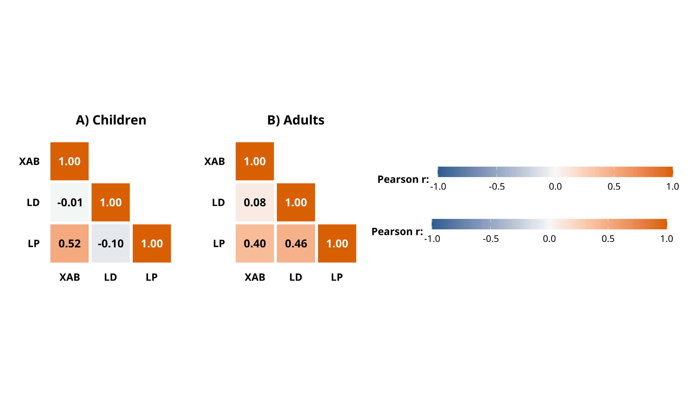

```

???

Crucially, our cross-task correlation analysis reveals a striking developmental dissociation:In adults, stored phonolexical fidelity—measured in Lexical Preference—strongly predicts novel word learning performance ($r = .816, p < .001$). Adults directly leverage the precision of their existing lexical targets as structural templates when encoding new vocabulary.In children, however, this correlation drops to zero ($r = .075$, non-significant). Even though bilingual children possess well-specified representations for familiar words, that memory precision does not automatically guarantee successful novel word encoding. This proves that directly coupling stored phonolexical targets to the dynamic process of building new words is an emergent developmental milestone that matures between childhood and adulthood.

---
# Group variables
```{r}
library(dplyr)
library(knitr)
library(stringr)

# 1. Process Adult Profile Summary
adult_profile_summary <- responses_adults_clean %>%
  distinct(Participant, .keep_all = TRUE) %>%
  mutate(
    Age_Years = suppressWarnings(as.numeric(str_extract(as.character(Edat), "\\d+")))
  ) %>%
  summarise(
    Cohort = "Adults",
    `N (Total)` = n(),
    `Age Mean (SD)` = paste0(round(mean(Age_Years, na.rm = TRUE), 1), " (", round(sd(Age_Years, na.rm = TRUE), 1), " yrs)"),
    `Key Language Metric` = "Categorical Dominance (Catalan-vs-Spanish)"
  )

# 2. Process Child Profile Summary
child_profile_summary <- subject_covariates %>%
  distinct(number, .keep_all = TRUE) %>%
  summarise(
    Cohort = "Children",
    `N (Total)` = n(),
    `Age Mean (SD)` = paste0(round(mean(age_in_months, na.rm = TRUE), 1), " (", round(sd(age_in_months, na.rm = TRUE), 1), " mos)"),
    `Key Language Metric` = paste0("Home Catalan Exp: ", round(mean(Exp_Home, na.rm = TRUE), 1), "% (SD = ", round(sd(Exp_Home, na.rm = TRUE), 1), "%)")
  )

# 3. Combine into HTML/Markdown Table
summary_table <- bind_rows(adult_profile_summary, child_profile_summary)
knitr::kable(summary_table, align = "lccc", caption = "Participant Cohort Profile Summary")
```


```{r}
library(ggplot2)
library(scales)

# Visualizing Child Catalan Home Exposure (Exp_Home)
ggplot(subject_covariates, aes(x = Exp_Home)) +
  geom_histogram(binwidth = 10, fill = "#0072B2", color = "white", alpha = 0.8) +
  geom_vline(xintercept = 50, linetype = "dashed", color = "red", linewidth = 0.8) +
  scale_x_continuous(breaks = seq(0, 100, 20), labels = function(x) paste0(x, "%")) +
  labs(
    title = "Distribution of Relative Catalan Home Exposure in Children",
    x = "Relative Catalan Home Exposure (%)",
    y = "Participant Count"
  ) +
  theme_minimal(base_size = 12)
```

