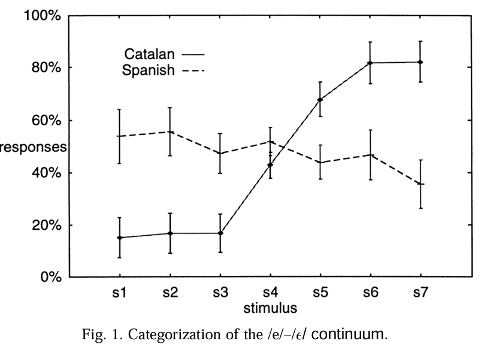
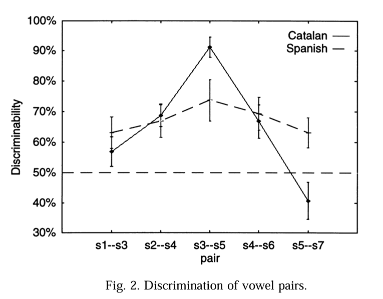
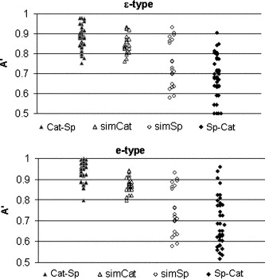
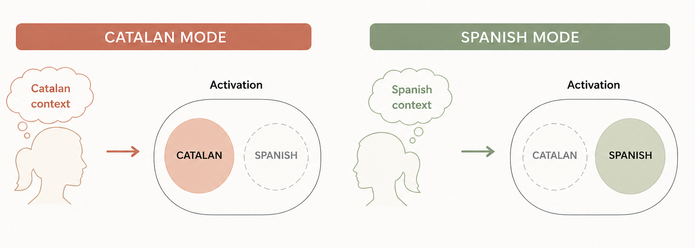
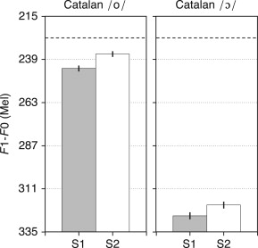
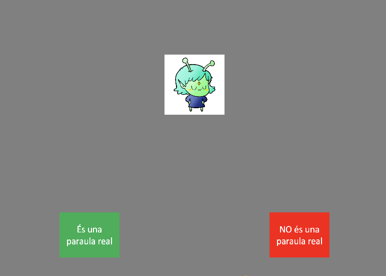

```{r setup-knitr, include=FALSE}
knitr::opts_chunk$set(
  echo = FALSE,
  warning = FALSE,
  message = FALSE,
  dev = "svg",         # Renders as crisp vector graphics
  fig.width = 7,       # Aspect ratio width
  fig.height = 4.2,    # Aspect ratio height
  out.width = "100%",  # Stretches plot to fit slide/column width
  dpi = 300            # Fallback high resolution
)


```


```{css, echo = FALSE, eval = FALSE}

.center2 {
  margin: 0;
  position: absolute;
  top: 50%;
  left: 50%;
  -ms-transform: translate(-50%, -50%);
  transform: translate(-50%, -50%);
}

.regression table {
  font-size: 12px;     
}

.caption {
  font-size: .6rem;
}

.center-text {
  text-align: center;
  font-size: 7rem;
}

@media print {
  body, html, .remark-slides-area, .remark-notes-area {
    height: 100% !important;
    width: 100% !important;
    overflow: visible;
    display: inline-block;
  }
    
  p1 { 
    color: red; 
    top: 15cm !important; 
    position: relative !important; 
    left: 1cm !important;
  }
}
```

```{r xaringan-themer, include=FALSE, warning=FALSE}
library(xaringanthemer)

style_duo(
  # Palette: Oxford Navy & Slate Steel (Formal / Academic)
  primary_color   = "#0A2540", # Oxford Navy
  secondary_color = "#3B6978", # Muted Slate Steel
  text_color      = "#1F2937", # High-contrast Dark Charcoal
  background_color = "#FFFFFF", # Crisp Pure White
  
  # Typography: Classical Academic Serif Headers paired with Clean Professional Body
  header_font_google = google_font("Merriweather", "700"),
  text_font_google   = google_font("Source Sans Pro", "400", "400i", "700"),
  code_font_google   = google_font("Source Code Pro", "400"),
  
  # Sizing & Hierarchical Ratios
  text_font_size      = "1.0rem",
  header_h1_font_size = "2.2rem",
  header_h2_font_size = "1.6rem",
  header_h3_font_size = "1.25rem",
  
  # Custom CSS for Professional Structure
  extra_css = list(
    ".remark-slide-content" = list(
      "padding"     = "2.5em 4em 2.5em 4em",
      "line-height" = "1.6"
    ),
    "blockquote" = list(
      "border-left"   = "4px solid #0A2540",
      "background"    = "#F3F4F6",
      "padding"       = "0.8em 1.2em",
      "border-radius" = "0px", # Sharp lines look more formal than rounded edges
      "font-style"    = "italic",
      "color"         = "#374151"
    ),
    ".inverse" = list(
      "background-color" = "#0A2540",
      "color"            = "#FFFFFF"
    ),
    ".inverse h1, .inverse h2, .inverse h3" = list(
      "color" = "#FFFFFF"
    )
  )
)

```


---


class: inverse, center, middle

# Act I: Adaptive bilingual systems

---

## Bilingual Grammars

* While the two grammars of early bilingual speakers **develop largely independently**, they also **influence each other** throughout life in both childhood and adulthood.
* This interaction often results in **crosslinguistic transfer patterns**, where speakers apply features or structures from one language when using the other.


---

## What is the result of crosslinguistic transfer?


Divergence from monolingual norms have been interpreted traditionally as evidence of "incomplete acquisition," "attrition," or "fuzzy internal representations." It assumes the bilingual cognitive architecture ideal is rigid.

> **From individual to community:**  
> In cases of societal bilingualism (e.g., Catalan and Spanish in Catalonia), individual-level transfer can accumulate over time, driving language variation at the community level $\rightarrow$ variable input for early bilinguals.


---


## The Catalan Vowel System


* For **bilingual speakers of Spanish and Catalan**:
  * Spanish has only one mid-front (/e/) and one mid-back (/o/)
  * Leads to **variable input**: *gall[ɛ]da* vs. *gall[e]da*


```{r vowel-space-scheme, fig.height=2, fig.width=4, echo=FALSE, message=FALSE, warning=FALSE}
library(ggplot2)
library(dplyr)
library(ragg)
# 1. Coordinate data points (Recasens & Espinosa, 2006)
library(dplyr)
library(ggplot2)
library(ragg)

# 1. Coordinate data points (Recasens & Espinosa, 2006)
catalan_vowels <- data.frame(
  vowel = c("i", "e", "ɛ", "a", "ɔ", "o", "u", "ə"),
  F1 = c(320, 480, 660, 740, 710, 540, 390, 560),
  F2 = c(2150, 1900, 1740, 1460, 1170, 1000, 900, 1400),
  sys = "Catalan"
)

spanish_vowels <- data.frame(
  vowel = c("i", "e", "a", "o", "u"),
  F1 = c(320, 560, 730, 490, 370),
  F2 = c(2130, 1820, 1400, 1060, 930),
  sys = "Spanish"
)

# Polygon paths (perimeter ordering)
cat_poly <- catalan_vowels %>% filter(vowel != "ə") %>% slice(c(1:7, 1))
sp_poly  <- spanish_vowels %>% slice(c(1:5, 1))

# 2. Render schematic plot
p = ggplot() +
  # Polygon boundaries
  geom_path(data = cat_poly, aes(x = F2, y = F1), color = "#005f73", linewidth = 1.2, linetype = "solid") +
  geom_path(data = sp_poly, aes(x = F2, y = F1), color = "#ca6702", linewidth = 1.2, linetype = "dashed") +
  
  # Catalan Vowel Labels (Increased size from 6.5 to 8.5)
  geom_text(data = catalan_vowels, aes(x = F2, y = F1, label = vowel), 
            color = "#005f73", fontface = "bold", size = 20) +
  
  # Spanish Vowel Labels (Increased size from 4.5 to 6.0 and adjusted offset)
  geom_text(data = spanish_vowels, aes(x = F2 - 45, y = F1 + 20, label = vowel), 
            color = "#ca6702", fontface = "bold", size = 20) +
  
  # Phonetic standard reversed axes (High/Front at top-left)
  scale_x_reverse(limits = c(2250, 850), name = "F2 (Hz)  [← Back  |  Front →]") +
  scale_y_reverse(limits = c(800, 280), name = "F1 (Hz)  [← High  |  Low →]") +
  
  labs(
    subtitle = "Solid line = Catalan | Dashed line = Spanish",
    caption = "Adapted from Recasens & Espinosa (2006)"
  ) +
  theme_minimal(base_size = 13) +
  theme(
    plot.title = element_text(face = "bold", size = 15),
    panel.grid.minor = element_blank(),
    panel.border = element_rect(color = "grey80", fill = NA, linewidth = 0.5)
  )
ggsave("catalan_spanish_vowels.png", plot = p, device = ragg::agg_png, width = 8, height = 6, dpi = 300)

# Method A: Display in R Markdown / Quarto / RStudio Viewer
knitr::include_graphics("catalan_spanish_vowels.png")


```


???

* The **Catalan stressed vowel system** includes seven vowels: /i e ɛ a ɔ o u/, contrasting:
  * High-mid: /e, o/
  * Low-mid: /ɛ, ɔ/
* The **lexical distribution** of these mid vowels varies across dialects.

---

## Phonetic systems

```{r}
library(ggplot2)
library(dplyr)

# 1. Processing Modules (Core L2 Pipeline + L1 Transfer Sources)
modules <- tribble(
  ~xmin, ~xmax, ~ymin, ~ymax, ~label, ~system,
  # L2 Architecture Modules
  2.2, 4.2, 5.0, 6.0, "1. Lexical Level\n(Phonological Word)", "L2 Pipeline",
  2.2, 4.2, 3.0, 4.0, "2. Perceptual Level\n(Acoustic-to-Category)", "L2 Pipeline",
  2.2, 4.2, 1.0, 2.0, "3. Gestural Level\n(Category-to-Motor)", "L2 Pipeline",
  
  # L1 Transfer Sources
  0.2, 1.4, 5.0, 6.0, "L1 Lexical\nRepresentations", "L1 Source",
  0.2, 1.4, 3.0, 4.0, "L1 Perceptual\nCategories", "L1 Source",
  0.2, 1.4, 1.0, 2.0, "L1 Motor / Gestural\nHabits", "L1 Source"
)

# 2. Vertical Processing Arrows (Feed-forward / Feed-backward)
vertical_arrows <- tribble(
  ~x, ~y, ~xend, ~yend,
  3.2, 4.0, 3.2, 5.0,  # Perception to Lexicon
  3.2, 3.0, 3.2, 2.0   # Category to Gestures
)

# 3. Horizontal Transfer Arrows (L1 Interception Points)
transfer_arrows <- tribble(
  ~x, ~y, ~xend, ~yend, ~label,
  1.4, 5.5, 2.2, 5.5, "Mismapping at the lexical level",
  1.4, 3.5, 2.2, 3.5, "Changes in the phonetic categories",
  1.4, 1.5, 2.2, 1.5, "Transfer of gestural implementation"
)

# 4. Text Annotations for Locus Descriptions
locus_descriptions <- tribble(
  ~x, ~y, ~text,
  4.4, 5.5, "• Mis-mapped underlying phonemes\n• Cross-linguistic lexical leakage",
  4.4, 3.5, "• Altered acoustic boundaries\n• Perceptual category shift",
  4.4, 1.5, "• Non-native VOT / target values\n• Sub-phonemic articulatory drift"
)

# Render Plot
ggplot() +
  # Draw Modules
  geom_rect(data = modules, aes(xmin = xmin, xmax = xmax, ymin = ymin, ymax = ymax, fill = system),
            color = "grey30", linewidth = 0.6, alpha = 0.85) +
  
  # Module Text Labels
  geom_text(data = modules, aes(x = (xmin + xmax) / 2, y = (ymin + ymax) / 2, label = label),
            fontface = "bold", size = 3.8, color = "white") +
  
  # Vertical Internal Flow Arrows
  geom_segment(data = vertical_arrows, aes(x = x, y = y, xend = xend, yend = yend),
               arrow = arrow(length = unit(0.25, "cm"), ends = "both"),
               color = "grey40", linewidth = 0.9) +
  
  # Horizontal Transfer Arrows
  geom_segment(data = transfer_arrows, aes(x = x, y = y, xend = xend, yend = yend),
               arrow = arrow(length = unit(0.3, "cm")), color = "#D55E00", linewidth = 1.2) +
  
  # Transfer Arrow Text Labels
  geom_text(data = transfer_arrows, aes(x = (x + xend) / 2, y = y + 0.25, label = label),
            color = "#D55E00", fontface = "bold", size = 3.5) +
  
  # Locus Description Bullet Points
  geom_text(data = locus_descriptions, aes(x = x, y = y, label = text),
            hjust = 0, size = 3.3, color = "grey20", lineheight = 0.95) +
  
  # Color Palette
  scale_fill_manual(values = c("L2 Pipeline" = "#0072B2", "L1 Source" = "#56B4E9")) +
  
  # Axis & Plot Formatting
  scale_x_continuous(limits = c(0, 7.5)) +
  scale_y_continuous(limits = c(0.5, 6.8)) +
  labs(
    title = "Loci of Transfer in Bilingual Phonological Systems",
    subtitle = "Adaptation of Natvig's (2019) tripartite framework of cross-linguistic interaction"
  ) +
  theme_void(base_size = 12) +
  theme(
    plot.title = element_text(face = "bold", size = 14, margin = margin(b = 4)),
    plot.subtitle = element_text(size = 11, color = "grey30", margin = margin(b = 12)),
    legend.position = "none",
    plot.margin = margin(10, 10, 10, 10)
  )
```


???
Where could transfer occur in the phonetic systems? (Natvig, 2019)


- It could occur at the phonetic-perceptual level of representation (perception)

- It could occur when mapping phonetic categories to gestures (production)

- It could occur at the level of the lexical representation (mapping of phonemes at the level of the phonological word)


- It could occur at the perceptual level: cue-weightings that are influenced by the Spanish grammar, and associate a low-mid vowel to a high mid vowel, Spanish cue-weightings are active when examining Catalan cue-weightings

- 

---
### Transfer at the lexical level


---

### Transfer in the phonetic categories

```{r biphon-model, echo=FALSE, fig.width=9.5, fig.height=6.5, out.width="100%"}

library(ggplot2)
library(dplyr)

# 1. Define the 5 Core Levels of Representation
levels_df <- tribble(
  ~xmin, ~xmax, ~ymin, ~ymax, ~title, ~spec, ~domain,
  2.3, 5.7, 5.2, 6.0, "Semantic Representation (SemR)", "Meaning & Morphemes", "Phonology",
  2.3, 5.7, 4.0, 4.8, "Underlying Representation (UR)", "| Abstract Phonological Word |", "Phonology",
  2.3, 5.7, 2.8, 3.6, "Surface Representation (SR)", "/ Distinctive Phonological Features /", "Phonology",
  2.3, 5.7, 1.6, 2.4, "Auditory Representation (AudR)", "[ Continuous Acoustic / Formant Space ]", "Phonetics",
  2.3, 5.7, 0.4, 1.2, "Articulatory Representation (ArtR)", "[ Motor Gestures & Muscle Execution ]", "Phonetics"
)

# 2. Grammar Modules / Mapping Constraints (Between Levels)
grammars_df <- tribble(
  ~x, ~y, ~label,
  4.0, 4.9, "Lexical Mapping (UR ↔ SemR)",
  4.0, 3.7, "Phonological Grammar (Faithfulness & Structural / Markedness)",
  4.0, 2.5, "Phonetic-Phonological Grammar (Cue Constraints: AudR ↔ SR)",
  4.0, 1.3, "Sensorimotor Grammar (Effort & Sensorimotor Constraints)"
)

# 3. Process Direction Flow (Comprehension vs. Production)
flow_arrows <- tribble(
  ~x, ~y, ~xend, ~yend, ~label, ~side,
  # Perception / Comprehension (Bottom-Up)
  1.5, 1.8, 1.5, 5.6, "COMPREHENSION / PERCEPTION\n(Bottom-Up Processing)", "Perception",
  # Production (Top-Down)
  6.5, 5.6, 6.5, 0.8, "PRODUCTION\n(Top-Down Processing)", "Production"
)

# Render Diagram
ggplot() +
  # Representation Blocks
  geom_rect(data = levels_df, aes(xmin = xmin, xmax = xmax, ymin = ymin, ymax = ymax, fill = domain),
            color = "grey30", linewidth = 0.7, alpha = 0.85) +
  
  # Text inside Blocks (Title + Specification)
  geom_text(data = levels_df, aes(x = (xmin + xmax) / 2, y = (ymin + ymax) / 2 + 0.12, label = title),
            fontface = "bold", size = 4, color = "white") +
  geom_text(data = levels_df, aes(x = (xmin + xmax) / 2, y = (ymin + ymax) / 2 - 0.15, label = spec),
            fontface = "italic", size = 3.2, color = "grey95") +
  
  # Grammar Mapping Labels (Between Levels)
  geom_label(data = grammars_df, aes(x = x, y = y, label = label),
             fill = "white", color = "grey20", size = 3.1, fontface = "bold",
             label.padding = unit(0.2, "lines"), border.color = "grey70") +
  
  # Vertical Directional Flow Arrows
  geom_segment(data = flow_arrows, aes(x = x, y = y, xend = xend, yend = yend, color = side),
               arrow = arrow(length = unit(0.35, "cm")), linewidth = 1.3) +
  geom_text(data = flow_arrows, aes(x = x, y = (y + yend) / 2, label = label, color = side),
            angle = ifelse(flow_arrows$side == "Perception", 90, -90),
            vjust = ifelse(flow_arrows$side == "Perception", -0.8, -0.8),
            fontface = "bold", size = 3.5) +
  
  # Auditory-Articulatory Loop (Feedback connection)
  geom_curve(aes(x = 5.7, y = 0.8, xend = 5.7, yend = 2.0),
             arrow = arrow(length = unit(0.25, "cm"), ends = "both"),
             color = "#D55E00", curvature = -0.5, linewidth = 0.8, linetype = "dashed") +
  annotate("text", x = 6.4, y = 1.4, label = "Auditory Feedback\n(Sensorimotor Loop)", 
           size = 2.8, color = "#D55E00", fontface = "italic") +

  # Color Manual Scales
  scale_fill_manual(values = c("Phonology" = "#0072B2", "Phonetics" = "#E69F00")) +
  scale_color_manual(values = c("Perception" = "#009E73", "Production" = "#D55E00")) +
  
  # Layout Settings
  scale_x_continuous(limits = c(0.5, 7.5)) +
  scale_y_continuous(limits = c(0.1, 6.5)) +
  labs(
    title = "The Bidirectional Phonology and Phonetics Model (BiPhon)",
    subtitle = "Adaptation of Boersma & Hamann's multi-level OT architecture for speech perception and production"
  ) +
  theme_void(base_size = 12) +
  theme(
    plot.title = element_text(face = "bold", size = 14, margin = margin(b = 3)),
    plot.subtitle = element_text(size = 10.5, color = "grey30", margin = margin(b = 10)),
    legend.position = "none",
    plot.margin = margin(10, 10, 10, 10)
  )
```

```{r}
library(ggplot2)
library(dplyr)

# 1. Processing Modules (Core BiPhon Auditory-Motor Pipeline)
modules <- tribble(
  ~xmin, ~xmax, ~ymin, ~ymax, ~label,
  1.5, 4.0, 7.0, 8.0, "|Underlying Form|\n(Lexical Storage)",
  1.5, 4.0, 5.0, 6.0, "/Surface Form/\n(Phonological Categories)",
  1.5, 4.0, 3.0, 4.0, "[Auditory Form]\n(Perceptual Input)",
  1.5, 4.0, 1.0, 2.0, "[[Articulatory Form]]\n(Motor Execution)"
)

# 2. Vertical Internal Flow Arrows (Bidirectional)
vertical_arrows <- tribble(
  ~x, ~y, ~xend, ~yend,
  2.75, 6.0, 2.75, 7.0,  # SF <-> UF (Recognition / Phonological Implementation)
  2.75, 4.0, 2.75, 5.0,  # AudF <-> SF (Perception / Phonetic Implementation)
  2.75, 2.0, 2.75, 3.0   # ArtF <-> AudF (Articulation / Sensorimotor)
)

# 3. Loci of Cross-Linguistic Influence (CLI)
transfer_arrows <- tribble(
  ~x, ~y, ~xend, ~yend, ~label,
  4.0, 3.5, 4.8, 3.5, "Locus 1: Auditory Cue Constraints",
  4.0, 5.5, 4.8, 5.5, "Locus 2: Structural / Phonotactic Constraints",
  4.0, 1.5, 4.8, 1.5, "Locus 3: Articulatory Motor Complexity"
)

# 4. Text Annotations for Locus Descriptions
locus_descriptions <- tribble(
  ~x, ~y, ~text,
  4.9, 3.5, "• L1 acoustic cue weighting (spectral F3 vs. closure duration)\n• Drives L2-to-L1 category mapping & individual variability",
  4.9, 5.5, "• L1 syllable-structure restrictions (e.g., ManPhono)\n• Forces position-dependent repairs (e.g. illusory schwa /lə/ in coda)",
  4.9, 1.5, "• Physical difficulty of tongue-tip tap & coarticulation\n• Causes tap deletion in production despite accurate perception"
)

# Render Plot
ggplot() +
  # Draw Modules
  geom_rect(data = modules, aes(xmin = xmin, xmax = xmax, ymin = ymin, ymax = ymax),
            fill = "#0072B2", color = "#1C3D5A", linewidth = 0.6, alpha = 0.9) +
  
  # Module Text Labels
  geom_text(data = modules, aes(x = (xmin + xmax) / 2, y = (ymin + ymax) / 2, label = label),
            fontface = "bold", size = 3.8, color = "white") +
  
  # Vertical Bidirectional Flow Arrows
  geom_segment(data = vertical_arrows, aes(x = x, y = y, xend = xend, yend = yend),
               arrow = arrow(length = unit(0.25, "cm"), ends = "both"),
               color = "grey40", linewidth = 0.9) +
  
  # Horizontal Transfer / Loci Arrows
  geom_segment(data = transfer_arrows, aes(x = x, y = y, xend = xend, yend = yend),
               arrow = arrow(length = unit(0.3, "cm")), color = "#D55E00", linewidth = 1.2) +
  
  # Transfer Arrow Text Labels
  geom_text(data = transfer_arrows, aes(x = xend + 0.1, y = y + 0.22, label = label),
            color = "#D55E00", fontface = "bold", size = 3.5, hjust = 0) +
  
  # Locus Description Bullet Points
  geom_text(data = locus_descriptions, aes(x = x, y = y - 0.15, label = text),
            hjust = 0, vjust = 1, size = 3.2, color = "grey20", lineheight = 0.95) +
  
  # Axis & Plot Formatting
  scale_x_continuous(limits = c(0.5, 9.8)) +
  scale_y_continuous(limits = c(0.2, 8.8)) +
  labs(
    title = "Loci of Cross-Linguistic Influence in BiPhon-HG (Auditory-Motor Core)",
    subtitle = "Core architecture without orthographic/reading grammar (adapted from Zhou & Hamann, 2024)"
  ) +
  theme_void(base_size = 12) +
  theme(
    plot.title = element_text(face = "bold", size = 14, margin = margin(b = 4)),
    plot.subtitle = element_text(size = 10.5, color = "grey30", margin = margin(b = 12)),
    legend.position = "none",
    plot.margin = margin(10, 10, 10, 10)
  )
```


---

### Transfer in the gestural implementation


```{r vowel-space-models, echo=FALSE, fig.width=9.5, fig.height=4.2, out.width="100%"}
library(ggplot2)
library(dplyr)
library(stringr)

# Parametric ellipse coordinate generator
make_ellipse <- function(x_center, y_center, x_radius, y_radius, category, model) {
  theta <- seq(0, 2 * pi, length.out = 100)
  data.frame(
    F2 = x_center + x_radius * cos(theta),
    F1 = y_center + y_radius * sin(theta),
    Category = category,
    Model = model
  )
}

# 1. Structural Merger: Single collapsed ellipse
m1_ellipse <- make_ellipse(1820, 570, 160, 120, "/e/ - /ɛ/ Merged", "1. Structural Merger\n(Pallier et al., 1997)")

# 2. Asymmetric Access: Two distinct tight categories
m2_e   <- make_ellipse(1900, 480, 80, 50, "/e/", "2. Asymmetric Access\n(Sebastián-Gallés et al., 2005)")
m2_eps <- make_ellipse(1740, 660, 80, 50, "/ɛ/", "2. Asymmetric Access\n(Sebastián-Gallés et al., 2005)")

# 3. Adaptive Flexibility: Two broader, overlapping/gradient categories
m3_e   <- make_ellipse(1900, 480, 130, 95, "/e/", "3. Adaptive Flexibility\n(Simonet, 2014; Amengual, 2016)")
m3_eps <- make_ellipse(1740, 660, 130, 95, "/ɛ/", "3. Adaptive Flexibility\n(Simonet, 2014; Amengual, 2016)")

df_ellipses <- bind_rows(m1_ellipse, m2_e, m2_eps, m3_e, m3_eps)

# Centroid Labels
df_centers <- tribble(
  ~F2,  ~F1,  ~Label,   ~Model,
  1820, 570, "/e, ɛ/", "1. Structural Merger\n(Pallier et al., 1997)",
  1900, 480, "/e/",    "2. Asymmetric Access\n(Sebastián-Gallés et al., 2005)",
  1740, 660, "/ɛ/",    "2. Asymmetric Access\n(Sebastián-Gallés et al., 2005)",
  1900, 480, "/e/",    "3. Adaptive Flexibility\n(Simonet, 2014; Amengual, 2016)",
  1740, 660, "/ɛ/",    "3. Adaptive Flexibility\n(Simonet, 2014; Amengual, 2016)"
)

# Reference anchors (/i/ and /a/)
df_anchors <- tribble(
  ~F2,  ~F1,  ~Label,
  2150, 320,  "/i/",
  1460, 740,  "/a/"
)

# Render Plot
ggplot() +
  # Anchor reference vowels
  geom_text(data = df_anchors, aes(x = F2, y = F1, label = Label), color = "grey65", size = 5, fontface = "italic") +
  
  # Ellipse distributions
  geom_polygon(data = df_ellipses, aes(x = F2, y = F1, fill = Category, color = Category), alpha = 0.35, linewidth = 0.8) +
  
  # Centroid text
  geom_text(data = df_centers, aes(x = F2, y = F1, label = Label), color = "black", size = 4.5, fontface = "bold") +
  
  # Directional arrow for Asymmetric Access (leakage from /ɛ/ into /e/)
  geom_segment(data = filter(df_centers, str_detect(Model, "Asymmetric") & Label == "/ɛ/"),
               aes(x = 1750, y = 610, xend = 1870, yend = 520),
               arrow = arrow(length = unit(0.25, "cm")), color = "#D55E00", linewidth = 1) +
  
  facet_wrap(~ Model) +
  
  # Standard Phonetic Reversed Axes
  scale_x_reverse(limits = c(2250, 1350), name = "F2 (Hz) [← Back | Front →]") +
  scale_y_reverse(limits = c(800, 280),  name = "F1 (Hz) [← High | Low →]") +
  
  scale_fill_manual(values = c("/e/" = "#0072B2", "/ɛ/" = "#D55E00", "/e/ - /ɛ/ Merged" = "#707070")) +
  scale_color_manual(values = c("/e/" = "#0072B2", "/ɛ/" = "#D55E00", "/e/ - /ɛ/ Merged" = "#333333")) +
  
  labs(
    title = "Hypothesized Catalan Mid-Front Vowel Space Across Accounts",
    subtitle = "Acoustic representation of /e/ vs. /ɛ/ in early bilinguals"
  ) +
  theme_minimal(base_size = 12) +
  theme(
    panel.border = element_rect(color = "grey80", fill = NA, linewidth = 0.5),
    panel.grid.minor = element_blank(),
    strip.text = element_text(face = "bold", size = 9.5),
    legend.position = "bottom"
  )

```

---

## Perception: The Categorization Gap

> **The Question:** Do Spanish-Catalan bilinguals build sharp category boundaries?

.pull-left[
### Identification (Pallier et al., 1997)

* **Catalan-Dominant:**  
  Sharp, categorical boundary separating $/e/$ and $/\varepsilon/$.

* **Spanish-Dominant:**  
  Near chance-level categorization across the continuum.

* **Traditional Diagnosis:**  
  $\rightarrow$ *Incomplete or "fuzzy" underlying phonological categories.*
]

.pull-right[

<p style="font-size: 0.75em; text-align: center; color: gray;">/e/–/ɛ/ Identification Curves (Pallier et al., 1997)</p>
]

---

## Perception: Acoustic Discrimination

> **The Question:** Do Spanish-Catalan bilinguals build sharp category boundaries?

.pull-left[
### AX Discrimination (Pallier et al., 1997)

  Catalan-dominant listeners show a sharp discrimination peak at the boundary.

  Spanish-dominant listeners exhibit flat discrimination across the whole continuum.

* **The Assumption:**  
  $\rightarrow$ *Early, continuous exposure sets the hard ceiling on perceptual acuity.*
  
    *  **Auditory Form [AudF] $\rightarrow$ Surface Form /SF/** mapping issue.
  * Driven by **L1 Cue Constraints** (`[F1/F2] ➔ /e/`) weighting out competing L2 constraints.
    * Discrimination relies on mapping continuous acoustic input **[AudF]** to abstract categories **/SF/** via weighted **Cue Constraints**.
  * For Spanish-dominant listeners, the L1 cue weight for single-category mapping `/e/` dominates.
]

.pull-right[

]

---

## Lexical Access: Asymmetric Tolerance

> **The Question:** How do non-canonical realizations impact word recognition?

.pull-left[
### Lexical Decision (Sebastián-Gallés et al., 2005)

* **The Pattern:**  
  High acceptance of mispronounced forms:
  * *gall[ɛ]da* (canonical) $\rightarrow$ **Accepted**
  * *gall[e]da* (accented) $\rightarrow$ **Also Accepted!**

  * **Deficit View:** Fuzzy lexical representations.
  * **Adaptation View:** Functional tolerance for Spanish-accented input.
> High acceptance of *gall[e]da* reflects an adaptive **Bilingual Mode** strategy—relaxing phonetic boundaries to process noisy, Spanish-accented input efficiently.

]

.pull-right[

]


## Language mode and bilingual perception

* Bilinguals draw on **two perceptual grammars** and sensitivity to language-specific contrasts fluctuates with **language mode**: the activation level of Catalan and Spanish at a given time (Grosjean, 1998).

<div align="center">
  
</div>

> **Why does it matter?**  
> If there is greater acuity in the contrast in Catalan language mode than in Spanish language mode, this suggests that perceptual grammars are selectively activated depending on the linguistic context.

---

## Language mode and bilingual perception

Language context shapes bilingual perception and production (Elman, 1977; Garcia-Sierra et al., 2009; Gonzales et al., 2013; Simonet, 2014; Escudero et al., 2009).

> **Simonet (2014)**  
> Majorcan Catalan–Spanish bilinguals: production and perception of /o/–/ɔ/ in unilingual and bilingual modes.

.pull-left[
**Dominance effects**

* **Catalan-dominant bilinguals**: near-ceiling discrimination (>90%)
* **Spanish-dominant bilinguals**: reduced discrimination (~70%), smaller acoustic contrast, but still two categories
]

.pull-right[
**Language mode effects**

<div align="center">
  
  <p style="font-size: 0.7em; color: gray;">Dominance effects in /o/–/ɔ/ discrimination.</p>
</div>
]


## Overview of Llompart's Research Program

> **Core Research Question:** How do second-language (L2) learners represent, update, and access challenging non-native sound contrasts in their mental lexicon? [2, 3]

.pull-left[
### Key Theoretical Insights
* **Beyond Sublexical Perception:** Accuracy in sound identification does not automatically guarantee accurate word recognition [4, 5].
* **Multimodal & Attentional Drivers:** Articulatory cues and minimal-pair exposure direct selective attention to challenging contrasts [6, 7].
* **Individual Differences:** Receptive vocabulary size and phonetic categorization skills predict lexical encoding success [8].
]

.pull-right[
### Methodological Paradigms
* **Visual-World Eye-Tracking:** Tracking real-time gaze fixations to measure target recognition and competitor dynamics [1, 6, 7].
* **Nonword Rejection & Lexical Decision:** Assessing the precision of phonolexical entries [1, 9].
* **Symmetrical Task Comparisons:** Comparing vowel identification (VI) directly against Word-Picture Matching (WPM) [4].
]

---

## Articulatory Knowledge in Lexical Encoding

> **Llompart & Reinisch (2017)** — *Journal of Experimental Psychology: Human Perception and Performance* [6]

.pull-left[
### Experimental Design
* German learners of English trained on novel words containing the difficult $/ɛ/-/æ/$ contrast (e.g., *tenzer*–*tandek*) [6].
* **Training Conditions:**
  1. *Audio-Only* (Baseline) [6]
  2. *Passive Audiovisual* (Video of speaker's articulation) [6]
  3. *Active Production* (Word repetition during training) [6]
]

.pull-right[
### Findings & Implications
* **Audio-Only Group:** Failed to establish distinct fixations between $/ɛ/$ and $/æ/$ targets [6].
* **Audiovisual & Repetition Groups:** Showed asymmetric target fixation patterns mirroring native speaker word recognition [6].
* **Conclusion:** Visual articulatory information and motor production habits both help encode challenging foreign vowel contrasts into novel lexical representations [6].
]

---

## Minimal Pairs & Selective Attention

> **Llompart & Reinisch (2020)** — *Journal of Experimental Psychology: Learning, Memory, and Cognition* [7, 10]

.pull-left[
### Minimal vs. Non-Minimal Pairs
* Investigated whether word phonological form modulates contrast encoding during word-picture learning [7].
* **Minimal-Pair Condition:** Words differed *only* by the critical vowel (e.g., *tendek*–*tandek*) [1, 7].
* **Non-Minimal Pair Condition:** Words differed by the critical vowel *plus* second-syllable details (e.g., *tenzer*–*tandek*) [1, 7].
]

.pull-right[
### Key Findings
* Eye-tracking revealed successful lexical separation of $/ɛ/$ and $/æ/$ **only** when trained on minimal pairs that appeared together [7].
* Non-minimal pairs failed to promote lexical contrast encoding [7].
* **Takeaway:** Co-occurrence of minimal pairs highlights subtle phonetic differences that learners would otherwise ignore [7].
]

---

## Plasticity & Rapid Lexical Updating

> **Llompart & Reinisch (2021)** — *Journal of Phonetics* [1, 11]

.pull-left[
### Updating Early Representations
* Tested whether newly formed L2 lexical representations can be rapidly updated upon encountering new input [1].
* **Experiment 1:** Exposed learners to native English input [1].
* **Experiment 2:** Exposed learners to mixed native + L2-accented input [1].
]

.pull-right[
### Key Findings
* Early L2 lexical representations remain highly plastic and update rapidly in early word learning [1].
* Exposure to **L2-accented input** constrains lexical updating, leading to broader acceptance of mispronounced forms [1].
* Demonstrates that input variability directly shapes the precision of long-term lexical storage [1].
]

---

## Individual Predictors of Lexical Encoding

> **Llompart (2021b)** — *Bilingualism: Language and Cognition* [8, 12]  
> **Llompart (2021a)** — *Frontiers in Psychology* [9, 13]

.pull-left[
### Categorization & Vocabulary Size (2021b)
* Tested German advanced and intermediate learners on English $/ɛ/-/æ/$ [8, 14].
* **Two Key Predictors:**
  1. *Phonetic Categorization Ability:* Sharper perceptual boundaries predicted more target-like lexical encoding [8].
  2. *Receptive Vocabulary Size:* Larger vocabulary size independently facilitated accurate lexical encoding [8].
]

.pull-right[
### Lexical & Acoustic Effects (2021a)
* Examined nonword rejection accuracy for mispronounced L2 forms [1, 9].
* Phonolexical encoding precision is strongly modulated by:
  * **Lexical Frequency** [9]
  * **Phonological Neighborhood Density** [9]
  * **Vowel Acoustic Distance** [9]
]

---

## Disconnect: Sound Identification vs. Word Recognition

> **Llompart, Gorba, & Prieto (2025)** — *Studies in Second Language Acquisition* [4, 15]

.pull-left[
### Methodological Symmetrical Test
* Re-examined Catalan/Spanish learners of English on two vowel contrasts:
  * $/i/-/ɪ/$ (Difficult contrast) [4]
  * $/ɛ/-/æ/$ (Easy contrast) [4]
* Compared **Vowel Identification (VI)** directly with **Word-Picture Matching (WPM)** using identical minimal pairs [4].
]

.pull-right[
### Findings & Implications
* Learners scored **substantially higher** in sound identification (VI) than in word recognition (WPM) for $/i/-/ɪ/$ [4].
* Individual scores across tasks were only weakly correlated [4].
* **Conclusion:** High accuracy in sublexical sound identification does **not** guarantee accurate form-meaning retrieval during spoken word recognition [4, 5].
]

---

## 25 Years of L2 Lexicon Research: A Synthesis

> **Darcy, Llompart, Hayes-Harb, Mora, Adrian, Cook, & Ernestus (2025)** — *SSLA* [2, 16, 17]

.pull-left[
### Major Milestones
* Perception and lexical storage do **not** develop in 1-to-1 correspondence [18].
* Access processes and stored phonolexical content must be theoretically separated [19].
* Neighborhood density and vocabulary expansion force the L2 lexicon to build finer contrasts [19].
]

.pull-right[
### Refining "Fuzziness"
To replace vague terminology, Darcy et al. (2025) propose two distinct dimensions [2, 20]:
1. **Precision:** Whether a phonolexical representation is activated only by specific perceptual inputs [20].
2. **Contrastiveness:** Whether a set of representations is *differentially* activated during word recognition [20].
]

---

## Key References

* **Darcy, I., Llompart, M., Hayes-Harb, R., Mora, J. C., Adrian, M., Cook, S., & Ernestus, M. (2025).** Phonological processing and the L2 mental lexicon: Looking back and moving forward. *Studies in Second Language Acquisition*, 47(1), 361–387. [2, 17]
* **Llompart, M. (2021a).** Lexical and phonetic influences on the phonolexical encoding of difficult second-language contrasts: Insights from nonword rejection. *Frontiers in Psychology*, 12, 659852. [13]
* **Llompart, M. (2021b).** Phonetic categorization ability and vocabulary size contribute to the encoding of difficult second-language phonological contrasts into the lexicon. *Bilingualism: Language and Cognition*, 24(3), 481–496. [8, 12]
* **Llompart, M., Gorba, C., & Prieto, P. (2025).** Revisiting the link between second-language sound identification and word recognition with an eye on methodological similarity. *Studies in Second Language Acquisition*, 47(5), 1456–1468. [4, 21]
* **Llompart, M., & Reinisch, E. (2017).** Articulatory information helps encode lexical contrasts in a second language. *Journal of Experimental Psychology: Human Perception and Performance*, 43(5), 1040–1056. [6, 22]
* **Llompart, M., & Reinisch, E. (2020).** The phonological form of lexical items modulates the encoding of challenging second-language sound contrasts. *Journal of Experimental Psychology: Learning, Memory, and Cognition*, 46(8), 1590–1610. [7, 10]
* **Llompart, M., & Reinisch, E. (2021).** Lexical representations can rapidly be updated in the early stages of second-language word learning. *Journal of Phonetics*, 88, 101080. [11]
---

## Research Questions

> **RQ1**  
> To determine whether the /i/–/e/ continuum shows higher perceptual accuracy than the /e/–/ɛ/ continuum, and whether this difference interacts with language dominance and language mode.

> **RQ2**  
> To investigate how language mode (Catalan-only vs. Spanish-only) and language dominance affect the discrimination of /e/–/ɛ/.

---

## Design and Tasks

**Language modes:** Two counter-balanced sessions

**Perception task:**
* Catalan-only session: AXB discrimination task + production task  
* Spanish-only session: AXB discrimination task + production task  

<br>

**Dominance and perceptual acuity tasks:**
* Bilingual Language Profile (Birdsong et al., 2012)
* LexTale Spanish (vocabulary assessment) (Izura et al., 2014)
* Formant acuity task (Saito et al., 2022)

---

## Methodology: Design

.pull-left[
> **Stimuli**  
> 13-point vowel continuum between [i], [e], and [ɛ], generated as follows:
>
> **Endpoints:** recorded from a female Catalan-dominant bilingual speaker  
> **Synthesis:** source-filter synthesis in Praat  
>   
> F1 and F2 values defined the continuum endpoints.

<br>


```{r}
# HTML5 Audio Player for the stimulus
htmltools::tagList(
  htmltools::tags$audio(
    src = "chain.mp3",
    type = "audio/mpeg",
    controls = NA
  )
)
```

]

.pull-right[
<div align="center">
  
  <p style="font-size: 0.8em; color: gray;">Perceptual continuum used in the AXB task.</p>
</div>
]

---

## Methodology: Design

<!-- Using CSS grid to neatly arrange the 4 images -->
<div style="display: grid; grid-template-columns: 1fr 1fr; gap: 15px; text-align: center;">
  <div></div>
  <div></div>
  <div></div>
  <div></div>
</div>

<br>
<div align="center">
  <audio controls>
    <source src="chain1.mp3" type="audio/mpeg">
  </audio>
</div>


---

## Analytical Strategy: Two-Fold Approach

To assess bilingual perceptual behavior across acoustic continua, we implement a complementary two-fold analytical framework:

.pull-left[
> **1. Parametric 4PL Curve Fitting**
> * Fit 4-Parameter Logistic (4PL) functions per participant and contrast.
> * Extract explicit psychometric parameters: category boundary ($c$) and boundary steepness ($s$).
> * Model slope parameter ($s$) using Linear Mixed Models (**LMM**) to test perceptual sharpness differences.
]

.pull-right[
> **2. Non-Linear GAMM Modeling**
> * Generalized Additive Mixed Models (**GAMM**) on raw trial-by-trial accuracy.
> * Captures non-linear trajectories across continuum steps while controlling for item and participant variability.
> * Evaluates interactions between **Language Mode**, **Dominance**, and **Formant Acuity**.ç

]


```{r, warning=FALSE, message=FALSE}
library(tidyverse)
library(lme4)
library(lmerTest)
library(mgcv)
library(minpack.lm)
library(broom)
library(viridis)

# Fix for potential macOS/R 4.0+ OpenMP library issues with minpack.lm
Sys.setenv(OMP_NUM_THREADS = 1)

# ── 2. Load & Clean Behavioural Data ─────────────────────────────────────────
data_all <- map_dfr(
  c("data/data_list1_2025_cat_26p.csv",
    "data/data_list1_2025_spa_29p.csv",
    "data/data_list2_2025_cat_24p.csv",
    "data/data_list2_2025_spa_20p.csv"),
  ~ read_csv(.x) %>% mutate(List = if_else(str_detect(.x, "list1"), "List1", "List2"))
) %>%
  rename(
    Keypress    = "Component Name",
    display     = "Spreadsheet: display",
    Participant = "Participant Public ID",
    Step        = "Spreadsheet: steps",
    Mid_step    = "Spreadsheet: step_mid_point",
    Contrast    = "Spreadsheet: contrast",
    Mode        = "Spreadsheet: Mode",
    audio_1     = "Spreadsheet: audio_1",
    audio_2     = "Spreadsheet: audio_2",
    audio_3     = "Spreadsheet: audio_3"
  ) %>%
  mutate(item = paste(audio_1, audio_2, audio_3, sep = "_")) %>%
  select(Keypress, display, Participant, Step, Mid_step, Contrast, Correct, Mode, item, List) %>%
  filter(
    Keypress == "Click Response",
    display %in% paste0("AXB_block", 1:4)
  ) %>%
  mutate(across(c(Step, Contrast, Participant, Mode, item, List), as.factor),
         Mid_step = as.numeric(Mid_step))

# ── 3. Load & Score BLP Questionnaire ────────────────────────────────────────
data_blp <- map_dfr(
  c("data/data_questionnaire_list1.csv", "data/data_questionnaire_list2.csv"),
  read_csv
) %>%
  rename(Question_Key = `Question Key`, Participant_Public_ID = `Participant Public ID`) %>%
  mutate(
    Question_Key = case_match(
      Question_Key,
      "Cantonese_Native_Think"          ~ "Castellà_Native_Think",
      "Cantonese_Native_Think-quantised" ~ "Castellà_Native_Think-quantised",
      "response-8"                        ~ "Català_Word",
      "Catellà_Speak"                     ~ "Castellà_Proficiency",
      .default = Question_Key
    ),
    Question_Key = str_replace_all(Question_Key, "Castella",  "Castellà"),
    Question_Key = str_replace_all(Question_Key, "Espanyol", "Castellà")
  )

reverse_20 <- function(x) ifelse(!is.na(as.numeric(x)), 20 - as.numeric(x), NA)

modules <- list(
  history     = c("AoA", "Comfort", "Ed", "Live", "Family_Years", "Work"),
  use         = c("Friends", "Family_Percent", "School_Percent", "TalkYourself", "Count_Percent"),
  proficiency = c("Proficiency", "Understand", "Read", "Write"),
  attitudes   = c("Speak_Feel", "Culture", "Native_Importance", "Native_Think")
)

score_language_per_participant <- function(data, lang = "Català") {
  hist_regex <- paste0("^", lang, "_(", paste(modules$history, collapse = "|"), "|_Comfort)")
  use_regex  <- paste0("^", lang, "_(", paste(modules$use, collapse = "|"), ")")
  prof_regex <- paste0("^", lang, "_(", paste(modules$proficiency, collapse = "|"), ")")
  att_regex  <- paste0("^", lang, "_(", paste(modules$attitudes, collapse = "|"), ")")

  data %>%
    group_by(Participant_Public_ID) %>%
    group_modify(~ {
      df <- .x

      hist_items <- df %>%
        filter(str_detect(Question_Key, hist_regex), !str_detect(Question_Key, "-quantised$")) %>%
        mutate(Score = case_when(
          str_detect(Question_Key, "AoA|_Comfort") ~ reverse_20(Response),
          TRUE ~ suppressWarnings(as.numeric(Response))
        ))
      hist_adjusted <- sum(hist_items$Score, na.rm = TRUE) * 0.454

      use_items <- df %>%
        filter(str_detect(Question_Key, use_regex), !str_detect(Question_Key, "-quantised$"))
      use_adjusted <- sum(as.numeric(use_items$Response) / 10, na.rm = TRUE) * 1.09

      prof_items <- df %>%
        filter(str_detect(Question_Key, prof_regex), !str_detect(Question_Key, "-quantised$"))
      prof_adjusted <- sum(as.numeric(prof_items$Response), na.rm = TRUE) * 2.27

      att_items <- df %>%
        filter(str_detect(Question_Key, att_regex), !str_detect(Question_Key, "-quantised$"))
      att_adjusted <- sum(as.numeric(att_items$Response), na.rm = TRUE) * 2.27

      tibble(adjusted_total = hist_adjusted + use_adjusted + prof_adjusted + att_adjusted)
    }) %>% 
    ungroup()
}

catalan_scores    <- score_language_per_participant(data_blp, lang = "Català")
castellano_scores <- score_language_per_participant(data_blp, lang = "Castellà")

combined_scores <- catalan_scores %>%
  rename(adjusted_total_cat = adjusted_total) %>%
  left_join(castellano_scores %>% rename(adjusted_total_cas = adjusted_total), by = "Participant_Public_ID") %>%
  mutate(
    Dominance_Index = adjusted_total_cas - adjusted_total_cat,
    Participant     = as.factor(Participant_Public_ID)
  )

demographics <- data_blp %>%
  filter(Question_Key %in% c("response-25", "response-26")) %>%
  select(Participant_Public_ID, Question_Key, Response) %>%
  pivot_wider(names_from = Question_Key, values_from = Response) %>%
  rename(Raw_Age = `response-25`, Raw_Gender = `response-26`) %>%
  mutate(
    Age = readr::parse_number(Raw_Age),
    Gender = factor(case_when(
      str_to_lower(str_trim(Raw_Gender)) %in% c("dona", "femení", "femeni", "fem") ~ "Female",
      str_to_lower(str_trim(Raw_Gender)) %in% c("masculí", "masculi", "home", "h", "m") ~ "Male",
      TRUE ~ "Other"
    ))
  )

combined_scores <- left_join(combined_scores, demographics, by = "Participant_Public_ID")

# ── 4. Acuity & LexTALE ──────────────────────────────────────────────────────
data_acuity <- map_dfr(c("data/Acuity_list1.csv", "data/Acuity_list2.csv"), read_csv) %>%
  rename(Participant = "Participant Public ID", Acuity = "current_step") %>%
  group_by(Participant) %>% slice_tail(n = 1) %>% select(Participant, Acuity)

scores <- map_dfr(c("data/lextale_sp_list1.csv", "data/lextale_sp_list2.csv"), read_csv) %>%
  rename(Participant = "Participant Public ID", type = "Spreadsheet: type") %>%
  filter(type %in% c("word", "non")) %>%
  group_by(Participant) %>%
  summarise(lextale_score = sum(Correct[type == "word"]) - 2 * sum(Correct[type == "non"] == 0))

# ── 5. Merge Data & Recode ───────────────────────────────────────────────────
data_clean <- data_all %>%
  left_join(combined_scores %>% select(Participant, Dominance_Index), by = "Participant") %>%
  left_join(data_acuity, by = "Participant") %>%
  left_join(scores, by = "Participant") %>%
  filter(!Participant %in% c("p108", "p161")) %>%
  mutate(
    Participant = as.factor(Participant),
    Mid_step = case_match(
      Mid_step,
      1.5 ~ 6.5, 6.5 ~ 1.5, 2.5 ~ 5.5, 5.5 ~ 2.5, 3.5 ~ 4.5, 4.5 ~ 3.5,
      12.5 ~ 7.5, 7.5 ~ 12.5, 11.5 ~ 8.5, 8.5 ~ 11.5, 10.5 ~ 9.5, 9.5 ~ 10.5,
      .default = Mid_step
    ),
    dominance_binary = case_when(
      Dominance_Index > 0 ~ "Spanish_dominant",
      Dominance_Index < 0 ~ "Catalan_dominant",
      TRUE ~ NA_character_
    ),
    Dominance_Index_raw = Dominance_Index,
    Dominance_Index = scale(Dominance_Index, scale = FALSE)
  ) %>%
  filter(!is.na(dominance_binary)) %>%
  droplevels() %>%
  mutate(
    dominance_binary = factor(dominance_binary),
    Acuity_z         = as.numeric(scale(Acuity)),
    Mid_step_z       = as.numeric(scale(Mid_step)),
    lextale_z        = as.numeric(scale(lextale_score))
  )

participants <- data_clean %>% distinct(Participant, .keep_all = TRUE)

# Accuracy Summaries
compute_props <- function(df) {
  df %>%
    group_by(Mid_step, Participant, Correct, Contrast, Mode, dominance_binary, Dominance_Index) %>%
    count() %>%
    group_by(Mid_step, Participant, Contrast, Mode, dominance_binary, Dominance_Index) %>%
    mutate(Prop = n / sum(n)) %>%
    filter(Correct == "1") %>%
    ungroup()
}

props_cat <- compute_props(filter(data_clean, Mode == "Catalan"))
props_spa <- compute_props(filter(data_clean, Mode == "Spanish"))
# ── 6. 4PL Nonlinear Fitting ─────────────────────────────────────────────────
data_summarized <- data_clean %>%
  group_by(Participant, Contrast, Mid_step) %>%
  summarise(y = mean(Correct, na.rm = TRUE), .groups = "drop")

fit_4pl_group <- function(df) {
  fit <- tryCatch({
    nlsLM(
      y ~ a1 + (a2 - a1) / (1 + exp(-s * (Mid_step - c))),
      data = df,
      start = list(a1 = min(df$y, na.rm = TRUE), a2 = max(df$y, na.rm = TRUE), 
                   c = mean(range(df$Mid_step, na.rm = TRUE)), s = 1.0),
      lower = c(a1 = 0, a2 = 0, c = min(df$Mid_step), s = -10),
      upper = c(a1 = 1, a2 = 1, c = max(df$Mid_step), s = 10),
      control = nls.lm.control(maxiter = 500)
    )
  }, error = function(e) NULL)
  
  if (!is.null(fit)) {
    pars <- coef(fit)
    tibble(a1 = pars[["a1"]], a2 = pars[["a2"]], c = pars[["c"]], s = pars[["s"]], converged = TRUE)
  } else {
    tibble(a1 = NA, a2 = NA, c = NA, s = NA, converged = FALSE)
  }
}

results_4pl_contrast <- data_summarized %>%
  group_by(Participant, Contrast) %>%
  group_modify(~ fit_4pl_group(.x)) %>%
  ungroup()

# Prepare LMM dataset
participant_metadata <- data_clean %>%
  mutate(Dominance_Index = as.numeric(Dominance_Index)) %>%
  group_by(Participant, Contrast, Mode) %>%
  summarise(Dominance_Index = mean(Dominance_Index, na.rm = TRUE),
            Acuity = mean(Acuity, na.rm = TRUE), .groups = "drop")

df_lmer <- results_4pl_contrast %>%
  filter(converged == TRUE) %>%
  inner_join(participant_metadata, by = c("Participant", "Contrast")) %>%
  mutate(Dominance_Index_z = as.numeric(scale(Dominance_Index)),
         Acuity_z = as.numeric(scale(Acuity)))

lmm_slope <- lmer(s ~ Dominance_Index_z * Contrast + Mode * Contrast + Acuity_z * Contrast + (1 | Participant), data = df_lmer)

# ── 7. GAMM Model ────────────────────────────────────────────────────────────
df_mid_low <- data_clean %>%
  filter(Contrast == "mid_low") %>%
  mutate(across(c(Participant, item, Mode, Contrast), as.factor),
         Dominance_Index_z = as.numeric(scale(Dominance_Index)),
         lextale_score_z   = as.numeric(scale(lextale_score)),
         Acuity_z          = as.numeric(scale(Acuity)))

contrasts(df_mid_low$Mode) <- matrix(c(0.5, -0.5), ncol = 1, dimnames = list(c("Catalan", "Spanish"), c("Catalan_vs_Spanish")))

gam_model_new2 <- gam(
  Correct ~ Mode + List + Dominance_Index_z * Mode + Acuity_z * Mode +
    s(Mid_step, by = Mode, k = 6, bs = "ts") +
    ti(Mid_step, Dominance_Index_z, by = Mode, k = c(6,6), bs = c("ts","ts")) +
    ti(Mid_step, Acuity_z, by = Mode, k = c(6,6), bs = c("ts","ts")) +
    s(Participant, bs = "re") + s(item, bs = "re"),
  family = binomial, method = "REML", select = TRUE, data = df_mid_low
)

# Helper function for GAMM plotting
make_pred_data <- function(df, mode_name, model) {
  newdat <- expand.grid(
    Mid_step = seq(min(df$Mid_step, na.rm = TRUE), max(df$Mid_step, na.rm = TRUE), length.out = 200),
    Acuity_z = c(-1, 0, 1),
    Dominance_Index_z = 0,
    Mode = factor(mode_name, levels = levels(df$Mode)),
    List = factor(levels(df$List)[1], levels = levels(df$List))
  )
  newdat$Participant <- df$Participant[1]
  newdat$item <- df$item[1]

  pred <- predict(model, newdata = newdat, type = "link", se.fit = TRUE, exclude = c("s(Participant)", "s(item)"))

  newdat %>%
    mutate(
      fit_link = pred$fit, se = pred$se.fit,
      fit = plogis(fit_link), lower = plogis(fit_link - 1.96 * se), upper = plogis(fit_link + 1.96 * se),
      Acuity = factor(Acuity_z, levels = c(-1, 0, 1), labels = c("High acuity", "Mean acuity", "Low acuity")),
      Mode = mode_name
    )
}

# ── 6. 4PL Nonlinear Fitting ─────────────────────────────────────────────────
data_summarized <- data_clean %>%
  group_by(Participant, Contrast, Mid_step) %>%
  summarise(y = mean(Correct, na.rm = TRUE), .groups = "drop")

fit_4pl_group <- function(df) {
  fit <- tryCatch({
    nlsLM(
      y ~ a1 + (a2 - a1) / (1 + exp(-s * (Mid_step - c))),
      data = df,
      start = list(a1 = min(df$y, na.rm = TRUE), a2 = max(df$y, na.rm = TRUE), 
                   c = mean(range(df$Mid_step, na.rm = TRUE)), s = 1.0),
      lower = c(a1 = 0, a2 = 0, c = min(df$Mid_step), s = -10),
      upper = c(a1 = 1, a2 = 1, c = max(df$Mid_step), s = 10),
      control = nls.lm.control(maxiter = 500)
    )
  }, error = function(e) NULL)
  
  if (!is.null(fit)) {
    pars <- coef(fit)
    tibble(a1 = pars[["a1"]], a2 = pars[["a2"]], c = pars[["c"]], s = pars[["s"]], converged = TRUE)
  } else {
    tibble(a1 = NA, a2 = NA, c = NA, s = NA, converged = FALSE)
  }
}

results_4pl_contrast <- data_summarized %>%
  group_by(Participant, Contrast) %>%
  group_modify(~ fit_4pl_group(.x)) %>%
  ungroup()

# Prepare LMM dataset
participant_metadata <- data_clean %>%
  mutate(Dominance_Index = as.numeric(Dominance_Index)) %>%
  group_by(Participant, Contrast, Mode) %>%
  summarise(Dominance_Index = mean(Dominance_Index, na.rm = TRUE),
            Acuity = mean(Acuity, na.rm = TRUE), .groups = "drop")

df_lmer <- results_4pl_contrast %>%
  filter(converged == TRUE) %>%
  inner_join(participant_metadata, by = c("Participant", "Contrast")) %>%
  mutate(Dominance_Index_z = as.numeric(scale(Dominance_Index)),
         Acuity_z = as.numeric(scale(Acuity)))

lmm_slope <- lmer(s ~ Dominance_Index_z * Contrast + Mode * Contrast + Acuity_z * Contrast + (1 | Participant), data = df_lmer)

# ── 7. GAMM Model ────────────────────────────────────────────────────────────
df_mid_low <- data_clean %>%
  filter(Contrast == "mid_low") %>%
  mutate(across(c(Participant, item, Mode, Contrast), as.factor),
         Dominance_Index_z = as.numeric(scale(Dominance_Index)),
         lextale_score_z   = as.numeric(scale(lextale_score)),
         Acuity_z          = as.numeric(scale(Acuity)))

contrasts(df_mid_low$Mode) <- matrix(c(0.5, -0.5), ncol = 1, dimnames = list(c("Catalan", "Spanish"), c("Catalan_vs_Spanish")))

gam_model_new2 <- gam(
  Correct ~ Mode + List + Dominance_Index_z * Mode + Acuity_z * Mode +
    s(Mid_step, by = Mode, k = 6, bs = "ts") +
    ti(Mid_step, Dominance_Index_z, by = Mode, k = c(6,6), bs = c("ts","ts")) +
    ti(Mid_step, Acuity_z, by = Mode, k = c(6,6), bs = c("ts","ts")) +
    s(Participant, bs = "re") + s(item, bs = "re"),
  family = binomial, method = "REML", select = TRUE, data = df_mid_low
)

# Helper function for GAMM plotting
make_pred_data <- function(df, mode_name, model) {
  newdat <- expand.grid(
    Mid_step = seq(min(df$Mid_step, na.rm = TRUE), max(df$Mid_step, na.rm = TRUE), length.out = 200),
    Acuity_z = c(-1, 0, 1),
    Dominance_Index_z = 0,
    Mode = factor(mode_name, levels = levels(df$Mode)),
    List = factor(levels(df$List)[1], levels = levels(df$List))
  )
  newdat$Participant <- df$Participant[1]
  newdat$item <- df$item[1]

  pred <- predict(model, newdata = newdat, type = "link", se.fit = TRUE, exclude = c("s(Participant)", "s(item)"))

  newdat %>%
    mutate(
      fit_link = pred$fit, se = pred$se.fit,
      fit = plogis(fit_link), lower = plogis(fit_link - 1.96 * se), upper = plogis(fit_link + 1.96 * se),
      Acuity = factor(Acuity_z, levels = c(-1, 0, 1), labels = c("High acuity", "Mean acuity", "Low acuity")),
      Mode = mode_name
    )
}
```


---

## Participant Profile & Dominance Distribution

* 43 Catalan–Spanish bilinguals (27 Female, 16 Male).

```{r }

participant_dominance <- data_clean %>% distinct(Participant, Dominance_Index)

ggplot(participant_dominance, aes(x = Dominance_Index, y = "")) +
  geom_vline(xintercept = 0, linetype = "dashed", color = "grey40", linewidth = 0.8) +
  geom_boxplot(fill = "grey92", color = "grey30", alpha = 0.6, outlier.shape = NA, width = 0.3) +
  geom_jitter(color = "#0072B2", height = 0.08, size = 3, alpha = 0.8) +
  labs(
    title = "Language Dominance Index Distribution",
    subtitle = "◄ Catalan-dominant (Negative) | Spanish-dominant (Positive) ►",
    x = "Dominance Index", y = ""
  ) +
  theme_classic(base_size = 14) +
  theme(
    plot.title = element_text(face = "bold"),
    axis.text.y = element_blank(), 
    axis.ticks.y = element_blank(), 
    axis.line.y = element_blank()
  )
```


---

## Results

## Boundary Sharpness: 4PL Nonlinear Modeling

Perceptual categorization curves were evaluated by fitting a 4PL logistic function:

$$f(x) = a_1 + \frac{a_2 - a_1}{1 + e^{-s(x - c)}}$$

- $a_1, a_2$: Lower and upper asymptotes (constrained within $[0, 1]$).
- $c$: Crossover point (category boundary location).
- $s$: Boundary steepness/slope parameter (higher values = sharper perception).

```{r}
slope_wide <- results_4pl_contrast %>%
  filter(converged == TRUE) %>%
  pivot_wider(id_cols = Participant, names_from = Contrast, values_from = s, names_prefix = "slope_") %>%
  mutate(diff_slope = slope_mid_low - slope_i_e) %>%
  drop_na(diff_slope)

ggplot(slope_wide, aes(x = reorder(Participant, diff_slope), y = diff_slope)) +
  geom_col(aes(fill = diff_slope > 0), show.legend = FALSE) +
  geom_hline(yintercept = 0, linetype = "dashed", color = "black", linewidth = 0.8) +
  coord_flip() +
  scale_fill_manual(values = c("TRUE" = "#0072B2", "FALSE" = "#D55E00")) +
  labs(
    title = "Individual Slope Differences (/e/–/ɛ/ minus /i/–/e/)",
    subtitle = "Positive = steeper for /e/–/ɛ/ | Negative = steeper for /i/–/e/",
    x = "Participant", y = "Difference in Slope (s)"
  ) +
  theme_minimal(base_size = 11) +
  theme(axis.text.y = element_blank())

```


---

## Boundary Steepness: Linear Mixed ModelLinear Mixed Model predicting 4PL slope estimates ($s$):


```{r}
props_combined <- bind_rows(
  props_cat %>% mutate(Mode = "Catalan Mode"),
  props_spa %>% mutate(Mode = "Spanish Mode")
)

real_names <- unique(props_combined$dominance_binary)
my_colors  <- setNames(c("#0072B2", "#009E73"), real_names)

ggplot(props_combined, aes(x = Mid_step, y = Prop, color = dominance_binary, fill = dominance_binary)) +
  stat_summary(fun = mean, geom = "line", linewidth = 1.2) +
  stat_summary(fun = mean, geom = "point", size = 2.5) +
  stat_summary(fun.data = mean_se, geom = "ribbon", alpha = 0.2, color = NA) +
  facet_wrap(~ Mode) +
  scale_y_continuous(limits = c(0, 1)) +
  scale_color_manual(values = my_colors) +
  scale_fill_manual(values = my_colors) +
  labs(
    title = "Proportion Correct Across Continuum Steps",
    x = "Continuum Step", y = "Mean Proportion Correct",
    color = "Dominance Group", fill = "Dominance Group"
  ) +
  theme_classic(base_size = 14) +
  theme(
    legend.position = "top", 
    strip.background = element_blank(), 
    strip.text = element_text(face = "bold")
  )
```


---

## GAMM

```{r}
library(dplyr)
library(ggplot2)


newdat_cat <- make_pred_data(df_mid_low, "Catalan", gam_model_new2)
newdat_sp  <- make_pred_data(df_mid_low, "Spanish", gam_model_new2)

plotdat <- bind_rows(newdat_cat, newdat_sp)


ggplot(plotdat,
       aes(x = Mid_step,
           y = fit,
           colour = Acuity,
           fill = Acuity,
           group = Acuity)) +

  geom_ribbon(
    aes(ymin = lower, ymax = upper),
    alpha = 0.2,
    colour = NA
  ) +

  geom_line(linewidth = 1.2) +

  facet_wrap(~Mode) +

  scale_y_continuous(limits = c(0, 1)) +

  scale_colour_manual(values = c(
    "High acuity" = "#0072B2",
    "Mean acuity" = "#009E73",
    "Low acuity"  = "#D55E00"
  )) +

  scale_fill_manual(values = c(
    "High acuity" = "#0072B2",
    "Mean acuity" = "#009E73",
    "Low acuity"  = "#D55E00"
  )) +

  labs(
    x = "Mid step",
    y = "Predicted probability of correct response",
    colour = "Acuity",
    fill = "Acuity"
  ) +

  theme_classic(base_size = 14) +

  theme(
    legend.position = "top",
    strip.background = element_blank(),
    strip.text = element_text(face = "bold"),
    panel.spacing = unit(1.2, "lines")
  )
```

---

## Theoretical Insight: Cooperative Joint Activation

Why did Language Mode fail to collapse category sharpness ($s$) for $/e/–/\varepsilon/$?

* **Adaptive Control Hypothesis (ACH; Green & Abutalebi, 2013):**
  * Top-down suppression and inhibition are only recruited when there is **functional cross-linguistic conflict** (e.g., overlapping VOTs).
  * Because $/e/–/\varepsilon/$ exists **exclusively in Catalan**, keeping the Catalan grammar active during Spanish mode creates **zero category competition** in the Spanish mid-vowel space.

> **Key Takeaway:**  
> The bilingual mind defaults to a **cooperative, non-selective mode**. Unilateral contrasts remain active across modes because suppressing them yields no computational advantage.

---

## Adaptive Gradiency: Exposure vs. Sensory Acuity

Rather than "fuzzy representations," our dynamic continuum results reveal two distinct mechanisms:

.pull-left[
**1. Long-Term Exposure (Dominance)**
* Catalan dominance drives **within-category gradiency** across the entire continuum.
* **Mechanism:** Cumulative exposure to Spanish-accented Catalan (*gall[e]da*) reshapes the grammar to retain fine-grained acoustic detail for flexible mapping.
]

.pull-right[
**2. Online Acoustic Density (Acuity)**
* High **Formant Acuity** selectively boosts discrimination in the variable $/e/$ region in Catalan mode.
* **Mechanism:** Catalan mode activates a denser mid-vowel space ($/e/ \text{ vs. } /\varepsilon/$). High sensory acuity allows listeners to navigate this online density.
]

> **Gradiency as an Asset:** Perceptual flexibility is an adaptive response to input variability, not structural decay.

---

## The Methodological Imperative: Why AXB Is Not Enough

Our discussion highlights a fundamental limitation of isolated discrimination tasks:

* **The Task-Cueing Problem:** An AXB ("odd-one-out") task forces attention onto subtle acoustic differences, potentially cued-activating the Catalan grammar implicitly.
* **The Multitask Thesis:** High acoustic acuity on AXB does **not** prove how words are retrieved or learned in real-time language use.

| Processing Layer | Key Question Answered | What Layer 1 (AXB) Established |
| :--- | :--- | :--- |
| **Layer 1: Perception (AXB)** | *Can they hear the difference?* | **Yes:** Unilateral contrasts show cooperative activation & adaptive gradiency. |
| **Layer 2: Lexical Access (LD)** | *Do they tolerate non-canonical forms?* | *Pending:* Does acoustic gradiency lead to lexical acceptance of *gall[e]da*? |
| **Layer 3: Phonological Preference** | *What is the stored lexical target?* | *Pending:* Do listeners prefer canonical $/e/$ over $/\varepsilon/$ targets? |
| **Layer 4: Word Learning** | *Can they build new minimal pairs?* | *Pending:* Does formant acuity predict novel lexical encoding? |

---
## Multitask battery

| Level | Experimental Paradigm | Core Question |
| :--- | :--- | :--- |
| **1. Acoustic** | XAB Discrimination | Can children discriminate $[e]$ and $[\varepsilon]$ out of context? |
| **2. Lexical** | Lexical Decision | Are non-canonical realizations accepted as real words? |
| **3. Learning** | Novel Word Learning | Can children map $[e]$ vs. $[\varepsilon]$ onto new objects? |
| **4. Production** | Word Reading | Do children produce distinct acoustic categories? |


---

## Development: The Input Bottleneck

Early exposure shapes the trajectory, but input is rarely monolithic.

* **Infant Perceptual Dip** *(Bosch & Sebastián-Gallés, 2003)*  
  * **4 mos:** Universal discrimination of $/e/$–$/\varepsilon/$.  
  * **8 mos:** Temporary dip/loss in bilinguals (*perceptual reorganization*).  
  * **12 mos:** Re-emergence driven by language dominance.

* **Environmental Predictors** *(Ramon-Casas et al., 2023)*  
  * Grandparent/family language profile directly predicts child production accuracy.

> Is variable input **"noise"** that causes incomplete acquisition, or is it **"richness"** that drives adaptive flexibility?
---

```{r , include=FALSE}


library(dplyr)
library(stringr)
library(tidyr)
library(ggplot2)
library(lme4)
library(sjPlot)
library(readr)
library(readxl)
library(scales)
library(ggeffects)

# --- xaringan Plot Theme Extensions ---
theme_clean_task <- theme_xaringan(background_color = "#FFFFFF") +
  theme(
    legend.position = "none",
    plot.title = element_text(face = "bold", size = 12),
    plot.subtitle = element_text(color = "gray30", size = 10, margin = margin(b = 6)),
    plot.caption = element_text(color = "gray40", size = 8, margin = margin(t = 6)),
    axis.title.x = element_text(margin = margin(t = 6)),
    axis.title.y = element_text(margin = margin(r = 6)),
    panel.grid.minor = element_blank(),
    strip.text = element_text(face = "bold", size = 10)
  )

theme_effect_plot <- theme_clean_task

# --- Data Loading & ID Cleaning ---
excluded_ids <- c("F012_CH", "F004_CH")

# Children Datasets
XAB_ch <- read.csv("combined_file_XAB.csv")
LD_ch  <- read.csv("combined_file_LD.csv")
LP_ch  <- read.csv("combined_file_LP.csv")
WL_ch  <- read.csv("combined_file_WL.csv")

# Adult Datasets
XAB_ad <- read.csv("combined_file_XAB_adults.csv")
LD_ad  <- read.csv("combined_file_LD_adults.csv")
LP_ad  <- read.csv("combined_file_LP_adults.csv")
WL_ad  <- read.csv("combined_file_WL_adults.csv")

# Adult Questionnaire Dataset
responses_adults <- read_excel("responses_adults.xlsx")

# ID Cleaning Function (Supports optional exclusion filtering)
clean_id <- function(df, col_name, filter_excluded = TRUE) {
  df_clean <- df %>%
    mutate(
      extracted_id = str_extract(.data[[col_name]], "[A-Za-z0-9]+_(CH|AD)"),
      number = ifelse(is.na(extracted_id), str_extract(.data[[col_name]], "[A-Za-z0-9_]+"), extracted_id),
      number = str_remove(number, "_def")
    ) %>%
    select(-extracted_id)
  
  if (filter_excluded) {
    df_clean <- df_clean %>% filter(!number %in% excluded_ids)
  }
  
  return(df_clean)
}

# Clean Children Datasets (excluding IDs)
XAB_ch_clean <- clean_id(XAB_ch, ifelse("participant" %in% names(XAB_ch), "participant", "source_file"), filter_excluded = TRUE) %>%
  filter(trial %in% c("experimental", "filler")) %>%
  mutate(trial = factor(trial, levels = c("filler", "experimental")))
LD_ch_clean  <- clean_id(LD_ch, "source_file", filter_excluded = TRUE)
LP_ch_clean  <- clean_id(LP_ch, "source_file", filter_excluded = TRUE)
WL_ch_clean  <- clean_id(WL_ch, "source_file", filter_excluded = TRUE)

# Clean Adult Datasets (retaining all adult IDs)
XAB_ad_clean <- clean_id(XAB_ad, ifelse("participant" %in% names(XAB_ad), "participant", "source_file"), filter_excluded = FALSE) %>%
  filter(trial %in% c("experimental", "filler")) %>%
  mutate(trial = factor(trial, levels = c("filler", "experimental")))
LD_ad_clean  <- clean_id(LD_ad, "source_file", filter_excluded = FALSE)
LP_ad_clean  <- clean_id(LP_ad, "source_file", filter_excluded = FALSE)
WL_ad_clean  <- clean_id(WL_ad, "source_file", filter_excluded = FALSE)

# Clean Adult Questionnaire Dataset (retaining all adult IDs and target column 'Codi estudi')
responses_adults_clean <- clean_id(responses_adults, "Participant", filter_excluded = FALSE)

# --- Covariates & Merging (Children Only) ---
participants <- read.csv("participants_Catalan_Spanish.csv")
participant_pc_scores <- read_csv("participant_pc_scores.csv")

participants_clean <- participants %>%
  mutate(number = str_remove(number, "_def")) %>%
  filter(!number %in% excluded_ids)

participants_calculated <- participants_clean %>%
  mutate(
    Exp_Home      = 100 * `home.current.exposure.Catalan` / (`home.current.exposure.Catalan` + `home.current.exposure.Spanish`),
    Exp_School    = 100 * `school.current.exposure.Catalan` / (`school.current.exposure.Catalan` + `school.current.exposure.Spanish`),
    Exp_Community = 100 * `community.current.exposure.Catalan` / (`community.current.exposure.Catalan` + `community.current.exposure.Spanish`),
    Exp_Holiday   = 100 * `holiday.current.exposure.Catalan` / (`holiday.current.exposure.Catalan` + `holiday.current.exposure.Spanish`),
    Use_Home      = 100 * `home.current.use.Catalan` / (`home.current.use.Catalan` + `home.current.use.Spanish`),
    Use_School    = 100 * `school.current.use.Catalan` / (`school.current.use.Catalan` + `school.current.use.Spanish`),
    Use_Community = 100 * `community.current.use.Catalan` / (`community.current.use.Catalan` + `community.current.use.Spanish`),
    Use_Holiday   = 100 * `holiday.current.use.Catalan` / (`holiday.current.use.Catalan` + `holiday.current.use.Spanish`)
  )

subject_covariates <- participants_calculated %>%
  inner_join(participant_pc_scores, by = "number") %>%
  mutate(
    Age_z           = scale(age_in_months)[,1],
    Exp_Home_z      = scale(Exp_Home)[,1],
    Exp_School_z    = scale(Exp_School)[,1],
    Exp_Community_z = scale(Exp_Community)[,1],
    Exp_Holiday_z   = scale(Exp_Holiday)[,1],
    Use_Home_z      = scale(Use_Home)[,1],
    Use_School_z    = scale(Use_School)[,1],
    Use_Community_z = scale(Use_Community)[,1],
    Use_Holiday_z   = scale(Use_Holiday)[,1]
  )

# Merge Full Datasets (Children)
XAB_ch_full <- inner_join(XAB_ch_clean, subject_covariates, by = "number")
LD_ch_full  <- inner_join(LD_ch_clean,  subject_covariates, by = "number")
LP_ch_full  <- inner_join(LP_ch_clean,  subject_covariates, by = "number")
WL_ch_full  <- inner_join(WL_ch_clean,  subject_covariates, by = "number")

# Merge Full Datasets (Adults with Questionnaire Data)
# If joining 'number' from task files to 'Participant' in responses_adults_clean:
XAB_ad_full <- inner_join(XAB_ad_clean, responses_adults_clean, by = c("number" = "Participant"))
library(stringr)

# 1. Clean the number column to retain only the base ID (e.g., "UPF_001")
LD_ad_clean <- LD_ad_clean %>%
  mutate(number = str_extract(number, "^[A-Za-z]+_\\d+"))

# 2. Re-run the inner join
LD_ad_full <- inner_join(LD_ad_clean, responses_adults_clean, by = c("number" = "Participant"))

# 3. Verify that rows are retained
nrow(LD_ad_full)
library(stringr)

# --- Lexical Preference (LP) ---
LP_ad_clean <- LP_ad_clean %>%
  mutate(number = str_extract(number, "^[A-Za-z]+_\\d+"))

LP_ad_full <- inner_join(LP_ad_clean, responses_adults_clean, by = c("number" = "Participant"))

# --- Word Learning (WL) ---
WL_ad_clean <- WL_ad_clean %>%
  mutate(number = str_extract(number, "^[A-Za-z]+_\\d+"))

WL_ad_full <- inner_join(WL_ad_clean, responses_adults_clean, by = c("number" = "Participant"))

# Verify retained rows
nrow(LP_ad_full)
nrow(WL_ad_full)


# --- Statistical Models: Children (with Covariates) ---
m_XAB_ch <- glmer(
  key_resp.corr ~ Age_z + PC1_CatalanUse + PC2_SocialFluency + (1 | number) + (1 | Xfile),
  data = filter(XAB_ch_full, trial == "experimental"), family = binomial(link = "logit"), control = glmerControl(optimizer = "bobyqa")
)
m_LD_ch <- glmer(
  response_trials.corr ~ Condition + Age_z + PC1_CatalanUse + PC2_SocialFluency + (1 | number) + (1 | Word),
  data = LD_ch_full, family = binomial(link = "logit"), control = glmerControl(optimizer = "bobyqa")
)
m_LP_ch <- glmer(
  key_resp.corr ~ target_vowel + Age_z + PC1_CatalanUse + PC2_SocialFluency + (1 | number) + (1 | source_file),
  data = LP_ch_full, family = binomial(link = "logit"), control = glmerControl(optimizer = "bobyqa")
)
m_WL_ch <- glmer(
  correct ~ trial_type * item_type + Age_z + PC1_CatalanUse + PC2_SocialFluency + (1 | number) + (1 | source_file),
  data = filter(WL_ch_full, block >= 3), family = binomial(link = "logit"), control = glmerControl(optimizer = "bobyqa")
)

# --- Statistical Models: Adults ---
m_XAB_ad <- glmer(
  key_resp.corr ~ trial+Dominant+(1 | number) + (1 | Xfile),
  data = filter(XAB_ad_full), family = binomial(link = "logit"), control = glmerControl(optimizer = "bobyqa")
)
summary(m_XAB_ad)


m_LD_ad <- glmer(
  response_trials.corr ~ Condition*Item_type + Dominant +(1 | number) + (1 | Word),
  data = LD_ad_full, family = binomial(link = "logit"), control = glmerControl(optimizer = "bobyqa")
)
summary(m_LD_ad)


m_LP_ad <- glmer(
  key_resp.corr ~ target_vowel + Dominant+ (1 | number) + (1 | source_file),
  data = LP_ad_full, family = binomial(link = "logit"), control = glmerControl(optimizer = "bobyqa")
)

summary(m_LP_ad)

m_WL_ad <- glmer(
  correct ~ trial_type * item_type +Dominant+ (1 | number) + (1 | source_file),
  data = filter(WL_ad_full, block >= 3), family = binomial(link = "logit"), control = glmerControl(optimizer = "bobyqa")
)

summary(m_WL_ad)


# --- 1. XAB Dataset ---
XAB_all_full <- bind_rows(
  XAB_ch_full %>% select(number, trial, key_resp.corr, Xfile) %>% mutate(Group = "Children"),
  XAB_ad_full %>% select(number, trial, key_resp.corr, Xfile) %>% mutate(Group = "Adults")
) %>% mutate(Group = factor(Group, levels = c("Children", "Adults")))

# --- 2. Lexical Decision Dataset ---
LD_all_full <- bind_rows(
  LD_ch_full %>% select(number, Condition, Item_type, response_trials.corr, Word) %>% mutate(Group = "Children"),
  LD_ad_full %>% select(number, Condition, Item_type, response_trials.corr, Word) %>% mutate(Group = "Adults")
) %>% mutate(Group = factor(Group, levels = c("Children", "Adults")))

# --- 3. Lexical Preference Dataset ---
LP_all_full <- bind_rows(
  LP_ch_full %>% select(number, target_vowel, key_resp.corr, source_file) %>% mutate(Group = "Children"),
  LP_ad_full %>% select(number, target_vowel, key_resp.corr, source_file) %>% mutate(Group = "Adults")
) %>% mutate(Group = factor(Group, levels = c("Children", "Adults")))

# --- 4. Word Learning Dataset ---
WL_all_full <- bind_rows(
  WL_ch_full %>% select(number, block, trial_type, item_type, correct, source_file) %>% mutate(Group = "Children"),
  WL_ad_full %>% select(number, block, trial_type, item_type, correct, source_file) %>% mutate(Group = "Adults")
) %>% mutate(Group = factor(Group, levels = c("Children", "Adults")))


# Task 1: XAB
m_XAB_all <- glmer(
  key_resp.corr ~ trial * Group + (1 | number) + (1 | Xfile),
  data = filter(XAB_all_full),
  family = binomial(link = "logit"),
  control = glmerControl(optimizer = "bobyqa")
)
summary(m_XAB_all)

# Task 2: Lexical Decision
m_LD_all <- glmer(
  response_trials.corr ~ Condition * Item_type + Group *Condition+ (1 | number) + (1 | Word),
  data = filter(LD_all_full),
  family = binomial(link = "logit"),
  control = glmerControl(optimizer = "bobyqa")
)
summary(m_LD_all)

# Task 3: Lexical Preference
m_LP_all <- glmer(
  key_resp.corr ~ target_vowel + Group + (1 | number) + (1 | source_file),
  data = LP_all_full,
  family = binomial(link = "logit"),
  control = glmerControl(optimizer = "bobyqa")
)
summary(m_LP_all)

# Task 4: Word Learning
m_WL_all <- glmer(
  correct ~ trial_type * item_type * Group + (1 | number) + (1 | source_file),
  data = filter(WL_all_full, block >= 3),
  family = binomial(link = "logit"),
  control = glmerControl(optimizer = "bobyqa")
)
summary(m_WL_all)


```

## Participants

25 Catalan–Spanish bilinguals from a school in Barcelona (Gràcia) participated in the experimental session.

```{r participant-summary, echo=FALSE, message=FALSE}
library(dplyr)


# 1. Clean hidden spaces/formatting from all column names
names(participants) <- trimws(names(participants))

excluded_ids <- c("F012_CH", "F004_CH")

# 2. Clean data types and filter safely
p_clean <- participants %>%
  mutate(
    age_in_years = as.numeric(age_in_years),
    age_in_months = as.numeric(age_in_months),
    gender = as.character(gender)
  ) %>%
  dplyr::filter(!number %in% excluded_ids)

# 3. Create summary table
age_summary <- p_clean %>%
  summarise(
    N = n(),
    Gender = paste0(sum(gender == "gender-female", na.rm = TRUE), " F, ", 
                    sum(gender == "gender-male", na.rm = TRUE), " M"),
    `Age (Years)` = paste0(round(mean(age_in_years, na.rm = TRUE), 2), " \u00B1 ", 
                           round(sd(age_in_years, na.rm = TRUE), 2)),
    `Range (Years)` = paste0(round(min(age_in_years, na.rm = TRUE), 2), " - ", 
                             round(max(age_in_years, na.rm = TRUE), 2)),
    `Age (Months)` = paste0(round(mean(age_in_months, na.rm = TRUE), 1), " \u00B1 ", 
                            round(sd(age_in_months, na.rm = TRUE), 1)),
    `Range (Months)` = paste0(round(min(age_in_months, na.rm = TRUE), 1), " - ", 
                              round(max(age_in_months, na.rm = TRUE), 1))
  )

print(age_summary)
knitr::kable(age_summary, format = "html", align = "c")
```


```{r, warning =FALSE}
library(dplyr)
library(tidyr)
library(ggplot2)
participants_clean <- participants %>%
  mutate(number = str_remove(number, "_def")) %>%
  mutate(
    Exp_Home      = (home.current.exposure.Catalan / (home.current.exposure.Catalan + home.current.exposure.Spanish)) * 100,
    Use_Home      = (home.current.use.Catalan / (home.current.use.Catalan + home.current.use.Spanish)) * 100,
    Exp_School    = (school.current.exposure.Catalan / (school.current.exposure.Catalan + school.current.exposure.Spanish)) * 100,
    Use_School    = (school.current.use.Catalan / (school.current.use.Catalan + school.current.use.Spanish)) * 100,
    Exp_Community = (community.current.exposure.Catalan / (community.current.exposure.Catalan + community.current.exposure.Spanish)) * 100,
    Use_Community = (community.current.use.Catalan / (community.current.use.Catalan + community.current.use.Spanish)) * 100,
    Exp_Holiday   = (holiday.current.exposure.Catalan / (holiday.current.exposure.Catalan + holiday.current.exposure.Spanish)) * 100,
    Use_Holiday   = (holiday.current.use.Catalan / (holiday.current.use.Catalan + holiday.current.use.Spanish)) * 100
  ) %>%
  mutate(
    age.of.first.words.years = coalesce(as.numeric(age.of.first.words..years.), 0) + (coalesce(as.numeric(age.of.first.words..months.), 0) / 12),
    age.of.first.sentence.years = coalesce(as.numeric(age.of.first.sentence..years.), 0) + (coalesce(as.numeric(age.of.first.sentence..months.), 0) / 12),
    age.of.first.exposure.Catalan.years = coalesce(as.numeric(age.of.first.exposure.to.Catalan.years), 0) + (coalesce(as.numeric(age.of.first.exposure.to.Catalan.months), 0) / 12),
    age.of.first.exposure.Spanish.years = coalesce(as.numeric(age.of.first.exposure.to.Spanish.years), 0) + (coalesce(as.numeric(age.of.first.exposure.to.Spanish.months), 0) / 12)
  ) %>%
  select(
    number, respondent_id, gender, country.of.birth, country.of.residence,
    number.of.siblings, child.s.birth.order, language.concerns.before.age.4,
    age.of.first.exposure.Catalan.years, age.of.first.exposure.Spanish.years,
    Exp_Home, Use_Home, Exp_School, Use_School, Exp_Community, Use_Community, Exp_Holiday, Use_Holiday,
    starts_with("frequency.of."), starts_with("highest.education.of."), starts_with("number.of.speakers"),
    starts_with("speakers.with.high"), starts_with("satisfied.with"), starts_with("pressure.on.caregiver"),
    starts_with("child.s.willingness")
  )
# 1. Reshape exposure & use variables into long format
context_df <- participants_clean %>%
  select(
    number, 
    Exp_School, Use_School,
    Exp_Community, Use_Community,
    Exp_Holiday, Use_Holiday, Exp_Home, Use_Home
  ) %>%
  pivot_longer(
    cols = -number,
    names_to = c("Metric", "Context"),
    names_sep = "_",
    values_to = "Percentage"
  ) %>%
  mutate(
    Metric = ifelse(Metric == "Exp", "Exposure", "Use"),
    Context = factor(Context, levels = c("School", "Community", "Holiday", "Home"))
  )

# 2. Render distribution plot
ggplot(context_df, aes(x = Context, y = Percentage, fill = Metric)) +
  geom_boxplot(alpha = 0.7, outlier.shape = NA, position = position_dodge(width = 0.8)) +
  geom_point(
    aes(color = Metric),
    position = position_jitterdodge(dodge.width = 0.8, jitter.width = 0.15),
    size = 1.8,
    alpha = 0.6
  ) +
  scale_y_continuous(limits = c(0, 100), labels = function(x) paste0(x, "%")) +
  scale_fill_manual(values = c("Exposure" = "#23395b", "Use" = "#c87d55")) +
  scale_color_manual(values = c("Exposure" = "#14213d", "Use" = "#8c4422")) +
  labs(
    title = "Relative Catalan to Spanish Exposure vs. Use by Context",
    x = "Context Setting",
    y = "Relative Catalan (%)",
    fill = "Metric Type",
    color = "Metric Type"
  ) +
  theme_minimal(base_size = 13) +
  theme(
    legend.position = "top",
    plot.title = element_text(face = "bold", size = 14),
    panel.grid.minor = element_blank()
  )
```

---

class: inverse, center, middle

# Individual Differences: Dimensionality Reduction

---

## PCA Rationale: Language Exposure Profiles

* Questionnaire data contains **highly collinear variables** (e.g., home exposure, school use, reading frequency, parent satisfaction).
* Including raw items directly in mixed-effects models introduces severe **multicollinearity** and **overparameterization**.

> **PCA Objective:**  
> Compress high-dimensional questionnaire metrics into **uncorrelated orthogonal components** capturing latent continuous dimensions of language experience.

```{r pca-pipeline, include=FALSE}
library(dplyr)
library(stringr)
library(readr)
library(ggplot2)
library(tibble)
library(scales)

# 1. Clean & Calculate Relative Catalan Metrics


# 2. Ordinal Conversion & Filtering
participants_ordinal <- participants_clean %>%
  filter(!number %in% c("F012_CH", "F004_CH")) %>%
  select(-child.s.birth.order, -language.concerns.before.age.4) %>%
  mutate(
    across(c(starts_with("frequency.of."), starts_with("pressure.on.caregiver")), ~ case_when(
      . %in% c("frequency-never", "never", "frequency-almost-never", "(almost) never") ~ 1,
      . %in% c("frequency-year", "a few times a year", "frequency-month", "once or twice a month") ~ 2,
      . %in% c("frequency-week", "once or twice a week") ~ 3,
      . %in% c("frequency-week-several", "several times a week") ~ 4,
      . %in% c("frequency-every-day", "every day") ~ 5,
      TRUE ~ suppressWarnings(as.numeric(.))
    )),
    across(starts_with("highest.education.of.caregiver"), ~ case_when(
      . %in% c("education-level-none", "none") ~ 1,
      . %in% c("education-level-primary", "primary school") ~ 2,
      . %in% c("education-level-secondary", "secondary school or equivalent") ~ 3,
      . %in% c("education-level-post-secondary", "post-secondary school training, but not a university degree") ~ 4,
      . %in% c("education-level-university", "university degree") ~ 5,
      TRUE ~ suppressWarnings(as.numeric(.))
    )),
    across(c(contains("number.of.speakers"), contains("speakers.with.high.proficiency")), ~ case_when(
      . %in% c("frequency-number-range-0", "0") ~ 1,
      . %in% c("frequency-number-range-1-2", "1-2") ~ 2,
      . %in% c("frequency-number-range-3-5", "3-5") ~ 3,
      . %in% c("frequency-number-range-6-10", "6-10") ~ 4,
      . %in% c("frequency-number-range-11-plus", "more than 10") ~ 5,
      TRUE ~ suppressWarnings(as.numeric(.))
    )),
    across(starts_with("satisfied.with"), ~ case_when(
      . %in% c("satisfaction-not-at-all", "not at all satisfied") ~ 1,
      . %in% c("satisfaction-not-very", "not very satisfied") ~ 2,
      . %in% c("satisfaction-pretty", "pretty satisfied") ~ 3,
      . %in% c("satisfaction-totally", "totally saisfied", "totally satisfied") ~ 4,
      TRUE ~ suppressWarnings(as.numeric(.))
    )),
    across(contains("child.s.willingness"), ~ case_when(
      . %in% c("frequency-willing-almost-never", "(almost) never willing") ~ 1,
      . %in% c("frequency-willing-rarely", "rarely willing") ~ 2,
      . %in% c("frequency-willing-half", "willing half of the time") ~ 3,
      . %in% c("frequency-willing-often", "often willing") ~ 4,
      . %in% c("frequency-willing-almost-always", "(almost) always willing") ~ 5,
      TRUE ~ suppressWarnings(as.numeric(.))
    ))
  )

# 3. Fit PCA
# STEP 3: Create PCA matrix excluding demographic metadata & Language 1 items
pca_matrix_raw <- participants_ordinal %>%
  select(
    -number, 
    -respondent_id, 
    -gender, 
    -country.of.birth, 
    -country.of.residence,
    -ends_with("language.1")  # <-- DROPS ALL 15 "language.1" VARIABLES
  )
pca_matrix_clean <- pca_matrix_raw %>%
  mutate(across(everything(), ~ ifelse(is.na(.), median(., na.rm = TRUE), .)))

col_sds <- apply(pca_matrix_clean, 2, sd, na.rm = TRUE)
pca_matrix_final <- pca_matrix_clean[, col_sds > 0 & !is.na(col_sds)]

pca_fit <- prcomp(pca_matrix_final, center = TRUE, scale. = TRUE)

# Variance Explained
var_explained <- (pca_fit$sdev^2) / sum(pca_fit$sdev^2)
cum_var <- cumsum(var_explained)

scree_df <- data.frame(
  PC = factor(paste0("PC", 1:length(var_explained)), levels = paste0("PC", 1:length(var_explained))),
  Variance = var_explained,
  Cumulative = cum_var
)
```

---

## PCA Scree Plot: Language Profiles

```{r, warning = FALSE, message = FALSE}
ggplot(scree_df[1:8, ], aes(x = PC, y = Variance)) +
  geom_bar(stat = "identity", fill = "#23395b", width = 0.6) +
  geom_line(aes(y = Cumulative, group = 1), color = "#c87d55", linewidth = 1) +
  geom_point(aes(y = Cumulative), color = "#c87d55", size = 2.5) +
  geom_text(aes(label = scales::percent(Variance, accuracy = 0.1)), vjust = -0.5, size = 3) +
  scale_y_continuous(labels = scales::percent, limits = c(0, 1)) +
  labs(
    title = "PCA Scree Plot: Language Profile & Context Variables",
    subtitle = "Bars = Individual Variance | Line = Cumulative Variance Explained",
    x = "Principal Component", y = "Proportion of Variance"
  ) +
  theme_xaringan(background_color = "#FFFFFF") +
  theme(
    plot.title = element_text(face = "bold", size = 12),
    plot.subtitle = element_text(color = "gray30", size = 10)
  )
```

---

## PCA Factor Loadings Overview

A Principal Component Analysis on the questionnaire items yielded two retainable principal components:


```{r , include=FALSE}
library(dplyr)
library(tibble)
library(knitr)
library(ggplot2)

# Extract rotation matrix and adjust signs to match score direction
loadings_df <- as.data.frame(pca_fit$rotation) %>%
  rownames_to_column(var = "Variable") %>%
  mutate(
    PC1_CatalanUse    = PC1,
    PC2_SocialFluency = PC2
  ) %>%
  select(Variable, PC1_CatalanUse, PC2_SocialFluency)

# Prepare top loadings for PC1 and PC2
top_pc1 <- loadings_df %>%
  arrange(desc(abs(PC1_CatalanUse))) %>%
  head(8) %>%
  select(Variable, Loading = PC1_CatalanUse) %>%
  mutate(Component = "PC1")

top_pc2 <- loadings_df %>%
  arrange(desc(abs(PC2_SocialFluency))) %>%
  head(8) %>%
  select(Variable, Loading = PC2_SocialFluency) %>%
  mutate(Component = "PC2")
```


```{r, warning = FALSE, message = FALSE}
# Combine top loadings for ggplot visualization
plot_loadings <- bind_rows(top_pc1, top_pc2) %>%
  mutate(
    Clean_Var = gsub("\\.", " ", Variable),
    Clean_Var = reorder(Clean_Var, Loading)
  )

ggplot(plot_loadings, aes(x = Loading, y = Clean_Var, fill = Loading > 0)) +
  geom_col(width = 0.7, show.legend = FALSE) +
  geom_vline(xintercept = 0, linetype = "dashed", color = "gray50") +
  facet_wrap(~ Component, scales = "free_y") +
  scale_fill_manual(values = c("TRUE" = "#23395b", "FALSE" = "#c87d55")) +
  labs(
    title = "Top Variable Loadings across PC1 and PC2",
    subtitle = "Blue = Positive Loadings (Catalan/Support) | Terracotta = Negative Loadings (Spanish)",
    x = "Factor Loading Weight",
    y = NULL
  ) +
  theme_xaringan(background_color = "#FFFFFF") +
  theme(
    strip.text = element_text(face = "bold", size = 11),
    axis.text.y = element_text(size = 8),
    axis.text.x = element_text(size = 6),

    plot.title = element_text(face = "bold", size = 12),
    plot.subtitle = element_text(color = "gray30", size = 9)
  )
```


---

## Experimental Overview: Multitask Design

* **Vowel categorization task**
* **Lexical decision task**
* **Word production task**

---

## Task: XAB task

.pull-left[
* XAB task with 30 target trials of Catalan mid-vowel minimal pairs (e.g., pem--pɛm) and 16 control filler trials (e.g., tis--tas)
* Stimuli recorded with a Zoom H4n recorder by a native speaker of Central Catalan.
]

.pull-right[
```{r ldt-img, echo=FALSE, out.width="100%", fig.align="center"}
knitr::include_graphics("xab.png")
```

]

---

## Task: Novel word learning task

.pull-left[
**Experimental Design**
* Learned **8 novel words** paired with unfamiliar objects across 8 blocks.
* **Stimulus Contrasts**:
  * 2 /e/–/ɛ/ target minimal pairs (e.g., /pemu/ /pɛmu/)
  * 2 /i/–/a/ control minimal pairs (e.g., /tisu/ /tasu/)
]

.pull-right[
```{r , echo=FALSE, out.width="100%", fig.align="center"}
knitr::include_graphics("wl.png")
```


```{r , echo=FALSE, out.width="100%", fig.align="center"}


htmltools::tagList(
  htmltools::tags$p(
    htmltools::tags$strong("[e]")  ),
  htmltools::tags$audio(
    src = "pemu_1.wav",
    type = "audio/wav",
    controls = NA,
    style = "width: 50%; margin-top: 5px;"
  )
)
```
]

```{r , echo=FALSE, out.width="100%", fig.align="center", eval = FALSE}

htmltools::tagList(
  htmltools::tags$p(
    htmltools::tags$strong("[ɛ]")  ),
htmltools::tags$audio(
  src = "peemu_2.wav",
  type = "audio/wav",
  controls = NA,
  style = "width: 50%; margin-top: 15px;"
))
```


---
## Task: Lexical Decision Task

.pull-left[
### Methodology
* **Task:** Forced choice identification of words.
* **Design:** Latin square with 3 counterbalanced lists.
* **Trials:** 72 per list
  * 24 targets
  * 48 fillers (28 words, 20 pseudowords) 


**Conditions**

* **Canonical vowel** (word): *barre[ɛ]ja* 'mixture'
* **Non-mid-vowel** (easy nonce-word): *barr[a]ja*
* **Non-canonical mid-vowel** (difficult nonce-word): *barr[e]ja* 

```{r , echo=FALSE, out.width="50%", fig.align="center"}
#
 

```
]

.pull-right[


```{r , echo=FALSE, out.width="25%", fig.align="center"}

htmltools::tagList(
  htmltools::tags$p(
    htmltools::tags$strong("Canonical: barr[ɛ]ja")  ),
htmltools::tags$audio(
  src = "barreja_canonical.wav",
  type = "audio/wav",
  controls = NA,
  style = "width: 50%; margin-top: 15px;"
))
```


```{r , echo=FALSE, out.width="25%", fig.align="center"}
htmltools::tagList(
  htmltools::tags$p(
    htmltools::tags$strong("Non-canonical easy: barr[a]ja")  ),

htmltools::tags$audio(
  src = "barreja_easy.wav",
  type = "audio/wav",
  controls = NA,
  style = "width: 50%; margin-top: 15px;"
))
```


```{r , echo=FALSE, out.width="25%", fig.align="center"}

htmltools::tagList(
  htmltools::tags$p(
    htmltools::tags$strong("Non-canonical difficult: barr[e]ja")  ),
htmltools::tags$audio(
  src = "barreja_difficult.wav",
  type = "audio/wav",
  controls = NA,
  style = "width: 50%; margin-top: 15px;"
))
```

]


---

## Predictions: Lexical Decision Task

.pull-left[
**1. Phonetic-Lexical Uncertainty**

* **Symmetric performance**: Equal failure rate in rejecting nonwords across both mid-vowels.
* Nonwords with **[e]** and **[ɛ]** disrupt lexical access equally for both canonical /e/ and /ɛ/ targets.
]

.pull-right[
**2. Adaptation-Based Tolerance**

* **Asymmetric performance**: Rejection accuracy depends on the canonical vowel category:
  * **Canonical /e/** $\rightarrow$ **Higher rejection rate** ([ɛ] does *not* activate /e/-words).
  * **Canonical /ɛ/** $\rightarrow$ **Lower rejection rate** ([e] *may* activate /ɛ/-words).
]


---

## Task: Lexical preference task

24 target words (from Lexical Decision Task) in 2 orders (AB and BA)

.pull-left[


```{r , echo=FALSE, out.width="100%", fig.align="center"}
knitr::include_graphics("lex_preference.png")
```
]

.pull-right[

```{r , echo=FALSE, out.width="100%", fig.align="center"}

htmltools::tagList(
  htmltools::tags$p(
    htmltools::tags$strong("Canonical: barr[ɛ]ja")  ),
htmltools::tags$audio(
  src = "barreja_canonical.wav",
  type = "audio/wav",
  controls = NA,
  style = "width: 50%; margin-top: 15px;"
))
```

```{r , echo=FALSE, out.width="100%", fig.align="center"}

htmltools::tagList(
  htmltools::tags$p(
    htmltools::tags$strong("Non-canonical difficult: barr[ɛ]ja")  ),
htmltools::tags$audio(
  src = "barreja_difficult.wav",
  type = "audio/wav",
  controls = NA,
  style = "width: 50%; margin-top: 15px;"
))
```


]

---
### Task 1: XAB Discrimination Performance


```{r xab-combined-plot}
XAB_combined <- bind_rows(
  XAB_ch_full %>%
    group_by(number, trial) %>%
    summarise(accuracy = mean(key_resp.corr, na.rm = TRUE), .groups = "drop") %>%
    mutate(Group = "Children"),
  XAB_ad_full %>%
    group_by(number, trial) %>%
    summarise(accuracy = mean(key_resp.corr, na.rm = TRUE), .groups = "drop") %>%
    mutate(Group = "Adults")
) %>%
  mutate(Group = factor(Group, levels = c("Children", "Adults")))

ggplot(XAB_combined, aes(x = trial, y = accuracy, fill = Group)) +
  geom_boxplot(alpha = 0.7, outlier.shape = NA, width = 0.5) +
  stat_summary(fun = mean, geom = "point", shape = 23, size = 2.5, fill = "white", color = "black") +
  geom_jitter(width = 0.15, size = 1.5, alpha = 0.5) +
  geom_hline(yintercept = 0.5, linetype = "dashed", color = "red", alpha = 0.7) +
  facet_wrap(~ Group) +
  scale_y_continuous(labels = scales::percent, limits = c(0, 1.05), breaks = seq(0, 1, by = 0.2), expand = c(0, 0)) +
  scale_x_discrete(labels = c("filler" = "Filler", "experimental" = "Experimental")) +
  scale_fill_manual(values = c("Children" = "#0A2540", "Adults" = "#3B6978")) +
  labs(
    title = "XAB Discrimination Performance",
    subtitle = "Participant accuracy by trial type (diamonds = group mean)",
    x = "Trial Type",
    y = "Accuracy (%)"
  ) +
  theme_clean_task +
  theme(legend.position = "none")
```


---

### Task 2: Lexical Decision Accuracy

```{r}
LD_combined <- bind_rows(
  LD_ch_full %>%
    filter(Condition != "Same") %>%
    group_by(number, Condition, Item_type) %>%
    summarise(accuracy = mean(response_trials.corr, na.rm = TRUE), .groups = "drop") %>%
    mutate(Group = "Children"),
  LD_ad_full %>%
    filter(Condition != "Same") %>%
    group_by(number, Condition, Item_type) %>%
    summarise(accuracy = mean(response_trials.corr, na.rm = TRUE), .groups = "drop") %>%
    mutate(Group = "Adults")
) %>%
  mutate(Group = factor(Group, levels = c("Children", "Adults")))

ggplot(LD_combined, aes(x = Condition, y = accuracy, fill = Group)) +
  geom_boxplot(alpha = 0.7, outlier.shape = NA, width = 0.5) +
  stat_summary(fun = mean, geom = "point", shape = 23, size = 2.5, fill = "white", color = "black") +
  geom_jitter(width = 0.15, size = 1.5, alpha = 0.5) +
  geom_hline(yintercept = 0.5, linetype = "dashed", color = "red", alpha = 0.7) +
  facet_grid(Item_type ~ Group) +
  scale_y_continuous(labels = scales::percent, limits = c(0, 1.05), breaks = seq(0, 1, by = 0.2), expand = c(0, 0)) +
  scale_x_discrete(labels = c("canonical" = "Canonical", "difficult" = "Difficult", "easy" = "Easy")) +
  scale_fill_manual(values = c("Children" = "#0A2540", "Adults" = "#3B6978")) +
  labs(
    title = "Lexical Decision Accuracy",
    subtitle = "Participant accuracy across conditions, item types, and groups",
    x = "Condition",
    y = "Accuracy (%)"
  ) +
  theme_clean_task +
  theme(legend.position = "none")
```


---
### Task 3: Lexical Preference Performance


```{r}
LP_combined <- bind_rows(
  LP_ch_full %>%
    group_by(number, target_vowel) %>%
    summarise(accuracy = mean(key_resp.corr, na.rm = TRUE), .groups = "drop") %>%
    mutate(Group = "Children"),
  LP_ad_full %>%
    group_by(number, target_vowel) %>%
    summarise(accuracy = mean(key_resp.corr, na.rm = TRUE), .groups = "drop") %>%
    mutate(Group = "Adults")
) %>%
  mutate(Group = factor(Group, levels = c("Children", "Adults")))

ggplot(LP_combined, aes(x = target_vowel, y = accuracy, fill = Group)) +
  geom_boxplot(alpha = 0.7, outlier.shape = NA, width = 0.5) +
  stat_summary(fun = mean, geom = "point", shape = 23, size = 2.5, fill = "white", color = "black") +
  geom_jitter(width = 0.15, size = 1.5, alpha = 0.5) +
  geom_hline(yintercept = 0.5, linetype = "dashed", color = "red", alpha = 0.7) +
  facet_wrap(~ Group) +
  scale_y_continuous(labels = scales::percent, limits = c(0, 1.05), breaks = seq(0, 1, by = 0.2), expand = c(0, 0)) +
  scale_x_discrete(labels = c("close" = "Close /e/", "open" = "Open /ɛ/")) +
  scale_fill_manual(values = c("Children" = "#0A2540", "Adults" = "#3B6978")) +
  labs(
    title = "Lexical Preference Performance",
    subtitle = "Participant accuracy by target vowel contrast (diamonds = group mean)",
    x = "Target Vowel",
    y = "Accuracy (%)"
  ) +
  theme_clean_task +
  theme(legend.position = "none")
```


---

### Task 4: Word Learning Accuracy (Blocks 3–8)

```{r}
WL_combined <- bind_rows(
  WL_ch_full %>%
    filter(block >= 3) %>%
    group_by(number, trial_type, item_type) %>%
    summarise(accuracy = mean(correct, na.rm = TRUE), .groups = "drop") %>%
    mutate(Group = "Children"),
  WL_ad_full %>%
    filter(block >= 3) %>%
    group_by(number, trial_type, item_type) %>%
    summarise(accuracy = mean(correct, na.rm = TRUE), .groups = "drop") %>%
    mutate(Group = "Adults")
) %>%
  mutate(Group = factor(Group, levels = c("Children", "Adults")))

ggplot(WL_combined, aes(x = trial_type, y = accuracy, fill = Group)) +
  geom_boxplot(alpha = 0.7, outlier.shape = NA, width = 0.5) +
  stat_summary(fun = mean, geom = "point", shape = 23, size = 2.5, fill = "white", color = "black") +
  geom_jitter(width = 0.15, size = 1.5, alpha = 0.5) +
  geom_hline(yintercept = 0.5, linetype = "dashed", color = "red", alpha = 0.7) +
  facet_grid(item_type ~ Group, labeller = labeller(item_type = c("filler" = "Filler (i-a)", "mid" = "Mid Vowel (e-ɛ)"))) +
  scale_y_continuous(labels = scales::percent, limits = c(0, 1.05), breaks = seq(0, 1, by = 0.2), expand = c(0, 0)) +
  scale_x_discrete(labels = c("minimal" = "Minimal", "nonminimal" = "Non-minimal")) +
  scale_fill_manual(values = c("Children" = "#0A2540", "Adults" = "#3B6978")) +
  labs(
    title = "Word Learning Accuracy (Blocks 3–8)",
    subtitle = "Participant accuracy across trial types, item types, and groups",
    x = "Trial Type",
    y = "Accuracy (%)"
  ) +
  theme_clean_task +
  theme(legend.position = "none")
```


---
class: inverse, center, middle

Model Predictions: Significant Effects

---
## XAB Discrimination: Effect of PC1 Catalan Use


```{r}
preds_xab_pc1 <- ggpredict(m_XAB_ch, terms = "PC1_CatalanUse [all]")

ggplot(preds_xab_pc1, aes(x = x, y = predicted)) +
  geom_ribbon(aes(ymin = conf.low, ymax = conf.high), fill = "#2b5c8f", alpha = 0.2) +
  geom_line(color = "#2b5c8f", linewidth = 1.2) +
  geom_hline(yintercept = 0.5, linetype = "dashed", color = "red", alpha = 0.7) +
  scale_y_continuous(labels = scales::percent, limits = c(0, 1.05), breaks = seq(0, 1, 0.2), expand = c(0, 0)) +
  labs(
    title = "XAB Task: Catalan Exposure & Use Effect (p = 0.037)",
    subtitle = "Higher Catalan exposure/use predicts increased experimental trial accuracy",
    x = "PC1 Score (Catalan Context Exposure & Use)", y = "Predicted Accuracy (%)",
    caption = "Model: glmer (binomial logit) | Band = 95% CI"
  ) +
  theme_effect_plot
```

---


## Lexical Decision: Age and Condition Effects
.pull-left[

```{r}

preds_ld_age <- ggpredict(m_LD_ch, terms = "Age_z [all]")

ggplot(preds_ld_age, aes(x = x, y = predicted)) +
  geom_ribbon(aes(ymin = conf.low, ymax = conf.high), fill = "#2b5c8f", alpha = 0.2) +
  geom_line(color = "#2b5c8f", linewidth = 1.2) +
  geom_hline(yintercept = 0.5, linetype = "dashed", color = "red", alpha = 0.7) +
  scale_y_continuous(labels = scales::percent, limits = c(0, 1.05), breaks = seq(0, 1, 0.2), expand = c(0, 0)) +
  labs(title = "Age Effect (p = 0.033)", x = "Age (Z-Score)", y = "Predicted Accuracy (%)") +
  theme_effect_plot

```
]

.pull-right[

```{r}
preds_ld_cond <- ggpredict(m_LD_ch, terms = "Condition")

ggplot(preds_ld_cond, aes(x = x, y = predicted, color = x)) +
  geom_pointrange(aes(ymin = conf.low, ymax = conf.high), size = 0.7, linewidth = 1) +
  geom_hline(yintercept = 0.5, linetype = "dashed", color = "red", alpha = 0.7) +
  scale_color_manual(values = c("canonical" = "#2b5c8f", "difficult" = "#e06d53", "easy" = "#2ca02c", "Same" = "#888888")) +
  scale_y_continuous(labels = scales::percent, limits = c(0, 1.05), breaks = seq(0, 1, 0.2), expand = c(0, 0)) +
  labs(title = "Condition Effect (p < 0.001)", x = "Condition", y = "Predicted Accuracy (%)") +
  theme_effect_plot +
  theme(legend.position = "none")
```

]
---
## Lexical Preference: Target Vowel & Individual Predictors
.pull-left[

```{r}
preds_lp_vowel <- ggpredict(m_LP_ch, terms = "target_vowel")

ggplot(preds_lp_vowel, aes(x = x, y = predicted, color = x)) +
  geom_pointrange(aes(ymin = conf.low, ymax = conf.high), size = 0.8, linewidth = 1) +
  geom_hline(yintercept = 0.5, linetype = "dashed", color = "red", alpha = 0.7) +
  scale_x_discrete(labels = c("close" = "/e/", "open" = "/ɛ/")) +
  scale_color_manual(values = c("close" = "#2b5c8f", "open" = "#e06d53")) +
  scale_y_continuous(labels = scales::percent, limits = c(0, 1.05), breaks = seq(0, 1, 0.2), expand = c(0, 0)) +
  labs(title = "Vowel Effect (p < 0.001)", x = "Target Vowel", y = "Predicted Accuracy (%)") +
  theme_effect_plot +
  theme(legend.position = "none")
```

]

.pull-right[

```{r}
preds_lp_age <- ggpredict(m_LP_ch, terms = "Age_z [all]")

ggplot(preds_lp_age, aes(x = x, y = predicted)) +
  geom_ribbon(aes(ymin = conf.low, ymax = conf.high), fill = "#2b5c8f", alpha = 0.2) +
  geom_line(color = "#2b5c8f", linewidth = 1.2) +
  geom_hline(yintercept = 0.5, linetype = "dashed", color = "red", alpha = 0.7) +
  scale_y_continuous(labels = scales::percent, limits = c(0, 1.05), breaks = seq(0, 1, 0.2), expand = c(0, 0)) +
  labs(title = "Age Effect (p < 0.001)", x = "Age (Z-Score)", y = "Predicted Accuracy (%)") +
  theme_effect_plot
```


]
---
## Word Learning: Trial Type × Item Type Interaction

```{r}
preds_wl_int <- ggpredict(m_WL_ch, terms = c("trial_type", "item_type"))

ggplot(preds_wl_int, aes(x = x, y = predicted, color = group, group = group)) +
  geom_line(linewidth = 1) +
  geom_point(size = 3) +
  geom_errorbar(aes(ymin = conf.low, ymax = conf.high), width = 0.1, linewidth = 0.7) +
  geom_hline(yintercept = 0.5, linetype = "dashed", color = "red", alpha = 0.7) +
  scale_color_manual(
    values = c("filler" = "#888888", "mid" = "#e06d53"),
    labels = c("filler" = "Filler (i-a)", "mid" = "Mid Vowel (e-ɛ)")
  ) +
  scale_x_discrete(labels = c("minimal" = "Minimal", "nonminimal" = "Non-minimal")) +
  scale_y_continuous(labels = scales::percent, limits = c(0, 1.05), breaks = seq(0, 1, 0.2), expand = c(0, 0)) +
  labs(
    title = "Trial Type × Item Type Interaction (p = 0.005)",
    subtitle = "Performance drops severely for minimal pairs in mid-vowel contrasts",
    x = "Trial Type", y = "Predicted Accuracy (%)", color = "Item Type",
    caption = "Model: glmer (binomial logit) | Error bars = 95% CI"
  ) +
  theme_effect_plot
```

```{r cross-task-cluster-analysis-faceted, message=FALSE, warning=FALSE}
library(tidyverse)

# --- 1. Helper Functions (Exclusions Removed) ---
clean_id <- function(df) {
  col_name <- if ("participant" %in% names(df)) "participant" else "source_file"
  
  df %>%
    mutate(
      extracted_id = str_extract(.data[[col_name]], "[A-Za-z0-9]+_(CH|AD)"),
      number = ifelse(is.na(extracted_id), str_extract(.data[[col_name]], "[A-Za-z0-9_]+"), extracted_id),
      number = str_remove(number, "_def")
    )
}

# --- 2. Load & Summarize Task Performance ---

# Task 1: XAB (Experimental trials only)
xab_ch <- read.csv("combined_file_XAB.csv") %>% clean_id() %>% select(number, trial, key_resp.corr) %>% mutate(Group = "Children")
xab_ad <- read.csv("combined_file_XAB_adults.csv") %>% clean_id() %>% select(number, trial, key_resp.corr) %>% mutate(Group = "Adults")

xab_perf <- bind_rows(xab_ch, xab_ad) %>%
  filter(trial == "experimental") %>%
  group_by(number, Group) %>%
  summarise(XAB = mean(as.numeric(key_resp.corr), na.rm = TRUE), .groups = "drop")

# Task 2: Lexical Decision (Difficult condition only)
ld_ch <- read.csv("combined_file_LD.csv") %>% clean_id() %>% select(number, Condition, response_trials.corr) %>% mutate(Group = "Children")
ld_ad <- read.csv("combined_file_LD_adults.csv") %>% clean_id() %>% select(number, Condition, response_trials.corr) %>% mutate(Group = "Adults")

ld_perf <- bind_rows(ld_ch, ld_ad) %>%
  filter(tolower(Condition) == "difficult") %>%
  group_by(number, Group) %>%
  summarise(LD = mean(as.numeric(response_trials.corr), na.rm = TRUE), .groups = "drop")

# Task 3: Lexical Preference (All trials)
lp_ch <- read.csv("combined_file_LP.csv") %>% clean_id() %>% select(number, key_resp.corr) %>% mutate(Group = "Children")
lp_ad <- read.csv("combined_file_LP_adults.csv") %>% clean_id() %>% select(number, key_resp.corr) %>% mutate(Group = "Adults")

lp_perf <- bind_rows(lp_ch, lp_ad) %>%
  group_by(number, Group) %>%
  summarise(LP = mean(as.numeric(key_resp.corr), na.rm = TRUE), .groups = "drop")

# Task 4: Word Learning (Blocks >= 3, Mid-vowel items, Minimal-pair trials only)
wl_ch <- read.csv("combined_file_WL.csv") %>% clean_id() %>% select(number, block, item_type, trial_type, correct) %>% mutate(Group = "Children")
wl_ad <- read.csv("combined_file_WL_adults.csv") %>% clean_id() %>% select(number, block, item_type, trial_type, correct) %>% mutate(Group = "Adults")

wl_perf <- bind_rows(wl_ch, wl_ad) %>%
  filter(as.numeric(block) >= 3, item_type == "mid", trial_type == "minimal") %>%
  group_by(number, Group) %>%
  summarise(WL = mean(as.numeric(correct), na.rm = TRUE), .groups = "drop")

# --- 3. Merge Tasks into Wide Participant Matrix ---
wide_perf <- xab_perf %>%
  inner_join(ld_perf, by = c("number", "Group")) %>%
  inner_join(lp_perf, by = c("number", "Group")) %>%
  inner_join(wl_perf, by = c("number", "Group")) %>%
  mutate(Group = factor(Group, levels = c("Children", "Adults")))

# --- 4. Cluster Analysis & PCA Projection ---
task_matrix <- wide_perf %>% select(XAB, LD, LP, WL)

set.seed(123)
km_fit <- kmeans(task_matrix, centers = 3, nstart = 25)
wide_perf$Cluster <- as.factor(km_fit$cluster)

pca_fit <- prcomp(task_matrix, scale. = TRUE)
var_explained <- round(summary(pca_fit)$importance[2, 1:2] * 100, 1)

# Display PCA Loadings Table
pca_loadings <- as.data.frame(pca_fit$rotation[, 1:2]) %>%
  rename(PC1_Loading = PC1, PC2_Loading = PC2)
knitr::kable(pca_loadings, digits = 3, caption = "Variable Loadings for PC1 and PC2")

pca_df <- as.data.frame(pca_fit$x) %>%
  bind_cols(wide_perf)

cluster_colors <- c("1" = "#0072B2", "2" = "#D55E00", "3" = "#009E73")

# --- 5. Visualizations ---
ggplot(pca_df, aes(x = PC1, y = PC2, color = Cluster)) +
  geom_point(size = 3, alpha = 0.85) +
  stat_ellipse(aes(fill = Cluster), geom = "polygon", alpha = 0.15, color = NA) +
  facet_wrap(~ Group) +
  scale_color_manual(values = cluster_colors) +
  scale_fill_manual(values = cluster_colors) +
  labs(
    title = "Cross-Task Performance Clusters Divided by Group",
    subtitle = "2D PCA Projection based on target sub-conditions",
    x = paste0("PC1 (", var_explained[1], "% Variance)"),
    y = paste0("PC2 (", var_explained[2], "% Variance)"),
    color = "Cluster Profile"
  ) +
  theme_clean_task +
  theme(legend.position = "top")

profile_group_df <- wide_perf %>%
  pivot_longer(cols = c(XAB, LD, LP, WL), names_to = "Task", values_to = "Accuracy") %>%
  group_by(Group, Cluster, Task) %>%
  summarise(Mean_Accuracy = mean(Accuracy), .groups = "drop")

ggplot(profile_group_df, aes(x = Task, y = Mean_Accuracy, color = Cluster, group = Cluster)) +
  geom_line(linewidth = 1.2) +
  geom_point(size = 3.5) +
  facet_wrap(~ Group) +
  scale_y_continuous(labels = scales::percent, limits = c(0, 1.05), breaks = seq(0, 1, 0.2)) +
  scale_color_manual(values = cluster_colors) +
  labs(
    title = "Behavioral Profiles by Cluster and Age Group",
    subtitle = "Mean accuracy across target sub-conditions for Children vs. Adults",
    x = "Task Variable",
    y = "Mean Accuracy (%)",
    color = "Cluster Profile"
  ) +
  theme_clean_task +
  theme(legend.position = "top")
```


```{r pca-interpretation, message=FALSE, warning=FALSE}
library(tidyverse)

# --- 1. Variance Explained Summary ---
var_imp <- summary(pca_fit)$importance
var_table <- data.frame(
  Metric = c("Standard Deviation", "Proportion of Variance (%)", "Cumulative Variance (%)"),
  PC1 = round(var_imp[1:3, 1] * c(1, 100, 100), 2),
  PC2 = round(var_imp[1:3, 2] * c(1, 100, 100), 2)
)

knitr::kable(var_table, caption = "Variance Explained by PC1 and PC2")

# --- 2. Loadings & Task Correlations with PCs ---
loadings_df <- as.data.frame(pca_fit$rotation[, 1:2]) %>%
  rownames_to_column(var = "Task") %>%
  rename(PC1_Loading = PC1, PC2_Loading = PC2)

# Calculate direct correlations between task accuracy and PC scores
task_pc_cor <- cor(wide_perf %>% select(XAB, LD, LP, WL), pca_fit$x[, 1:2]) %>%
  as.data.frame() %>%
  rownames_to_column(var = "Task") %>%
  rename(Cor_PC1 = PC1, Cor_PC2 = PC2)

pca_metrics <- loadings_df %>%
  inner_join(task_pc_cor, by = "Task")

knitr::kable(pca_metrics, digits = 3, caption = "Task Loadings and Pearson Correlations with PC1/PC2")

# --- 3. Loading Vector Plot (Base ggplot2) ---
ggplot(loadings_df, aes(x = 0, y = 0)) +
  geom_segment(aes(xend = PC1_Loading, yend = PC2_Loading),
               arrow = arrow(length = unit(0.25, "cm")), color = "#0072B2", linewidth = 1.1) +
  geom_text(aes(x = PC1_Loading * 1.18, y = PC2_Loading * 1.18, label = Task),
            fontface = "bold", size = 4, color = "#0A2540") +
  geom_vline(xintercept = 0, linetype = "dashed", color = "gray60") +
  geom_hline(yintercept = 0, linetype = "dashed", color = "gray60") +
  annotate("path", x = cos(seq(0, 2*pi, length.out = 100)), 
                   y = sin(seq(0, 2*pi, length.out = 100)), 
           color = "gray80", linetype = "dotted") +
  coord_fixed() +
  xlim(-1.1, 1.1) + ylim(-1.1, 1.1) +
  labs(
    title = "PCA Variable Loading Directions",
    subtitle = "Arrows indicate the weight and alignment of each task on PC1 and PC2",
    x = paste0("PC1 Loading (", var_table[2, "PC1"], "% Variance)"),
    y = paste0("PC2 Loading (", var_table[2, "PC2"], "% Variance)")
  ) +
  theme_clean_task
```

