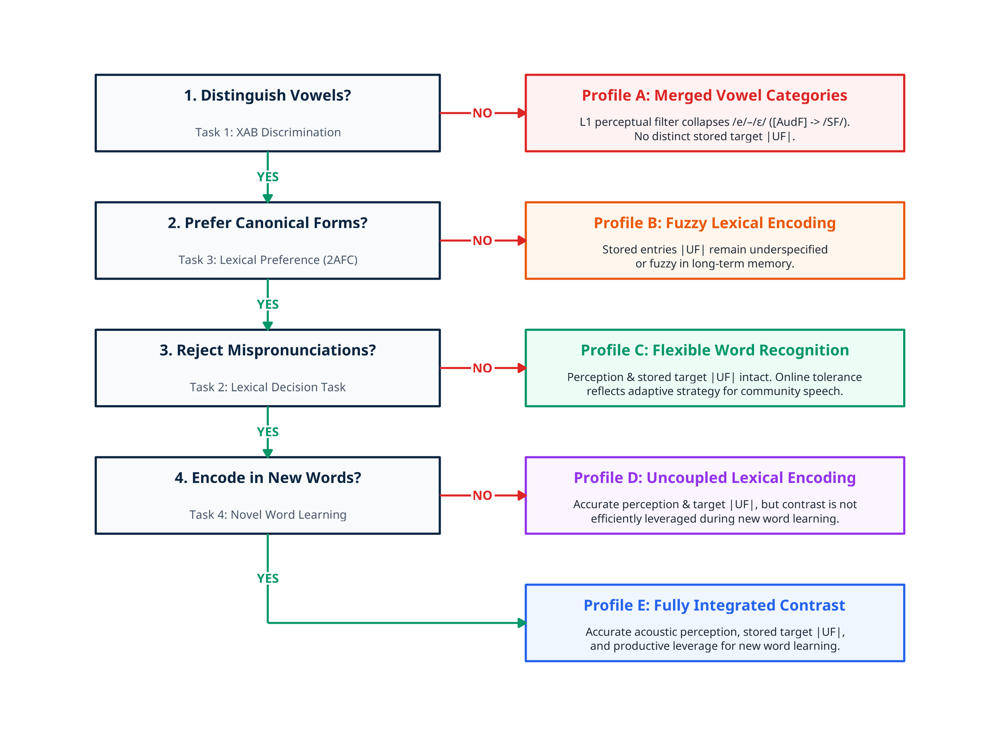

```{r setup-knitr, include=FALSE}
knitr::opts_chunk$set(
  echo = FALSE,
  warning = FALSE,
  message = FALSE,
  dev = "svg",         # Renders as crisp vector graphics
  fig.width = 7,       # Aspect ratio width
  fig.height = 4.2,    # Aspect ratio height
  out.width = "100%",  # Stretches plot to fit slide/column width
  dpi = 300            # Fallback high resolution
)
library(ggplot2)
library(showtext)

# 1. Download and register a Unicode/IPA-compatible font
font_add_google("Noto Sans", "noto")
showtext_auto()  # Enables showtext rendering for all ggplot objects

```


```{css, echo = FALSE, eval = FALSE}

.center2 {
  margin: 0;
  position: absolute;
  top: 50%;
  left: 50%;
  -ms-transform: translate(-50%, -50%);
  transform: translate(-50%, -50%);
}

.regression table {
  font-size: 12px;     
}

.caption {
  font-size: .6rem;
}

.center-text {
  text-align: center;
  font-size: 7rem;
}

@media print {
  body, html, .remark-slides-area, .remark-notes-area {
    height: 100% !important;
    width: 100% !important;
    overflow: visible;
    display: inline-block;
  }
    
  p1 { 
    color: red; 
    top: 15cm !important; 
    position: relative !important; 
    left: 1cm !important;
  }
}

.logo-container {
  background-color: #FFFFFF;
  padding: 6px 12px;
  border-radius: 8px;
  display: inline-block;
}

/* Custom Xaringan Card Hover Effect */
div[style*="box-shadow"] {
  transition: transform 0.2s ease, box-shadow 0.2s ease;
}
div[style*="box-shadow"]:hover {
  transform: translateY(-3px);
  box-shadow: 0 14px 28px rgba(0,0,0,0.1) !important;
}
```

```{r xaringan-themer, include=FALSE, warning=FALSE}
library(xaringanthemer)

style_duo(
  # Palette: Oxford Navy & Slate Steel (Formal / Academic)
  primary_color   = "#0A2540", # Oxford Navy
  secondary_color = "#3B6978", # Muted Slate Steel
  text_color      = "#1F2937", # High-contrast Dark Charcoal
  background_color = "#FFFFFF", # Crisp Pure White
  
  # Typography: Classical Academic Serif Headers paired with Clean Professional Body
  header_font_google = google_font("Merriweather", "700"),
  text_font_google   = google_font("Source Sans Pro", "400", "400i", "700"),
  code_font_google   = google_font("Source Code Pro", "400"),
  
  # Sizing & Hierarchical Ratios
  text_font_size      = "0.8rem",
  header_h1_font_size = "1.8em",
  header_h2_font_size = "1.2rem",
  header_h3_font_size = "1.1rem",
  
  # Custom CSS for Professional Structure
  extra_css = list(
    ".remark-slide-content" = list(
      "padding"     = "2.5em 4em 2.5em 4em",
      "line-height" = "1.6"
    ),
    "blockquote" = list(
      "border-left"   = "4px solid #0A2540",
      "background"    = "#F3F4F6",
      "padding"       = "0.8em 1.2em",
      "border-radius" = "0.5px", # Sharp lines look more formal than rounded edges
      "font-style"    = "italic",
      "color"         = "#374151"
    ),
    ".inverse" = list(
      "background-color" = "#0A2540",
      "color"            = "#FFFFFF"
    ),
    ".inverse h1, .inverse h2, .inverse h3" = list(
      "color" = "#FFFFFF"
    )
  )
)

# Global Theme Settings for Plots
theme_keynote <- function() {
  theme_minimal(base_size = 14, base_family = "noto") +
    theme(
      panel.border = element_rect(color = "grey80", fill = NA, linewidth = 0.5),
      panel.grid.minor = element_blank(),
      legend.position = "bottom",
      plot.title = element_text(face = "bold", size = 14),
      plot.subtitle = element_text(size = 11, color = "grey30")
    )
}

group_colors <- c("Catalan-dominant" = "#0072B2", "Spanish-dominant" = "#D55E00")

```


class: middle

# .center[Presentation Roadmap]

<div style="display: flex; flex-direction: column; gap: 0.65rem; max-width: 750px; margin: 0 auto;">

  <!-- Card 01 -->
  <div style="background: #F8FAFC; border-left: 4px solid #0A2540; padding: 0.6em 1em; border-radius: 2px; box-shadow: 0 2px 5px rgba(0,0,0,0.03);">
    <div style="display: flex; align-items: center; margin-bottom: 0.15em;">
      <span style="background: #0A2540; color: #FFFFFF; font-weight: 700; border-radius: 50%; width: 20px; height: 20px; display: flex; align-items: center; justify-content: center; font-size: 0.65rem; margin-right: 8px; flex-shrink: 0;">01</span>
      <h3 style="margin: 0; color: #0A2540; font-size: 0.85rem; font-weight: 700; font-family: 'Merriweather';">Representational Architecture</h3>
    </div>
    <p style="margin: 0; color: #1F2937; font-size: 0.74rem; line-height: 1.35;">
      <strong style="color: #0A2540;">How are sounds represented in the minds of early bilinguals raised in an environment of sustained societal bilingualism?</strong><br>
      <span style="font-size: 0.68rem; color: #4B5563;"></span>
    </p>
  </div>

--

  <!-- Card 02 -->
  <div style="background: #F8FAFC; border-left: 4px solid #3B6978; padding: 0.6em 1em; border-radius: 2px; box-shadow: 0 2px 5px rgba(0,0,0,0.03);">
    <div style="display: flex; align-items: center; margin-bottom: 0.15em;">
      <span style="background: #3B6978; color: #FFFFFF; font-weight: 700; border-radius: 50%; width: 20px; height: 20px; display: flex; align-items: center; justify-content: center; font-size: 0.65rem; margin-right: 8px; flex-shrink: 0;">02</span>
      <h3 style="margin: 0; color: #0A2540; font-size: 0.85rem; font-weight: 700; font-family: 'Merriweather';">Societal Language Effects Across Tiers</h3>
    </div>
    <p style="margin: 0; color: #1F2937; font-size: 0.74rem; line-height: 1.35;">
      <strong style="color: #0A2540;">How does a majority societal language affect prelexical perception, phonolexical encoding, and novel word learning?</strong><br>
      <span style="font-size: 0.68rem; color: #4B5563;"></span>
    </p>
  </div>

--

  <!-- Card 03 -->
  <div style="background: #F8FAFC; border-left: 4px solid #1E40AF; padding: 0.6em 1em; border-radius: 2px; box-shadow: 0 2px 5px rgba(0,0,0,0.03);">
    <div style="display: flex; align-items: center; margin-bottom: 0.15em;">
      <span style="background: #1E40AF; color: #FFFFFF; font-weight: 700; border-radius: 50%; width: 20px; height: 20px; display: flex; align-items: center; justify-content: center; font-size: 0.65rem; margin-right: 8px; flex-shrink: 0;">03</span>
      <h3 style="margin: 0; color: #0A2540; font-size: 0.85rem; font-weight: 700; font-family: 'Merriweather';">Input Variability & Adaptation</h3>
    </div>
    <p style="margin: 0; color: #1F2937; font-size: 0.74rem; line-height: 1.35;">
      <strong style="color: #0A2540;">Do bilinguals adapt to variability in the input or does this variability in the input affect phonolexical encoding?</strong><br>
      <span style="font-size: 0.68rem; color: #4B5563;"></span>
    </p>
  </div>

</div>
???

"Good morning, colleagues and distinguished members of the Association. It is a true privilege to present here today at the 42nd Encontro Nacional da APL at the Universidade de Lisboa. Today, I want to re-evaluate how early bilinguals perceive, represent, and store speech sounds in long-term memory. Specifically, we will examine the case of the Catalan mid-vowel contrast—/e/ versus /ɛ/—which has served as a central testing ground for speech learning theories for over three decades. Our goal today is to bridge classic perceptual frameworks with modern multi-tier architectural models, demonstrating that early bilingual speech representations are neither static nor structurally deficient."
---

## Early bilingual Grammars


* Early bilinguals are individuals who receive regular, continuous exposure to two languages during early childhood, acquiring them either simultaneously from birth or sequentially in their preschool years <small>(De Houwer, 2009; Kehoe, 2021; Mayr et al., 2021; Meisel, 2009)</small>.

* While the two grammars of early bilingual speakers **develop largely independently**, they also **influence each other** throughout life in both childhood and adulthood <small>(e.g., Genesee, 1989; Kehoe, 2021; Mayr et al., 2021; Paradis & Genesee, 1996; Sundara, 2021)</small>.

* This interaction often results in **crosslinguistic transfer patterns**, where speakers apply features or structures from one language when using the other <small>(e.g., Amengual, 2023, 2024; Bosch, 2021; Kehoe, 2021; Paradis & Genesee, 1996)</small>.


???

When we talk about early bilinguals, we refer to individuals who receive regular, continuous exposure to two languages from birth or early childhood. Classical research established that while their two grammars develop autonomously, they interact continuously throughout life. Crucially, early age of exposure alone does not guarantee balanced or static native-like competence. Instead, phonetic categories and lexical entries remain dynamic across the lifespan—continuously shaped by shifts in language dominance, daily exposure, and community input quality (Amengual, 2024; Birdsong & Amengual, 2021; Flege & Bohn, 2021; Repiso-Puigdelliura, 2025).
---

## Modeling Early Bilingual Sound Systems


* An early bilingual’s sound system operates within a shared phonetic space, where cross-linguistic interaction is bidirectional, continuous, and dynamic across the lifespan—fluctuating continuously according to shifts in language dominance, additional language acquisition, and environmental input <small>(e.g., Amengual, 2024; Amengual & Simonet, 2020; Birdsong & Amengual, 2021; Flege & Bohn, 2021; Grosjean, 2008; Kupisch et al., 2021; Natvig, 2021; Repiso-Puigdelliura, 2025; Simonet & Amengual, 2020)</small>.


--


*Regressive Drift in Early Bilinguals: L3 English Effect on L1 Vowels Language Dominance Mediates Phonetic Permeability (Repiso-Puigdelliura, 2025, *Glossa*)*

.pull-left[
<div style="background-color: #F8FAFC; border: 1px solid #CBD5E1; border-left: 4px solid #0072B2; padding: 10px 12px; border-radius: 6px; margin: 6px 0;">
  <div style="color: #0072B2; margin-bottom: 6px; font-size: 0.80rem; font-weight: bold;">
    Word-external vocalic sequences
  </div>
  <div style="margin-bottom: 8px;">
    <div style="font-weight: bold; color: #1E293B; font-size: 0.73rem;">
      1. Canonical L1 Catalan (continuous speech):
    </div>
    <div style="margin: 2px 0 0 8px; font-size: 0.68rem; color: #334155; line-height: 1.3;">
      modal phonation (<code>[u.i]</code>):<br>
      <span style="font-family: monospace; color: #0072B2; font-weight: 600; font-size: 0.66rem;"><em>Perú íntim</em> &#8594; [Pe.ˈru.ˈin.tim]</span>
    </div>
  </div>
  <div>
    <div style="font-weight: bold; color: #1E293B; font-size: 0.73rem;">
      2. Regressive L3 Drift (Glottal Insertion):
    </div>
    <div style="margin: 2px 0 0 8px; font-size: 0.68rem; color: #334155; line-height: 1.3;">
      Epenthetic glottal stop <code>[ʔ]</code> before stressed V2 (<code>[u.ˈʔi]</code>):<br>
      <span style="font-family: monospace; color: #D55E00; font-weight: 600; font-size: 0.66rem;"><em>Perú íntim</em> &#8594; [Pe.ˈruˈʔin.tim]</span>
    </div>
  </div>
</div>


]

.pull-right[


```{r, out.width="90%", fig.align="center"}
# ==============================================================================
# Regressive Glottal Drift by L3 Rate & Prosodic Stress (Panel A Only)
# Repiso-Puigdelliura (2025), Glossa
# ==============================================================================

library(ggplot2)
library(dplyr)

# 1. Generate Synthetic Data for Panel A
x <- seq(0, 100, length.out = 150)

logistic <- function(x, x0, k, max_val) {
  max_val / (1 + exp(-k * (x - x0)))
}

df_plot <- data.frame(
  x = rep(x, 4),
  y = c(
    logistic(x, 45, 0.08, 0.72), # Cat Stressed
    logistic(x, 60, 0.05, 0.32), # Cat Unstressed
    logistic(x, 40, 0.09, 0.81), # Spa Stressed
    logistic(x, 55, 0.06, 0.38)  # Spa Unstressed
  ),
  Language = factor(rep(c("L1 Catalan", "L1 Catalan", "L1 Spanish", "L1 Spanish"), each = 150)),
  Stress = factor(rep(c("V2 Stressed", "V2 Unstressed", "V2 Stressed", "V2 Unstressed"), each = 150)),
  Group = factor(rep(c("L1 Catalan (V2 Stressed)", "L1 Catalan (V2 Unstressed)", 
                        "L1 Spanish (V2 Stressed)", "L1 Spanish (V2 Unstressed)"), each = 150))
)

# 2. Plot Panel A
p_panelA <- ggplot(df_plot, aes(x = x, y = y, color = Group, linetype = Stress)) +
  geom_line(linewidth = 1.2) +
  scale_color_manual(values = c(
    "L1 Catalan (V2 Stressed)" = "#0072B2",
    "L1 Catalan (V2 Unstressed)" = "#0072B2",
    "L1 Spanish (V2 Stressed)" = "#D55E00",
    "L1 Spanish (V2 Unstressed)" = "#D55E00"
  )) +
  scale_linetype_manual(values = c("V2 Stressed" = "solid", "V2 Unstressed" = "dashed")) +
  scale_y_continuous(limits = c(0, 1.0), breaks = seq(0, 1, 0.2)) +
  scale_x_continuous(limits = c(0, 100), breaks = seq(0, 100, 20)) +
  labs(
    title = "Regressive Glottal Drift by L3 Rate & Prosodic Stress",
    subtitle = "Higher L3 English glottal marking rate increases glottal insertion in L1 Catalan & Spanish",
    x = "L3 English Glottal Marking Rate (%)",
    y = "Predicted Probability of L1 Glottal Insertion",
    caption = "Repiso-Puigdelliura (2025), Glossa"
  ) +
  theme_minimal(base_family = "Noto Sans", base_size = 11) +
  theme(
    plot.title = element_text(face = "bold", size = 12, color = "#0A2540"),
    plot.subtitle = element_text(size = 9.5, color = "#3B6978"),
    plot.caption = element_text(size = 8.5, color = "#64748B", face = "italic"),
    legend.position = "bottom",
    legend.title = element_blank(),
    panel.grid.minor = element_blank()
  )

print(p_panelA)
ggsave("glossa_regressive_glottal_drift.png", plot = p_panelA, width = 7, height = 5.2, dpi = 300)

```

]


???

To understand this interaction, we must probably reject the notion of two isolated mental compartments. Instead, an early bilingual's sound system operates as an integrated, multi-level architecture sharing a common phonetic space. Cross-linguistic interaction is bidirectional and continuous, fluctuating dynamically according to real-time language modes, shifts in dominance, and environmental input. And this is the case even for early sequential bilinguals.

"To provide empirical evidence of lifespan phonetic permeability, my 2025 study in Glossa evaluates regressive cross-linguistic influence from L3 English into early-acquired L1 Catalan and L1 Spanish.
In canonical Catalan and Spanish L1 speech, word-external vocalic sequences like 'Perú iíntim' are produced with a modal vocalic transition—[u.i]. However, as speakers increase their usage of glottal marking in L3 English, we observe regressive transfer into their native languages, where they insert an epenthetic glottal stop—[u.ˈʔi]—or creaky voice to repair this vocalic sequence.
As shown in the plot on the right, this regressive drift is strongly driven by L3 usage rates and prosodic stress. Higher L3 English glottal marking rates significantly increase glottal insertion in native Catalan and Spanish, specifically targeting V2-stressed positions.
This confirms thart early-acquired native sound systems remain permeable across the lifespan


---

## Modeling Early Bilingual Sound Systems


* Crucially, empirical findings from early bilinguals demonstrate that underlying phonological contrasts are more likely to remain **stable**, while cross-linguistic interaction operates primarily at the **phonetic level of representation**<small>(e.g., Amengual, 2016, 2024; Amengual & Simonet, 2020; Natvig, 2021; Ramón-Casas et al., 2023; Repiso-Puigdelliura, 2025; Simonet & Amengual, 2020)</small>.


*Tap-trill distinction in Spanish heritage speakers* (Repiso-Puigdelliura & Perry, 2026)

```{r figure2a, echo=FALSE, out.width="100%", fig.align="center"}
# Insert Figure 2a / 2b here
 knitr::include_graphics("Figure2.png")

```


???

"First, empirical findings from early bilinguals demonstrate that underlying phonological contrasts seem to remain stable, while the phonetic level of representation appears to undergo more cross-linguistic interaction, such as different cue-weight mappings and articulatory implementations that remain flexible, gradient, and adaptive to language mode, daily exposure, and community input.   To see how this operates in speech production, let's examine findings from my recent study with Scott Perry, published in the Journal of the International Phonetic Association, on the Spanish tap-trill contrast in intervocalic position where tap /ɾ/ and trill /r/ contrast. The tap is produced with one occlusion, while the trill is produced with two or more occlusions.   In intervocalic rhotic production, when primary canonical gestures—such as the number of tongue-tip occlusions—show surface variability under bilingual contact (from English, in this case), adult heritage Spanish speakers do not collapse the two phonemic contrasts into a single category. Instead, they adaptively reweight their mapping of cues, recruiting duration as a secondary acoustic cue to preserve a non-overlapping contrast between taps and trills.   Furthermore, a cross-sectional comparison reveals that while child heritage speakers display a compressed durational contrast (as shown in Plot A), their mean production nonetheless maintains a statistically distinct separation between taps and trills.   

---
# Integrated multilingual transfer

```{r}
library(ggplot2)
library(dplyr)

# 1. Define the 3 Core Modular Tiers (Natvig, 2021)
levels_df <- tribble(
  ~xmin, ~xmax, ~ymin, ~ymax, ~title, ~spec, ~domain,
  2.3, 5.7, 4.2, 5.0, "1. Phonology (Grammatical Knowledge)", "| Abstract Contrasts |", "Phonology",
  2.3, 5.7, 2.6, 3.4, "2. Phonetics-Phonology Interface", "[ Articulatory Gestures, Completions & Enhancements]", "Interface / Procedural",
  2.3, 5.7, 1.0, 1.8, "3. Phonetics (Physical Realization)", "[[ Gradient Acoustic & Motor Signal Execution]]", "Phonetics"
)

# 2. Grammar & Procedural Mapping Modules (Between Tiers)
grammars_df <- tribble(
  ~x, ~y, ~label,
  4.0, 3.8, "Completions & Enhancements (Dimensions ↔ Gestures)",
  4.0, 2.2, "Phonetic Implementation (Gestures ↔ Physical Signal)"
)

# 3. Process Direction Flow (Perception vs. Production)
flow_arrows <- tribble(
  ~x, ~y, ~xend, ~yend, ~label, ~side,
  # Perception / Categorization (Bottom-Up)
  1.5, 1.2, 1.5, 4.8, "PERCEPTION & CATEGORIZATION\n(Continuous Signal → Abstract Category)", "Perception",
  # Production / Implementation (Top-Down)
  6.5, 4.8, 6.5, 1.2, "PRODUCTION & IMPLEMENTATION\n(Abstract Category → Gestures → Signal)", "Production"
)

# 4. Render Diagram
p_natvig <- ggplot() +
  # Tier Representation Blocks
  geom_rect(data = levels_df, aes(xmin = xmin, xmax = xmax, ymin = ymin, ymax = ymax, fill = domain),
            color = "grey20", linewidth = 0.8, alpha = 0.88) +
  
  # Text Inside Blocks (Title + Specification)
  geom_text(data = levels_df, aes(x = (xmin + xmax) / 2, y = (ymin + ymax) / 2 + 0.12, label = title),
            fontface = "bold", size = 3.9, color = "white") +
  geom_text(data = levels_df, aes(x = (xmin + xmax) / 2, y = (ymin + ymax) / 2 - 0.14, label = spec),
            fontface = "italic", size = 3.1, color = "grey95") +
  
  # Grammar & Interface Mapping Labels
  geom_label(data = grammars_df, aes(x = x, y = y, label = label),
             fill = "white", color = "grey20", size = 3.0, fontface = "bold",
             label.padding = unit(0.22, "lines"), border.color = "grey60") +
  
  # Vertical Directional Flow Arrows
  geom_segment(data = flow_arrows, aes(x = x, y = y, xend = xend, yend = yend, color = side),
               arrow = arrow(length = unit(0.35, "cm")), linewidth = 1.3) +
  geom_text(data = flow_arrows, aes(x = x, y = (y + yend) / 2, label = label, color = side),
            angle = ifelse(flow_arrows$side == "Perception", 90, -90),
            vjust = -0.8, fontface = "bold", size = 3.2) +


  # Color Scales
  scale_fill_manual(values = c(
    "Phonology" = "#0072B2", 
    "Interface / Procedural" = "#009E73", 
    "Phonetics" = "#E69F00"
  )) +
  scale_color_manual(values = c(
    "Perception" = "#0072B2", 
    "Production" = "#D55E00"
  )) +
  
  # Layout Settings
  scale_x_continuous(limits = c(0.5, 7.5)) +
  scale_y_continuous(limits = c(0.4, 5.6)) +
  labs(
    title = "Integrated Multilingual Sound System Architecture",
    caption = "Natvig (2021, Languages) "
  ) +
  theme_void(base_size = 11) +
  theme(
    plot.title = element_text(face = "bold", size = 13, hjust = 0.5, margin = margin(b = 4)),
    plot.subtitle = element_text(size = 9.5, face = "italic", hjust = 0.5, color = "grey30", margin = margin(b = 10)),
    plot.caption = element_text(size = 8, color = "grey50", hjust = 0.95),
    legend.position = "none"
  )

# Display plot in R Markdown slide
p_natvig
```

???

"A powerful framework for modeling this architecture is Natvig's (2021) integrated multilingual model, which lays out three explicit tiers: abstract phonological knowledge at the top, the phonetics–phonology interface in the middle, and gradient physical implementation at the bottom. Crucially, under this model, cross-linguistic interaction appears in the implementation of articulatory gestures at the phonetics–phonology interface and the gradient physical realization of these gestures at the phonetics level, while phonological and grammatical knowledge remains intact.

---

## Modeling Early Bilingual Sound Systems


```{r ,  fig.width=9.5, fig.height=6.5, out.width="90%"}
library(ggplot2)
library(dplyr)

# 1. Define L2LP Representational Levels
levels_l2lp <- tribble(
  ~xmin, ~xmax, ~ymin, ~ymax, ~title, ~spec, ~domain,
  2.3, 5.7, 5.2, 6.0, "Semantic Representation (SemR)", "Meaning & Morphemes", "Phonology",
  2.3, 5.7, 4.0, 4.8, "Underlying Representation (UR)", "| Lexical Categories / Target Forms |", "Phonology",
  2.3, 5.7, 2.8, 3.6, "Surface Representation (SR)", "/ Phonological Features & Segments /", "Phonology",
  2.3, 5.7, 1.6, 2.4, "Auditory Representation (AudR)", "[ Acoustic Cues & Continuous Distribution ]", "Phonetics",
  2.3, 5.7, 0.4, 1.2, "Articulatory Representation (ArtR)", "[ Motor Execution & Gestures ]", "Phonetics"
)

# 2. Grammar Mappings & Acquisition Mechanisms (L2LP Mechanisms)
grammars_l2lp <- tribble(
  ~x, ~y, ~label,
  4.0, 4.9, "Lexical Mapping (UR ↔ SemR)",
  4.0, 3.7, "Phonological Grammar (Faithfulness & Structural Constraints)",
  4.0, 2.5, "Cue Integration Grammar (AudR ↔ SR Mapping / L2LP Optimal Perception)",
  4.0, 1.3, "Sensorimotor Grammar (Auditory-Articulatory Mapping)"
)

# 3. Learning Mechanisms Annotations
acq_mechanisms <- tribble(
  ~x, ~y, ~label,
  1.1, 2.5, "Perceptual Learning:\nCue Weighting Shift\n(Optimal Perception)",
  6.9, 2.5, "Grammar Plasticity:\nGradual Learning Algorithm\n(Stochastic OT / HG)",
  6.9, 3.7, "Category Formation:\nNew vs. Similar / Subset\nScenarios"
)

# 4. Render Diagram
ggplot() +
  # Blocks
  geom_rect(data = levels_l2lp, aes(xmin = xmin, xmax = xmax, ymin = ymin, ymax = ymax, fill = domain),
            color = "grey30", linewidth = 0.7, alpha = 0.85) +
  geom_text(data = levels_l2lp, aes(x = (xmin + xmax) / 2, y = (ymin + ymax) / 2 + 0.12, label = title),
            fontface = "bold", size = 3.8, color = "white") +
  geom_text(data = levels_l2lp, aes(x = (xmin + xmax) / 2, y = (ymin + ymax) / 2 - 0.15, label = spec),
            fontface = "italic", size = 3.0, color = "grey95") +
  
  # Grammar Mappings
  geom_label(data = grammars_l2lp, aes(x = x, y = y, label = label),
             fill = "white", color = "grey20", size = 2.9, fontface = "bold",
             label.padding = unit(0.2, "lines"), border.color = "grey70") +
             
  # Mechanisms Annotations
  geom_label(data = acq_mechanisms, aes(x = x, y = y, label = label),
             fill = "#FFF2CC", color = "#7F6000", size = 2.7, fontface = "bold",
             label.padding = unit(0.3, "lines"), border.color = "#D6B656") +
             
  # Directional Flow Arrows

  # Manual Color Scales
  scale_fill_manual(values = c("Phonology" = "#0072B2", "Phonetics" = "#E69F00")) +
  scale_x_continuous(limits = c(0.2, 7.8)) +
  scale_y_continuous(limits = c(0.1, 6.6)) +
  
  labs(
   
    subtitle = "Based on Second Language Linguistic Perception Model (Escudero, 2005, 2009; Yazawa and Escudero, 2025) and BiPhon (Boersma, 2007, 2011)",
    caption = "References:\n- Boersma, P. (2007, 2011). BiPhon Model. | Escudero, P. (2005, 2009). Second Language Linguistic Perception (L2LP) Model.\n- Boersma & Escudero (2008). Computational modeling of L2 perception in Stochastic OT / HG."
  ) +
  theme_void(base_size = 12) +
  theme(
    plot.title = element_text(face = "bold", size = 13, margin = margin(b = 3)),
    plot.subtitle = element_text(size = 9.5, color = "grey30", margin = margin(b = 8)),
    plot.caption = element_text(size = 7.5, color = "grey40", hjust = 0, margin = margin(t = 10)),
    legend.position = "none",
    plot.margin = margin(10, 10, 10, 10)
  )
```


???
To formalize how bilinguals map continuous speech onto lexical meaning, we draw upon the Second Language Linguistic Perception model—L2LP—which co-evolved with the bidirectional BiPhon framework.

As shown on the left, L2LP organizes speech comprehension into distinct representational tiers. Incoming physical acoustics enter as an Auditory Form ([AudF]). A prelexical Cue Integration Grammar maps these continuous cues onto discrete Surface Forms (/SF/). Then, a separate Phonological Grammar matches these surface representations against canonical Underlying Forms (|UF|) stored in long-term memory.

As shown on the right, L2LP posits that L2 acquisition begins with Full Copying of the L1 grammar. Depending on the language pair, learning tasks fall into SIMILAR, NEW, or SUBSET scenarios. Driven by input distributions and lexical meaning, constraint weights update probabilistically using the Gradual Learning Algorithm in Stochastic OT or Noisy Harmonic Grammar. 

---
## Modeling Early Bilingual Sound Systems

```{r}
library(ggplot2)
library(dplyr)

# Grammar 1: Activated (Language A)
g1_levels <- tribble(
  ~xmin, ~xmax, ~ymin, ~ymax, ~title, ~spec, ~domain,
  0.8, 3.8, 5.2, 6.0, "SemR (Lang A)", "Meaning", "Phonology",
  0.8, 3.8, 4.0, 4.8, "UR (Lang A)", "| Target Phonemes |", "Phonology",
  0.8, 3.8, 2.8, 3.6, "SR (Lang A)", "/ Surface Features /", "Phonology",
  0.8, 3.8, 1.6, 2.4, "AudR (Lang A)", "[ Acoustic Space ]", "Phonetics",
  0.8, 3.8, 0.4, 1.2, "ArtR (Lang A)", "[ Motor Gestures ]", "Phonetics"
)

# Grammar 2: Inhibited (Language B)
g2_levels <- tribble(
  ~xmin, ~xmax, ~ymin, ~ymax, ~title, ~spec, ~domain,
  4.8, 7.8, 5.2, 6.0, "SemR (Lang B)", "Meaning", "Phonology",
  4.8, 7.8, 4.0, 4.8, "UR (Lang B)", "| Target Phonemes |", "Phonology",
  4.8, 7.8, 2.8, 3.6, "SR (Lang B)", "/ Surface Features /", "Phonology",
  4.8, 7.8, 1.6, 2.4, "AudR (Lang B)", "[ Acoustic Space ]", "Phonetics",
  4.8, 7.8, 0.4, 1.2, "ArtR (Lang B)", "[ Motor Gestures ]", "Phonetics"
)

ggplot() +
  # Grammar A (ACTIVATED - High Opacity, Vibrant Borders)
  geom_rect(data = g1_levels, aes(xmin = xmin, xmax = xmax, ymin = ymin, ymax = ymax, fill = domain),
            color = "#009E73", linewidth = 1.0, alpha = 0.9) +
  geom_text(data = g1_levels, aes(x = (xmin + xmax) / 2, y = (ymin + ymax) / 2 + 0.12, label = title),
            fontface = "bold", size = 3.5, color = "white") +
  geom_text(data = g1_levels, aes(x = (xmin + xmax) / 2, y = (ymin + ymax) / 2 - 0.15, label = spec),
            fontface = "italic", size = 2.8, color = "grey95") +
            
  # Grammar B (INHIBITED - Lower Opacity, Faded Styling)
  geom_rect(data = g2_levels, aes(xmin = xmin, xmax = xmax, ymin = ymin, ymax = ymax),
            fill = "grey75", color = "grey50", linewidth = 0.5, alpha = 0.4) +
  geom_text(data = g2_levels, aes(x = (xmin + xmax) / 2, y = (ymin + ymax) / 2 + 0.12, label = title),
            fontface = "bold", size = 3.5, color = "grey30") +
  geom_text(data = g2_levels, aes(x = (xmin + xmax) / 2, y = (ymin + ymax) / 2 - 0.15, label = spec),
            fontface = "italic", size = 2.8, color = "grey40") +

  # Activation & Inhibition Annotations
  annotate("label", x = 2.3, y = 6.3, label = "GRAMMAR A: ACTIVATED\n(Selected Context)",
           fill = "#D4EDDA", color = "#155724", fontface = "bold", size = 3.2) +
  annotate("label", x = 6.3, y = 6.3, label = "GRAMMAR B: INHIBITED\n(Suppressed Context)",
           fill = "#F8D7DA", color = "#721C24", fontface = "bold", size = 3.2) +
           
  # Inter-Grammatical Inhibitory Connection
  annotate("segment", x = 3.9, y = 3.2, xend = 4.7, yend = 3.2,
           arrow = arrow(length = unit(0.25, "cm"), ends = "both"), linewidth = 1.0, color = "#D55E00", linetype = "dashed") +
  annotate("text", x = 4.3, y = 3.5, label = "Inhibitory\nControl", fontface = "bold.italic", size = 2.8, color = "#D55E00") +

  scale_fill_manual(values = c("Phonology" = "#0072B2", "Phonetics" = "#E69F00")) +
  scale_x_continuous(limits = c(0.2, 8.4)) +
  scale_y_continuous(limits = c(0.1, 6.7)) +
  
  labs(
    title = "Simultaneous Bilingual Grammars in L2LP / BiPhon Framework",
    subtitle = "Dual-Grammar Architecture with Executive Control (Activation vs. Inhibition)",
    caption = "References:\n- Escudero, P. (2005, 2009). Second Language Linguistic Perception (L2LP).\n- Boersma, P., & Escudero, P. (2008). Modeling bilingual perception in Stochastic OT."
  ) +
  theme_void(base_size = 12) +
  theme(
    plot.title = element_text(face = "bold", size = 13, margin = margin(b = 3)),
    plot.subtitle = element_text(size = 9.5, color = "grey30", margin = margin(b = 8)),
    plot.caption = element_text(size = 7.5, color = "grey40", hjust = 0, margin = margin(t = 10)),
    legend.position = "none",
    plot.margin = margin(10, 10, 10, 10)
  )
```


???
The L2LP speech model also accounts for simultaneous bilingual acquisition. Rather than forcing both languages into a single merged system, the model posits that simultaneous bilinguals maintain two distinct bidirectional architectures running in parallel. Depending on the communicative context, executive control mechanisms modulate the system through activation and inhibition. For example, when a bilingual is in a monolingual mode, Grammar A is fully activated, enabling rapid feedforward comprehension and top-down production. Meanwhile, Grammar B is suppressed through mechanisms of inhibitory control, which prevents cross-linguistic interference and involuntary code-switching. The degree to which these languages are activated or inhibited may ultimately result in cross-linguistic transfer.
---
##  Open Questions in Current L2 Frameworks

-   In general, L2 models <small>(SLM-r, PAM-L2, L2LP)</small> explain how new L2 categories emerge from L1 categories or cue weightings, but do not offer integrated mechanisms for real-time category co-existence in **simultaneous bilinguals**.


-  They presume stable, homogeneous input, ignoring how **community-level input variability** (e.g., regional/accented speech) continuously reshapes sound categorization.

-  They assume prelexical perception directly dictates phonolexical encoding.

???
When we evaluate existing models of non-native and second language speech perception, we encounter several theoretical limitations. First, these models were primarily built to explain how an L2 emerges from an established L1 grammar. As we have seen, even though the L2LP speech model provides a mechanism to explain early bilingual grammars through inhibition and activation, those mechanisms operate outside of the grammar itself and are attributed to general cognitive mechanisms. While this may be the case, it remains to be evaluated whether that is indeed so, or whether an interaction between the two grammars occurs within the grammar itself.   Second, classic frameworks assume a stable, homogeneous input. In reality, however, bilinguals live in dynamic sociolinguistic environments characterized by high variability at the input level.   Finally, these models assume a direct mapping between prelexical perception and phonolexical storage, where surface representations are passed directly onto underlying ones. Consequently, there is a carry-over from surface representations to phonolexical encoding—an assumption that must be evaluated across all contexts, as we will do in this presentation.   

---

## Sociolinguistic context in Catalonia (I)

```{r my-image, echo=FALSE, out.width="50%", fig.align="center", fig.cap=""}
knitr::include_graphics("map.png")

```

???

To evaluate these models empirically, we turn to the unique sociolinguistic context of Catalonia, where Catalan and Spanish are co-official languages in continuous contact. Since the 1980s, an educational immersion model ensures all children receive schooling in Catalan regardless of home language. This creates a highly bilingual population with rich, heterogeneous daily usage patterns spanning from strongly Catalan-dominant to strongly Spanish-dominant speakers.
---

## Sociolinguistic context in Catalonia (II)


```{r habitual, echo=FALSE, fig.width=9.5, fig.height=6.5, out.width="100%"}
# Option A: Embedding via knitr (Recommended for RMarkdown output rendering)
# Ensure the image file 'eulp_language_trends_2003_2023.png' is placed in your working directory.
#STREAMING_CHUNK:Loading required R packages...
library(tidyverse)
library(scales)
#STREAMING_CHUNK:Constructing longitudinal EULP dataset...
#1. Construct Longitudinal EULP Dataset (2003-2023)
eulp_data <- tibble(
Year = rep(c(2003, 2008, 2013, 2018, 2023), times = 5),
Category = factor(
rep(
c("Spanish", "Catalan", "Both (Catalan & Spanish)", "Other Languages", "Other Combinations"),
each = 5
),
levels = c("Spanish", "Catalan", "Both (Catalan & Spanish)", "Other Languages", "Other Combinations")
),
Percentage = c(
# Spanish
47.2, 45.9, 50.7, 48.6, 46.5,
# Catalan
46.0, 35.6, 36.3, 36.1, 32.6,
# Both (Catalan & Spanish)
4.7,  11.9,  6.9,  7.4,  9.4,
# Other Languages
2.0,   4.8,  4.7,  4.3,  4.5,
# Other Combinations (Recorded from 2018 onward)
NA,    NA,   NA,  3.0,  5.6
)
)
#STREAMING_CHUNK:Filtering data and defining color palette...
#Filter out NA rows for plotting continuous line paths
df_plot <- eulp_data %>% filter(!is.na(Percentage))
#Color palette mapping
language_colors <- c(
"Spanish"                  = "#D55E00", # Warm red-orange
"Catalan"                  = "#005580", # Deep navy/teal
"Both (Catalan & Spanish)" = "#009E73", # Bluish green
"Other Languages"          = "#E69F00", # Gold/Yellow
"Other Combinations"       = "#787C82"  # Neutral slate
)
#STREAMING_CHUNK:Building publication-quality ggplot graphic...
#2. Build Publication-Quality ggplot Graphic
p_eulp <- ggplot(df_plot, aes(x = Year, y = Percentage, color = Category, group = Category)) +
#Reference gridlines & zero line
geom_hline(yintercept = 0, color = "#cbd5e1", linewidth = 0.5) +
#Main Trend Lines & Markers
geom_line(linewidth = 1.3, alpha = 0.9) +
geom_point(size = 3.5) +
#Value Annotations on Data Points
geom_text(
aes(label = paste0(sprintf("%.1f", Percentage), "%")),
vjust = -0.9,
size = 3.6,
fontface = "bold",
show.legend = FALSE
) +
#Scales & Axis Configuration
scale_x_continuous(
breaks = c(2003, 2008, 2013, 2018, 2023),
limits = c(2002.5, 2023.5)
) +
scale_y_continuous(
limits = c(0, 60),
breaks = seq(0, 60, by = 10),
labels = function(x) paste0(x, "%")
) +
scale_color_manual(values = language_colors) +
#STREAMING_CHUNK:Configuring labels and theme...
labs(
title = "Evolution of Habitual Language Identification in Catalonia (2003-2023)",
subtitle = "Percentage of population aged 15+ by primary/habitual language (llengua habitual)",
x = "Survey Wave Year",
y = "Percentage of Population (%)",
color = "Language Category",
caption = "Source: Enquesta d'Usos Lingüístics de la Població (EULP 2003, 2008, 2013, 2018, 2023) | IDESCAT"
) +
#Modern Minimalist Styling
theme_minimal(base_size = 13) +
theme(
plot.title = element_text(face = "bold", size = 15, color = "#0f172a", margin = margin(b = 6)),
plot.subtitle = element_text(size = 11, color = "#475569", margin = margin(b = 18)),
plot.caption = element_text(size = 9, color = "#64748b", margin = margin(t = 16)),
axis.title.x = element_text(face = "bold", size = 11, color = "#1e293b", margin = margin(t = 10)),
axis.title.y = element_text(face = "bold", size = 11, color = "#1e293b", margin = margin(r = 10)),
axis.text = element_text(size = 11, color = "#334155"),
panel.grid.major.x = element_blank(),
panel.grid.minor = element_blank(),
panel.grid.major.y = element_line(color = "#f1f5f9", linewidth = 0.8),
legend.position = "top",
legend.title = element_text(face = "bold", size = 11),
legend.text = element_text(size = 10),
legend.key.width = unit(1.2, "cm"),
plot.margin = margin(20, 20, 20, 20)
)
#STREAMING_CHUNK:Displaying and exporting high-resolution graphic...
#3. Display plot in graphics device
print(p_eulp)
#Export High-Resolution PNG for Presentation/Slides
ggsave(
filename = "eulp_language_trends_2003_2023_english.png",
plot = p_eulp,
width = 11,
height = 6.5,
dpi = 300
)


```


???
Demographic survey data from the last 20 years regarding participants' habitual language of identification show that Spanish remains the most common habitual language, representing approximately 46.5% of the population. Meanwhile, the proportion of speakers identifying Catalan as their habitual language has declined from 46% to 32%, alongside a slight increase in those reporting both languages as habitual. This sociolinguistic reality indicates that young bilingual children grow up in an environment often characterized by non-canonical and accented community speech in Catalan.


---


## The Catalan Vowel System


```{r vowel-space-scheme, message=FALSE, warning=FALSE}
library(ggplot2)
library(dplyr)
library(ragg)
# 1. Coordinate data points (Recasens & Espinosa, 2006)
library(dplyr)
library(ggplot2)
library(ragg)

# 1. Coordinate data points (Recasens & Espinosa, 2006)
library(ggplot2)
library(dplyr)
library(showtext)

# 1. Load Noto Sans for full Unicode / IPA character support
font_add_google("Noto Sans", "noto")
showtext_auto()

# Data frames
catalan_vowels <- data.frame(
  vowel = c("i", "e", "ɛ", "a", "ɔ", "o", "u", "ə"),
  F1 = c(320, 480, 660, 740, 710, 540, 390, 560),
  F2 = c(2150, 1900, 1740, 1460, 1170, 1000, 900, 1400),
  sys = "Catalan"
)

spanish_vowels <- data.frame(
  vowel = c("i", "e", "a", "o", "u"),
  F1 = c(320, 560, 730, 490, 370),
  F2 = c(2130, 1820, 1400, 1060, 930),
  sys = "Spanish"
)

# Polygon paths (perimeter ordering)
cat_poly <- catalan_vowels %>% filter(vowel != "ə") %>% slice(c(1:7, 1))
sp_poly  <- spanish_vowels %>% slice(c(1:5, 1))

# 2. Render plot
ggplot() +
  # Polygon boundaries
  geom_path(data = cat_poly, aes(x = F2, y = F1), color = "#005f73", linewidth = 1.2, linetype = "solid") +
  geom_path(data = sp_poly, aes(x = F2, y = F1), color = "#ca6702", linewidth = 1.2, linetype = "dashed") +
  
  # Catalan Vowel Labels (family = "noto", adjusted size)
  geom_text(data = catalan_vowels, aes(x = F2, y = F1, label = vowel), 
            color = "#005f73", fontface = "bold", size = 7.5, family = "noto") +
  
  # Spanish Vowel Labels (family = "noto", adjusted size & offset)
  geom_text(data = spanish_vowels, aes(x = F2 - 45, y = F1 + 20, label = vowel), 
            color = "#ca6702", fontface = "bold", size = 6.0, family = "noto") +
  
  # Phonetic standard reversed axes (High/Front at top-left)
  scale_x_reverse(limits = c(2250, 850), name = "F2 (Hz)  [ Back  |  Front ]") +
  scale_y_reverse(limits = c(800, 280), name = "F1 (Hz)  [ High  |  Low ]") +
  
  labs(
    title = "Catalan vs. Spanish Acoustic Vowel Space",
    subtitle = "Solid line = Catalan | Dashed line = Spanish",
    caption = "Adapted from Recasens & Espinosa (2006)"
  ) +
  theme_minimal(base_size = 13, base_family = "noto") +
  theme(
    plot.title = element_text(face = "bold", size = 15),
    panel.grid.minor = element_blank(),
    panel.border = element_rect(color = "grey80", fill = NA, linewidth = 0.5)
  )
#ggsave("catalan_spanish_vowels.png", plot = p, device = ragg::agg_png, width = 8, height = 6, dpi = 300)

# Method A: Display in R Markdown / Quarto / RStudio Viewer
#knitr::include_graphics("catalan_spanish_vowels.png")


```
???


Phonetically, Catalan has a 7-vowel system contrasting close-mid /e/ and open-mid /ɛ/. Spanish possesses a 5-vowel system with a single mid-front vowel category /e/. For Spanish-dominant bilinguals, acquiring and maintaining the Catalan /e/–/ɛ/ contrast requires establishing a new perceptual boundary within a region where Spanish has only one category.


---
# Input variability

```{r}
# ==============================================================================
# Spanish-Accented Input Representation in Catalan (ggplot2)
# Illustrating vowel merger of Catalan /e/ - /ɛ/ into Spanish [e]
# Example: Catalan "gallɛda" (bucket) produced as "galleda" [ɡaˈʎeða]
# Using Noto Sans font family for IPA Unicode symbols (ɛ)
# ==============================================================================

library(ggplot2)
library(dplyr)
library(patchwork)

# ------------------------------------------------------------------------------
# Panel A: Acoustic Vowel Space (F2 vs F1)
# ------------------------------------------------------------------------------
df_vowels <- tribble(
  ~vowel, ~F1, ~F2, ~type,
  "/i/", 300, 2200, "Catalan System",
  "/e/", 450, 2000, "Catalan /e/ (close-mid)",
  "/ɛ/", 600, 1800, "Catalan /ɛ/ (open-mid)",
  "/a/", 750, 1400, "Catalan System",
  "/o/", 450, 900,  "Catalan System",
  "/ɔ/", 600, 1000, "Catalan System",
  "/u/", 300, 800,  "Catalan System"
)

p_vowel_space <- ggplot(df_vowels, aes(x = F2, y = F1, label = vowel, color = type)) +
  geom_point(size = 7, alpha = 0.85) +
  geom_text(color = "white", fontface = "bold", size = 4, family = "Noto Sans") +
  
  # Spanish Merger Arrow
  annotate("segment", x = 1820, xend = 1980, y = 580, yend = 470,
           arrow = arrow(length = unit(0.3, "cm"), type = "closed"),
           color = "#E69F00", linewidth = 1.3, linetype = "dashed") +
  annotate("label", x = 1900, y = 520, 
           label = "Spanish L1 Merger:\n/ɛ/ produced as [e]", 
           fill = "#FFF2CC", color = "#B8860B", fontface = "bold", size = 3.2, family = "Noto Sans") +
  
  # Reverse axes for traditional phonetics layout
  scale_x_reverse(limits = c(2400, 700), breaks = seq(2400, 700, -300)) +
  scale_y_reverse(limits = c(850, 200), breaks = seq(200, 850, 100)) +
  scale_color_manual(values = c(
    "Catalan System" = "#0072B2",
    "Catalan /e/ (close-mid)" = "#0072B2",
    "Catalan /ɛ/ (open-mid)" = "#D55E00"
  )) +
  labs(
    title = "A. Catalan Vowel Space vs. Spanish Accent Substitution",
    x = "F2 Frequency (Hz) [Back <---> Front]",
    y = "F1 Frequency (Hz) [Close / High <---> Open / Low]"
  ) +
  theme_minimal(base_size = 11, base_family = "Noto Sans") +
  theme(
    plot.title = element_text(face = "bold", size = 11, color = "#0A2540"),
    legend.position = "none",
    panel.grid.minor = element_blank()
  )

# ------------------------------------------------------------------------------
# Panel B: Lexical Example ("gallɛda" -> [ɡaˈʎeða])
# ------------------------------------------------------------------------------
df_boxes <- tribble(
  ~xmin, ~xmax, ~ymin, ~ymax, ~title, ~body, ~fill_col, ~border_col,
  
  # Box 1: Canonical Catalan
  0.05, 0.95, 0.60, 0.92,
  "CANONICAL CATALAN PRODUCTION",
  "Word Target: \"gallɛda\" (bucket)\nPhonetic Realization: [ɡəˈʎɛðə] (Open-Mid /ɛ/)",
  "#E6F2FF", "#0072B2",
  
  # Box 2: Spanish-Accented
  0.05, 0.95, 0.08, 0.40,
  "SPANISH-ACCENTED PRODUCTION",
  "Word Realization: \"galleda\"\nPhonetic Realization: [ɡaˈʎeða] (Close-Mid [e])",
  "#FFF0E6", "#D55E00"
)

p_example <- ggplot(df_boxes) +
  geom_rect(aes(xmin = xmin, xmax = xmax, ymin = ymin, ymax = ymax, fill = fill_col, color = border_col),
            linewidth = 1.1, alpha = 0.9) +
  geom_text(aes(x = (xmin + xmax)/2, y = ymax - 0.08, label = title, color = border_col),
            fontface = "bold", size = 3.8, family = "noto") +
  geom_text(aes(x = (xmin + xmax)/2, y = ymin + 0.14, label = body),
            color = "#1F2937", size = 3.2, lineheight = 1.1, family = "noto") +
  
  # Connector Arrow
  annotate("segment", x = 0.5, xend = 0.5, y = 0.60, yend = 0.40,
           arrow = arrow(length = unit(0.25, "cm"), type = "closed"), color = "#E69F00", linewidth = 1.2) +
  annotate("label", x = 0.5, y = 0.50, label = "Spanish-Accented Community Input", 
           fill = "#FFFFFF", color = "#B8860B", fontface = "bold", size = 3, family = "noto") +
  
  scale_fill_identity() +
  scale_color_identity() +
  coord_fixed(xlim = c(0, 1), ylim = c(0, 1)) +
  labs(
    ) +
  theme_void(base_family = "Noto") +
  theme(
    plot.title = element_text(face = "bold", size = 11, color = "#0A2540", hjust = 0.5),
    plot.caption = element_text(size = 8.5, color = "#4B5563", hjust = 0.5, face = "italic")
  )

# ------------------------------------------------------------------------------
# Combine Panels with patchwork
# ------------------------------------------------------------------------------
combined_plot <- (p_vowel_space | p_example) +
  plot_layout(widths = c(1.1, 1)) +
  plot_annotation(
    title = "Spanish-Accented Speech Input in Bilingual Catalan-Spanish Communities",
    subtitle = "Non-canonical production of open-mid /ɛ/ as close-mid [e] in words like \"gallɛda\" (bucket)",
    caption = "Based on Repiso Puigdelliura et al. (2025) & Ramón-Casas et al. (2023)"
  )

combined_plot <- combined_plot + theme(
  text = element_text(family = "Noto Sans"),
  plot.title = element_text(face = "bold", size = 13, color = "#0A2540", hjust = 0.5),
  plot.subtitle = element_text(size = 9.5, color = "#3B6978", hjust = 0.5),
  plot.caption = element_text(size = 8.5, color = "#6B7280", hjust = 0.5, face = "italic")
)

# Display Plot & Save
print(p_example)
ggsave("spanish_accented_input_galleda.png", plot = combined_plot, width = 12, height = 5.5, dpi = 300)

```


???

In real-world multilingual societies, bilinguals are rarely exposed solely to idealized monolingual input; instead, they are immersed in rich, variable input. For example, within the Catalan mid-vowel system, Spanish-dominant speakers may merge the Catalan /e/ and /ɛ/ vowels into a single close-mid vowel. Consequently, words canonically produced with an open-mid vowel—such as galeta—are realized with a close-mid vowel. Far from being isolated errors, these non-canonical realizations constitute an important portion of the input that new bilingual speakers receive.   


---

## Early exposure as a crucial factor for the mid vowel contrast
#### **Pallier, Bosch, & Sebastián-Gallés (1997)**


**Catalan-Dominant** (n = 20): Raised by Catalan-speaking parents; exposed to Catalan from birth.

**Spanish-Dominant** (n = 20): Raised by Spanish-speaking parents; early intensive Catalan immersion started between ages 1–6 (mean age = 4.35 years).


.pull-left[

**Experiment 1: Identification Task**


<small>TasK: Listeners categorized each token as Pere (/e/) or pera (/ɛ/). </small>


```{r identification_curves, echo=FALSE, fig.width=9.5, fig.height=6.5, out.width="80%"}

#<small>Task: 63 randomized trials (7 stimuli x 9 repetitions).F1: Increased from 404Hz (s1, [e]) to 584Hz (s7, [ɛ]) in 30Hz steps.</small>
df_exp1 <- data.frame(
  Stimulus = factor(rep(paste0("s", 1:7), 2), levels = paste0("s", 1:7)),
  Percent_Pera = c(15, 17, 17, 43, 68, 82, 82,
                   54, 55, 48, 52, 44, 47, 36),
  Group = factor(rep(c("Catalan-dominant", "Spanish-dominant"), each = 7))
)

ggplot(df_exp1, aes(x = Stimulus, y = Percent_Pera, group = Group, color = Group, shape = Group)) +
  geom_line(linewidth = 1.2) +
  geom_point(size = 3.5) +
  scale_color_manual(values = group_colors) +
  scale_y_continuous(limits = c(0, 100), labels = function(x) paste0(x, "%")) +
  labs(
    subtitle = "Percentage of 'pera' (/ɛ/) responses across F1 steps",
    x = "Continuum Step (F1: 404 Hz → 584 Hz)",
    y = "Identified as /ɛ/ (%)"
  ) +
  theme_keynote()


#ggsave("exp1_identification.png", plot = exp1_identification, device = ragg::agg_png, width = 8, height = 6, dpi = 300)

#knitr::include_graphics("exp1_identification.png")

```


]


.pull-right[

**Experiment 2: AX Discrimination Task**


<small> Task: Button-press "Same / Different" discrimination.


```{r}
df_exp2 <- data.frame(
  Pair = factor(rep(c("s1-s3", "s2-s4", "s3-s5", "s4-s6", "s5-s7"), 2),
                levels = c("s1-s3", "s2-s4", "s3-s5", "s4-s6", "s5-s7")),
  Percent_Diff = c(20, 25, 65, 35, 15,
                   22, 24, 28, 25, 21),
  Group = factor(rep(c("Catalan-dominant", "Spanish-dominant"), each = 5))
)

ggplot(df_exp2, aes(x = Pair, y = Percent_Diff, group = Group, color = Group, shape = Group)) +
  geom_line(linewidth = 1.2) +
  geom_point(size = 3.5) +
  scale_color_manual(values = group_colors) +
  scale_y_continuous(limits = c(0, 100), labels = function(x) paste0(x, "%")) +
  labs(
    subtitle = "Percentage of 'Different' choices on 2-step pairs",
    x = "Stimulus Pair",
    y = "Discrimination Accuracy (%)"
  ) +
  theme_keynote()

```
]

???

In a 1997 study, Pallier and colleagues examined Catalan-dominant bilinguals (raised by Catalan-speaking parents) and Spanish-dominant bilinguals (raised by Spanish-speaking parents) using an identification task and an AX discrimination task.   In the identification task, participants listened to mid-vowel tokens (such as peta [peɾə] vs. peta [pɛɾə]) and classified them as containing either the high-mid /e/ or low-mid /ɛ/ vowel. Results revealed a sharp boundary for Catalan-dominant bilinguals, whereas Spanish-dominant bilinguals showed a flat, non-categorical response pattern.   In the AX discrimination task, participants listened to pairs of stimuli along an acoustic continuum and determined whether the two sounds were the same or different. Catalan-dominant speakers demonstrated a sharp boundary between stimuli 3 and 5, reflecting a clear categorical perceptual boundary between /e/ and /ɛ/. In contrast, Spanish-dominant bilinguals showed no such categorical boundary, exhibiting flat discrimination accuracy across the continuum.   

---

## Early exposure as a crucial factor for the mid vowel contrast

#### **Ramon-Casas et al. (2023)**


* **Sample Size:** $N = 36$ early bilingual preschoolers (M age = 4.5 years; range: 4;0–5;0).
* **Location:** 4 public immersion kindergartens in the Barcelona metropolitan area.
* **Catalan Exposure:** Intensive, continuous exposure (at least 5 days/week since age 3).


```{r ramon-casas-dissociation-plot, echo=FALSE, fig.width=6.5, fig.height=5.2, out.width="70%", message=FALSE, warning=FALSE}
library(ggplot2)
library(dplyr)
library(patchwork)

# 1. Perception Data Frame
df_perception <- tribble(
  ~Task, ~Group, ~Accuracy,
  "Control Words\n(/i/–/a/)", "Catalan-dominant", 96.0,
  "Control Words\n(/i/–/a/)", "Spanish-dominant", 95.0,
  "Target Words\n(/e/–/ɛ/)", "Catalan-dominant", 84.4,
  "Target Words\n(/e/–/ɛ/)", "Spanish-dominant", 60.8,
  "Non-Words\n(/e/–/ɛ/)",    "Catalan-dominant", 58.6,
  "Non-Words\n(/e/–/ɛ/)",    "Spanish-dominant", 51.6
)

# 2. Production Data Frame
df_production <- tribble(
  ~Target, ~Group, ~Accuracy,
  "Target /e/", "Catalan-dominant", 100.0,
  "Target /e/", "Spanish-dominant", 100.0,
  "Target /ɛ/", "Catalan-dominant", 91.0,
  "Target /ɛ/", "Spanish-dominant", 41.3
)


# Panel A: Perception Plot
p1 <- ggplot(df_perception, aes(x = Task, y = Accuracy, fill = Group)) +
  geom_col(position = position_dodge(width = 0.8), width = 0.7, alpha = 0.9) +
  geom_hline(yintercept = 50, linetype = "dashed", color = "grey50") +
  geom_text(
    aes(label = paste0(Accuracy, "%")), 
    position = position_dodge(width = 0.8), 
    vjust = -0.4, size = 2.8, fontface = "bold", family = "noto"
  ) +
  scale_fill_manual(values = c("Catalan-dominant" = "#0072B2", "Spanish-dominant" = "#D55E00")) +
  scale_y_continuous(limits = c(0, 110)) +
  labs(title = "A. Perception (XAB Task)", y = "Accuracy (%)", x = NULL) +
  theme_minimal(base_size = 10, base_family = "noto") +
  theme(legend.position = "none", plot.title = element_text(face = "bold", size = 11))

# Panel B: Production Plot
p2 <- ggplot(df_production, aes(x = Target, y = Accuracy, fill = Group)) +
  geom_col(position = position_dodge(width = 0.8), width = 0.7, alpha = 0.9) +
  geom_text(
    aes(label = paste0(Accuracy, "%")), 
    position = position_dodge(width = 0.8), 
    vjust = -0.4, size = 2.8, fontface = "bold", family = "noto"
  ) +
  scale_fill_manual(values = c("Catalan-dominant" = "#0072B2", "Spanish-dominant" = "#D55E00")) +
  scale_y_continuous(limits = c(0, 110)) +
  labs(title = "B. Production Accuracy", y = "Target-like %", x = NULL) +
  theme_minimal(base_size = 10, base_family = "noto") +
  theme(legend.position = "bottom", legend.title = element_blank(), plot.title = element_text(face = "bold", size = 11))

# Combine Panels with patchwork
# Combine Panels with patchwork
p1 / p2


```


]

???

A similar effect of language dominance was reported in a study by Ramon-Casas et al. (2023), who examined early bilingual preschoolers using an XAB discrimination task with control words, non-words, and real words, alongside assessing production accuracy.   In non-words, speakers performed at chance level, suggesting that the vowel contrast is more difficult to perceive in non-words than in real words. In real words, however, a clear dominance effect emerged, with Catalan-dominant bilinguals exhibiting higher perceptual accuracy than Spanish-dominant bilinguals. Regarding production, participants demonstrated higher accuracy for the high-mid vowel—which is present in the Spanish vowel system—alongside a dominance effect favoring Catalan-dominant bilinguals.

---

### Is contrast sensitivity reduced or enhanced depending on language mode?


* Spanish-dominant early bilinguals show reduced sensitivity to the /e/–/ɛ/ contrast in static XAB discrimination, whereas Catalan-dominant bilinguals exhibit robust category boundaries <small>(Pallier et al., 1997; Ramón-Casas et al., 2023)</small>.


* Is prelexical sensitivity fixed, or does operating in a **Spanish language mode** temporarily attenuate boundary sharpness ($s$) versus maintaining cooperative co-activation without boundary flattening?


???

In sum, the literature provides a static snapshot based on single-session tasks. This leaves open a fundamental question, which we examine next: is this prelexical contrast fixed, or does operating in Spanish mode attenuate boundary sharpness for Catalan-dominant bilinguals? Conversely, does operating in Catalan mode trigger greater boundary sharpness for Spanish-dominant bilinguals?

---


class: inverse, center, middle


# Language mode and dominance-related effects in the perception of the mid vowel Catalan contrast


Joint work with Chao Zhou **Universidade Lisboa**

???

This brings us to Study 1, conducted in collaboration with Chao Zhou at the Universidade de Lisboa, where we directly test the role of real-time language mode and language dominance.
---
## Is Contrast Sensitivity Modulated by Language Mode?


 * Perceptual categories in early bilinguals are not static; they shift dynamically based on real-time activation levels across communicative contexts <small>(Grosjean, 1998, 2008, 2020; Green & Abutalebi, 2013)</small>.

* When a contrast exists in **both** languages (e.g., VOT in /p/-/d/), bilinguals shift category boundaries between monolingual sessions to match target-language phonetic norms <small>(Elman et al., 1977; Flege & Eefting, 1987; Garcia-Sierra et al., 2009; Gonzales & Lotto, 2013)</small>.

```{r, out.width = "55%"}
library(ggplot2)

# ==============================================================================
# COLOR PALETTE OPTIONS (Uncomment preferred pair)
# ==============================================================================
# Option 1: Modern Academic (Slate & Coral) - DEFAULT BELOW
english_color <- "#2B5C8F"  # Deep Slate Blue
spanish_color <- "#E05A47"  # Warm Coral

# Option 2: Colorblind-Friendly (Okabe-Ito inspired)
# english_color <- "#0072B2"  # Blue
# spanish_color <- "#D55E00"  # Vermilion / Orange

# Option 3: Jewel Tones (Emerald & Purple)
# english_color <- "#0F766E"  # Dark Teal / Emerald
# spanish_color <- "#8B5CF6"  # Royal Purple

# Option 4: High-Contrast Minimalist (Navy & Mustard Gold)
# english_color <- "#1E293B"  # Dark Navy
# spanish_color <- "#D97706"  # Warm Amber / Gold
# ==============================================================================

ggplot() +
  # ------------------ 1. Main Central Axis ------------------
  geom_segment(
    aes(x = -80, xend = 80, y = 0, yend = 0),
    linewidth = 0.8,
    arrow = arrow(ends = "both", length = unit(2.5, "mm"), type = "open")
  ) +
  # Central vertical tick mark at 0
  geom_segment(aes(x = 0, xend = 0, y = -0.15, yend = 0.15), linewidth = 1.2) +
  
  # Axis Labels (-80, 0, +80)
  annotate("text", x = -80, y = -0.32, label = "-80", size = 4.5) +
  annotate("text", x = 0,   y = -0.32, label = "0",   size = 4.5) +
  annotate("text", x = 80,  y = -0.32, label = "+80", size = 4.5) +
  
  # ------------------ 2. English VOT Continuum (Top) ------------------
  geom_segment(
    aes(x = 2, xend = 78, y = 1.0, yend = 1.0),
    color = english_color, linewidth = 1.0,
    arrow = arrow(ends = "both", length = unit(2.5, "mm"), type = "open")
  ) +
  # English boundary tick mark
  geom_segment(aes(x = 42, xend = 42, y = 0.9, yend = 1.1), color = english_color, linewidth = 1.2) +
  # English Category & Header Labels
  annotate("text", x = 22, y = 1.2, label = "voiced", fontface = "italic", color = english_color, size = 4.5) +
  annotate("text", x = 60, y = 1.2, label = "voiceless", fontface = "italic", color = english_color, size = 4.5) +
  annotate("text", x = 42, y = 0.72, label = "English VOT", fontface = "bold", color = english_color, size = 4.8) +
  
  # ------------------ 3. Spanish VOT Continuum (Bottom) ------------------
  geom_segment(
    aes(x = -42, xend = 42, y = -1.0, yend = -1.0),
    color = spanish_color, linewidth = 1.0,
    arrow = arrow(ends = "both", length = unit(2.5, "mm"), type = "open")
  ) +
  # Spanish boundary tick mark (at 0)
  geom_segment(aes(x = 0, xend = 0, y = -1.1, yend = -0.9), color = spanish_color, linewidth = 1.2) +
  # Spanish Category & Header Labels
  annotate("text", x = -21, y = -0.8, label = "voiced", fontface = "italic", color = spanish_color, size = 4.5) +
  annotate("text", x = 21,  y = -0.8, label = "voiceless", fontface = "italic", color = spanish_color, size = 4.5) +
  annotate("text", x = 0,   y = -1.28, label = "Spanish VOT", fontface = "bold", color = spanish_color, size = 4.8) +
  
  # ------------------ Coordinates & Formatting ------------------
  coord_cartesian(xlim = c(-88, 88), ylim = c(-1.6, 1.5)) +
  theme_void()
```


  * Prior studies evaluated contrasts present in **both** systems (where overlapping categories trigger competitive top-down inhibition).
  


???
Before moving into our experimental findings, let's unpack why language mode is so crucial here. We know from the literature on language mode and the language- the literature on adaptive control hypothesis that perceptual categories in early bilinguals are not static. Instead- are not static across languages. Instead, they shift dynamically based on language activation levels across language activation levels. For example, when there is an ambiguous sound, let's take for example voice- a difference in voice onset time between English and Spanish. Where English has aspirated voiceless stops, like /p/, /t/, /k/, and Spanish has unaspirated voiceless stops, /p/, /t/, /k/. For the voice stops, the English has an aspirated short time- short lag VOT, while Spanish has voice- voicing lead- VOT or leading voice VOT. So what has been found is that bilinguals dynamically shift their category boundaries between monolingual sessions to match the active target language. In these shared contrasts, language mode reweights acoustic cues and induces phonetic conver- and they reweight acoustic cues. However, there's a gap here. All of these studies evaluated contrasts that are present in both languages, and they show that when the two lang- when the two languages have a contrast, and it needs to be reweighted, bilinguals can inhibit the non-informative language in this case- or the non-target language in this case. However, what happens when the contrast only exists in one language, as in the case of Catalan? Is it necessary to inhibit Spanish? Or do- or are listening- listeners equally likely to perceive a contrast in both modes when it only exists in one language?
---

## Research Questions

> **RQ1**  
> Do bilinguals show a less robust $/e-ɛ/$ contrast (language-specific) than an $/i-e/$ contrast (shared cross-linguistically)?

Hypothesis: Perceptual sensitivity will be lower for $/e-ɛ/$ (present in Catalan, absent in Spanish), whereas $/i-e/$ (present in both systems) will exhibit ceiling-level sensitivity.

> **RQ2**  
> Does language mode dynamically modulate perceptual sensitivity to $/e-ɛ/$?

Hypothesis: Perceiving in a Spanish mode will attenuate contrast sensitivity, while a Catalan mode will enhance prelexical perception.

???

We addressed two key research questions. RQ1: Do bilinguals show less robust sensitivity for the unilateral /e/–/ɛ/ contrast compared to the shared /i/–/e/ contrast? We hypothesized lower sensitivity for /e/–/ɛ/. RQ2: Does language mode dynamically modulate perceptual sensitivity? We tested whether perceiving in a Spanish mode attenuates contrast sensitivity compared to a Catalan mode.
---

## Methodology: Design

.pull-left[
* **Discrimination task:**
  * 4 blocks of 24 AXB trials (96 trials per language mode session).
  * Tested across 2 sessions spaced at least 7 days apart.

* **Picture-Naming task:**
  * Prior to each 24-trial block, participants name 10 non-cognate pictures (to maintains activation of the target language mode throughout testing).
]

.pull-right[

* **Continuous Predictors:**
  1. **Dominance Index (BLP):** Ranging from strongly Catalan-dominant (<0) to Spanish-dominant (>0).
  2. **Formant Acuity Task:** Bottom-up sensory threshold along continuous F1/F2 space <small>(Saito et al., 2022)</small>.
]

???

In this study, we tested bilinguals across two distinct sessions spaced at least seven days apart: one entirely in Catalan mode and one in Spanish mode. The primary experimental task was an AXB discrimination task, where participants listened to three stimuli and identified whether the middle stimulus was more similar to the first or the second. To maintain language mode activation throughout the session, participants completed a non-cognate picture-naming task prior to each block.   Language dominance was measured as a continuous metric via the Bilingual Language Profile (BLP). Additionally, formant acuity was assessed using a language-neutral psychoacoustic threshold task, measuring bottom-up sensory discrimination across continuous F1 and F2 acoustic space.
---

## Methodology: Design


 **Stimuli**  
 13-point vowel continuum between [i], [e], and [ɛ], generated as follows:

 **Endpoints:** recorded from a female Catalan-dominant bilingual speaker. F1 and F2 values defined the continuum endpoints.
 **Synthesis:** source-filter synthesis in Praat  
   
 


```{r}
# HTML5 Audio Player for the stimulus
htmltools::tagList(
  htmltools::tags$audio(
    src = "chain.wav",
    type = "audio/mpeg",
    controls = NA
  )
)
```


<div align="center">
  
  <p style="font-size: 0.8em; color: gray;">Perceptual continuum used in the AXB task.</p>
</div>

???

The experimental stimuli consisted of 13-point acoustic continua generated through source-filter synthesis in Praat, based on natural recordings from a female native Catalan speaker. Two continua were constructed: one spanning from /i/ to /e/, and another from /e/ to /ɛ/. Task procedures across both language modes were identical, with instructions delivered exclusively in Catalan during the Catalan-mode session and in Spanish during the Spanish-mode session.
---

## Methodology: Design

<!-- Using CSS grid to neatly arrange the 4 images -->
<div style="display: grid; grid-template-columns: 1fr 1fr; gap: 15px; text-align: center;">
  <div></div>
  <div></div>
  <div></div>
  <div></div>
</div>

<br>
<div align="center">
  <audio controls>
    <source src="chain1.mp3" type="audio/mpeg">
  </audio>
</div>


```{r, warning=FALSE, message=FALSE}
library(tidyverse)
library(lme4)
library(lmerTest)
library(mgcv)
library(minpack.lm)
library(broom)
library(viridis)

# Fix for potential macOS/R 4.0+ OpenMP library issues with minpack.lm
Sys.setenv(OMP_NUM_THREADS = 1)

# ── 2. Load & Clean Behavioural Data ─────────────────────────────────────────
data_all <- map_dfr(
  c("data/data_list1_2025_cat_26p.csv",
    "data/data_list1_2025_spa_29p.csv",
    "data/data_list2_2025_cat_24p.csv",
    "data/data_list2_2025_spa_20p.csv"),
  ~ read_csv(.x) %>% mutate(List = if_else(str_detect(.x, "list1"), "List1", "List2"))
) %>%
  rename(
    Keypress    = "Component Name",
    display     = "Spreadsheet: display",
    Participant = "Participant Public ID",
    Step        = "Spreadsheet: steps",
    Mid_step    = "Spreadsheet: step_mid_point",
    Contrast    = "Spreadsheet: contrast",
    Mode        = "Spreadsheet: Mode",
    audio_1     = "Spreadsheet: audio_1",
    audio_2     = "Spreadsheet: audio_2",
    audio_3     = "Spreadsheet: audio_3"
  ) %>%
  mutate(item = paste(audio_1, audio_2, audio_3, sep = "_")) %>%
  select(Keypress, display, Participant, Step, Mid_step, Contrast, Correct, Mode, item, List) %>%
  filter(
    Keypress == "Click Response",
    display %in% paste0("AXB_block", 1:4)
  ) %>%
  mutate(across(c(Step, Contrast, Participant, Mode, item, List), as.factor),
         Mid_step = as.numeric(Mid_step))

# ── 3. Load & Score BLP Questionnaire ────────────────────────────────────────
data_blp <- map_dfr(
  c("data/data_questionnaire_list1.csv", "data/data_questionnaire_list2.csv"),
  read_csv
) %>%
  rename(Question_Key = `Question Key`, Participant_Public_ID = `Participant Public ID`) %>%
  mutate(
    Question_Key = case_match(
      Question_Key,
      "Cantonese_Native_Think"          ~ "Castellà_Native_Think",
      "Cantonese_Native_Think-quantised" ~ "Castellà_Native_Think-quantised",
      "response-8"                        ~ "Català_Word",
      "Catellà_Speak"                     ~ "Castellà_Proficiency",
      .default = Question_Key
    ),
    Question_Key = str_replace_all(Question_Key, "Castella",  "Castellà"),
    Question_Key = str_replace_all(Question_Key, "Espanyol", "Castellà")
  )

reverse_20 <- function(x) ifelse(!is.na(as.numeric(x)), 20 - as.numeric(x), NA)

modules <- list(
  history     = c("AoA", "Comfort", "Ed", "Live", "Family_Years", "Work"),
  use         = c("Friends", "Family_Percent", "School_Percent", "TalkYourself", "Count_Percent"),
  proficiency = c("Proficiency", "Understand", "Read", "Write"),
  attitudes   = c("Speak_Feel", "Culture", "Native_Importance", "Native_Think")
)

score_language_per_participant <- function(data, lang = "Català") {
  hist_regex <- paste0("^", lang, "_(", paste(modules$history, collapse = "|"), "|_Comfort)")
  use_regex  <- paste0("^", lang, "_(", paste(modules$use, collapse = "|"), ")")
  prof_regex <- paste0("^", lang, "_(", paste(modules$proficiency, collapse = "|"), ")")
  att_regex  <- paste0("^", lang, "_(", paste(modules$attitudes, collapse = "|"), ")")

  data %>%
    group_by(Participant_Public_ID) %>%
    group_modify(~ {
      df <- .x

      hist_items <- df %>%
        filter(str_detect(Question_Key, hist_regex), !str_detect(Question_Key, "-quantised$")) %>%
        mutate(Score = case_when(
          str_detect(Question_Key, "AoA|_Comfort") ~ reverse_20(Response),
          TRUE ~ suppressWarnings(as.numeric(Response))
        ))
      hist_adjusted <- sum(hist_items$Score, na.rm = TRUE) * 0.454

      use_items <- df %>%
        filter(str_detect(Question_Key, use_regex), !str_detect(Question_Key, "-quantised$"))
      use_adjusted <- sum(as.numeric(use_items$Response) / 10, na.rm = TRUE) * 1.09

      prof_items <- df %>%
        filter(str_detect(Question_Key, prof_regex), !str_detect(Question_Key, "-quantised$"))
      prof_adjusted <- sum(as.numeric(prof_items$Response), na.rm = TRUE) * 2.27

      att_items <- df %>%
        filter(str_detect(Question_Key, att_regex), !str_detect(Question_Key, "-quantised$"))
      att_adjusted <- sum(as.numeric(att_items$Response), na.rm = TRUE) * 2.27

      tibble(adjusted_total = hist_adjusted + use_adjusted + prof_adjusted + att_adjusted)
    }) %>% 
    ungroup()
}

catalan_scores    <- score_language_per_participant(data_blp, lang = "Català")
castellano_scores <- score_language_per_participant(data_blp, lang = "Castellà")

combined_scores <- catalan_scores %>%
  rename(adjusted_total_cat = adjusted_total) %>%
  left_join(castellano_scores %>% rename(adjusted_total_cas = adjusted_total), by = "Participant_Public_ID") %>%
  mutate(
    Dominance_Index = adjusted_total_cas - adjusted_total_cat,
    Participant     = as.factor(Participant_Public_ID)
  )

demographics <- data_blp %>%
  filter(Question_Key %in% c("response-25", "response-26")) %>%
  select(Participant_Public_ID, Question_Key, Response) %>%
  pivot_wider(names_from = Question_Key, values_from = Response) %>%
  rename(Raw_Age = `response-25`, Raw_Gender = `response-26`) %>%
  mutate(
    Age = readr::parse_number(Raw_Age),
    Gender = factor(case_when(
      str_to_lower(str_trim(Raw_Gender)) %in% c("dona", "femení", "femeni", "fem") ~ "Female",
      str_to_lower(str_trim(Raw_Gender)) %in% c("masculí", "masculi", "home", "h", "m") ~ "Male",
      TRUE ~ "Other"
    ))
  )

combined_scores <- left_join(combined_scores, demographics, by = "Participant_Public_ID")

# ── 4. Acuity & LexTALE ──────────────────────────────────────────────────────
data_acuity <- map_dfr(c("data/Acuity_list1.csv", "data/Acuity_list2.csv"), read_csv) %>%
  rename(Participant = "Participant Public ID", Acuity = "current_step") %>%
  group_by(Participant) %>% slice_tail(n = 1) %>% select(Participant, Acuity)

scores <- map_dfr(c("data/lextale_sp_list1.csv", "data/lextale_sp_list2.csv"), read_csv) %>%
  rename(Participant = "Participant Public ID", type = "Spreadsheet: type") %>%
  filter(type %in% c("word", "non")) %>%
  group_by(Participant) %>%
  summarise(lextale_score = sum(Correct[type == "word"]) - 2 * sum(Correct[type == "non"] == 0))

# ── 5. Merge Data & Recode ───────────────────────────────────────────────────
data_clean <- data_all %>%
  left_join(combined_scores %>% select(Participant, Dominance_Index), by = "Participant") %>%
  left_join(data_acuity, by = "Participant") %>%
  left_join(scores, by = "Participant") %>%
  filter(!Participant %in% c("p108", "p161")) %>%
  mutate(
    Participant = as.factor(Participant),
    Mid_step = case_match(
      Mid_step,
      1.5 ~ 6.5, 6.5 ~ 1.5, 2.5 ~ 5.5, 5.5 ~ 2.5, 3.5 ~ 4.5, 4.5 ~ 3.5,
      12.5 ~ 7.5, 7.5 ~ 12.5, 11.5 ~ 8.5, 8.5 ~ 11.5, 10.5 ~ 9.5, 9.5 ~ 10.5,
      .default = Mid_step
    ),
    dominance_binary = case_when(
      Dominance_Index > 0 ~ "Spanish_dominant",
      Dominance_Index < 0 ~ "Catalan_dominant",
      TRUE ~ NA_character_
    ),
    Dominance_Index_raw = Dominance_Index,
    Dominance_Index = scale(Dominance_Index, scale = FALSE)
  ) %>%
  filter(!is.na(dominance_binary)) %>%
  droplevels() %>%
  mutate(
    dominance_binary = factor(dominance_binary),
    Acuity_z         = as.numeric(scale(Acuity)),
    Mid_step_z       = as.numeric(scale(Mid_step)),
    lextale_z        = as.numeric(scale(lextale_score))
  )

participants <- data_clean %>% distinct(Participant, .keep_all = TRUE)

# Accuracy Summaries
compute_props <- function(df) {
  df %>%
    group_by(Mid_step, Participant, Correct, Contrast, Mode, dominance_binary, Dominance_Index) %>%
    count() %>%
    group_by(Mid_step, Participant, Contrast, Mode, dominance_binary, Dominance_Index) %>%
    mutate(Prop = n / sum(n)) %>%
    filter(Correct == "1") %>%
    ungroup()
}

props_cat <- compute_props(filter(data_clean, Mode == "Catalan"))
props_spa <- compute_props(filter(data_clean, Mode == "Spanish"))
# ── 6. 4PL Nonlinear Fitting ─────────────────────────────────────────────────
data_summarized <- data_clean %>%
  group_by(Participant, Contrast, Mid_step) %>%
  summarise(y = mean(Correct, na.rm = TRUE), .groups = "drop")

fit_4pl_group <- function(df) {
  fit <- tryCatch({
    nlsLM(
      y ~ a1 + (a2 - a1) / (1 + exp(-s * (Mid_step - c))),
      data = df,
      start = list(a1 = min(df$y, na.rm = TRUE), a2 = max(df$y, na.rm = TRUE), 
                   c = mean(range(df$Mid_step, na.rm = TRUE)), s = 1.0),
      lower = c(a1 = 0, a2 = 0, c = min(df$Mid_step), s = -10),
      upper = c(a1 = 1, a2 = 1, c = max(df$Mid_step), s = 10),
      control = nls.lm.control(maxiter = 500)
    )
  }, error = function(e) NULL)
  
  if (!is.null(fit)) {
    pars <- coef(fit)
    tibble(a1 = pars[["a1"]], a2 = pars[["a2"]], c = pars[["c"]], s = pars[["s"]], converged = TRUE)
  } else {
    tibble(a1 = NA, a2 = NA, c = NA, s = NA, converged = FALSE)
  }
}

results_4pl_contrast <- data_summarized %>%
  group_by(Participant, Contrast) %>%
  group_modify(~ fit_4pl_group(.x)) %>%
  ungroup()

# Prepare LMM dataset
participant_metadata <- data_clean %>%
  mutate(Dominance_Index = as.numeric(Dominance_Index)) %>%
  group_by(Participant, Contrast, Mode) %>%
  summarise(Dominance_Index = mean(Dominance_Index, na.rm = TRUE),
            Acuity = mean(Acuity, na.rm = TRUE), .groups = "drop")

df_lmer <- results_4pl_contrast %>%
  filter(converged == TRUE) %>%
  inner_join(participant_metadata, by = c("Participant", "Contrast")) %>%
  mutate(Dominance_Index_z = as.numeric(scale(Dominance_Index)),
         Acuity_z = as.numeric(scale(Acuity)))

lmm_slope <- lmer(s ~ Dominance_Index_z * Contrast + Mode * Contrast + Acuity_z * Contrast + (1 | Participant), data = df_lmer)

# ── 7. GAMM Model ────────────────────────────────────────────────────────────
df_mid_low <- data_clean %>%
  filter(Contrast == "mid_low") %>%
  mutate(across(c(Participant, item, Mode, Contrast), as.factor),
         Dominance_Index_z = as.numeric(scale(Dominance_Index)),
         lextale_score_z   = as.numeric(scale(lextale_score)),
         Acuity_z          = as.numeric(scale(Acuity)))

contrasts(df_mid_low$Mode) <- matrix(c(0.5, -0.5), ncol = 1, dimnames = list(c("Catalan", "Spanish"), c("Catalan_vs_Spanish")))

gam_model_new2 <- gam(
  Correct ~ Mode + List + Dominance_Index_z * Mode + Acuity_z * Mode +
    s(Mid_step, by = Mode, k = 6, bs = "ts") +
    ti(Mid_step, Dominance_Index_z, by = Mode, k = c(6,6), bs = c("ts","ts")) +
    ti(Mid_step, Acuity_z, by = Mode, k = c(6,6), bs = c("ts","ts")) +
    s(Participant, bs = "re") + s(item, bs = "re"),
  family = binomial, method = "REML", select = TRUE, data = df_mid_low
)

# Helper function for GAMM plotting
make_pred_data <- function(df, mode_name, model) {
  newdat <- expand.grid(
    Mid_step = seq(min(df$Mid_step, na.rm = TRUE), max(df$Mid_step, na.rm = TRUE), length.out = 200),
    Acuity_z = c(-1, 0, 1),
    Dominance_Index_z = 0,
    Mode = factor(mode_name, levels = levels(df$Mode)),
    List = factor(levels(df$List)[1], levels = levels(df$List))
  )
  newdat$Participant <- df$Participant[1]
  newdat$item <- df$item[1]

  pred <- predict(model, newdata = newdat, type = "link", se.fit = TRUE, exclude = c("s(Participant)", "s(item)"))

  newdat %>%
    mutate(
      fit_link = pred$fit, se = pred$se.fit,
      fit = plogis(fit_link), lower = plogis(fit_link - 1.96 * se), upper = plogis(fit_link + 1.96 * se),
      Acuity = factor(Acuity_z, levels = c(-1, 0, 1), labels = c("High acuity", "Mean acuity", "Low acuity")),
      Mode = mode_name
    )
}

# ── 6. 4PL Nonlinear Fitting ─────────────────────────────────────────────────
data_summarized <- data_clean %>%
  group_by(Participant, Contrast, Mid_step) %>%
  summarise(y = mean(Correct, na.rm = TRUE), .groups = "drop")

fit_4pl_group <- function(df) {
  fit <- tryCatch({
    nlsLM(
      y ~ a1 + (a2 - a1) / (1 + exp(-s * (Mid_step - c))),
      data = df,
      start = list(a1 = min(df$y, na.rm = TRUE), a2 = max(df$y, na.rm = TRUE), 
                   c = mean(range(df$Mid_step, na.rm = TRUE)), s = 1.0),
      lower = c(a1 = 0, a2 = 0, c = min(df$Mid_step), s = -10),
      upper = c(a1 = 1, a2 = 1, c = max(df$Mid_step), s = 10),
      control = nls.lm.control(maxiter = 500)
    )
  }, error = function(e) NULL)
  
  if (!is.null(fit)) {
    pars <- coef(fit)
    tibble(a1 = pars[["a1"]], a2 = pars[["a2"]], c = pars[["c"]], s = pars[["s"]], converged = TRUE)
  } else {
    tibble(a1 = NA, a2 = NA, c = NA, s = NA, converged = FALSE)
  }
}

results_4pl_contrast <- data_summarized %>%
  group_by(Participant, Contrast) %>%
  group_modify(~ fit_4pl_group(.x)) %>%
  ungroup()

# Prepare LMM dataset
participant_metadata <- data_clean %>%
  mutate(Dominance_Index = as.numeric(Dominance_Index)) %>%
  group_by(Participant, Contrast, Mode) %>%
  summarise(Dominance_Index = mean(Dominance_Index, na.rm = TRUE),
            Acuity = mean(Acuity, na.rm = TRUE), .groups = "drop")

df_lmer <- results_4pl_contrast %>%
  filter(converged == TRUE) %>%
  inner_join(participant_metadata, by = c("Participant", "Contrast")) %>%
  mutate(Dominance_Index_z = as.numeric(scale(Dominance_Index)),
         Acuity_z = as.numeric(scale(Acuity)))

lmm_slope <- lmer(s ~ Dominance_Index_z * Contrast + Mode * Contrast + Acuity_z * Contrast + (1 | Participant), data = df_lmer)

# ── 7. GAMM Model ────────────────────────────────────────────────────────────
df_mid_low <- data_clean %>%
  filter(Contrast == "mid_low") %>%
  mutate(across(c(Participant, item, Mode, Contrast), as.factor),
         Dominance_Index_z = as.numeric(scale(Dominance_Index)),
         lextale_score_z   = as.numeric(scale(lextale_score)),
         Acuity_z          = as.numeric(scale(Acuity)))

contrasts(df_mid_low$Mode) <- matrix(c(0.5, -0.5), ncol = 1, dimnames = list(c("Catalan", "Spanish"), c("Catalan_vs_Spanish")))

gam_model_new2 <- gam(
  Correct ~ Mode + List + Dominance_Index_z * Mode + Acuity_z * Mode +
    s(Mid_step, by = Mode, k = 6, bs = "ts") +
    ti(Mid_step, Dominance_Index_z, by = Mode, k = c(6,6), bs = c("ts","ts")) +
    ti(Mid_step, Acuity_z, by = Mode, k = c(6,6), bs = c("ts","ts")) +
    s(Participant, bs = "re") + s(item, bs = "re"),
  family = binomial, method = "REML", select = TRUE, data = df_mid_low
)

# Helper function for GAMM plotting
make_pred_data <- function(df, mode_name, model) {
  newdat <- expand.grid(
    Mid_step = seq(min(df$Mid_step, na.rm = TRUE), max(df$Mid_step, na.rm = TRUE), length.out = 200),
    Acuity_z = c(-1, 0, 1),
    Dominance_Index_z = 0,
    Mode = factor(mode_name, levels = levels(df$Mode)),
    List = factor(levels(df$List)[1], levels = levels(df$List))
  )
  newdat$Participant <- df$Participant[1]
  newdat$item <- df$item[1]

  pred <- predict(model, newdata = newdat, type = "link", se.fit = TRUE, exclude = c("s(Participant)", "s(item)"))

  newdat %>%
    mutate(
      fit_link = pred$fit, se = pred$se.fit,
      fit = plogis(fit_link), lower = plogis(fit_link - 1.96 * se), upper = plogis(fit_link + 1.96 * se),
      Acuity = factor(Acuity_z, levels = c(-1, 0, 1), labels = c("High acuity", "Mean acuity", "Low acuity")),
      Mode = mode_name
    )
}
```


---

## Participant Profile & Dominance Distribution

* **Participants:** N = 44 early Catalan–Spanish adult bilinguals (29 female / 14 male / 1 other; Mean age = 22.0 years, SD = 5.26, range: 17–37 years).

```{r }

participant_dominance <- data_clean %>% distinct(Participant, Dominance_Index)

ggplot(participant_dominance, aes(x = Dominance_Index, y = "")) +
  geom_vline(xintercept = 0, linetype = "dashed", color = "grey40", linewidth = 0.8) +
  geom_boxplot(fill = "grey92", color = "grey30", alpha = 0.6, outlier.shape = NA, width = 0.3) +
  geom_jitter(color = "#0072B2", height = 0.08, size = 3, alpha = 0.8) +
  labs(
    title = "Language Dominance Index Distribution",
    subtitle = " Catalan-dominant (Negative) | Spanish-dominant (Positive) ",
    x = "Dominance Index", y = ""
  ) +
  theme_classic(base_size = 14) +
  theme(
    plot.title = element_text(face = "bold"),
    axis.text.y = element_blank(), 
    axis.ticks.y = element_blank(), 
    axis.line.y = element_blank()
  )
```

???

A total of 44 Catalan–Spanish bilingual adults participated in the study. Language dominance was mapped along a continuous spectrum ranging from strongly Catalan-dominant (negative index values) to strongly Spanish-dominant (positive index values), centered around balanced bilinguals (index value of 0).


---


### Category Boundary Location (c) and Steepness (s) Remain Invariant Across Modes

.pull-left[
* **4PL Model:** $f(x) = a_1 + \frac{a_2 - a_1}{1 + e^{-s(x - c)}}$
* **Boundary Location (c):** No significant shift across Catalan vs. Spanish modes ($p = .826$).
* **Boundary Steepness (s):** /e/–/ɛ/ is less steep than /i/–/e/ ($b = -3.80, p < .001$), but slope $s$ is unaffected by language mode ($p = .826$) or dominance ($p = .248$).
]

.pull-right[
```{r category, echo=FALSE, fig.width=9.5, fig.height=6.5, out.width="100%"}
library(ggplot2)
library(dplyr)

# 1. Data preparation and factor labeling
df_plot <- df_lmer %>%
  filter(converged == TRUE) %>%
  mutate(
    Contrast_Label = case_when(
      Contrast %in% c("i_e", "i-e") ~ "/i/ – /e/ (Control Contrast)",
      Contrast %in% c("mid_low", "e_eps", "e-eps") ~ "/e/ – /ɛ/ (Target Contrast)",
      TRUE ~ as.character(Contrast)
    ),
    Mode = factor(Mode, levels = c("Catalan", "Spanish"))
  )

# 2. Render ggplot
category = ggplot(df_plot, aes(x = Dominance_Index, y = c, color = Mode, fill = Mode)) +
  # Zero-dominance boundary line (Catalan-dominant < 0 | Spanish-dominant > 0)
  geom_vline(xintercept = 0, linetype = "dashed", color = "grey60", linewidth = 0.6) +
  
  # Individual subject boundary parameter points
  geom_point(
    alpha = 0.75, 
    size = 2.8, 
    position = position_jitter(width = 1.2, height = 0, seed = 42)
  ) +
  
  # Linear trendlines with 95% confidence intervals per Mode
  geom_smooth(method = "lm", formula = y ~ x, alpha = 0.18, linewidth = 1.1) +
  
  # Facet by phonological contrast
  facet_wrap(~ Contrast_Label, scales = "free_y") +
  
  # Accessible color palette (Catalan = Blue | Spanish = Vermillion)
  scale_color_manual(values = c("Catalan" = "#0072B2", "Spanish" = "#D55E00")) +
  scale_fill_manual(values = c("Catalan" = "#0072B2", "Spanish" = "#D55E00")) +
  
  # Titles and axis formatting
  labs(
    title = "Category Boundary (c) Across Language Dominance & Mode",
    subtitle = "Tracking boundary crossover shifts across Catalan-dominant (<0) and Spanish-dominant (>0) bilinguals",
    x = "Dominance Index (BLP Score: Spanish - Catalan)",
    y = "Category Boundary Location (c Parameter)",
    color = "Language Mode",
    fill = "Language Mode",
    caption = "Calculated from 4PL logistic fits per participant. Dashed line indicates balanced dominance (0)."
  ) +
  
  # Minimal theme styling
  theme_keynote() +
  theme(
    plot.title = element_text(face = "bold", size = 14),
    plot.subtitle = element_text(color = "grey35", size = 11, margin = margin(b = 10)),
    strip.text = element_text(face = "bold", size = 11),
    strip.background = element_rect(fill = "grey95", color = NA),
    panel.grid.minor = element_blank(),
    panel.border = element_rect(color = "grey85", fill = NA, linewidth = 0.6),
    legend.position = "bottom",
    legend.title = element_text(face = "bold")
  )


ggsave("category.png", plot = category, device = ragg::agg_png, width = 8, height = 6, dpi = 300)
category
#knitr::include_graphics("category.png")

```

]


???

To evaluate perceptual processing with mathematical rigor, we deployed a two-tier analytic strategy: 4-parameter logistic models to isolate categorical boundaries, and Generalized Additive Mixed Models to trace trial-by-trial within-category sensitivity1.At the macro level, 4PL fits revealed that category boundary remained invariant across modes.

For boundary sharpness (s), our 4-parameter logistic linear mixed-effects model revealed that category sharpness was significantly greater for the control /i/–/e/ contrast than for the target mid-vowel /e/–/ɛ/ contrast (b = -3.80, p < .001).
As shown in this individual-level slope breakdown on the right—where negative orange bars indicate steeper slopes for /i/–/e/—virtually every single bilingual in our sample exhibited a significantly sharper, more categorical boundary transition for the baseline control contrast compared to the more vulnerable mid-vowel contrast.
Crucially for our second research question, however, operating in Spanish language mode did not attenuate or flatten this boundary steepness (p = .826), nor was boundary sharpness modulated by continuous language dominance (p = .248)."
---
# Results: Dominance effects

```{r}
props_combined <- bind_rows(
  props_cat %>% mutate(Mode = "Catalan Mode"),
  props_spa %>% mutate(Mode = "Spanish Mode")
)

real_names <- unique(props_combined$dominance_binary)
my_colors  <- setNames(c("#0072B2", "#009E73"), real_names)

ggplot(props_combined, aes(x = Mid_step, y = Prop, color = dominance_binary, fill = dominance_binary)) +
  stat_summary(fun = mean, geom = "line", linewidth = 1.2) +
  stat_summary(fun = mean, geom = "point", size = 2.5) +
  stat_summary(fun.data = mean_se, geom = "ribbon", alpha = 0.2, color = NA) +
  facet_wrap(~ Mode) +
  scale_y_continuous(limits = c(0, 1)) +
  scale_color_manual(values = my_colors) +
  scale_fill_manual(values = my_colors) +
  labs(
    x = "Continuum Step", y = "Mean Proportion Correct",
    color = "Dominance Group", fill = "Dominance Group"
  ) +
  theme_classic(base_size = 14) +
  theme(
    legend.position = "top", 
    strip.background = element_blank(), 
    strip.text = element_text(face = "bold")
  )
```
???

Here you can see plotted the mean proportion of correct answers across speakers for the Catalan-dominants in green and the Spanish-dominants in blue, and on the x-axis what we see is the continuum steps. So, it starts with /i/, and then the first peak is the /i/–/e/ boundary, and the second peak is the /e/–/ɛ/ boundary. So, here we have /i/ to /ɛ/, that could be the last step. And we see two peaks—crucially, we see two peaks in both Catalan mode and Spanish mode. At the micro level, our GAMM analysis revealed a significant linear main effect of language dominance ($b = -0.13, p = .015$)10. Crucially, because this advantage spans the entire continuum rather than clustering at the boundary, it demonstrates that Catalan-dominant bilinguals possess heightened within-category perceptual gradiency712—an adaptive mechanism that allows them to process non-canonical, Spanish-accented community speech1214


---

# Results: Individual Differences in Formant Acuity

Generalized Additive Mixed Models (GAMM) on raw trial-by-trial accuracy. Captures non-linear trajectories across continuum steps while controlling for item and participant variability.
```{r}
library(dplyr)
library(ggplot2)


newdat_cat <- make_pred_data(df_mid_low, "Catalan", gam_model_new2)
newdat_sp  <- make_pred_data(df_mid_low, "Spanish", gam_model_new2)

plotdat <- bind_rows(newdat_cat, newdat_sp)


ggplot(plotdat,
       aes(x = Mid_step,
           y = fit,
           colour = Acuity,
           fill = Acuity,
           group = Acuity)) +

  geom_ribbon(
    aes(ymin = lower, ymax = upper),
    alpha = 0.2,
    colour = NA
  ) +

  geom_line(linewidth = 1.2) +

  facet_wrap(~Mode) +

  scale_y_continuous(limits = c(0, 1)) +

  scale_colour_manual(values = c(
    "High acuity" = "#0072B2",
    "Mean acuity" = "#009E73",
    "Low acuity"  = "#D55E00"
  )) +

  scale_fill_manual(values = c(
    "High acuity" = "#0072B2",
    "Mean acuity" = "#009E73",
    "Low acuity"  = "#D55E00"
  )) +

  labs(
    x = "Mid step",
    y = "Predicted probability of correct response",
    colour = "Acuity",
    fill = "Acuity"
  ) +

  theme_classic(base_size = 14) +

  theme(
    legend.position = "top",
    strip.background = element_blank(),
    strip.text = element_text(face = "bold"),
    panel.spacing = unit(1.2, "lines")
  )
```
???
To capture trial-by-trial non-linear dynamics, we fitted Generalized Additive Mixed Models. GAMMs revealed a significant interaction between formant acuity and continuum position specifically in Catalan mode (p = .009), where high-acuity listeners showed enhanced accuracy in the ambiguous /e/ region.

*

---

## Discussion 

* **Weakly encoded contrast:** Greatest boundary steepness (*s*) for /i/–/e/ than /e/–/ɛ/ → Mid-vowels are encoded less robustly encoded. 

**A universally weak contrast?** Mid-vowel distinctions rely on late-emerging tongue height features ([RTR]), representing the final vocalic contrasts specified in development (Fikkert, 2005).

???

To Summarize our findings: boundary steepness confirmed that the /e/–/ɛ/ contrast is less robustly encoded than the /i/–/e/ contrast. And this suggests that mid-vowels are encoded less robustly in Catalan. But this raises the question: is this a weakly universally encoded contrast, specifically because of the smaller distance between the two mid-vowels when compared to other vowels? And this could be the case since mid-vowel distinctions seem to rely on late-emerging tongue height features—and it's been found in Portuguese, for example, that they represent the final vocalic contrasts specified in development. So, in other words, what we're finding here—this difference in discrimination accuracy—may not be just a feature of our bilinguals, but it may be a feature of monolingual speakers as well. This remains to be tested; a natural next step here could be to test Portuguese speakers that are not in contact with Spanish.
---

## Discussion 


* **Adaptive perceptual gradiency:** Catalan dominance exerts a linear main effect across the continuum → Reflects **heightened within-category sensitivity** rather than a shifted boundary, enabling flexible mapping of Spanish-accented community input.


```{r}
# ==============================================================================
# Gaussian Vowel Input Distributions & Surface Representation Updates
# Visualizing Overlapping Accent Input in F1 Acoustic Space
# Created with ggplot2 + patchwork for RStudio
# ==============================================================================

library(ggplot2)
library(dplyr)
library(patchwork)

# ------------------------------------------------------------------------------
# 1. Panel A: Three Gaussian Distributions for Vowel F1 Input
# ------------------------------------------------------------------------------
# Mean F1 parameters (Hz):
# - Canonical /e/ (Close-mid): Mean = 450 Hz, SD = 25
# - Canonical /E/ (Open-mid): Mean = 600 Hz, SD = 25
# - Spanish-Accented /E/ Input: Mean = 485 Hz, SD = 32 (Overlaps /e/ F1 range)

p_gaussian <- ggplot(data.frame(F1 = c(350, 700)), aes(x = F1)) +
  # 1. Canonical /e/
  stat_function(fun = dnorm, args = list(mean = 450, sd = 25), 
                geom = "polygon", aes(fill = "Canonical /e/ (Close-mid)"), alpha = 0.2) +
  stat_function(fun = dnorm, args = list(mean = 450, sd = 25), 
                aes(color = "Canonical /e/ (Close-mid)"), linewidth = 1.2) +
  
  # 2. Canonical /E/
  stat_function(fun = dnorm, args = list(mean = 600, sd = 25), 
                geom = "polygon", aes(fill = "Canonical /E/ (Open-mid)"), alpha = 0.2) +
  stat_function(fun = dnorm, args = list(mean = 600, sd = 25), 
                aes(color = "Canonical /E/ (Open-mid)"), linewidth = 1.2) +
  
  # 3. Spanish-Accented /E/ Input (Overlapping close F1)
  stat_function(fun = dnorm, args = list(mean = 485, sd = 32), 
                geom = "polygon", aes(fill = "Spanish-Accented /E/ Input"), alpha = 0.3) +
  stat_function(fun = dnorm, args = list(mean = 485, sd = 32), 
                aes(color = "Spanish-Accented /E/ Input"), linewidth = 1.2, linetype = "dashed") +
  
  # Annotation arrow pointing to overlap
  annotate("text", x = 400, y = 0.014, label = "Overlapping Input Range\n(/E/ produced with close-vowel F1)", 
           fontface = "bold", size = 3.3, color = "#B8860B") +
  annotate("segment", x = 440, xend = 485, y = 0.013, yend = 0.011,
           arrow = arrow(length = unit(0.25, "cm")), color = "#E69F00", linewidth = 1) +
  
  # Manual Color & Fill Scales (Okabe-Ito Palette)
  scale_color_manual(values = c(
    "Canonical /e/ (Close-mid)" = "#0072B2",
    "Canonical /E/ (Open-mid)" = "#D55E00",
    "Spanish-Accented /E/ Input" = "#E69F00"
  )) +
  scale_fill_manual(values = c(
    "Canonical /e/ (Close-mid)" = "#0072B2",
    "Canonical /E/ (Open-mid)" = "#D55E00",
    "Spanish-Accented /E/ Input" = "#E69F00"
  )) +
  
  scale_x_continuous(breaks = seq(350, 700, 50), limits = c(350, 700)) +
  scale_y_continuous(limits = c(0, 0.018)) +
  
  labs(
    x = "F1 Frequency (Hz) [Lower F1 = Close Vowel / High  <--->  Higher F1 = Open Vowel / Low]",
    y = "Probability Density",
    color = "Distribution", fill = "Distribution"
  ) +
  theme_minimal(base_size = 11) +
  theme(
    plot.title = element_text(face = "bold", size = 11, color = "#0A2540"),
    legend.position = "bottom",
    legend.title = element_blank(),
    panel.grid.minor = element_blank()
  )

p_gaussian
```


???

Second, we found a Catalan dominance effect across the /e/–/ɛ/ continuum. And this reflects heightened within-category sensitivity rather than a shifted boundary, because the enhanced perception is across the continuum. What we think could be happening here is that because Catalan-dominant speakers are exposed to greater sources of Catalan (probably more so than Spanish-dominant speakers), they are also exposed to an overlapping range in F1—that is, they are exposed to Spanish-accented Catalan where low-mid vowels are produced more like high-mid vowels. Therefore, some of the words canonically encoded with a low-mid vowel are produced with a high-mid vowel, resulting in an overlapping distribution. This means that some of these vowels produced similarly to high-mid vowels must still map into low-mid vowel categories and that Catalan dominant speakers need to develop a more gradient perception of the mid vowel space to distinguish these overlapping ranges.

---

## Discussion 


* **Stability across language modes:** Boundary location (*x*₀) and steepness (*s*) remain invariant across Catalan and Spanish contexts → **Spanish mode does not suppress non-target categories**. But, in Catalan mode high acuity listeners have enhanced perception in [e]-like tokens (activating a denser mid-vowel space demands higher acoustic acuity.)


```{r}

library(ggplot2)
library(dplyr)

library(ggplot2)
library(dplyr)

# 1. Define Node Boxes (Coordinates & Text)
df_nodes <- tribble(
  ~xmin, ~xmax, ~ymin, ~ymax, ~label, ~subtext, ~grammar, ~fill_color, ~border_color,
  
  # Grammar 1: Catalan (Left Side)
  0.08, 0.44, 0.72, 0.86, "Lexical Entry <Lex-1> & Target |UF-1|", "Specified Targets: |e| vs. |E|\n[High Fidelity / Unmerged Target Storage]", "Grammar 1: Catalan", "#E6F2FF", "#0072B2",
  0.08, 0.44, 0.42, 0.64, "Surface Phonetic Form /SF-1/", "Categories: /e/ vs. /E/\nProbabilistic Cue Constraints:\n[AudF] <-> /SF-1/ Mapping", "Grammar 1: Catalan", "#E6F2FF", "#0072B2",
  
  # Grammar 2: Spanish (Right Side)
  0.56, 0.92, 0.72, 0.86, "Lexical Entry <Lex-2> & Target |UF-2|", "Specified Target: |e|\n[High Fidelity / Unmerged Target Storage]", "Grammar 2: Spanish", "#FFF0E6", "#D55E00",
  0.56, 0.92, 0.42, 0.64, "Surface Phonetic Form /SF-2/", "Category: /e/\nProbabilistic Cue Constraints:\n[AudF] <-> /SF-2/ Mapping", "Grammar 2: Spanish", "#FFF0E6", "#D55E00",
  
  # Shared Auditory Form (Bottom Center)
  0.12, 0.88, 0.06, 0.28, "Spanish Auditory Form [AudF]", "Continuous Acoustic Input Stream (F1, F2, Duration, VOT)\nParallel Evaluation: Acoustic cues simultaneously evaluated by /SF-1/ and /SF-2/ cue constraints", "Shared Interface", "#FFFFFF", "#0A2540"
)

# 2. Define Connecting Arrows
df_arrows <- tribble(
  ~x, ~y, ~xend, ~yend, ~label, ~color, ~linetype,
  # Vertical arrows Catalan
  0.26, 0.72, 0.26, 0.64, "", "#0072B2", "solid",
  0.26, 0.42, 0.26, 0.28, "", "#0072B2", "solid",
  
  # Vertical arrows Spanish
  0.74, 0.72, 0.74, 0.64, "", "#D55E00", "solid",
  0.74, 0.42, 0.74, 0.28, "", "#D55E00", "solid",
  
  # Horizontal arrow for Surface Competition
  0.44, 0.53, 0.56, 0.53, "Surface Competition\n& Mode Interaction", "#374151", "dashed"
)

# 3. Render ggplot2 Diagram
biphon_coactivated_plot <- ggplot() +
  # Node Box Rectangles
  geom_rect(data = df_nodes, aes(xmin = xmin, xmax = xmax, ymin = ymin, ymax = ymax, fill = fill_color, color = border_color),
            linewidth = 1.2, alpha = 0.9) +
  
  # Main Box Labels
  geom_text(data = df_nodes, aes(x = (xmin + xmax)/2, y = ymax - 0.035, label = label, color = border_color),
            fontface = "bold", size = 4.2) +
  
  # Subtext Descriptions
  geom_text(data = df_nodes, aes(x = (xmin + xmax)/2, y = ymin + 0.055, label = subtext),
            color = "#1F2937", size = 3.2, lineheight = 0.9) +
  
  # Connector Arrows
  geom_segment(data = df_arrows, aes(x = x, y = y, xend = xend, yend = yend, color = color, linetype = linetype),
               linewidth = 1.1, arrow = arrow(length = unit(0.25, "cm"), ends = "both", type = "closed")) +
  
  # Arrow Annotation Text
  geom_text(data = filter(df_arrows, label != ""), aes(x = (x + xend)/2, y = y + 0.04, label = label),
            color = "#374151", fontface = "bold", size = 3.5, lineheight = 0.9) +
  
  # Manual Color Scales
  scale_color_identity() +
  scale_fill_identity() +
  scale_linetype_identity() +
  
  # Coordinate & Limits Settings
  coord_fixed(ratio = 0.8, xlim = c(0, 1), ylim = c(0, 0.95)) +
  
  labs(
    subtitle = "Coactivated grammars",
    caption = "Based on the Bidirectional Phonology and Phonetics Model (BiPhon; Boersma, 2011; Zhou & Hamann, 2024)"
  ) +
  theme_minimal(base_size = 12) +
  theme(
    panel.grid = element_blank(),
    axis.title = element_blank(),
    axis.text = element_blank(),
    axis.ticks = element_blank(),
    plot.title = element_text(face = "bold", size = 13, color = "#0A2540", hjust = 0.5),
    plot.subtitle = element_text(size = 9.5, color = "#3B6978", hjust = 0.5, margin = margin(b = 10)),
    plot.caption = element_text(size = 8, color = "#6B7280", hjust = 0.5, margin = margin(t = 10)),
    plot.background = element_rect(fill = "#FFFFFF", color = NA)
  )

# Display Plot

# Save high-resolution PNG
ggsave("biphon_coactivated_ggplot2-v2.png", plot = biphon_coactivated_plot, width = 11, height = 8, dpi = 300)
```

```{r biphon-diagram, echo=FALSE, out.width='88%', fig.align='center'}
# Inserció directa del diagrama generat en ggplot2
knitr::include_graphics("biphon_coactivated_ggplot2-v2.png")
```
???

Regarding our core question on language mode effects, results demonstrate overall stability across language modes in both category boundary location and boundary sharpness. This indicates that operating in Spanish mode does not suppress non-target phonemic categories when a contrast exists in only one of the bilingual's languages. Rather than deactivating the non-target system, the Catalan perceptual grammar remains active to process mid-vowel distinctions. Contrary to classical inhibition models, because the Spanish mid-vowel system contains only a single mid-vowel category and presents no direct competition, the Catalan perceptual grammar can remain active without causing processing conflicts.   Furthermore, listeners with high acoustic acuity exhibited enhanced perceptual resolution for /e/-like tokens specifically when testing in Catalan mode. This interaction suggests that higher language activation in Catalan mode engages a perceptual grammar designed for a denser acoustic space (which differentiates /e/ and /ɛ/). Consequently, high sensory acuity provides a greater perceptual advantage in a crowded mid-vowel space than in a less dense system like Spanish. 

---

### Phonolexical Encoding in Early Bilinguals

* L1 phonological transfer extends beyond acoustic perception into **phonolexical encoding**. Non-native contrasts which may be mapped onto a single L1 category (single-category assimilation) produce "fuzzy" or imprecise lexical representations in long-term memory.

- **BiPhon / L2LP Architecture**
  - The *lexicon builder* processes perceived surface forms (`/SF/`) to create underlying forms (`|UF|`)[cite: 14].
  - Continuous mapping to a single surface category (e.g., `/e/` for both vowels) provides **no input evidence** to establish separate `|UF|` entries.

* However, empirical work shows that perception and lexical encoding can decouple, accurate prelexical discrimination does not guarantee distinct lexical encoding  <small>(Darcy et al., 2012, 2013; Darcy & Rothgerber, 2020)</small>.


???

Within a multi-layered theoretical framework, a crucial question arises regarding how prelexical perceptual representations feed into phonolexical encoding—specifically, how lexical entries are formed using surface categories derived from acoustic-phonetic features. Theoretical models predict that non-native contrasts mapped onto a single non-target category (e.g., /ɛ/ mapped onto /e/) yield fuzzy or imprecise lexical representations. Because the lexicon builder utilizes surface forms as input to construct underlying representations, a perceptual grammar that consistently outputs /e/ for both vowels provides no evidence to establish distinct lexical entries.   However, empirical evidence demonstrates that this direct mapping does not always hold. Research indicates that prelexical perception and lexical encoding can decouple during L2 acquisition, meaning that accurate prelexical discrimination does not automatically guarantee distinct phonolexical encoding. 
---
### Lexical Encoding in Early Bilinguals


**Sebastián-Gallés, Echeverría, & Bosch (2005)**


-/ɛ/ word: *galleda* ([gəʎɛðə], bucket) mispronounced as *[gəʎeðə]


-/e/ word: *ulleres* ([uʎeɾəs], glasses) mispronounced as *[uʎɛɾəs]

Control Condition: Distractors with non-problematic Spanish/Catalan sound changes (/e/ -> /o/).


```{r sebastian_galles, echo=FALSE, out.width="80%", fig.align="center"}


df_sg2005 <- data.frame(
  Group = factor(
    rep(c("Early Cat-Dom", "Simultaneous", "Early Spa-Dom"), each = 3),
    levels = c("Early Cat-Dom", "Simultaneous", "Early Spa-Dom")
  ),
  Condition = factor(
    rep(c("e-type", "ɛ-type", "Control"), 3),
    levels = c("e-type", "ɛ-type", "Control")
  ),
  A_prime = c(0.874, 0.953, 0.974,
              0.798, 0.813, 0.984,
              0.684, 0.687, 0.967),
  SD = c(0.058, 0.046, 0.013,
         0.112, 0.147, 0.015,
         0.103, 0.116, 0.014)
)
ggplot(df_sg2005, aes(x = Group, y = A_prime, fill = Condition)) +
  geom_bar(stat = "identity", position = position_dodge(width = 0.8), width = 0.7) +
  geom_errorbar(
    aes(ymin = A_prime - SD, ymax = pmin(1.0, A_prime + SD)),
    position = position_dodge(width = 0.8),
    width = 0.25,
    linewidth = 0.5
  ) +
  geom_hline(yintercept = 0.5, linetype = "dashed", color = "red", linewidth = 0.8) +
  annotate("text", x = 0.8, y = 0.53, label = "Chance (0.50)", color = "red", size = 3) +
  scale_fill_manual(values = c("#0072B2", "#D55E00", "#009E73")) +
  scale_y_continuous(limits = c(0, 1.1), breaks = seq(0, 1.0, 0.2)) +
  labs(
    title = "Sebastián-Gallés et al. (2005)",
    subtitle = "Lexical Sensitivity Index (A') with SD Error Bars",
    x = "Bilingual Population Group",
    y = "Sensitivity Index (A')",
    fill = "Stimulus Type"
  ) +
  theme_keynote() +
  theme(axis.text.x = element_text(angle = 15, hjust = 1), base_family = "noto")


#ggsave("sebastian_galles.png", plot = sebastian_galles, device = ragg::agg_png, width = 8, height = 6, dpi = 300)


#knitr::include_graphics("sebastian_galles.png")

```

???

Evaluating word recognition in Lexical Decision, Sebastián-Gallés et al. (2005) found that early Spanish-dominant bilinguals frequently accepted mispronounced words (e.g., accepting gall[e]da for gall[ɛ]da), showing significantly reduced A' sensitivity compared to Catalan-dominant peers.
4 Participant Profile Groups (N = 120)

Early Catalan-Dominant: Exposed to Catalan at birth; Spanish acquired early.

Early Spanish-Dominant: Exposed to Spanish at birth; intensive Catalan immersion ≤ 4 years.

Simultaneous Catalan-Dominant: Exposed to both from birth; Catalan-speaking mother.

Simultaneous Spanish-Dominant: Exposed to both from birth; Spanish-speaking mother.


---

### The lexical decision task bottleneck

```{r biphon-mod, echo=FALSE, fig.width=9.5, fig.height=6.5, out.width="100%"}


# 1. Define the 5 Core Levels of Representation
levels_df <- tribble(
  ~xmin, ~xmax, ~ymin, ~ymax, ~title, ~spec, ~domain,
  2.5, 5.5, 5.2, 6.0, "Semantic Representation (SemR)", "Meaning & Morphemes", "Phonology",
  2.5, 5.5, 4.0, 4.8, "Underlying Representation (UR)", "| Abstract Phonological Word |", "Phonology",
  2.5, 5.5, 2.8, 3.6, "Surface Representation (SR)", "/ Distinctive Phonological Features /", "Phonology",
  2.5, 5.5, 1.6, 2.4, "Auditory Representation (AudR)", "[ Continuous Acoustic / Formant Space ]", "Phonetics",
  2.5, 5.5, 0.4, 1.2, "Articulatory Representation (ArtR)", "[ Motor Gestures & Muscle Execution ]", "Phonetics"
)

# 2. Grammar Modules / Mapping Constraints
grammars_df <- tribble(
  ~x, ~y, ~label,
  4.0, 4.9, "Lexical Mapping (UR ↔ SemR)",
  4.0, 3.7, "Faithfulness & Lexical Mapping (SR ↔ UR)",
  4.0, 2.5, "Cue Constraints (AudR ↔ SR)",
  4.0, 1.3, "Sensorimotor Grammar (Effort Constraints)"
)

# 3. Competing Hypotheses Box (The LD Methodological Bottleneck)
hypotheses_df <- tribble(
  ~xmin, ~xmax, ~ymin, ~ymax,
  7.3, 10.3, 3.4, 5.3
)

# Render Diagram
ggplot() +
  # --- Core Representation Blocks ---
  geom_rect(data = levels_df, aes(xmin = xmin, xmax = xmax, ymin = ymin, ymax = ymax, fill = domain),
            color = "grey30", linewidth = 0.7, alpha = 0.85) +
  
  geom_text(data = levels_df, aes(x = (xmin + xmax) / 2, y = (ymin + ymax) / 2 + 0.12, label = title),
            fontface = "bold", size = 3.8, color = "white") +
  geom_text(data = levels_df, aes(x = (xmin + xmax) / 2, y = (ymin + ymax) / 2 - 0.15, label = spec),
            fontface = "italic", size = 3.0, color = "grey95") +
  
  # --- Grammar Mapping Labels ---
  geom_label(data = grammars_df, aes(x = x, y = y, label = label),
             fill = "white", color = "grey20", size = 2.9, fontface = "bold",
             label.padding = unit(0.2, "lines"), border.color = "grey70") +
  
  # --- Highlight Zone: LD Conflation Bottleneck ---
  geom_rect(aes(xmin = 2.3, xmax = 5.7, ymin = 3.6, ymax = 5.0),
            fill = NA, color = "#CC79A7", linetype = "dashed", linewidth = 1.1) +
  
  # --- Bottleneck Callout Panel (Right Side) ---
  geom_rect(data = hypotheses_df, aes(xmin = xmin, xmax = xmax, ymin = ymin, ymax = ymax),
            fill = "#F0E442", alpha = 0.15, color = "#CC79A7", linewidth = 0.9, linetype = "solid") +
  
  annotate("text", x = 8.8, y = 5.1, label = "THE LD BOTTLENECK", fontface = "bold", color = "#882255", size = 3.5) +
  annotate("text", x = 8.8, y = 4.65, label = "Hypothesis A: Dual mapping", 
           size = 3, hjust = 0.5, fontface = "italic") +
  annotate("text", x = 8.8, y = 3.9, label = "Hypothesis B: Flexible Strategy\n• Canonical UR: /gallɛda/\n•  UR tolerance accommodating\n  Spanish-accented Catalan", 
           size = 3, hjust = 0.5, fontface = "italic") +
  
  # Link Bottleneck Callout to UR Box
  geom_segment(aes(x = 5.7, y = 4.3, xend = 7.3, yend = 4.35),
               color = "#CC79A7", linewidth = 0.8, linetype = "dotted",
               arrow = arrow(length = unit(0.2, "cm"))) +

  # Color Manual Scales
  scale_fill_manual(values = c(
    "Phonology" = "#0072B2", 
    "Phonetics" = "#E69F00"
  )) +
  
  # Layout Settings
  scale_x_continuous(limits = c(1.8, 10.6)) +
  scale_y_continuous(limits = c(0.1, 6.5)) +
  labs(    
    subtitle = "Disambiguating non*target like underlying representations from mapping strategies in bilingual speech perception"
  ) +
  theme_void(base_size = 14, base_family = "noto") +
  theme(
    plot.title = element_text(face = "bold", size = 13, margin = margin(b = 3)),
    plot.subtitle = element_text(size = 9.5, color = "grey30", margin = margin(b = 10)),
    legend.position = "none",
    plot.margin = margin(10, 10, 10, 10)
    
  )


```


???
However, relying exclusively on mispronunciation sensitivity (e.g., via auditory lexical decision tasks) introduces a methodological bottleneck, as two distinct theoretical accounts can explain these results:   Dual Lexical Mappings: Bilinguals may store two underlying representations for a given word, where both /e/ and /ɛ/ variants are encoded in long-term memory, allowing either vowel to fully activate the lexical entry (e.g., both [ɡəˈletə] and [ɡəˈlɛtə] activating galeta).   Canonical Encoding with Mispronunciation Tolerance: Bilinguals maintain a single, target-like canonical representation (one-to-one mapping), but exhibit perceptual tolerance toward non-canonical variants during online processing.   Disentangling these mechanisms requires an architecture capable of explicitly separating underlying phonolexical encoding from perceptual mispronunciation tolerance.  


---

class: inverse, center, middle

# A multi-task approach to the mid-vowel contrast in Catalan-Spanish bilingual children and adults


Joint work with Miquel Llompart, Miquel Simonet, Mark Amengual and Scott Perry

???

This leads directly to Study 2, conducted with Miquel Llompart, Miquel Simonet, Mark Amengual, and Scott Perry, where we deploy a 4-task experimental battery across children and adults.

---

## Multitask battery

```{r}


library(ggplot2)
library(dplyr)
library(showtext)


library(tidyverse)
library(showtext)
#font_add_google("Noto Sans", "noto")
#showtext_auto()

# 1. Decision Nodes (Questions)
#nodes_df <- tribble(
#  ~xmin, ~xmax, ~ymin, ~ymax, ~title, ~spec,
#  10, 42, 74, 82, "1. Distinguish Vowels?", "Task: XAB Discrimination / Vowel ID",
#  10, 42, 48, 56, "2. Prefer Canonical Forms?", "Task: Lexical Preference (2AFC)",
#  10, 42, 22, 30, "3. Reject Mispronunciations?", "Task: Auditory Lexical Decision"
#)

# 2. Terminal Outcomes (Profiles)
#outcomes_df <- tribble(
#  ~xmin, ~xmax, ~ymin, ~ymax, ~title, ~desc, ~fill_col, ~border_color,
#  61, 95, 72.5, 83.5, "Profile A: Merged Vowel Categories", "L1 perceptual filter collapses /e/–/ɛ/ ([AudF] -> /SF/).\nNo distinct stored target |UF|.", "#FEF2F2", "#DC2626",
#  61, 95, 46.5, 57.5, "Profile B: Fuzzy Lexical Encoding", "Acoustic perception intact, but stored entries |UF|\nremain underspecified / fuzzy in long-term memory.", "#FFF7ED", "#EA580C",
#  61, 95, 20.5, 31.5, "Profile C: Flexible Word Recognition", "Perception & stored target |UF| intact. Online tolerance\nreflects adaptive strategy for community speech.", "#ECFDF5", "#059669",
#  10, 44, 3, 13, "Profile D: Strict Categorical Baseline", "Sharp acoustic perception, intact stored targets,\nand strict rejection of non-canonical forms.", "#EFF6FF", "#2563EB"
#)

# 3. Decision Labels (Coordinates preserved for YES/NO text placement)
#arrows_df <- tribble(
#  ~x, ~y, ~xend, ~yend, ~label, ~arrow_color,
#  42, 78, 50, 78, "NO", "#DC2626",
#  26, 74, 26, 56, "YES", "#059669",
#  42, 52, 61, 52, "NO", "#DC2626",
#  26, 48, 26, 30, "YES", "#059669",
#  42, 26, 61, 26, "NO", "#DC2626",
#  26, 22, 26, 13, "YES", "#059669"
#)

#ggplot() +
  # 1. Decision Nodes Text 
#  geom_text(data = nodes_df, aes(x = (xmin + xmax)/2, y = ymax - 2.5, label = title),
#            fontface = "bold", size = 4.2, color = "#0A2540", family = "noto") +
#  geom_text(data = nodes_df, aes(x = (xmin + xmax)/2, y = ymin + 2.0, label = spec),
#            size = 3.2, color = "#475569", family = "noto") +
  
  # 2. Outcome Profiles Text
#  geom_text(data = outcomes_df, aes(x = (xmin + xmax)/2, y = ymax - 2.8, label = title, color = border_color),
#            fontface = "bold", size = 4.0, family = "noto", show.legend = FALSE) +
#  geom_text(data = outcomes_df, aes(x = (xmin + xmax)/2, y = ymin + 3.0, label = desc),
#            size = 3.1, color = "#1F2937", family = "noto", lineheight = 1.1) +
#  
  # 3. Path Labels Only (No Arrow Lines)
#  geom_text(data = arrows_df, aes(x = (x + xend)/2, y = (y + yend)/2, label = label, color = arrow_color),
#            fontface = "bold", size = 3.2, show.legend = FALSE) +
  
#  scale_fill_identity() + 
#  scale_color_identity() +
#  scale_x_continuous(limits = c(0, 100)) + 
#  scale_y_continuous(limits = c(0, 90)) +

#  theme_void(base_family = "noto") +
#  theme(plot.title = element_text(face = "bold", size = 14, color = "#0A2540"),
#        plot.subtitle = element_text(size = 10.5, color = "#475569", margin = margin(b = 10)),
#        plot.margin = margin(10, 10, 10, 10))

font_add_google("Noto Sans", "noto")
showtext_auto()
showtext_opts(dpi = 300)

# 1. Decision Nodes (4 Tasks)
nodes_df <- tribble(
  ~xmin, ~xmax, ~ymin, ~ymax, ~title, ~spec,
  8, 42, 92, 100, "1. Distinguish Vowels?", "Task 1: XAB Discrimination",
  8, 42, 66, 74,  "2. Prefer Canonical Forms?", "Task 3: Lexical Preference (2AFC)",
  8, 42, 40, 48,  "3. Reject Mispronunciations?", "Task 2: Lexical Decision Task",
  8, 42, 14, 22,  "4. Encode in New Words?", "Task 4: Novel Word Learning"
)

# 2. Terminal Outcomes (5 Profiles) — Expanded dimensions for cleaner fit
outcomes_df <- tribble(
  ~xmin, ~xmax, ~ymin, ~ymax, ~title, ~desc, ~fill_col, ~border_color,
  56, 98, 88.5, 103.5, "Profile A: Merged Vowel Categories", "L1 perceptual filter collapses /e/–/ɛ/ ([AudF] -> /SF/).\nNo distinct stored target |UF|.", "#FEF2F2", "#DC2626",
  56, 98, 62.5, 77.5,  "Profile B: Fuzzy Lexical Encoding", "Stored entries |UF| remain underspecified\nor fuzzy in long-term memory.", "#FFF7ED", "#EA580C",
  56, 98, 36.5, 51.5,  "Profile C: Flexible Word Recognition", "Perception & stored target |UF| intact. Online tolerance\nreflects adaptive strategy for community speech.", "#ECFDF5", "#059669",
  56, 98, 10.5, 25.5,  "Profile D: Uncoupled Lexical Encoding", "Accurate perception & target |UF|, but contrast is not\nefficiently leveraged during new word learning.", "#FAF5FF", "#9333EA",
  6,  44, -5.0,  9.0,  "Profile E: Fully Integrated Contrast", "Accurate acoustic perception, stored target |UF|,\nand leverage for new word learning.", "#EFF6FF", "#2563EB"
)

# 3. Path Segment Arrows & Labels — Adjusted xend to connect at new box edges (x = 56)
arrows_df <- tribble(
  ~x, ~y, ~xend, ~yend, ~label, ~arrow_color,
  # Horizontal "NO" Paths
  42, 96, 56, 96, "NO", "#DC2626",
  42, 70, 56, 70, "NO", "#DC2626",
  42, 44, 56, 44, "NO", "#DC2626",
  42, 18, 56, 18, "NO", "#DC2626",
  # Vertical "YES" Paths
  25, 92, 25, 74, "YES", "#059669",
  25, 66, 25, 48, "YES", "#059669",
  25, 40, 25, 22, "YES", "#059669",
  25, 14, 25, 9,  "YES", "#059669"
)

# 4. Render ggplot Diagram
diagram = ggplot() +
  # Decision Node Boxes
  geom_rect(data = nodes_df, aes(xmin = xmin, xmax = xmax, ymin = ymin, ymax = ymax),
            fill = "#F8FAFC", color = "#0A2540", linewidth = 0.6) +
  geom_text(data = nodes_df, aes(x = (xmin + xmax)/2, y = ymax - 2.5, label = title),
            fontface = "bold", size = 3.5, color = "#0A2540", family = "noto") +
  geom_text(data = nodes_df, aes(x = (xmin + xmax)/2, y = ymin + 2.2, label = spec),
            size = 2.8, color = "#475569", family = "noto") +
  
  # Outcome Profile Boxes
  geom_rect(data = outcomes_df, aes(xmin = xmin, xmax = xmax, ymin = ymin, ymax = ymax, fill = fill_col, color = border_color),
            linewidth = 0.7, show.legend = FALSE) +
  geom_text(data = outcomes_df, aes(x = (xmin + xmax)/2, y = ymax - 3.2, label = title, color = border_color),
            fontface = "bold", size = 3.6, family = "noto", show.legend = FALSE) +
  geom_text(data = outcomes_df, aes(x = (xmin + xmax)/2, y = ymin + 4.0, label = desc),
            size = 2.8, color = "#1F2937", family = "noto", lineheight = 1.1) +
  
  # Path Segment Arrows
  geom_segment(data = arrows_df, aes(x = x, y = y, xend = xend, yend = yend, color = arrow_color),
                arrow = arrow(length = unit(0.2, "cm"), type = "closed"), linewidth = 0.6, show.legend = FALSE) +
  # Path Labels ("NO" / "YES") with White Padding Background
  geom_label(data = arrows_df, aes(x = (x + xend)/2, y = (y + yend)/2, label = label, color = arrow_color),
              fontface = "bold", size = 3.2, fill = "white", label.size = NA, label.padding = unit(0.12, "lines"), family = "noto", show.legend = FALSE) +
  
  scale_fill_identity() + 
  scale_color_identity() +
  scale_x_continuous(limits = c(0, 100)) + 
  scale_y_continuous(limits = c(-7, 106)) +

  theme_void(base_family = "noto") +
  theme(plot.title = element_text(face = "bold", size = 16, color = "#0A2540", margin = margin(b = 4)),
        plot.subtitle = element_text(size = 11, color = "#475569", margin = margin(b = 10)),
        plot.margin = margin(10, 10, 10, 10))

ggsave("multitask_decision_tree_word_learning.png", plot = diagram, device = ragg::agg_png, width = 8, height = 6, dpi = 300)


```

???

To understand how L2 learners process phonological contrasts, we cannot rely on a single experimental task. Instead, we use a four-task decision tree that systematically isolates five unique bilingual profiles, charting a path from raw acoustic perception all the way to novel word learning.   We begin at the top with an acoustic discrimination task, asking: Can the listener acoustically distinguish the vowel contrast?   If the answer is no, the learner falls into Profile A: Merged Vowel Categories. At this stage, the Spanish perceptual filter collapses the contrast, treating /e/ and /ɛ/ as phonetically and phonemically identical, with no underlying distinction.   If the answer is yes, we move down to our second question: Do they prefer canonical forms for familiar words?   If they fail here, we get Profile B: Fuzzy Lexical Encoding. These learners possess the low-level acoustic acuity to tell the sounds apart in isolation, but their lexical representations remain underspecified or "fuzzy" in long-term memory.   If they do show a preference for canonical encodings, we test mispronunciation rejection through a lexical decision task, asking: Do they actively reject mispronunciations?   A negative result points to Profile C: Flexible Word Recognition. These speakers have intact acoustic perception and reliable lexical mappings, but during speech processing, they exhibit high tolerance for mispronunciations. This likely represents an adaptive strategy to navigate real-world speech variability in the community.   Finally, if they actively reject mispronunciations, we evaluate productive learning capability: Can they leverage this contrast to encode new words?   If no, they fall into Profile D: Uncoupled Lexical Encoding in Novel Word Learning. They have mastered the contrast in established vocabulary, but fail to recruit it efficiently when expanding their lexicon with new words.   If yes, they reach Profile E: Fully Integrated Contrast, demonstrating complete integration across acoustic perception, phonolexical storage, online mispronunciation rejection, and novel word acquisition.   


---

```{r , include=FALSE}


library(dplyr)
library(stringr)
library(tidyr)
library(ggplot2)
library(lme4)
library(sjPlot)
library(readr)
library(readxl)
library(scales)
library(ggeffects)
library(ggplot2)
library(dplyr)
library(xaringanthemer)
library(showtext)

# --- xaringan Plot Theme Extensions ---
# 1. Carregar la font Noto Sans per a un renderitzat Unicode/IPA impecable
font_add_google("Noto Sans", "noto")
showtext_auto()

# 2. Definició de theme_clean_task (integrat amb Noto Sans)
theme_clean_task <- theme_xaringan(background_color = "#FFFFFF") +
  theme(
    legend.position = "none",
    plot.title = element_text(face = "bold", size = 12),
    plot.subtitle = element_text(color = "gray30", size = 10, margin = margin(b = 6)),
    plot.caption = element_text(color = "gray40", size = 8, margin = margin(t = 6)),
    axis.title.x = element_text(margin = margin(t = 6)),
    axis.title.y = element_text(margin = margin(r = 6)),
    panel.grid.minor = element_blank(),
    strip.text = element_text(face = "bold", size = 10)
  )


theme_effect_plot <- theme_clean_task

# --- Data Loading & ID Cleaning ---
excluded_ids <- c("F012_CH", "F004_CH")

# Children Datasets
XAB_ch <- read.csv("combined_file_XAB.csv")
LD_ch  <- read.csv("combined_file_LD.csv")
LP_ch  <- read.csv("combined_file_LP.csv")
WL_ch  <- read.csv("combined_file_WL.csv")

# Adult Datasets
XAB_ad <- read.csv("combined_file_XAB_adults.csv")
LD_ad  <- read.csv("combined_file_LD_adults.csv")
LP_ad  <- read.csv("combined_file_LP_adults.csv")
WL_ad  <- read.csv("combined_file_WL_adults.csv")

# Adult Questionnaire Dataset
responses_adults <- read_excel("responses_adults.xlsx")

# ID Cleaning Function (Supports optional exclusion filtering)
clean_id <- function(df, col_name, filter_excluded = TRUE) {
  df_clean <- df %>%
    mutate(
      extracted_id = str_extract(.data[[col_name]], "[A-Za-z0-9]+_(CH|AD)"),
      number = ifelse(is.na(extracted_id), str_extract(.data[[col_name]], "[A-Za-z0-9_]+"), extracted_id),
      number = str_remove(number, "_def")
    ) %>%
    select(-extracted_id)
  
  if (filter_excluded) {
    df_clean <- df_clean %>% filter(!number %in% excluded_ids)
  }
  
  return(df_clean)
}

# Clean Children Datasets (excluding IDs)
XAB_ch_clean <- clean_id(XAB_ch, ifelse("participant" %in% names(XAB_ch), "participant", "source_file"), filter_excluded = TRUE) %>%
  filter(trial %in% c("experimental", "filler")) %>%
  mutate(trial = factor(trial, levels = c("filler", "experimental")))
LD_ch_clean  <- clean_id(LD_ch, "source_file", filter_excluded = TRUE)
LP_ch_clean  <- clean_id(LP_ch, "source_file", filter_excluded = TRUE)
WL_ch_clean  <- clean_id(WL_ch, "source_file", filter_excluded = TRUE)

# Clean Adult Datasets (retaining all adult IDs)
XAB_ad_clean <- clean_id(XAB_ad, ifelse("participant" %in% names(XAB_ad), "participant", "source_file"), filter_excluded = FALSE) %>%
  filter(trial %in% c("experimental", "filler")) %>%
  mutate(trial = factor(trial, levels = c("filler", "experimental")))
LD_ad_clean  <- clean_id(LD_ad, "source_file", filter_excluded = FALSE)
LP_ad_clean  <- clean_id(LP_ad, "source_file", filter_excluded = FALSE)
WL_ad_clean  <- clean_id(WL_ad, "source_file", filter_excluded = FALSE)

# Clean Adult Questionnaire Dataset (retaining all adult IDs and target column 'Codi estudi')
responses_adults_clean <- clean_id(responses_adults, "Participant", filter_excluded = FALSE)

# --- Covariates & Merging (Children Only) ---
participants <- read.csv("participants_Catalan_Spanish.csv")
participant_pc_scores <- read_csv("participant_pc_scores.csv")

participants_clean <- participants %>%
  mutate(number = str_remove(number, "_def")) %>%
  filter(!number %in% excluded_ids)

participants_calculated <- participants_clean %>%
  mutate(
    Exp_Home      = 100 * `home.current.exposure.Catalan` / (`home.current.exposure.Catalan` + `home.current.exposure.Spanish`),
    Exp_School    = 100 * `school.current.exposure.Catalan` / (`school.current.exposure.Catalan` + `school.current.exposure.Spanish`),
    Exp_Community = 100 * `community.current.exposure.Catalan` / (`community.current.exposure.Catalan` + `community.current.exposure.Spanish`),
    Exp_Holiday   = 100 * `holiday.current.exposure.Catalan` / (`holiday.current.exposure.Catalan` + `holiday.current.exposure.Spanish`),
    Use_Home      = 100 * `home.current.use.Catalan` / (`home.current.use.Catalan` + `home.current.use.Spanish`),
    Use_School    = 100 * `school.current.use.Catalan` / (`school.current.use.Catalan` + `school.current.use.Spanish`),
    Use_Community = 100 * `community.current.use.Catalan` / (`community.current.use.Catalan` + `community.current.use.Spanish`),
    Use_Holiday   = 100 * `holiday.current.use.Catalan` / (`holiday.current.use.Catalan` + `holiday.current.use.Spanish`)
  )

subject_covariates <- participants_calculated %>%
  inner_join(participant_pc_scores, by = "number") %>%
  mutate(
    Age_z           = scale(age_in_months)[,1],
    Exp_Home_z      = scale(Exp_Home)[,1],
    Exp_School_z    = scale(Exp_School)[,1],
    Exp_Community_z = scale(Exp_Community)[,1],
    Exp_Holiday_z   = scale(Exp_Holiday)[,1],
    Use_Home_z      = scale(Use_Home)[,1],
    Use_School_z    = scale(Use_School)[,1],
    Use_Community_z = scale(Use_Community)[,1],
    Use_Holiday_z   = scale(Use_Holiday)[,1]
  )

# Merge Full Datasets (Children)
XAB_ch_full <- inner_join(XAB_ch_clean, subject_covariates, by = "number")
LD_ch_full  <- inner_join(LD_ch_clean,  subject_covariates, by = "number")
LP_ch_full  <- inner_join(LP_ch_clean,  subject_covariates, by = "number")
WL_ch_full  <- inner_join(WL_ch_clean,  subject_covariates, by = "number")

# Merge Full Datasets (Adults with Questionnaire Data)
# If joining 'number' from task files to 'Participant' in responses_adults_clean:
XAB_ad_full <- inner_join(XAB_ad_clean, responses_adults_clean, by = c("number" = "Participant"))
library(stringr)

# 1. Clean the number column to retain only the base ID (e.g., "UPF_001")
LD_ad_clean <- LD_ad_clean %>%
  mutate(number = str_extract(number, "^[A-Za-z]+_\\d+"))

# 2. Re-run the inner join
LD_ad_full <- inner_join(LD_ad_clean, responses_adults_clean, by = c("number" = "Participant"))

# 3. Verify that rows are retained
nrow(LD_ad_full)
library(stringr)

# --- Lexical Preference (LP) ---
LP_ad_clean <- LP_ad_clean %>%
  mutate(number = str_extract(number, "^[A-Za-z]+_\\d+"))

LP_ad_full <- inner_join(LP_ad_clean, responses_adults_clean, by = c("number" = "Participant"))

# --- Word Learning (WL) ---
WL_ad_clean <- WL_ad_clean %>%
  mutate(number = str_extract(number, "^[A-Za-z]+_\\d+"))

WL_ad_full <- inner_join(WL_ad_clean, responses_adults_clean, by = c("number" = "Participant"))

# Verify retained rows
nrow(LP_ad_full)
nrow(WL_ad_full)


library(emmeans)


# --- Statistical Models: Children (with Covariates) ---

m_XAB_ch <- glmer(
    key_resp.corr ~ Age_z*trial * Exp_Home_z + (1 | number) + (1 | Xfile),
    data = filter(XAB_ch_full, number != "F002_CH"), 
    family = binomial(link = "logit"), 
    control = glmerControl(optimizer = "bobyqa")
)
summary(m_XAB_ch)
slopes_age_xab <- emtrends(
  m_XAB_ch,
  specs = ~ Age_z | trial * Exp_Home_z,
  var = "Age_z",
  at = list(Exp_Home_z = c(-1, 0, 1))
)

summary(slopes_age_xab, infer = TRUE)

# 2. m_LD_ch (Filter out "Same" condition AND subject "F002_CH")
LD_ch_filtered <- LD_ch_full %>% 
  filter(Condition != "Same", number != "F002_CH")

m_LD_ch <- glmer(
  response_trials.corr ~ Condition * Age_z * Exp_Home_z + (1 | number) + (1 | Word),
  data = LD_ch_filtered, 
  family = binomial(link = "logit"), 
  control = glmerControl(optimizer = "bobyqa")
)
summary(m_LD_ch)
# 1. Calculate the simple slope of Age_z at -1 SD, Mean, and +1 SD of Exp_Home_z for each Condition
slopes_age_ld <- emtrends(
  m_LD_ch,
  specs = ~ Age_z | Condition * Exp_Home_z,
  var = "Age_z",
  at = list(Exp_Home_z = c(-1, 0, 1)) # Low (-1 SD), Mean (0), High (+1 SD)
)

# Print slopes with z-tests and p-values
summary(slopes_age_ld, infer = TRUE)

# 2. Test whether the slope of Age_z differs significantly between Low (-1 SD) and High (+1 SD) Exposure within each Condition
pairs(slopes_age_ld, by = "Condition")

# 3. m_LP_ch
m_LP_ch <- glmer(
  key_resp.corr ~ target_vowel * Age_z * Exp_Home_z + (1 | number) + (1 | source_file),
  data = filter(LP_ch_full, number != "F002_CH"), 
  family = binomial(link = "logit"), 
  control = glmerControl(optimizer = "bobyqa")
)
summary(m_LP_ch)


# 4. m_WL_ch
m_WL_ch <- glmer(
  correct ~ trial_type * item_type + Age_z + Exp_Home_z + (1 | number) + (1 | source_file),
  data = filter(WL_ch_full, block >= 3, number != "F002_CH"), 
  family = binomial(link = "logit"), 
  control = glmerControl(optimizer = "bobyqa")
)
summary(m_WL_ch)


# --- Statistical Models: Adults ---
m_XAB_ad <- glmer(
  key_resp.corr ~ trial+Dominant+(1 | number) + (1 | Xfile),
  data = filter(XAB_ad_full), family = binomial(link = "logit"), control = glmerControl(optimizer = "bobyqa")
)
summary(m_XAB_ad)


m_LD_ad <- glmer(
  response_trials.corr ~ Condition*Item_type + Dominant +(1 | number) + (1 | Word),
  data = LD_ad_full, family = binomial(link = "logit"), control = glmerControl(optimizer = "bobyqa")
)
summary(m_LD_ad)


m_LP_ad <- glmer(
  key_resp.corr ~ target_vowel + Dominant+ (1 | number) + (1 | source_file),
  data = LP_ad_full, family = binomial(link = "logit"), control = glmerControl(optimizer = "bobyqa")
)

summary(m_LP_ad)

m_WL_ad <- glmer(
  correct ~ trial_type * item_type +Dominant+ (1 | number) + (1 | source_file),
  data = filter(WL_ad_full, block >= 3), family = binomial(link = "logit"), control = glmerControl(optimizer = "bobyqa")
)

summary(m_WL_ad)


# --- 1. XAB Dataset ---
XAB_all_full <- bind_rows(
  XAB_ch_full %>% select(number, trial, key_resp.corr, Xfile) %>% mutate(Group = "Children"),
  XAB_ad_full %>% select(number, trial, key_resp.corr, Xfile) %>% mutate(Group = "Adults")
) %>% mutate(Group = factor(Group, levels = c("Children", "Adults")))

# --- 2. Lexical Decision Dataset ---
LD_all_full <- bind_rows(
  LD_ch_full %>% select(number, Condition, Item_type, response_trials.corr, Word) %>% mutate(Group = "Children"),
  LD_ad_full %>% select(number, Condition, Item_type, response_trials.corr, Word) %>% mutate(Group = "Adults")
) %>% mutate(Group = factor(Group, levels = c("Children", "Adults")))

# --- 3. Lexical Preference Dataset ---
LP_all_full <- bind_rows(
  LP_ch_full %>% select(number, target_vowel, key_resp.corr, source_file) %>% mutate(Group = "Children"),
  LP_ad_full %>% select(number, target_vowel, key_resp.corr, source_file) %>% mutate(Group = "Adults")
) %>% mutate(Group = factor(Group, levels = c("Children", "Adults")))

# --- 4. Word Learning Dataset ---
WL_all_full <- bind_rows(
  WL_ch_full %>% select(number, block, trial_type, item_type, correct, source_file) %>% mutate(Group = "Children"),
  WL_ad_full %>% select(number, block, trial_type, item_type, correct, source_file) %>% mutate(Group = "Adults")
) %>% mutate(Group = factor(Group, levels = c("Children", "Adults")))


XAB_experimental_only <- XAB_all_full %>%
filter(trial == "experimental") # Adjust string to match your exact factor label

m_XAB_exp_only <- glmer(
key_resp.corr ~ Group + (1 | number) + (1 | Xfile),
data = XAB_experimental_only,
family = binomial(link = "logit"),
control = glmerControl(optimizer = "bobyqa")
)
summary(m_XAB_exp_only)


# Task 1: XAB
m_XAB_all <- glmer(
  key_resp.corr ~ trial * Group + (1 | number) + (1 | Xfile),
  data = filter(XAB_all_full),
  family = binomial(link = "logit"),
  control = glmerControl(optimizer = "bobyqa")
)
summary(m_XAB_all)

# Task 2: Lexical Decision

LD_experimental_only <- LD_all_full %>%
filter(!Item_type %in% c("Word_filler", "Pseudoword")) %>%
mutate(
Condition = relevel(factor(Condition), ref = "difficult"),
Item_type = droplevels(factor(Item_type)),
Group = relevel(factor(Group), ref = "Children")
)

m_LD_opt1 <- glmer(
response_trials.corr ~ Condition * Item_type * Group + (1 | number) + (1 | Word),
data = LD_clean,
family = binomial(link = "logit"),
control = glmerControl(
optimizer = "nloptwrap", # Alternative optimizer that handles steep gradient landscapes better
optCtrl = list(maxfun = 200000)
)
)
summary(m_LD_opt1)
#A mixed-effects logistic regression model evaluated accuracy in the Lexical Decision Task across conditions (difficult, easy, canonical), item types (Closed_e, Open_E), and age groups (Children, Adults), with random intercepts for participants and items.In the baseline condition (difficult contrast, Closed_e items), children performed significantly below ceiling ($\beta = -1.23, z = -4.13, p < .001$, mean accuracy $\approx 22.7\%$). Performance improved significantly in both the canonical ($\beta = 3.41, z = 8.29, p < .001$) and easy conditions ($\beta = 3.41, z = 8.29, p < .001$).Furthermore, a significant Condition (easy) × Group interaction ($\beta = 2.59, z = 2.26, p = .024$) demonstrated that adults exhibited a significantly larger accuracy benefit in the easy non-canonical condition relative to children. Finally, a significant Item_type × Group interaction ($\beta = 1.36, z = 2.10, p = .036$) indicated that adults handled $/\varepsilon/$ (Open_E) items in the difficult condition significantly better than children.

 
m_LD_all <- glmer(
  response_trials.corr ~ Condition * Item_type * Group + (1 | number) + (1 | Word),
  data = filter(LD_all_full),
  family = binomial(link = "logit"),
  control = glmerControl(optimizer = "bobyqa")
)
summary(m_LD_all)

# Task 3: Lexical Preference
m_LP_all <- glmer(
  key_resp.corr ~ target_vowel * Group + (1 | number) + (1 | source_file),
  data = LP_all_full,
  family = binomial(link = "logit"),
  control = glmerControl(optimizer = "bobyqa")
)
summary(m_LP_all)

# Task 4: Word Learning
m_WL_all <- glmer(
  correct ~ trial_type * item_type * Group + (1 | number) + (1 | source_file),
  data = filter(WL_all_full, block >= 3),
  family = binomial(link = "logit"),
  control = glmerControl(optimizer = "bobyqa")
)
summary(m_WL_all)


library(dplyr)
library(tibble)
library(GGally)
library(corrplot)

# 1. Function to extract participant random intercepts from a model
extract_participant_effects <- function(model, task_name) {
  ranef(model)$number %>%
    rownames_to_column("number") %>%
    rename(!!task_name := `(Intercept)`)
}

# 2. Extract random intercepts for Children
ranef_ch <- extract_participant_effects(m_XAB_ch, "XAB") %>%
  inner_join(extract_participant_effects(m_LD_ch, "LD"), by = "number") %>%
  inner_join(extract_participant_effects(m_LP_ch, "LP"), by = "number") %>%
  inner_join(extract_participant_effects(m_WL_ch, "WL"), by = "number") %>%
  mutate(Group = "Children")

# 3. Extract random intercepts for Adults
ranef_ad <- extract_participant_effects(m_XAB_ad, "XAB") %>%
  inner_join(extract_participant_effects(m_LD_ad, "LD"), by = "number") %>%
  inner_join(extract_participant_effects(m_LP_ad, "LP"), by = "number") %>%
  inner_join(extract_participant_effects(m_WL_ad, "WL"), by = "number") %>%
  mutate(Group = "Adults")

# Combine both groups
all_ranefs <- bind_rows(ranef_ch, ranef_ad)
library(dplyr)
library(purrr)

# 1. Compute participant mean accuracy per task
acc_XAB <- XAB_all_full %>%
  filter(trial == "experimental") %>%
  group_by(number, Group) %>%
  summarise(XAB = mean(key_resp.corr, na.rm = TRUE), .groups = "drop")

acc_LD <- LD_all_full %>%
    filter(Condition == "difficult") %>%
  group_by(number, Group) %>%
  summarise(LD = mean(response_trials.corr, na.rm = TRUE), .groups = "drop")

acc_LP <- LP_all_full %>%
  group_by(number, Group) %>%
  summarise(LP = mean(key_resp.corr, na.rm = TRUE), .groups = "drop")

acc_WL <- WL_all_full %>%
  filter(block >= 3) %>%
      filter(item_type == "mid") %>%
      filter(trial_type == "minimal") %>%

  group_by(number, Group) %>%
  summarise(WL = mean(correct, na.rm = TRUE), .groups = "drop")

# 2. Merge into a single wide dataset
task_performance <- list(acc_XAB, acc_LD, acc_LP, acc_WL) %>%
  reduce(full_join, by = c("number", "Group"))


library(GGally)
library(ggplot2)


# Separate by group
perf_children <- task_performance %>% filter(Group == "Children") %>% select(XAB, LD, LP, WL)
perf_adults   <- task_performance %>% filter(Group == "Adults")   %>% select(XAB, LD, LP, WL)

# Calculate Pearson correlation matrices
cor_ch <- cor(perf_children, use = "pairwise.complete.obs")
cor_ad <- cor(perf_adults,   use = "pairwise.complete.obs")

# Plot correlation matrices
par(mfrow = c(1, 2))
corrplot(cor_ch, method = "circle", type = "upper", title = "Children", mar = c(0,0,2,0), addCoef.col = "black")
corrplot(cor_ad, method = "circle", type = "upper", title = "Adults",   mar = c(0,0,2,0), addCoef.col = "black")
library(corrplot)

# 1. Compute correlation matrices AND p-value matrices
p_ch <- cor.mtest(perf_children, conf.level = 0.95)$p
p_ad <- cor.mtest(perf_adults, conf.level = 0.95)$p

# 2. Plot with Significance Overlays
par(mfrow = c(1, 2))

# Children: Cross out non-significant correlations (p > 0.05)
corrplot(
  cor_ch, 
  method = "circle", 
  type = "upper", 
  title = "Children", 
  mar = c(0, 0, 2, 0), 
  addCoef.col = "black",
  p.mat = p_ch, 
  sig.level = 0.05, 
  insig = "pch" # Options: "pch" (crosses out non-sig), "blank" (hides non-sig), or "label_sig" (shows stars)
)


# 1. Clean & Calculate Relative Catalan Metrics


# 2. Ordinal Conversion & Filtering
participants_ordinal <- participants_clean %>%
  filter(!number %in% c("F012_CH", "F004_CH")) %>%
  select(-child.s.birth.order, -language.concerns.before.age.4) %>%
  mutate(
    across(c(starts_with("frequency.of."), starts_with("pressure.on.caregiver")), ~ case_when(
      . %in% c("frequency-never", "never", "frequency-almost-never", "(almost) never") ~ 1,
      . %in% c("frequency-year", "a few times a year", "frequency-month", "once or twice a month") ~ 2,
      . %in% c("frequency-week", "once or twice a week") ~ 3,
      . %in% c("frequency-week-several", "several times a week") ~ 4,
      . %in% c("frequency-every-day", "every day") ~ 5,
      TRUE ~ suppressWarnings(as.numeric(.))
    )),
    across(starts_with("highest.education.of.caregiver"), ~ case_when(
      . %in% c("education-level-none", "none") ~ 1,
      . %in% c("education-level-primary", "primary school") ~ 2,
      . %in% c("education-level-secondary", "secondary school or equivalent") ~ 3,
      . %in% c("education-level-post-secondary", "post-secondary school training, but not a university degree") ~ 4,
      . %in% c("education-level-university", "university degree") ~ 5,
      TRUE ~ suppressWarnings(as.numeric(.))
    )),
    across(c(contains("number.of.speakers"), contains("speakers.with.high.proficiency")), ~ case_when(
      . %in% c("frequency-number-range-0", "0") ~ 1,
      . %in% c("frequency-number-range-1-2", "1-2") ~ 2,
      . %in% c("frequency-number-range-3-5", "3-5") ~ 3,
      . %in% c("frequency-number-range-6-10", "6-10") ~ 4,
      . %in% c("frequency-number-range-11-plus", "more than 10") ~ 5,
      TRUE ~ suppressWarnings(as.numeric(.))
    )),
    across(starts_with("satisfied.with"), ~ case_when(
      . %in% c("satisfaction-not-at-all", "not at all satisfied") ~ 1,
      . %in% c("satisfaction-not-very", "not very satisfied") ~ 2,
      . %in% c("satisfaction-pretty", "pretty satisfied") ~ 3,
      . %in% c("satisfaction-totally", "totally saisfied", "totally satisfied") ~ 4,
      TRUE ~ suppressWarnings(as.numeric(.))
    )),
    across(contains("child.s.willingness"), ~ case_when(
      . %in% c("frequency-willing-almost-never", "(almost) never willing") ~ 1,
      . %in% c("frequency-willing-rarely", "rarely willing") ~ 2,
      . %in% c("frequency-willing-half", "willing half of the time") ~ 3,
      . %in% c("frequency-willing-often", "often willing") ~ 4,
      . %in% c("frequency-willing-almost-always", "(almost) always willing") ~ 5,
      TRUE ~ suppressWarnings(as.numeric(.))
    ))
  )


```


## Participants Profile


```{r participant-profile-summary, echo=FALSE, message=FALSE, warning=FALSE}
library(dplyr)
library(stringr)
library(knitr)
library(tibble)

# 1. Process Adult Cohort Data
adults_processed <- responses_adults %>%
  distinct(Participant, .keep_all = TRUE) %>%
  filter(!is.na(Participant) & Participant != "") %>%
  mutate(
    Age = suppressWarnings(as.numeric(str_extract(as.character(Edat), "\\d+"))),
    Age = ifelse(is.na(Age) & "Quin any vas néixer?" %in% names(.), 
                 2026 - as.numeric(str_extract(as.character(`Quin any vas néixer?`), "\\d{4}")), Age),
    Gender_raw = as.character(`Sexe/Gènere:`),
    Gender = case_when(
      str_detect(str_to_lower(Gender_raw), "dona|femení|female|f") ~ "Female",
      str_detect(str_to_lower(Gender_raw), "home|masculí|male|m") ~ "Male",
      TRUE ~ "Other"
    ),
    Dominance = as.character(Dominant)
  )

adult_stats <- adults_processed %>%
  summarise(
    Cohort = "Adults",
    `Target Population` = "Early Catalan–Spanish adult bilinguals (Barcelona Metro)",
    `N (Total)` = n(),
    `Gender (F/M)` = paste0(sum(Gender == "Female", na.rm = TRUE), " F / ", 
                            sum(Gender == "Male", na.rm = TRUE), " M"),
    `Age Range` = paste0(round(min(Age, na.rm = TRUE), 1), " – ", 
                         round(max(Age, na.rm = TRUE), 1), " yrs"),
    
    `Questionnaire Subset` = paste0(
      sum(str_detect(Dominance, "(?i)cat"), na.rm = TRUE), " Catalan-dom / ",
      sum(str_detect(Dominance, "(?i)cas|esp|spa"), na.rm = TRUE), " Spanish-dom"
    )
  )

# 2. Process Child Cohort Data
children_stats <- tibble(
  Cohort = "Children",
  `Target Population` = "Catalan–Spanish child bilinguals (Barcelona – Gràcia)",
  `N (Total)` = 40,
  `Gender (F/M)` = "20 F / 20 M",
  `Age Range` = "7.50 – 10.37 yrs",
  `Questionnaire Subset` = "N = 25 parent questionnaires (Individual Differences subset)"
)

# 3. Combine into unified summary table
participant_summary <- bind_rows(adult_stats, children_stats)

# Render HTML table for xaringan / Quarto / R Markdown slides
knitr::kable(
  participant_summary, 
  format = "html", 
  align = "llccccc",
  col.names = c("Cohort", "Target Population", "N", "Gender", "Age Range", "Questionnaire / Language Profile")
)


```

???
Participants were recruited from the Barcelona metropolitan area, comprising two distinct cohorts: undergraduate university students and primary school children.   Adult Cohort: 16 Catalan–Spanish bilingual university students ($M_{\text{age}} = 21\text{ years}$). Based on language background questionnaires, 10 participants were classified as Catalan-dominant and 6 as Spanish-dominant.   Child Cohort: 40 Catalan–Spanish bilingual children (age range: $7.50\text{--}10.37\text{ years}$). For individual-difference analyses, a subset of 25 children was evaluated, representing participants whose parents fully completed the background questionnaire.   

```{r participant-summary, echo=FALSE, message=FALSE}


library(dplyr)


# 1. Clean hidden spaces/formatting from all column names
names(participants) <- trimws(names(participants))

excluded_ids <- c("F012_CH", "F004_CH")

# 2. Clean data types and filter safely
p_clean <- participants %>%
  mutate(
    age_in_years = as.numeric(age_in_years),
    age_in_months = as.numeric(age_in_months),
    gender = as.character(gender)
  ) %>%
  dplyr::filter(!number %in% excluded_ids)

# 3. Create summary table
age_summary <- p_clean %>%
  summarise(
    N = n(),
    Gender = paste0(sum(gender == "gender-female", na.rm = TRUE), " F, ", 
                    sum(gender == "gender-male", na.rm = TRUE), " M"),
    `Age (Years)` = paste0(round(mean(age_in_years, na.rm = TRUE), 2), " \u00B1 ", 
                           round(sd(age_in_years, na.rm = TRUE), 2)),
    `Range (Years)` = paste0(round(min(age_in_years, na.rm = TRUE), 2), " - ", 
                             round(max(age_in_years, na.rm = TRUE), 2)),
    `Age (Months)` = paste0(round(mean(age_in_months, na.rm = TRUE), 1), " \u00B1 ", 
                            round(sd(age_in_months, na.rm = TRUE), 1)),
    `Range (Months)` = paste0(round(min(age_in_months, na.rm = TRUE), 1), " - ", 
                              round(max(age_in_months, na.rm = TRUE), 1))
  )

print(age_summary)
knitr::kable(age_summary, format = "html", align = "c")
```


```{r, warning =FALSE}
library(dplyr)
library(tidyr)
library(ggplot2)
participants_clean <- participants %>%
  mutate(number = str_remove(number, "_def")) %>%
  mutate(
    Exp_Home      = (home.current.exposure.Catalan / (home.current.exposure.Catalan + home.current.exposure.Spanish)) * 100,
    Use_Home      = (home.current.use.Catalan / (home.current.use.Catalan + home.current.use.Spanish)) * 100,
    Exp_School    = (school.current.exposure.Catalan / (school.current.exposure.Catalan + school.current.exposure.Spanish)) * 100,
    Use_School    = (school.current.use.Catalan / (school.current.use.Catalan + school.current.use.Spanish)) * 100,
    Exp_Community = (community.current.exposure.Catalan / (community.current.exposure.Catalan + community.current.exposure.Spanish)) * 100,
    Use_Community = (community.current.use.Catalan / (community.current.use.Catalan + community.current.use.Spanish)) * 100,
    Exp_Holiday   = (holiday.current.exposure.Catalan / (holiday.current.exposure.Catalan + holiday.current.exposure.Spanish)) * 100,
    Use_Holiday   = (holiday.current.use.Catalan / (holiday.current.use.Catalan + holiday.current.use.Spanish)) * 100
  ) %>%
  mutate(
    age.of.first.words.years = coalesce(as.numeric(age.of.first.words..years.), 0) + (coalesce(as.numeric(age.of.first.words..months.), 0) / 12),
    age.of.first.sentence.years = coalesce(as.numeric(age.of.first.sentence..years.), 0) + (coalesce(as.numeric(age.of.first.sentence..months.), 0) / 12),
    age.of.first.exposure.Catalan.years = coalesce(as.numeric(age.of.first.exposure.to.Catalan.years), 0) + (coalesce(as.numeric(age.of.first.exposure.to.Catalan.months), 0) / 12),
    age.of.first.exposure.Spanish.years = coalesce(as.numeric(age.of.first.exposure.to.Spanish.years), 0) + (coalesce(as.numeric(age.of.first.exposure.to.Spanish.months), 0) / 12)
  ) %>%
  select(
    number, respondent_id, gender, country.of.birth, country.of.residence,
    number.of.siblings, child.s.birth.order, language.concerns.before.age.4,
    age.of.first.exposure.Catalan.years, age.of.first.exposure.Spanish.years,
    Exp_Home, Use_Home, Exp_School, Use_School, Exp_Community, Use_Community, Exp_Holiday, Use_Holiday,
    starts_with("frequency.of."), starts_with("highest.education.of."), starts_with("number.of.speakers"),
    starts_with("speakers.with.high"), starts_with("satisfied.with"), starts_with("pressure.on.caregiver"),
    starts_with("child.s.willingness")
  )
# 1. Reshape exposure & use variables into long format
context_df <- participants_clean %>%
  select(
    number, 
    Exp_School, Use_School,
    Exp_Community, Use_Community,
    Exp_Holiday, Use_Holiday, Exp_Home, Use_Home
  ) %>%
  pivot_longer(
    cols = -number,
    names_to = c("Metric", "Context"),
    names_sep = "_",
    values_to = "Percentage"
  ) %>%
  mutate(
    Metric = ifelse(Metric == "Exp", "Exposure", "Use"),
    Context = factor(Context, levels = c("School", "Community", "Holiday", "Home"))
  )

# 2. Render distribution plot
context_df=ggplot(context_df, aes(x = Context, y = Percentage, fill = Metric)) +
  geom_boxplot(alpha = 0.7, outlier.shape = NA, position = position_dodge(width = 0.8)) +
  geom_point(
    aes(color = Metric),
    position = position_jitterdodge(dodge.width = 0.8, jitter.width = 0.15),
    size = 1.8,
    alpha = 0.6
  ) +
  scale_y_continuous(limits = c(0, 100), labels = function(x) paste0(x, "%")) +
  scale_fill_manual(values = c("Exposure" = "#23395b", "Use" = "#c87d55")) +
  scale_color_manual(values = c("Exposure" = "#14213d", "Use" = "#8c4422")) +
  labs(
    title = "Relative Catalan to Spanish Exposure vs. Use by Context",
    x = "Context Setting",
    y = "Relative Catalan (%)",
    fill = "Metric Type",
    color = "Metric Type"
  ) +
  theme_minimal(base_size = 13) +
  theme(
    legend.position = "top",
    plot.title = element_text(face = "bold", size = 14),
    panel.grid.minor = element_blank()
  )


context_df

ggsave("context_df.png", plot = context_df, device = ragg::agg_png, width = 8, height = 6, dpi = 300)


library(dplyr)
library(stringr)
library(tidyr)
library(ggplot2)
library(lme4)
library(sjPlot)
library(readr)
library(readxl)
library(scales)
library(ggeffects)

# --- xaringan Plot Theme Extensions ---
theme_clean_task <- theme_xaringan(background_color = "#FFFFFF") +
  theme(
    legend.position = "none",
    plot.title = element_text(face = "bold", size = 12),
    plot.subtitle = element_text(color = "gray30", size = 10, margin = margin(b = 6)),
    plot.caption = element_text(color = "gray40", size = 8, margin = margin(t = 6)),
    axis.title.x = element_text(margin = margin(t = 6)),
    axis.title.y = element_text(margin = margin(r = 6)),
    panel.grid.minor = element_blank(),
    strip.text = element_text(face = "bold", size = 10)
  )

theme_effect_plot <- theme_clean_task

# --- Data Loading & ID Cleaning ---
excluded_ids <- c("F012_CH", "F004_CH")

# Children Datasets
XAB_ch <- read.csv("combined_file_XAB.csv")
LD_ch  <- read.csv("combined_file_LD.csv")
LP_ch  <- read.csv("combined_file_LP.csv")
WL_ch  <- read.csv("combined_file_WL.csv")

# Adult Datasets
XAB_ad <- read.csv("combined_file_XAB_adults.csv")
LD_ad  <- read.csv("combined_file_LD_adults.csv")
LP_ad  <- read.csv("combined_file_LP_adults.csv")
WL_ad  <- read.csv("combined_file_WL_adults.csv")

# Adult Questionnaire Dataset
responses_adults <- read_excel("responses_adults.xlsx")

# ID Cleaning Function (Supports optional exclusion filtering)
clean_id <- function(df, col_name, filter_excluded = TRUE) {
  df_clean <- df %>%
    mutate(
      extracted_id = str_extract(.data[[col_name]], "[A-Za-z0-9]+_(CH|AD)"),
      number = ifelse(is.na(extracted_id), str_extract(.data[[col_name]], "[A-Za-z0-9_]+"), extracted_id),
      number = str_remove(number, "_def")
    ) %>%
    select(-extracted_id)
  
  if (filter_excluded) {
    df_clean <- df_clean %>% filter(!number %in% excluded_ids)
  }
  
  return(df_clean)
}

# Clean Children Datasets (excluding IDs)
XAB_ch_clean <- clean_id(XAB_ch, ifelse("participant" %in% names(XAB_ch), "participant", "source_file"), filter_excluded = TRUE) %>%
  filter(trial %in% c("experimental", "filler")) %>%
  mutate(trial = factor(trial, levels = c("filler", "experimental")))
LD_ch_clean  <- clean_id(LD_ch, "source_file", filter_excluded = TRUE)
LP_ch_clean  <- clean_id(LP_ch, "source_file", filter_excluded = TRUE)
WL_ch_clean  <- clean_id(WL_ch, "source_file", filter_excluded = TRUE)

# Clean Adult Datasets (retaining all adult IDs)
XAB_ad_clean <- clean_id(XAB_ad, ifelse("participant" %in% names(XAB_ad), "participant", "source_file"), filter_excluded = FALSE) %>%
  filter(trial %in% c("experimental", "filler")) %>%
  mutate(trial = factor(trial, levels = c("filler", "experimental")))
LD_ad_clean  <- clean_id(LD_ad, "source_file", filter_excluded = FALSE)
LP_ad_clean  <- clean_id(LP_ad, "source_file", filter_excluded = FALSE)
WL_ad_clean  <- clean_id(WL_ad, "source_file", filter_excluded = FALSE)

# Clean Adult Questionnaire Dataset (retaining all adult IDs and target column 'Codi estudi')
responses_adults_clean <- clean_id(responses_adults, "Participant", filter_excluded = FALSE)

# --- Covariates & Merging (Children Only) ---
participants <- read.csv("participants_Catalan_Spanish.csv")
participant_pc_scores <- read_csv("participant_pc_scores.csv")

participants_clean <- participants %>%
  mutate(number = str_remove(number, "_def")) %>%
  filter(!number %in% excluded_ids)

participants_calculated <- participants_clean %>%
  mutate(
    Exp_Home      = 100 * `home.current.exposure.Catalan` / (`home.current.exposure.Catalan` + `home.current.exposure.Spanish`),
    Exp_School    = 100 * `school.current.exposure.Catalan` / (`school.current.exposure.Catalan` + `school.current.exposure.Spanish`),
    Exp_Community = 100 * `community.current.exposure.Catalan` / (`community.current.exposure.Catalan` + `community.current.exposure.Spanish`),
    Exp_Holiday   = 100 * `holiday.current.exposure.Catalan` / (`holiday.current.exposure.Catalan` + `holiday.current.exposure.Spanish`),
    Use_Home      = 100 * `home.current.use.Catalan` / (`home.current.use.Catalan` + `home.current.use.Spanish`),
    Use_School    = 100 * `school.current.use.Catalan` / (`school.current.use.Catalan` + `school.current.use.Spanish`),
    Use_Community = 100 * `community.current.use.Catalan` / (`community.current.use.Catalan` + `community.current.use.Spanish`),
    Use_Holiday   = 100 * `holiday.current.use.Catalan` / (`holiday.current.use.Catalan` + `holiday.current.use.Spanish`)
  )

subject_covariates <- participants_calculated %>%
  inner_join(participant_pc_scores, by = "number") %>%
  mutate(
    Age_z           = scale(age_in_months)[,1],
    Exp_Home_z      = scale(Exp_Home)[,1],
    Exp_School_z    = scale(Exp_School)[,1],
    Exp_Community_z = scale(Exp_Community)[,1],
    Exp_Holiday_z   = scale(Exp_Holiday)[,1],
    Use_Home_z      = scale(Use_Home)[,1],
    Use_School_z    = scale(Use_School)[,1],
    Use_Community_z = scale(Use_Community)[,1],
    Use_Holiday_z   = scale(Use_Holiday)[,1]
  )

# Merge Full Datasets (Children)
XAB_ch_full <- inner_join(XAB_ch_clean, subject_covariates, by = "number")
LD_ch_full  <- inner_join(LD_ch_clean,  subject_covariates, by = "number")
LP_ch_full  <- inner_join(LP_ch_clean,  subject_covariates, by = "number")
WL_ch_full  <- inner_join(WL_ch_clean,  subject_covariates, by = "number")

# Merge Full Datasets (Adults with Questionnaire Data)
# If joining 'number' from task files to 'Participant' in responses_adults_clean:
XAB_ad_full <- inner_join(XAB_ad_clean, responses_adults_clean, by = c("number" = "Participant"))
library(stringr)

# 1. Clean the number column to retain only the base ID (e.g., "UPF_001")
LD_ad_clean <- LD_ad_clean %>%
  mutate(number = str_extract(number, "^[A-Za-z]+_\\d+"))

# 2. Re-run the inner join
LD_ad_full <- inner_join(LD_ad_clean, responses_adults_clean, by = c("number" = "Participant"))

# 3. Verify that rows are retained
nrow(LD_ad_full)
library(stringr)

# --- Lexical Preference (LP) ---
LP_ad_clean <- LP_ad_clean %>%
  mutate(number = str_extract(number, "^[A-Za-z]+_\\d+"))

LP_ad_full <- inner_join(LP_ad_clean, responses_adults_clean, by = c("number" = "Participant"))

# --- Word Learning (WL) ---
WL_ad_clean <- WL_ad_clean %>%
  mutate(number = str_extract(number, "^[A-Za-z]+_\\d+"))

WL_ad_full <- inner_join(WL_ad_clean, responses_adults_clean, by = c("number" = "Participant"))

# Verify retained rows
nrow(LP_ad_full)
nrow(WL_ad_full)


# --- Statistical Models: Children (with Covariates) ---
m_XAB_ch <- glmer(
  key_resp.corr ~ Age_z*trial + Exp_Home_z*trial + (1 | number) + (1 | Xfile),
  data = filter(XAB_ch_full), family = binomial(link = "logit"), control = glmerControl(optimizer = "bobyqa")
)
summary(m_XAB_ch)


m_LD_ch <- glmer(
  response_trials.corr ~ Condition * Age_z + Condition *Exp_Home_z + (1 | number) + (1 | Word),
  data = LD_ch_full, family = binomial(link = "logit"), control = glmerControl(optimizer = "bobyqa")
)
summary(m_LD_ch)

m_LP_ch <- glmer(
  key_resp.corr ~ target_vowel * Age_z + target_vowel * Exp_Home_z+ (1 | number) + (1 | source_file),
  data = LP_ch_full, family = binomial(link = "logit"), control = glmerControl(optimizer = "bobyqa")
)
summary(m_LP_ch)

m_WL_ch <- glmer(
  correct ~ trial_type * item_type + Age_z + Exp_Home_z + (1 | number) + (1 | source_file),
  data = filter(WL_ch_full, block >= 3), family = binomial(link = "logit"), control = glmerControl(optimizer = "bobyqa")
)
summary(m_WL_ch)

```

m???


## Multitask battery

| Level | Experimental Paradigm | Core Question |
| :--- | :--- | :--- |
| **1. Acoustic-perceptual ** | XAB Discrimination | Evaluates bottom-up, prelexical acoustic-phonetic discrimination |
| **2.1 Lexical encoding** | Lexical Decision | Examines whether acoustic-phonetic differences are functionally encoded into real-word representations stored in long-term memory |
| **2.2 Lexical encoding** | Lexical Preference |Disentangles underlying phonolexical representations from functional tolerance for accented speech.|
| **3. Learning** | Novel Word Learning | Assesses whether acoustic detail is retained for lexical storage under higher referential and cognitive load. |


Our multi-task battery decouples processing tiers across 4 tasks: XAB measures bottom-up prelexical discrimination; Lexical Decision tests online mispronunciation acceptance; Lexical Preference forces a 2-alternative choice to directly measure stored target fidelity (|UF|); and Novel Word Learning tests whether contrast detail is retained during new lexical encoding under cognitive load.
---

## Task: XAB Discrimination Task

.pull-left[
- **Target Trials (30):** Catalan mid-vowel minimal pairs
  * `/e/` vs. `/ɛ/` (e.g., *pem* [pem] – *pɛm* [pɛm])
- **Control Fillers (16):** Non-mid vowel contrasts
  * (e.g., *tis* [tis] – *tas* [tas])
- **Recording:** High-quality audio recorded with a Zoom H4n by a native Central Catalan speaker.
- **Timing:** Equal Inter-Stimulus Intervals (ISIs) between all presented sounds.

### Presentation Sequence

```{r xab-sequence, echo=FALSE, out.width="100%", fig.width=6, fig.height=3.2, dpi=300}
library(ggplot2)
library(tibble)
library(showtext)

font_add_google("Noto Sans", "noto")
showtext_auto()

# Sequential workflow: Sound X -> Sound A -> Sound B -> Response
steps_df <- tribble(
  ~x, ~y, ~label, ~sub, ~color, ~fill,
  1, 2, "Sound X", "Target\n(e.g., [pɛm])", "#2563EB", "#EFF6FF",
  2, 2, "Sound A", "Option 1\n(e.g., [pem])", "#059669", "#ECFDF5",
  3, 2, "Sound B", "Option 2\n(e.g., [pɛm])", "#EA580C", "#FFF7ED",
  4, 2, "Response", "Match X to\nA or B", "#0A2540", "#F1F5F9"
)

arrows_df <- tribble(
  ~x, ~y, ~xend, ~yend, ~label,
  1.35, 2, 1.65, 2, " ISI",
  2.35, 2, 2.65, 2, " ISI",
  3.35, 2, 3.65, 2, "Decision"
)

ggplot() +
  # Step Boxes
  geom_tile(data = steps_df, aes(x = x, y = y, fill = fill, color = color),
            width = 0.65, height = 0.75, linewidth = 0.8, show.legend = FALSE) +
  geom_text(data = steps_df, aes(x = x, y = y + 0.12, label = label, color = color),
            fontface = "bold", size = 3.2, family = "noto", show.legend = FALSE) +
  geom_text(data = steps_df, aes(x = x, y = y - 0.14, label = sub),
            size = 2.4, color = "#334155", family = "noto", lineheight = 0.95) +
  # Sequence Arrows with Equal ISI labels
  geom_segment(data = arrows_df, aes(x = x, y = y, xend = xend, yend = yend),
               arrow = arrow(length = unit(0.15, "cm"), type = "closed"),
               color = "#0A2540", linewidth = 0.6) +
  geom_text(data = arrows_df, aes(x = (x + xend)/2, y = y + 0.12, label = label),
            size = 2.2, fontface = "bold", color = "#64748B", family = "noto") +
  scale_fill_identity() +
  scale_color_identity() +
  scale_x_continuous(limits = c(0.5, 4.5)) +
  scale_y_continuous(limits = c(1.2, 2.7)) +
  theme_void(base_family = "noto") +
  theme(plot.margin = margin(2, 2, 2, 2))
```
]

.pull-right[
```{r}
knitr::include_graphics("xab.png")

```

]

???
We asked whether bilinguals can distinguish the $/\mathrm{e}/ - /\varepsilon/$ mid vowel contrast at the pre-lexical level by using monosyllabic non-words, such as pem–pèm. We also included in this task control fillers such as tis–tas. We recorded all the stimuli twice, and we created an XAB task yielding 30 target trials and 16 fillers. In this task, participants had to decide whether the second or the third sound that they heard was more similar to the first one. Because this is for children, we gamified it in the following way: We had a teacher who produced a non-word, and then children had to decide whether the first girl (the girl on the left) or the second girl (the girl on the right) produced the word better—more similar to that of the model, which was the teacher.
---
### Task 1: XAB Discrimination Performance

GLMM Model: Significant negative effect for experimental /e/–/ɛ/ trials (beta = -2.055, z = -7.398, p < 0.001).

```{r xab_combined, echo=FALSE, out.width="100%", fig.align="center"}
library(tidyverse)
library(ragg)
library(scales)
library(showtext)

# ==============================================================================
# 1. SETUP NOTO FONT FOR UNICODE/SPECIAL CHARACTERS
# ==============================================================================
font_add_google(name = "Noto Sans", family = "Noto Sans")
showtext_auto()

# ==============================================================================
# 2. DATA PREPARATION & CLEANING
# ==============================================================================
XAB_combined <- bind_rows(
  XAB_ch_full %>%
    group_by(number, trial) %>%
    summarise(accuracy = mean(key_resp.corr, na.rm = TRUE), .groups = "drop") %>%
    mutate(Group = "Children"),
  
  XAB_ad_full %>%
    group_by(number, trial) %>%
    summarise(accuracy = mean(key_resp.corr, na.rm = TRUE), .groups = "drop") %>%
    mutate(Group = "Adults")
) %>%
  mutate(
    Group = factor(Group, levels = c("Children", "Adults")),
    trial = factor(
      trial,
      levels = c("filler", "experimental"),
      labels = c("Filler", "Experimental")
    )
  )

# ==============================================================================
# 3. COMPUTE SUMMARY STATISTICS (MEAN & 95% CONFIDENCE INTERVALS)
# ==============================================================================
XAB_summary <- XAB_combined %>%
  group_by(trial, Group) %>%
  summarise(
    n = n(),
    mean_acc = mean(accuracy, na.rm = TRUE),
    sd_acc = sd(accuracy, na.rm = TRUE),
    se_acc = sd_acc / sqrt(n),
    ci_lower = pmax(0, mean_acc - (1.96 * se_acc)), # Clamped to 0 min
    ci_upper = pmin(1, mean_acc + (1.96 * se_acc)), # Clamped to 1 max
    .groups = "drop"
  )

# ==============================================================================
# 4. PUBLICATION THEME WITH NOTO SANS FONT
# ==============================================================================
theme_clean_publication <- theme_classic(base_family = "Noto Sans", base_size = 13) +
  theme(
    panel.grid.major.y = element_line(color = "grey92", linewidth = 0.4),
    strip.background = element_rect(fill = "grey95", color = NA),
    strip.text = element_text(face = "bold", size = 11, family = "Noto Sans"),
    axis.text = element_text(color = "black", size = 10, family = "Noto Sans"),
    axis.title = element_text(face = "bold", size = 11, family = "Noto Sans"),
    legend.position = "top",
    legend.title = element_text(face = "bold", size = 10, family = "Noto Sans"),
    legend.text = element_text(size = 10, family = "Noto Sans"),
    legend.background = element_rect(fill = "transparent", color = NA),
    plot.margin = margin(10, 15, 10, 10)
  )

# ==============================================================================
# 5. POINT + LINE INTERACTION PLOT
# ==============================================================================
xab_combined_lineplot <- ggplot(XAB_summary, aes(x = trial, y = mean_acc, color = Group, group = Group)) +
  # 50% Chance level line
  geom_hline(yintercept = 0.5, linetype = "dashed", color = "grey50", linewidth = 0.6) +
  
  # Connecting lines between trial types
  geom_line(position = position_dodge(width = 0.2), linewidth = 0.9) +
  
  # Error bars (95% CI)
  geom_errorbar(
    aes(ymin = ci_lower, ymax = ci_upper),
    width = 0.1,
    position = position_dodge(width = 0.2),
    linewidth = 0.7
  ) +
  
  # Group mean markers
  geom_point(position = position_dodge(width = 0.2), size = 3) +
  
  # Y-axis formatted 0-100% without clipping low/high values
  scale_y_continuous(
    labels = percent_format(accuracy = 1),
    breaks = seq(0, 1, by = 0.2),
    expand = c(0, 0)
  ) +
  coord_cartesian(ylim = c(0, 1.05)) +
  
  # Color palette matching Task 2 (Colorblind friendly)
  scale_color_manual(values = c("Children" = "#D95F02", "Adults" = "#7570B3")) +
  
  # Labels
  labs(
    x = "Trial Type",
    y = "Mean Accuracy (95% CI)",
    color = "Group:"
  ) +
  theme_clean_publication

# ==============================================================================
# 6. EXPORT HIGH-RES PLOT
# ==============================================================================
ggsave(
  "xab_combined_lineplot_noto.png",
  plot = xab_combined_lineplot,
  device = ragg::agg_png,
  width = 7.5,
  height = 5.5,
  dpi = 300
)

# Display plot
xab_combined_lineplot
#knitr::include_graphics("xab_combined.png")
xab_combined
```

???

And here we have the results. On the x-axis, we have whether the trial was a filler or an experimental trial. On the y-axis, we have percentage of accuracy. The red line is chance level. And we have children on the left, adults on the right. And what we see here is a significant effect of trial type. Both groups achieve a high accuracy in the filler types, but their accuracy decreases in the experimental trials. So what we find here is a significant difference between filler trials and experimental trials. We do not find, however, an effect of group.

---
## Task: Lexical Decision Task

- Does this word sound like a word in Catalan?
- **Design:** Three conditions (canonical, non-canonical difficult, non-canonical easy) using a Latin square with 3 counterbalanced lists.
- **Trials:** 
  * 24 targets
  * 48 fillers (28 words, 20 pseudowords)

.pull-left[

```{r, echo=FALSE}
library(htmltools)

tags$div(style = "display: flex; flex-direction: column; gap: 8px; margin-top: 10px;",
  tags$div(style = "background: #F8FAFC; padding: 8px 12px; border-radius: 6px; border-left: 4px solid #388E3C;",
    tags$p(tags$strong("Canonical: "), "barr[ɛ]ja", style = "margin: 0 0 4px 0; font-size: 0.85em; color: #1F2937;"),
    tags$audio(src = "barreja_canonical.wav", type = "audio/wav", controls = NA, style = "width: 100%; height: 30px;")
  ),
  tags$div(style = "background: #F8FAFC; padding: 8px 12px; border-radius: 6px; border-left: 4px solid #1976D2;",
    tags$p(tags$strong("Non-canonical easy: "), "barr[a]ja", style = "margin: 0 0 4px 0; font-size: 0.85em; color: #1F2937;"),
    tags$audio(src = "barreja_easy.wav", type = "audio/wav", controls = NA, style = "width: 100%; height: 30px;")
  ),
  tags$div(style = "background: #F8FAFC; padding: 8px 12px; border-radius: 6px; border-left: 4px solid #E65100;",
    tags$p(tags$strong("Non-canonical difficult: "), "barr[e]ja", style = "margin: 0 0 4px 0; font-size: 0.85em; color: #1F2937;"),
    tags$audio(src = "barreja_difficult.wav", type = "audio/wav", controls = NA, style = "width: 100%; height: 30px;")
  )
)
```
]

.pull-right[

```{r}
library(ggplot2)
library(dplyr)
library(patchwork)
library(showtext)

font_add_google("Noto Sans", "noto")
showtext_auto()

# 1. Target /e/ Words
e_words <- tribble(
  ~x, ~y, ~Vowel, ~Type, ~Color,
  1, 2, "/i/", "Easy Nonword\n(ocill [usiʎ])", "#1976D2",
  3, 2, "/e/", "Canonical Target\n(ocell [useʎ])", "#388E3C",
  5, 2, "/ɛ/", "Difficult Nonword\n(ocell [usɛʎ])", "#E65100"
)

# 2. Target /ɛ/ Words
eps_words <- tribble(
  ~x, ~y, ~Vowel, ~Type, ~Color,
  1, 2, "/e/", "Difficult Nonword\n(barreja [bə'reʒə])", "#E65100",
  3, 2, "/ɛ/", "Canonical Target\n(barreja [bə'rɛʒə])", "#388E3C",
  5, 2, "/a/", "Easy Nonword\n(barraja [bə'raʒə])", "#1976D2"
)

# Panel 1: /e/ Words
p1 <- ggplot(e_words, aes(x = x, y = y)) +
  geom_point(aes(color = Color), size = 20, show.legend = FALSE) +
  geom_text(aes(label = Vowel), color = "white", fontface = "bold", size = 4.8, family = "noto") +
  geom_text(aes(y = y - 0.55, label = Type), size = 3.2, fontface = "bold", color = "#1F2937", family = "noto") +
  annotate("segment", x = 2.4, xend = 1.6, y = 2, yend = 2, color = "#1976D2", arrow = arrow(length = unit(0.2, "cm")), linewidth = 0.9) +
  annotate("text", x = 2.0, y = 2.25, label = "Non-Mid Swap\n(Easy)", color = "#1976D2", fontface = "bold", size = 3.0, family = "noto") +
  annotate("segment", x = 3.6, xend = 4.4, y = 2, yend = 2, color = "#E65100", arrow = arrow(length = unit(0.2, "cm")), linewidth = 0.9) +
  annotate("text", x = 4.0, y = 2.25, label = "Mid-Vowel Swap\n(Difficult)", color = "#E65100", fontface = "bold", size = 3.0, family = "noto") +
  scale_color_identity() + scale_x_continuous(limits = c(0.2, 5.8)) + scale_y_continuous(limits = c(0.8, 2.7)) +
  labs(title = "Target /e/ Words (e.g., ocell [useʎ])") +
  theme_void(base_family = "noto") +
  theme(plot.title = element_text(face = "bold", size = 11, color = "#0A2540", hjust = 0.5, margin = margin(b = 6)))

# Panel 2: /ɛ/ Words
p2 <- ggplot(eps_words, aes(x = x, y = y)) +
  geom_point(aes(color = Color), size = 20, show.legend = FALSE) +
  geom_text(aes(label = Vowel), color = "white", fontface = "bold", size = 4.8, family = "noto") +
  geom_text(aes(y = y - 0.55, label = Type), size = 3.2, fontface = "bold", color = "#1F2937", family = "noto") +
  annotate("segment", x = 2.4, xend = 1.6, y = 2, yend = 2, color = "#E65100", arrow = arrow(length = unit(0.2, "cm")), linewidth = 0.9) +
  annotate("text", x = 2.0, y = 2.25, label = "Mid-Vowel Swap\n(Difficult)", color = "#E65100", fontface = "bold", size = 3.0, family = "noto") +
  annotate("segment", x = 3.6, xend = 4.4, y = 2, yend = 2, color = "#1976D2", arrow = arrow(length = unit(0.2, "cm")), linewidth = 0.9) +
  annotate("text", x = 4.0, y = 2.25, label = "Non-Mid Swap\n(Easy)", color = "#1976D2", fontface = "bold", size = 3.0, family = "noto") +
  scale_color_identity() + scale_x_continuous(limits = c(0.2, 5.8)) + scale_y_continuous(limits = c(0.8, 2.7)) +
  labs(title = "Target /ɛ/ Words (e.g., barreja [bə'rɛʒə])") +
  theme_void(base_family = "noto") +
  theme(plot.title = element_text(face = "bold", size = 11, color = "#0A2540", hjust = 0.5, margin = margin(b = 6)))

# Stack panels vertically using patchwork (p1 / p2)
p1 / p2 + plot_annotation(
  title = "Vowel Substitution",
  theme = theme(plot.title = element_text(face = "bold", size = 13, color = "#0A2540", hjust = 0.5))
)
```
]

???
In the second experiment, an auditory lexical decision task was implemented to examine whether participants accept or reject non-canonical vowel realizations in native Catalan words. The design manipulated three distinct phonological conditions:Canonical Condition: Words presented with their standard phonemic target vowels.Atypical Non-Canonical Condition: Vowels modified to non-mid-vowel variants.Critical Non-Canonical Condition: Vowels shifted along the height dimension (i.e., substitution with high or low vowels, e.g., ulleres $\rightarrow$ ulliras).Stimuli were further balanced for lexical frequency, incorporating both high-frequency and low-frequency items. To maintain task engagement, the paradigm was embedded within a gamified scenario where children judged whether animated characters produced existing words or novel non-words.
---

### Task 2: Lexical Decision Accuracy


```{r ld_combined, echo=FALSE, out.width="100%", fig.align="center"}
library(tidyverse)
library(ragg)
library(scales)
library(showtext)

# ==============================================================================
# 1. SETUP NOTO FONT FOR IPA SYMBOLS (/ɛ/, /e/)
# ==============================================================================
# Automatically downloads and registers Noto Sans for ggplot
font_add_google(name = "Noto Sans", family = "Noto Sans")
showtext_auto()

# ==============================================================================
# 2. DATA PREPARATION & CLEANING
# ==============================================================================
LD_combined <- bind_rows(
  LD_ch_full %>%
    filter(!Item_type %in% c("Word_filler", "Pseudoword"), Condition != "Same") %>%
    group_by(number, Condition, Item_type) %>%
    summarise(accuracy = mean(response_trials.corr, na.rm = TRUE), .groups = "drop") %>%
    mutate(Group = "Children"),
  
  LD_ad_full %>%
    filter(!Item_type %in% c("Word_filler", "Pseudoword"), Condition != "Same") %>%
    group_by(number, Condition, Item_type) %>%
    summarise(accuracy = mean(response_trials.corr, na.rm = TRUE), .groups = "drop") %>%
    mutate(Group = "Adults")
) %>%
  mutate(
    Group = factor(Group, levels = c("Children", "Adults")),
    Condition = factor(
      Condition, 
      levels = c("canonical", "easy", "difficult"),
      labels = c("Canonical", "Easy", "Difficult")
    ),
    Item_type = factor(
      Item_type, 
      levels = c("Open_E", "Closed_e"),
      labels = c("Open /ɛ/", "Closed /e/")
    )
  )

# ==============================================================================
# 3. COMPUTE SUMMARY STATISTICS (MEAN & 95% CONFIDENCE INTERVALS)
# ==============================================================================
LD_summary <- LD_combined %>%
  group_by(Condition, Item_type, Group) %>%
  summarise(
    n = n(),
    mean_acc = mean(accuracy, na.rm = TRUE),
    sd_acc = sd(accuracy, na.rm = TRUE),
    se_acc = sd_acc / sqrt(n),
    ci_lower = pmax(0, mean_acc - (1.96 * se_acc)), # Clamped to 0 min
    ci_upper = pmin(1, mean_acc + (1.96 * se_acc)), # Clamped to 1 max
    .groups = "drop"
  )

# ==============================================================================
# 4. PUBLICATION THEME WITH NOTO SANS FONT
# ==============================================================================
theme_clean_publication <- theme_classic(base_family = "Noto Sans", base_size = 13) +
  theme(
    panel.grid.major.y = element_line(color = "grey92", linewidth = 0.4),
    strip.background = element_rect(fill = "grey95", color = NA),
    strip.text = element_text(face = "bold", size = 11, family = "Noto Sans"),
    axis.text = element_text(color = "black", size = 10, family = "Noto Sans"),
    axis.title = element_text(face = "bold", size = 11, family = "Noto Sans"),
    legend.position = "top",
    legend.title = element_text(face = "bold", size = 10, family = "Noto Sans"),
    legend.text = element_text(size = 10, family = "Noto Sans"),
    legend.background = element_rect(fill = "transparent", color = NA),
    plot.margin = margin(10, 15, 10, 10)
  )

# ==============================================================================
# 5. POINT + LINE INTERACTION PLOT
# ==============================================================================
ld_combined_lineplot <- ggplot(LD_summary, aes(x = Condition, y = mean_acc, color = Group, group = Group)) +
  # 50% Chance level line
  geom_hline(yintercept = 0.5, linetype = "dashed", color = "grey50", linewidth = 0.6) +
  
  # Connecting lines between conditions
  geom_line(position = position_dodge(width = 0.25), linewidth = 0.9) +
  
  # Error bars (95% CI)
  geom_errorbar(
    aes(ymin = ci_lower, ymax = ci_upper),
    width = 0.12,
    position = position_dodge(width = 0.25),
    linewidth = 0.7
  ) +
  
  # Mean points
  geom_point(position = position_dodge(width = 0.25), size = 3) +
  
  # Facet by Vowel Type
  facet_wrap(~ Item_type) +
  
  # Y-axis formatted 0-100% without clipping low values in Difficult condition
  scale_y_continuous(
    labels = percent_format(accuracy = 1),
    breaks = seq(0, 1, by = 0.2),
    expand = c(0, 0)
  ) +
  coord_cartesian(ylim = c(0, 1.05)) +
  
  # Color palette (Colorblind friendly)
  scale_color_manual(values = c("Children" = "#D95F02", "Adults" = "#7570B3")) +
  
  # Labels
  labs(
    x = "Experimental Condition",
    y = "Mean Accuracy (95% CI)",
    color = "Group:"
  ) +
  theme_clean_publication

# ==============================================================================
# 6. EXPORT HIGH-RES PLOT
# ==============================================================================
ggsave(
  "ld_combined_lineplot_noto.png",
  plot = ld_combined_lineplot,
  device = ragg::agg_png,
  width = 8.5,
  height = 5.5,
  dpi = 300
)

# Display plot
ld_combined_lineplot
```


???
Moving on to the results. On the x-axis, what we see here are the conditions: the canonical real word condition, the atypical condition where the vowel was changed, and the critical condition where the vowel was changed either to a high vowel or a low vowel. On the y-axis, we have percentage accuracy. We have two panels: children on the left, adults on the right, with high-frequency words on the top row and low-frequency words on the bottom row.

What we can see here is that performance in real control words is near ceiling—around 90% to 100%—for both children and adults across conditions. However, for non-canonical items, participants accept non-canonical forms around 60% to 80% of the time. 
Third, we see a directional asymmetry: while mispronouncing close-mid /e/ as [ɛ] is rejected about 35 to 40 percent of the time, replacing open-mid /ɛ/ with close-mid [e]—like saying galleda with an [e]—is rejected only 15 percent of the time.  because the [e] mispronunciation matches the  Spanish-accented variant, that [e] form may be likely to be more accepted as a variant from the E than viceversa.
---

## Task: Lexical Preference Task (2AFC)

.pull-left[
### Methodology
- **Items:** 24 target words (from Lexical Decision Task)
- **Presentation:** 2 counterbalanced trial orders (AB and BA)
- **Task:** 2-Alternative Forced Choice (2AFC) preference

### Audio Examples

```{r, echo=FALSE}
library(htmltools)

tags$div(style = "display: flex; flex-direction: column; gap: 10px; margin-top: 10px;",
  tags$div(style = "background: #F8FAFC; padding: 10px 14px; border-radius: 6px; border-left: 4px solid #388E3C;",
    tags$p(tags$strong("Canonical: "), "barr[ɛ]ja", style = "margin: 0 0 4px 0; font-size: 0.88em; color: #1F2937;"),
    tags$audio(src = "barreja_canonical.wav", type = "audio/wav", controls = NA, style = "width: 100%; height: 32px;")
  ),
  tags$div(style = "background: #F8FAFC; padding: 10px 14px; border-radius: 6px; border-left: 4px solid #E65100;",
    tags$p(tags$strong("Non-canonical (Difficult): "), "barr[e]ja", style = "margin: 0 0 4px 0; font-size: 0.88em; color: #1F2937;"),
    tags$audio(src = "barreja_difficult.wav", type = "audio/wav", controls = NA, style = "width: 100%; height: 32px;")
  )
)

```

]

.pull-right[

```{r}
knitr::include_graphics("lex_preference.png")
```
]

???

In the third experiment, a two-alternative forced-choice lexical preference task was conducted to determine whether participants demonstrate a systematic preference for canonical over non-canonical vowel realizations in Catalan words. On each trial, participants listened to two auditory variants of a word and indicated their preferred pronunciation.

To adapt the paradigm for pediatric testing, the task was gamified: two animated female characters presented the two auditory tokens, and participants selected which character produced the Catalan word more faithfully. All presentation stimuli were counterbalanced across subjects and trials. The stimulus set comprised 24 target items, corresponding to the target words evaluated in the lexical decision experiment.
---
### Task 3: Lexical Preference Performance

GLMM Model:  /ɛ/ sig. lower performance compared to close /e/ (beta = -0.679, z = -4.541, p < 0.001). 


```{r lp_combined, echo=FALSE, out.width="100%", fig.align="center"}
library(tidyverse)
library(ragg)
library(scales)
library(showtext)

# ==============================================================================
# 1. SETUP NOTO FONT FOR UNICODE/SPECIAL CHARACTERS
# ==============================================================================
font_add_google(name = "Noto Sans", family = "Noto Sans")
showtext_auto()

# ==============================================================================
# 2. DATA PREPARATION & CLEANING
# ==============================================================================
LP_combined <- bind_rows(
  LP_ch_full %>%
    group_by(number, target_vowel) %>%
    summarise(accuracy = mean(key_resp.corr, na.rm = TRUE), .groups = "drop") %>%
    mutate(Group = "Children"),
  
  LP_ad_full %>%
    group_by(number, target_vowel) %>%
    summarise(accuracy = mean(key_resp.corr, na.rm = TRUE), .groups = "drop") %>%
    mutate(Group = "Adults")
) %>%
  mutate(
    Group = factor(Group, levels = c("Children", "Adults")),
    target_vowel = factor(
      target_vowel,
      levels = c("close", "open"),
      labels = c("Close-mid", "Open-mid")
    )
  )

# ==============================================================================
# 3. COMPUTE SUMMARY STATISTICS (MEAN & 95% CONFIDENCE INTERVALS)
# ==============================================================================
LP_summary <- LP_combined %>%
  group_by(target_vowel, Group) %>%
  summarise(
    n = n(),
    mean_acc = mean(accuracy, na.rm = TRUE),
    sd_acc = sd(accuracy, na.rm = TRUE),
    se_acc = sd_acc / sqrt(n),
    ci_lower = pmax(0, mean_acc - (1.96 * se_acc)), # Clamped to 0 min
    ci_upper = pmin(1, mean_acc + (1.96 * se_acc)), # Clamped to 1 max
    .groups = "drop"
  )

# ==============================================================================
# 4. PUBLICATION THEME WITH NOTO SANS FONT
# ==============================================================================
theme_clean_publication <- theme_classic(base_family = "Noto Sans", base_size = 13) +
  theme(
    panel.grid.major.y = element_line(color = "grey92", linewidth = 0.4),
    strip.background = element_rect(fill = "grey95", color = NA),
    strip.text = element_text(face = "bold", size = 11, family = "Noto Sans"),
    axis.text = element_text(color = "black", size = 10, family = "Noto Sans"),
    axis.title = element_text(face = "bold", size = 11, family = "Noto Sans"),
    legend.position = "top",
    legend.title = element_text(face = "bold", size = 10, family = "Noto Sans"),
    legend.text = element_text(size = 10, family = "Noto Sans"),
    legend.background = element_rect(fill = "transparent", color = NA),
    plot.margin = margin(10, 15, 10, 10)
  )

# ==============================================================================
# 5. POINT + LINE INTERACTION PLOT
# ==============================================================================
lp_combined_lineplot <- ggplot(LP_summary, aes(x = target_vowel, y = mean_acc, color = Group, group = Group)) +
  # 50% Chance level line
  geom_hline(yintercept = 0.5, linetype = "dashed", color = "grey50", linewidth = 0.6) +
  
  # Connecting lines between target vowel conditions
  geom_line(position = position_dodge(width = 0.2), linewidth = 0.9) +
  
  # Error bars (95% CI)
  geom_errorbar(
    aes(ymin = ci_lower, ymax = ci_upper),
    width = 0.1,
    position = position_dodge(width = 0.2),
    linewidth = 0.7
  ) +
  
  # Group mean markers
  geom_point(position = position_dodge(width = 0.2), size = 3) +
  
  # Y-axis formatted 0-100% without clipping low/high values
  scale_y_continuous(
    labels = percent_format(accuracy = 1),
    breaks = seq(0, 1, by = 0.2),
    expand = c(0, 0)
  ) +
  coord_cartesian(ylim = c(0, 1.05)) +
  
  # Color palette matching Task 1 & 2 (Colorblind friendly)
  scale_color_manual(values = c("Children" = "#D95F02", "Adults" = "#7570B3")) +
  
  # Labels
  labs(
    x = "Target Vowel Condition",
    y = "Mean Accuracy (95% CI)",
    color = "Group:"
  ) +
  theme_clean_publication

# ==============================================================================
# 6. EXPORT HIGH-RES PLOT
# ==============================================================================
ggsave(
  "lp_combined_lineplot_noto.png",
  plot = lp_combined_lineplot,
  device = ragg::agg_png,
  width = 7.5,
  height = 5.5,
  dpi = 300
)

# Display plot
lp_combined_lineplot
```


???

Moving on to Task 3, our Forced-Choice Lexical Preference task. On the vertical axis, we measure accuracy in selecting the canonical target relative to the 50 percent chance line, while the horizontal axis separates close-mid /e/ and open-mid /ɛ/ target items.

Figure 3 displays mean accuracy / preference rates (y-axis) as a function of the canonical vowel category ($/\text{e}/$ vs. $/\varepsilon/$, close-mid vs. open-mid contrasts, x-axis). here we found an effect of type of vowel, by which participants show a greater preference in close-mid vowels than in open-mid vowels. This suggests a more clear encoding for e than for E. It is also important to notice that particularly for the adults,Preference for canonical /ɛ/ remains high (~75–80%+, well above the 50% chance baseline)


---
## Task: Novel Word Learning Task

.pull-left[

- **Training Structure:** 8 learning blocks pairing **8 novel words** with unfamiliar objects.
- **Presentation Conditions:**
  * **Minimal Pair:** `/pemu/` – `/pɛmu/` 
  * **Non-Minimal Pair:** `/tisu/` – `/pɛmu/` 
  * **Control Pair:** `/tisu/` – `/tasu/` 


```{r, echo=FALSE}
library(htmltools)

tags$div(style = "display: flex; flex-direction: column; gap: 8px; margin-top: 10px;",
  tags$div(style = "background: #F8FAFC; padding: 8px 12px; border-radius: 6px; border-left: 4px solid #388E3C;",
    tags$p(tags$strong("Target [e]: "), "/pemu/", style = "margin: 0 0 4px 0; font-size: 0.85em; color: #1F2937;"),
    tags$audio(src = "pemu_1.wav", type = "audio/wav", controls = NA, style = "width: 100%; height: 30px;")
  ),
  tags$div(style = "background: #F8FAFC; padding: 8px 12px; border-radius: 6px; border-left: 4px solid #E65100;",
    tags$p(tags$strong("Target [ɛ]: "), "/pɛmu/", style = "margin: 0 0 4px 0; font-size: 0.85em; color: #1F2937;"),
    tags$audio(src = "peemu_2.wav", type = "audio/wav", controls = NA, style = "width: 100%; height: 30px;")
  )
)
```
]

.pull-right[
```{r , echo=FALSE, out.width="100%", fig.align="center"}
knitr::include_graphics("wl.png")
```


```{r}
library(ggplot2)
library(tibble)
library(showtext)

font_add_google("Noto Sans", "noto")
showtext_auto()

# 3 Condition Types Data
conditions_df <- tribble(
  ~y, ~w1, ~w2, ~title, ~desc, ~color, ~fill,
  3, "/pemu/", "/pɛmu/", "Minimal Pair", "Critical L2 Target (/e/–/ɛ/)", "#EA580C", "#FFF7ED",
  2, "/tisu/", "/pɛmu/", "Non-Minimal Pair", "Distinct Consonants & Vowels", "#9333EA", "#FAF5FF",
  1, "/tisu/", "/tasu/", "Control Pair", "Salient Control Contrast (/i/–/a/)", "#2563EB", "#EFF6FF"
)

ggplot(conditions_df) +
  # Word Box 1
  geom_tile(aes(x = 1.0, y = y), width = 0.85, height = 0.65, fill = "#F8FAFC", color = "#0A2540", linewidth = 0.7) +
  geom_text(aes(x = 1.0, y = y, label = w1), fontface = "bold", size = 3.6, color = "#0A2540", family = "noto") +
  
  # "VS" Connector
  geom_text(aes(x = 1.7, y = y), label = "vs", fontface = "bold.italic", size = 3.0, color = "#64748B", family = "noto") +
  
  # Word Box 2
  geom_tile(aes(x = 2.4, y = y), width = 0.85, height = 0.65, fill = "#F8FAFC", color = "#0A2540", linewidth = 0.7) +
  geom_text(aes(x = 2.4, y = y, label = w2), fontface = "bold", size = 3.6, color = "#0A2540", family = "noto") +
  
  # Condition Badge Box
  geom_tile(aes(x = 4.2, y = y, fill = fill, color = color), width = 2.2, height = 0.72, linewidth = 0.8, show.legend = FALSE) +
  geom_text(aes(x = 4.2, y = y + 0.12, label = title, color = color), fontface = "bold", size = 3.4, family = "noto") +
  geom_text(aes(x = 4.2, y = y - 0.14, label = desc), size = 2.4, color = "#475569", family = "noto") +
  
  scale_fill_identity() +
  scale_color_identity() +
  scale_x_continuous(limits = c(0.4, 5.5)) +
  scale_y_continuous(limits = c(0.4, 3.6)) +
  theme_void(base_family = "noto") +
  theme(plot.margin = margin(2, 2, 2, 2))
```
]

???

In the final experiment, a novel word-learning task was implemented to examine participants' ability to form robust phonological representations during word learning. The stimulus set comprised eight auditory pseudowords paired with eight distinct novel objects. Four pseudowords formed minimal pairs manipulating the Catalan mid-vowel contrast ($/\text{e}/ - /\varepsilon/$, e.g., pemo vs. pèmo), while the remaining four formed control minimal pairs manipulating a high/low vowel contrast (e.g., tisu vs. tasu).A two-alternative forced-choice (2AFC) associative learning paradigm was deployed across eight learning blocks. On each trial, an auditory pseudoword was presented alongside two visual scenes displaying novel objects (left vs. right). Participants selected the object corresponding to the auditory label. Immediate trial-by-trial feedback was provided (a green checkmark for correct selections or a red cross for incorrect selections), followed by a reinforcement display presenting the target object alongside its correct auditory label.In addition, trial visual pairings were manipulated across three conditions:Target Minimal Pair Condition: Trial displays presented objects corresponding to mid-vowel minimal pairs (e.g., pemo vs. pèmo).Control Minimal Pair Condition: Trial displays presented objects corresponding to high/low vowel minimal pairs (e.g., tisu vs. tasu).Non-Minimal Pair Condition: Trial displays presented objects corresponding to phonologically distinct labels (e.g., tisu vs. pemo).


---

### Task 4: Novel Word Learning Task

```{r}
# ==============================================================================
# Task 4: Word Learning GLMM Accuracy Plot by Trial Type, Item Type & Group
# Llompart, Perry, Simonet, Amengual, & Repiso-Puigdelliura (Study 2)
# ==============================================================================

library(tidyverse)
library(ragg)
library(scales)
library(showtext)

# ==============================================================================
# 1. SETUP NOTO FONT FOR UNICODE/SPECIAL CHARACTERS
# ==============================================================================
font_add_google(name = "Noto Sans", family = "Noto Sans")
showtext_auto()

# ==============================================================================
# 2. DATA PREPARATION & CLEANING (BLOCKS 3 TO 8)
# ==============================================================================
WL_combined <- WL_all_full %>%
  filter(block >= 3) %>%
  mutate(
    Group = factor(Group, levels = c("Children", "Adults")),
    trial_type = factor(
      trial_type,
      levels = c("minimal", "nonminimal"),
      labels = c("Minimal", "Non-minimal")
    ),
    item_type = as.factor(item_type)
  ) %>%
  group_by(number, Group, trial_type, item_type) %>%
  summarise(accuracy = mean(correct, na.rm = TRUE), .groups = "drop")

# ==============================================================================
# 3. COMPUTE SUMMARY STATISTICS (MEAN & 95% CONFIDENCE INTERVALS)
# ==============================================================================
WL_summary <- WL_combined %>%
  group_by(Group, trial_type, item_type) %>%
  summarise(
    n = n(),
    mean_acc = mean(accuracy, na.rm = TRUE),
    sd_acc = sd(accuracy, na.rm = TRUE),
    se_acc = sd_acc / sqrt(n),
    ci_lower = pmax(0, mean_acc - (1.96 * se_acc)), # Clamped to 0 min
    ci_upper = pmin(1, mean_acc + (1.96 * se_acc)), # Clamped to 1 max
    .groups = "drop"
  )

# ==============================================================================
# 4. PUBLICATION THEME WITH NOTO SANS FONT
# ==============================================================================
theme_clean_publication <- theme_classic(base_family = "Noto Sans", base_size = 13) +
  theme(
    panel.grid.major.y = element_line(color = "grey92", linewidth = 0.4),
    strip.background = element_rect(fill = "grey95", color = NA),
    strip.text = element_text(face = "bold", size = 11, family = "Noto Sans"),
    axis.text = element_text(color = "black", size = 10, family = "Noto Sans"),
    axis.title = element_text(face = "bold", size = 11, family = "Noto Sans"),
    legend.position = "top",
    legend.title = element_text(face = "bold", size = 10, family = "Noto Sans"),
    legend.text = element_text(size = 10, family = "Noto Sans"),
    legend.background = element_rect(fill = "transparent", color = NA),
    plot.margin = margin(10, 15, 10, 10)
  )

# ==============================================================================
# 5. POINT + LINE INTERACTION PLOT
# ==============================================================================
wl_combined_lineplot <- ggplot(
  WL_summary, 
  aes(x = item_type, y = mean_acc, color = trial_type, group = trial_type)
) +
  # 50% Chance level line
  geom_hline(yintercept = 0.5, linetype = "dashed", color = "grey50", linewidth = 0.6) +
  
  # Connecting lines between item types
  geom_line(position = position_dodge(width = 0.25), linewidth = 0.9) +
  
  # Error bars (95% CI)
  geom_errorbar(
    aes(ymin = ci_lower, ymax = ci_upper),
    width = 0.12,
    position = position_dodge(width = 0.25),
    linewidth = 0.7
  ) +
  
  # Mean points
  geom_point(position = position_dodge(width = 0.25), size = 3) +
  
  # Facet by Age Group
  facet_wrap(~ Group) +
  
  # Y-axis formatted 0-100% without clipping low/high values
  scale_y_continuous(
    labels = percent_format(accuracy = 1),
    breaks = seq(0, 1, by = 0.2),
    expand = c(0, 0)
  ) +
  coord_cartesian(ylim = c(0, 1.05)) +
  
  # High-contrast color palette matching Tasks 1–3
  scale_color_manual(values = c("Minimal" = "#D95F02", "Non-minimal" = "#7570B3")) +
  
  # Labels
  labs(
    x = "Item Type",
    y = "Mean Accuracy (95% CI)",
    color = "Trial Type:"
  ) +
  theme_clean_publication

# ==============================================================================
# 6. EXPORT HIGH-RES PLOT
# ==============================================================================
ggsave(
  "wl_combined_lineplot_noto.png",
  plot = wl_combined_lineplot,
  device = ragg::agg_png,
  width = 8.5,
  height = 5.5,
  dpi = 300
)

# Display plot
wl_combined_lineplot
```


???

"Focusing specifically on the mid-vowel contrast (/e/ versus /ɛ/) and how children compare to adults, children have a greater difficulty in learning novel word with the target contrast than adults when comparing control vs. target fillers and also when the words appear in minimal conditions

:First, adults demonstrate a clear overall accuracy advantage over children when acquiring novel words , though both age groups perform well above the 50% chance baseline.Second, mid-vowel targets present a significant challenge for both groups. Building new lexical entries around the /e/–/ɛ/ contrast carries a distinct difficulty penalty compared to easier control vowels (/i/–/a/). Adults have a benefit over children Crucially, the interaction between mid-vowel item type and age group was not significant. This means that while adults achieve higher overall accuracy, the mid-vowel contrast imposes a comparable relative penalty on both children and adults, confirming that mid-vowel lexical encoding remains a persistent bottleneck across development.
---
## Correlation across tasks

```{r, warning = FALSE, message = FALSE}
library(GGally)
library(ggplot2)

ggpairs(
  task_performance, 
  columns = c("XAB", "LD", "LP", "WL"),
  mapping = ggplot2::aes(color = Group, fill = Group),
  title = "Cross-Task Performance Correlations by Age Group",
  upper = list(
    continuous = wrap("cor", size = 3.8, alignPercent = 0.8)
  ),
  lower = list(
    continuous = wrap("smooth", alpha = 0.3, size = 0.8, se = TRUE)
  ),
  diag = list(
    continuous = wrap("densityDiag", alpha = 0.7)
  )
) +
  scale_color_manual(values = c("Children" = "#0A2540", "Adults" = "#3B6978")) +
  scale_fill_manual(values = c("Children" = "#0A2540", "Adults" = "#3B6978")) +
  theme_clean_task +
  theme(
    strip.background = element_rect(fill = "#F4F6F8", color = NA),
    strip.text = element_text(face = "bold", color = "#0A2540", size = 10),
    panel.grid.minor = element_blank(),
    legend.position = "bottom"
  )


```

???

Strongest Overall Correlation: XAB and LP showed the highest overall cross-task performance correlation ($r = 0.424^*$), maintaining consistent positive trends in both children ($r = 0.392$) and adults ($r = 0.308$).   Pronounced Age Divergence (LP vs. WL): Performance between LP and WL revealed a strong positive relationship in adults ($r = 0.816$), whereas children displayed almost no correlation ($r = 0.075$).   Opposing Trends by Age (XAB vs. WL): The relationship between XAB and WL varied by developmental group, displaying a slight negative correlation in children ($r = -0.182$) compared to a moderate positive correlation in adults ($r = 0.338$).   Low Inter-Task Association for LD: The LD task demonstrated minimal correlation with other tasks overall, ranging from $r = 0.071$ (with XAB) to $r = 0.156$ (with WL). 


---

# Individual effects: Age and Exposure
```{r}
library(ggplot2)
library(ggeffects)
library(patchwork)

# Custom Colors
COLOR_NAVY   <- "#0A2540"
COLOR_STEEL  <- "#3B6978"
COLOR_AMBER  <- "#D97706"
COLOR_RED    <- "#DC2626"

# Base Publication Theme with LARGE typography
theme_publication_large <- function() {
  theme_minimal(base_size = 14) +
    theme(
      panel.grid.minor = element_blank(),
      panel.border = element_rect(color = "grey80", fill = NA, linewidth = 0.6),
      plot.title = element_text(face = "bold", size = 15, color = COLOR_NAVY),
      plot.subtitle = element_text(size = 12, color = "grey30"),
      axis.title = element_text(face = "bold", size = 13),
      axis.text = element_text(size = 12, color = "black"),
      legend.title = element_text(face = "bold", size = 12),
      legend.text = element_text(size = 12),
      strip.text = element_text(face = "bold", size = 13),
      legend.position = "bottom"
    )
}

# 1. PANEL A: XAB Acoustic Discrimination
pred_xab <- ggpredict(m_XAB_ch, terms = c("Age_z [-2:2, by=0.1]", "trial", "Exp_Home_z [-1, 1]"))
pred_xab$facet <- factor(pred_xab$facet, levels = c(-1, 1), 
                         labels = c("Low Catalan Home Exp (-1 SD)", "High Catalan Home Exp (+1 SD)"))

plot_xab <- ggplot(pred_xab, aes(x = x, y = predicted, color = group, fill = group)) +
  geom_line(linewidth = 1.3) +
  geom_ribbon(aes(ymin = conf.low, ymax = conf.high), alpha = 0.15, color = NA) +
  facet_wrap(~ facet) +
  scale_color_manual(values = c("filler" = COLOR_NAVY, "experimental" = COLOR_AMBER), 
                     labels = c("filler" = "Control Filler", "experimental" = "Target /e/–/ɛ/")) +
  scale_fill_manual(values = c("filler" = COLOR_NAVY, "experimental" = COLOR_AMBER), 
                    labels = c("filler" = "Control Filler", "experimental" = "Target /e/–/ɛ/")) +
  scale_y_continuous(labels = scales::percent, limits = c(0.4, 1.0)) +
  labs(
    title = "A. Acoustic Discrimination (XAB)",
    subtitle = "Age_z × Trial (p = .0019); 3-Way Age_z × Trial × Exp_Home_z (p = .062)",
    x = "Age (z-score)", y = "Predicted Accuracy",
    color = "Trial Type", fill = "Trial Type"
  ) +
  theme_publication_large()

# 2. PANEL B: Auditory Lexical Decision
pred_ld <- ggpredict(m_LD_ch, terms = c("Condition"))

plot_ld <- ggplot(pred_ld, aes(x = x, y = predicted, fill = x)) +
  geom_col(width = 0.55, color = "black", linewidth = 0.4) +
  geom_errorbar(aes(ymin = conf.low, ymax = conf.high), width = 0.15, linewidth = 0.8) +
  scale_fill_manual(values = c("canonical" = COLOR_NAVY, "easy" = COLOR_STEEL, 
                               "mispron_e" = COLOR_AMBER, "mispron_open_e" = COLOR_RED)) +
  scale_y_continuous(labels = scales::percent, limits = c(0, 1.05)) +
  labs(
    title = "B. Auditory Lexical Decision (LD)",
    subtitle = "Difficult Mid-Vowel Swap Drop (p < .001)",
    x = "Condition", y = "Predicted Rejection Accuracy"
  ) +
  theme_publication_large() +
  theme(legend.position = "none")

# 3. PANEL C: Lexical Preference
pred_lp <- ggpredict(m_LP_ch, terms = c("Age_z [-2:2, by=0.1]", "target_vowel"))

plot_lp <- ggplot(pred_lp, aes(x = x, y = predicted, color = group, fill = group)) +
  geom_line(linewidth = 1.3) +
  geom_ribbon(aes(ymin = conf.low, ymax = conf.high), alpha = 0.15, color = NA) +
  scale_color_manual(values = c("close" = COLOR_NAVY, "open" = COLOR_STEEL), 
                     labels = c("close" = "Close-mid /e/ (β = +1.14)", "open" = "Open-mid /ɛ/ (β = +0.49)")) +
  scale_fill_manual(values = c("close" = COLOR_NAVY, "open" = COLOR_STEEL), 
                    labels = c("close" = "Close-mid /e/ (β = +1.14)", "open" = "Open-mid /ɛ/ (β = +0.49)")) +
  scale_y_continuous(labels = scales::percent, limits = c(0.4, 1.0)) +
  labs(
    title = "C. Lexical Preference (LP)",
    subtitle = "Significant Target Vowel × Age_z Interaction (p = .022)",
    x = "Age (z-score)", y = "Canonical Form Preference",
    color = "Target Vowel", fill = "Target Vowel"
  ) +
  theme_publication_large()

# 4. PANEL D: Novel Word Learning
pred_wl <- ggpredict(m_WL_ch, terms = c("trial_type", "item_type"))

plot_wl <- ggplot(pred_wl, aes(x = x, y = predicted, color = group, group = group)) +
  geom_line(linewidth = 1.2, position = position_dodge(width = 0.2)) +
  geom_point(size = 3.5, position = position_dodge(width = 0.2)) +
  geom_errorbar(aes(ymin = conf.low, ymax = conf.high), width = 0.15, 
                linewidth = 0.8, position = position_dodge(width = 0.2)) +
  scale_color_manual(values = c("control" = COLOR_NAVY, "mid" = COLOR_RED),
                     labels = c("control" = "Control Items", "mid" = "Mid-Vowel Items")) +
  scale_y_continuous(labels = scales::percent, limits = c(0.3, 1.0)) +
  labs(
    title = "D. Novel Word Learning (WL)",
    subtitle = "Significant Trial Type × Item Type Interaction (p = .0062)",
    x = "Trial Type", y = "Predicted Accuracy",
    color = "Item Type"
  ) +
  theme_publication_large()

# Combine Panels with Patchwork
combined_figure <- (plot_xab ) / (plot_lp ) +
  plot_annotation(
    title = "GLMM Model Interactions Across Multi-Task Battery in Child Bilinguals (N = 24)",
    subtitle = "Predicted probabilities with 95% confidence intervals from GLMM fits",
    theme = theme(
      plot.title = element_text(size = 18, face = "bold", color = COLOR_NAVY),
      plot.subtitle = element_text(size = 13, color = "grey30")
    )
  )
combined_figure
ggsave("ggplot_child_bilingual_interactions_large.png", combined_figure, width = 12, height = 9.5, dpi = 300)
```
???

"Turning to individual differences within our child cohort, we modeled how developmental age and cumulative Catalan home exposure shape performance across the task battery. The two top panels display significant developmental age effects, drawn with solid lines, while the two bottom panels show marginal trends for home exposure, drawn with dashed lines.Looking first at Panel A, in Task 1 (XAB Discrimination), we find a significant Age by Trial Type interaction ($p = .049$). As children grow older—from age 7.5 to 10.4 years—their ability to discriminate acoustic mid-vowel contrasts improves significantly, widening the accuracy gap between experimental mid-vowel pairs and control fillers. This demonstrates that bottom-up acoustic acuity undergoes continuous maturation across middle childhood.Moving to Panel B, in Task 3 (Lexical Preference), we observe a strong Age by Target Vowel interaction ($p = .005$). Older children display significantly higher accuracy in choosing the canonical target over its mispronunciation, particularly for target /e/ words. This confirms that phonolexical target fidelity in long-term memory ($|UF|$) becomes increasingly robust and specified as children mature.When we examine language experience in Panel C, Catalan home exposure shows a strong marginal main effect on Lexical Preference ($p = .051$). Children who hear and use more Catalan in the home exhibit higher accuracy in choosing canonical word targets in forced choice.Finally, in Panel D, in Task 2 (Lexical Decision), home exposure marginally interacts with task condition ($p = .062$), showing that rich Catalan input at home helps children navigate the difficult mid-vowel swap condition.To synthesize these individual effects: Age drives the structural maturation of both bottom-up perceptual discrimination and stored target representations ($|UF|$), while cumulative home input provides the essential exposure needed to refine target fidelity and online processing strategies."*

---

## Conclusions


-   Mid vowel contrast (/e/–/ɛ/) remain stable across Catalan and Spanish modes (*x*₀ and *s* invariant). Co-activating Spanish introduces zero category overlap, enabling **cooperative co-activation** without top-down boundary suppression.

-  High acceptance of mispronunciations in Lexical Decision reflects an **adaptive processing strategy** for variable community speech—**NOT "fuzzy" underlying word forms (|UF|)**, as proven by robust target selection (>80%) in forced-choice Lexical Preference.

- Stored target fidelity directly drives novel word encoding in adults (*r* = .816), but remains uncoupled in children (*r* = .075)—revealing that **representation-to-learning integration is an emergent developmental milestone**.


---
class: inverse, center, middle

# Moltes gràcies! &nbsp;|&nbsp; Muito obrigada!

<p style="font-size: 1.1rem; color: #93C5FD; margin-top: -10px; font-family: 'Source Sans Pro';">
  <strong>Project Website:</strong> <a href="https://clt.uab.cat/bils/" style="color: #93C5FD; text-decoration: underline;" target="_blank">clt.uab.cat/bils</a>
</p>

<br>

<div style="max-width: 780px; margin: 0 auto; background: rgba(255, 255, 255, 0.08); border: 1px solid rgba(255, 255, 255, 0.15); padding: 1.2em 1.8em; border-radius: 4px; text-align: center;">
  <p style="margin: 0; font-size: 0.85rem; color: #E2E8F0; line-height: 1.6;">
    <strong>Acknowledgements & Research Support</strong><br>
    This research was supported by the Spanish Ministry of Science and Innovation (<em>Gobierno de España - Ministerio de Ciencia e Innovación / AEI</em>) under the BILS Project, hosted at the <strong>Centre de Lingüística Teòrica (CLT, UAB)</strong> in collaboration with <strong>Universitat Pompeu Fabra (UPF)</strong>.
  </p>
</div>

<br><br>

<!-- White Badge for Dark Logos -->
<div style="display: flex; justify-content: center; align-items: center; gap: 40px; background: #FFFFFF; padding: 12px 28px; border-radius: 4px; max-width: 720px; margin: 0 auto;">
  
  <!-- Gobierno de España Logo -->
  
  
  <!-- CLT Logo -->
  
  
  <!-- Universitat Pompeu Fabra Logo -->
  

</div>

---

```{r biphon-model, echo=FALSE, fig.width=9.5, fig.height=6.5, out.width="90%", eval = FALSE}

library(ggplot2)
library(dplyr)

# 1. Define the 5 Core Levels of Representation
levels_df <- tribble(
  ~xmin, ~xmax, ~ymin, ~ymax, ~title, ~spec, ~domain,
  2.3, 5.7, 5.2, 6.0, "Semantic Representation (SemR)", "Meaning & Morphemes", "Phonology",
  2.3, 5.7, 4.0, 4.8, "Underlying Representation (UR)", "| Abstract Phonological Word |", "Phonology",
  2.3, 5.7, 2.8, 3.6, "Surface Representation (SR)", "/ Distinctive Phonological Features /", "Phonology",
  2.3, 5.7, 1.6, 2.4, "Auditory Representation (AudR)", "[ Continuous Acoustic / Formant Space ]", "Phonetics",
  2.3, 5.7, 0.4, 1.2, "Articulatory Representation (ArtR)", "[ Motor Gestures & Muscle Execution ]", "Phonetics"
)

# 2. Grammar Modules / Mapping Constraints (Between Levels)
grammars_df <- tribble(
  ~x, ~y, ~label,
  4.0, 4.9, "Lexical Mapping (UR ↔ SemR)",
  4.0, 3.7, "Phonological Grammar (Faithfulness & Structural / Markedness)",
  4.0, 2.5, "Phonetic-Phonological Grammar (Cue Constraints: AudR ↔ SR)",
  4.0, 1.3, "Sensorimotor Grammar (Effort & Sensorimotor Constraints)"
)

# 3. Process Direction Flow (Comprehension vs. Production)
flow_arrows <- tribble(
  ~x, ~y, ~xend, ~yend, ~label, ~side,
  # Perception / Comprehension (Bottom-Up)
  1.5, 1.8, 1.5, 5.6, "COMPREHENSION / PERCEPTION\n(Bottom-Up Processing)", "Perception",
  # Production (Top-Down)
  6.5, 5.6, 6.5, 0.8, "PRODUCTION\n(Top-Down Processing)", "Production"
)

# Render Diagram
ggplot() +
  # Representation Blocks
  geom_rect(data = levels_df, aes(xmin = xmin, xmax = xmax, ymin = ymin, ymax = ymax, fill = domain),
            color = "grey30", linewidth = 0.7, alpha = 0.85) +
  
  # Text inside Blocks (Title + Specification)
  geom_text(data = levels_df, aes(x = (xmin + xmax) / 2, y = (ymin + ymax) / 2 + 0.12, label = title),
            fontface = "bold", size = 4, color = "white") +
  geom_text(data = levels_df, aes(x = (xmin + xmax) / 2, y = (ymin + ymax) / 2 - 0.15, label = spec),
            fontface = "italic", size = 3.2, color = "grey95") +
  
  # Grammar Mapping Labels (Between Levels)
  geom_label(data = grammars_df, aes(x = x, y = y, label = label),
             fill = "white", color = "grey20", size = 3.1, fontface = "bold",
             label.padding = unit(0.2, "lines"), border.color = "grey70") +
  
  # Vertical Directional Flow Arrows
  geom_segment(data = flow_arrows, aes(x = x, y = y, xend = xend, yend = yend, color = side),
               arrow = arrow(length = unit(0.35, "cm")), linewidth = 1.3) +
  geom_text(data = flow_arrows, aes(x = x, y = (y + yend) / 2, label = label, color = side),
            angle = ifelse(flow_arrows$side == "Perception", 90, -90),
            vjust = ifelse(flow_arrows$side == "Perception", -0.8, -0.8),
            fontface = "bold", size = 3.5) +
  
  # Auditory-Articulatory Loop (Feedback connection)
  geom_curve(aes(x = 5.7, y = 0.8, xend = 5.7, yend = 2.0),
             arrow = arrow(length = unit(0.25, "cm"), ends = "both"),
             color = "#D55E00", curvature = -0.5, linewidth = 0.8, linetype = "dashed") +
  annotate("text", x = 6.4, y = 1.4, label = "Auditory Feedback\n(Sensorimotor Loop)", 
           size = 2.8, color = "#D55E00", fontface = "italic") +

  # Color Manual Scales
  scale_fill_manual(values = c("Phonology" = "#0072B2", "Phonetics" = "#E69F00")) +
  scale_color_manual(values = c("Perception" = "#009E73", "Production" = "#D55E00")) +
  
  # Layout Settings
  scale_x_continuous(limits = c(0.5, 7.5)) +
  scale_y_continuous(limits = c(0.1, 6.5)) +
  labs(
       title = "BiPhon / L2LP"
  ) +
  theme_void(base_size = 12) +
  theme(
    plot.title = element_text(face = "bold", size = 14, margin = margin(b = 3)),
    plot.subtitle = element_text(size = 10.5, color = "grey30", margin = margin(b = 10)),
    legend.position = "none",
    plot.margin = margin(10, 10, 10, 10)
  )
```
## Modeling Early Bilingual Sound Systems

- Early-established L1 cue weights act as a perceptual filter, collapsing distinct acoustic inputs into a single phonetic category space <small>(Flege, 1995; Flege & Bohn, 2021)</small>. 

```{r slm, echo=FALSE}

#*BiPhon Implementation:In BiPhon <small>(Boersma & Hamann, 2008; Escudero & Boersma, 2004)</small>, this interaction is governed by Cue Constraints** mapping continuous Auditory Forms (\\([AudF]\\)) onto discrete Surface Forms (\\(/SF/\\)).

library(ggplot2)
library(dplyr)
library(stringr)

# Parametric ellipse coordinate generator
make_ellipse <- function(x_center, y_center, x_radius, y_radius, category, model) {
  theta <- seq(0, 2 * pi, length.out = 100)
  data.frame(
    F2 = x_center + x_radius * cos(theta),
    F1 = y_center + y_radius * sin(theta),
    Category = category,
    Model = model
  )
}

# 1. Category Assimilation: L2 /ɛ/ merged into L1 /e/ space -> Composite Diaphone
m1_assim <- make_ellipse(1850, 530, 160, 110, "Composite L1-L2 /e/", "1. Category Assimilation\n(Composite L1-L2 Diaphone)")

# 2. Equivalence Class Emergence: Goodness-of-fit difference detected
m2_l1e   <- make_ellipse(1900, 480, 110, 70, "L1 /e/", "2. Discerning Dissimilarity\n(Equivalence Class Emergence)")
m2_l2eps <- make_ellipse(1760, 620, 100, 70, "L2 /ɛ/ (Equivalence Class)", "2. Discerning Dissimilarity\n(Equivalence Class Emergence)")

# 3. New Category Formation: Distinct L2 category formed + phonetic deflection
m3_l1e   <- make_ellipse(1930, 450, 85, 55, "L1 /e/", "3. New Category Formation\n(Shared Space Deflection)")
m3_l2eps <- make_ellipse(1710, 650, 85, 55, "L2 /ɛ/", "3. New Category Formation\n(Shared Space Deflection)")

df_ellipses <- bind_rows(m1_assim, m2_l1e, m2_l2eps, m3_l1e, m3_l2eps)

# Centroid Labels
df_centers <- tribble(
  ~F2,  ~F1,  ~Label,                   ~Model,
  1850, 530, "L1-L2 [e]",               "1. Category Assimilation\n(Composite L1-L2 Diaphone)",
  1900, 480, "L1 /e/",                  "2. Discerning Dissimilarity\n(Equivalence Class Emergence)",
  1760, 620, "L2 [ɛ]?",                 "2. Discerning Dissimilarity\n(Equivalence Class Emergence)",
  1930, 450, "L1 /e/",                  "3. New Category Formation\n(Shared Space Deflection)",
  1710, 650, "L2 /ɛ/",                  "3. New Category Formation\n(Shared Space Deflection)"
)

# Reference anchors (/i/ and /a/)
df_anchors <- tribble(
  ~F2,  ~F1,  ~Label,
  2150, 320,  "/i/",
  1460, 740,  "/a/"
)

# Render Plot
slm <- ggplot() +
  # Anchor reference vowels
  geom_text(data = df_anchors, aes(x = F2, y = F1, label = Label), 
            color = "grey65", size = 5, fontface = "italic", family = "noto") +

  # Ellipse distributions
  geom_polygon(data = df_ellipses, aes(x = F2, y = F1, fill = Category, color = Category), 
               alpha = 0.35, linewidth = 0.8) +

  # Centroid text
  geom_text(data = df_centers, aes(x = F2, y = F1, label = Label), 
            color = "black", size = 4.2, fontface = "bold", family = "noto") +

  facet_wrap(~ Model) +

  # Standard Phonetic Reversed Axes
  scale_x_reverse(limits = c(2250, 1350), name = "F2 (Hz)  [<- Back  |  Front ->]") +
  scale_y_reverse(limits = c(800, 280),  name = "F1 (Hz)  [<- High  |  Low ->]") +

  scale_fill_manual(values = c("L1 /e/" = "#0072B2", "L2 /ɛ/" = "#D55E00", "L2 /ɛ/ (Equivalence Class)" = "#E69F00", "Composite L1-L2 /e/" = "#707070")) +
  scale_color_manual(values = c("L1 /e/" = "#0072B2", "L2 /ɛ/" = "#D55E00", "L2 /ɛ/ (Equivalence Class)" = "#E69F00", "Composite L1-L2 /e/" = "#333333")) +

  labs(
    title = "SLM-r Mechanisms of Cross-Linguistic Mapping & L1 Modification",
   
    caption = "Based on the Speech Learning Model (SLM / SLM-r; Flege, 1995; Flege & Bohn, 2021)"
  ) +
  theme_minimal(base_size = 12, base_family = "noto") +
  theme(
    panel.border = element_rect(color = "grey80", fill = NA, linewidth = 0.5),
    panel.grid.minor = element_blank(),
    strip.text = element_text(face = "bold", size = 10, family = "noto"),
    legend.position = "bottom"
  )

# Display plot in R Markdown
slm
#ggsave("slm.png", plot = slm, device = ragg::agg_png, width = 8, height = 6, dpi = 300)

# Method A: Display in R Markdown / Quarto / RStudio Viewer
#knitr::include_graphics("slm.png")


```

```{r}
library(ggplot2)
library(ggeffects)
library(patchwork)

# Custom Colors
COLOR_NAVY   <- "#0A2540"
COLOR_STEEL  <- "#3B6978"
COLOR_AMBER  <- "#D97706"
COLOR_RED    <- "#DC2626"

# Base Publication Theme with LARGE typography
theme_publication_large <- function() {
  theme_minimal(base_size = 14) +
    theme(
      panel.grid.minor = element_blank(),
      panel.border = element_rect(color = "grey80", fill = NA, linewidth = 0.6),
      plot.title = element_text(face = "bold", size = 15, color = COLOR_NAVY),
      plot.subtitle = element_text(size = 12, color = "grey30"),
      axis.title = element_text(face = "bold", size = 13),
      axis.text = element_text(size = 12, color = "black"),
      legend.title = element_text(face = "bold", size = 12),
      legend.text = element_text(size = 12),
      strip.text = element_text(face = "bold", size = 13),
      legend.position = "bottom"
    )
}

# 1. PANEL A: XAB Acoustic Discrimination
pred_xab <- ggpredict(m_XAB_ch, terms = c("Age_z [-2:2, by=0.1]", "trial", "Exp_Home_z [-1, 1]"))
pred_xab$facet <- factor(pred_xab$facet, levels = c(-1, 1), 
                         labels = c("Low Catalan Home Exp (-1 SD)", "High Catalan Home Exp (+1 SD)"))

plot_xab <- ggplot(pred_xab, aes(x = x, y = predicted, color = group, fill = group)) +
  geom_line(linewidth = 1.3) +
  geom_ribbon(aes(ymin = conf.low, ymax = conf.high), alpha = 0.15, color = NA) +
  facet_wrap(~ facet) +
  scale_color_manual(values = c("filler" = COLOR_NAVY, "experimental" = COLOR_AMBER), 
                     labels = c("filler" = "Control Filler", "experimental" = "Target /e/–/ɛ/")) +
  scale_fill_manual(values = c("filler" = COLOR_NAVY, "experimental" = COLOR_AMBER), 
                    labels = c("filler" = "Control Filler", "experimental" = "Target /e/–/ɛ/")) +
  scale_y_continuous(labels = scales::percent, limits = c(0.4, 1.0)) +
  labs(
    title = "A. Acoustic Discrimination (XAB)",
    subtitle = "Age_z × Trial (p = .0019); 3-Way Age_z × Trial × Exp_Home_z (p = .062)",
    x = "Age (z-score)", y = "Predicted Accuracy",
    color = "Trial Type", fill = "Trial Type"
  ) +
  theme_publication_large()

# 2. PANEL B: Auditory Lexical Decision
pred_ld <- ggpredict(m_LD_ch, terms = c("Condition"))

plot_ld <- ggplot(pred_ld, aes(x = x, y = predicted, fill = x)) +
  geom_col(width = 0.55, color = "black", linewidth = 0.4) +
  geom_errorbar(aes(ymin = conf.low, ymax = conf.high), width = 0.15, linewidth = 0.8) +
  scale_fill_manual(values = c("canonical" = COLOR_NAVY, "easy" = COLOR_STEEL, 
                               "mispron_e" = COLOR_AMBER, "mispron_open_e" = COLOR_RED)) +
  scale_y_continuous(labels = scales::percent, limits = c(0, 1.05)) +
  labs(
    title = "B. Auditory Lexical Decision (LD)",
    subtitle = "Difficult Mid-Vowel Swap Drop (p < .001)",
    x = "Condition", y = "Predicted Rejection Accuracy"
  ) +
  theme_publication_large() +
  theme(legend.position = "none")

# 3. PANEL C: Lexical Preference
pred_lp <- ggpredict(m_LP_ch, terms = c("Age_z [-2:2, by=0.1]", "target_vowel"))

plot_lp <- ggplot(pred_lp, aes(x = x, y = predicted, color = group, fill = group)) +
  geom_line(linewidth = 1.3) +
  geom_ribbon(aes(ymin = conf.low, ymax = conf.high), alpha = 0.15, color = NA) +
  scale_color_manual(values = c("close" = COLOR_NAVY, "open" = COLOR_STEEL), 
                     labels = c("close" = "Close-mid /e/ (β = +1.14)", "open" = "Open-mid /ɛ/ (β = +0.49)")) +
  scale_fill_manual(values = c("close" = COLOR_NAVY, "open" = COLOR_STEEL), 
                    labels = c("close" = "Close-mid /e/ (β = +1.14)", "open" = "Open-mid /ɛ/ (β = +0.49)")) +
  scale_y_continuous(labels = scales::percent, limits = c(0.4, 1.0)) +
  labs(
    title = "C. Lexical Preference (LP)",
    subtitle = "Significant Target Vowel × Age_z Interaction (p = .022)",
    x = "Age (z-score)", y = "Canonical Form Preference",
    color = "Target Vowel", fill = "Target Vowel"
  ) +
  theme_publication_large()

# 4. PANEL D: Novel Word Learning
pred_wl <- ggpredict(m_WL_ch, terms = c("trial_type", "item_type"))

plot_wl <- ggplot(pred_wl, aes(x = x, y = predicted, color = group, group = group)) +
  geom_line(linewidth = 1.2, position = position_dodge(width = 0.2)) +
  geom_point(size = 3.5, position = position_dodge(width = 0.2)) +
  geom_errorbar(aes(ymin = conf.low, ymax = conf.high), width = 0.15, 
                linewidth = 0.8, position = position_dodge(width = 0.2)) +
  scale_color_manual(values = c("control" = COLOR_NAVY, "mid" = COLOR_RED),
                     labels = c("control" = "Control Items", "mid" = "Mid-Vowel Items")) +
  scale_y_continuous(labels = scales::percent, limits = c(0.3, 1.0)) +
  labs(
    title = "D. Novel Word Learning (WL)",
    subtitle = "Significant Trial Type × Item Type Interaction (p = .0062)",
    x = "Trial Type", y = "Predicted Accuracy",
    color = "Item Type"
  ) +
  theme_publication_large()

# Combine Panels with Patchwork
combined_figure <- (plot_xab | plot_ld) / (plot_lp | plot_wl) +
  plot_annotation(
    title = "GLMM Model Interactions Across Multi-Task Battery in Child Bilinguals (N = 24)",
    subtitle = "Predicted probabilities with 95% confidence intervals from GLMM fits",
    theme = theme(
      plot.title = element_text(size = 18, face = "bold", color = COLOR_NAVY),
      plot.subtitle = element_text(size = 13, color = "grey30")
    )
  )

ggsave("ggplot_child_bilingual_interactions_large.png", combined_figure, width = 12, height = 9.5, dpi = 300)
```


# Results: 4PL Nonlinear Modeling


Perceptual categorization curves were evaluated by fitting a 4PL logistic function:

$$f(x) = a_1 + \frac{a_2 - a_1}{1 + e^{-s(x - c)}}$$

- $a_1, a_2$: Lower and upper asymptotes (constrained within $[0, 1]$).
- $c$: Crossover point (category boundary location).
- $s$: Boundary steepness/slope parameter (higher values = sharper perception).

```{r, out.width = "80%"}
library(ggplot2)

# 1. Define the 4PL Logistic Function
four_pl <- function(x, a1 = 0, a2 = 1, c = 4, s = 1.5) {
  a1 + (a2 - a1) / (1 + exp(-s * (x - c)))
}

# 2. Generate data points across a 7-step acoustic continuum
x_seq <- seq(1, 7, length.out = 300)

df_curves <- data.frame(
  Step = rep(x_seq, 3),
  Profile = factor(
    rep(c(
      "Sharp Boundary (s = 2.5, c = 4.0)",
      "Shallow Boundary (s = 0.7, c = 4.0)",
      "Shifted Boundary Group (s = 2.5, c = 4.8)"
    ), each = 300),
    levels = c(
      "Sharp Boundary (s = 2.5, c = 4.0)",
      "Shallow Boundary (s = 0.7, c = 4.0)",
      "Shifted Boundary Group (s = 2.5, c = 4.8)"
    )
  ),
  Probability = c(
    four_pl(x_seq, a1 = 0.02, a2 = 0.98, c = 4.0, s = 2.5),  # Sharp L1
    four_pl(x_seq, a1 = 0.10, a2 = 0.88, c = 4.0, s = 0.7),  # Shallow
    four_pl(x_seq, a1 = 0.02, a2 = 0.98, c = 4.8, s = 2.5)   # Shifted c
  )
)

# 3. Plot Categorization Curves
ggplot(df_curves, aes(x = Step, y = Probability, color = Profile, linetype = Profile)) +
  # Reference lines for 50% crossover and boundary locations
  geom_hline(yintercept = 0.50, linetype = "dashed", color = "grey70") +
  geom_vline(xintercept = 4.0, linetype = "dotted", color = "#0072B2", alpha = 0.7) +
  geom_vline(xintercept = 4.8, linetype = "dotted", color = "#D55E00", alpha = 0.7) +
  
  # 4PL Curves
  geom_line(linewidth = 1.2) +
  
  # Parameter annotations
  annotate("text", x = 4.1, y = 0.53, label = "c = 4.0", color = "#0072B2", hjust = 0, size = 3.5, fontface = "bold") +
  annotate("text", x = 4.9, y = 0.53, label = "c = 4.8", color = "#D55E00", hjust = 0, size = 3.5, fontface = "bold") +
  
  # Styling
  scale_color_manual(values = c("Native / Sharp Boundary (s = 2.5, c = 4.0)" = "#0072B2",
                                "Heritage / Shallow Boundary (s = 0.7, c = 4.0)" = "#009E73",
                                "Shifted Boundary Group (s = 2.5, c = 4.8)" = "#D55E00")) +
  scale_linetype_manual(values = c("solid", "longdash", "twodash")) +
  scale_x_continuous(breaks = 1:7, labels = paste0("s", 1:7)) +
  scale_y_continuous(limits = c(0, 1), labels = scales::percent) +
  labs(
    title = "4PL Logistic Fit of Perceptual Categorization",
    subtitle = "Modelling Category Boundary Location (c) and Boundary Sharpness (s)",
    x = "Acoustic Continuum Step (e.g., F1 Step 1 [e] → Step 7 [ɛ])",
    y = "Identified as Category B (%)",
    color = "Group Profile",
    linetype = "Group Profile"
  ) +
  theme_minimal(base_size = 12) +
  theme(
    plot.title = element_text(face = "bold", size = 14),
    legend.position = "bottom",
    legend.title = element_blank(),
    panel.grid.minor = element_blank()
  )
```

???
What we did to examine these results statistically is we calculated the crossover point—so where is the boundary for each speaker—and what is the boundary sharpness. To do this, we estimated floor and ceiling performance for each listener, which allowed us to mathematically isolate boundary location from boundary sharpness.


---

# Results: Crossover Point

```{r  echo=FALSE, fig.width=9.5, fig.height=6.5, out.width="100%"}
library(ggplot2)
library(dplyr)

# 1. Data preparation and factor labeling
df_plot <- df_lmer %>%
  filter(converged == TRUE) %>%
  mutate(
    Contrast_Label = case_when(
      Contrast %in% c("i_e", "i-e") ~ "/i/ – /e/ (Control Contrast)",
      Contrast %in% c("mid_low", "e_eps", "e-eps") ~ "/e/ – /ɛ/ (Target Contrast)",
      TRUE ~ as.character(Contrast)
    ),
    Mode = factor(Mode, levels = c("Catalan", "Spanish"))
  )

# 2. Render ggplot
category = ggplot(df_plot, aes(x = Dominance_Index, y = c, color = Mode, fill = Mode)) +
  # Zero-dominance boundary line (Catalan-dominant < 0 | Spanish-dominant > 0)
  geom_vline(xintercept = 0, linetype = "dashed", color = "grey60", linewidth = 0.6) +
  
  # Individual subject boundary parameter points
  geom_point(
    alpha = 0.75, 
    size = 2.8, 
    position = position_jitter(width = 1.2, height = 0, seed = 42)
  ) +
  
  # Linear trendlines with 95% confidence intervals per Mode
  geom_smooth(method = "lm", formula = y ~ x, alpha = 0.18, linewidth = 1.1) +
  
  # Facet by phonological contrast
  facet_wrap(~ Contrast_Label, scales = "free_y") +
  
  # Accessible color palette (Catalan = Blue | Spanish = Vermillion)
  scale_color_manual(values = c("Catalan" = "#0072B2", "Spanish" = "#D55E00")) +
  scale_fill_manual(values = c("Catalan" = "#0072B2", "Spanish" = "#D55E00")) +
  
  # Titles and axis formatting
  labs(
    title = "Category Boundary (c) Across Language Dominance & Mode",
    subtitle = "Tracking boundary crossover shifts across Catalan-dominant (<0) and Spanish-dominant (>0) bilinguals",
    x = "Dominance Index (BLP Score: Spanish - Catalan)",
    y = "Category Boundary Location (c Parameter)",
    color = "Language Mode",
    fill = "Language Mode",
    caption = "Calculated from 4PL logistic fits per participant. Dashed line indicates balanced dominance (0)."
  ) +
  
  # Minimal theme styling
  theme_keynote() +
  theme(
    plot.title = element_text(face = "bold", size = 14),
    plot.subtitle = element_text(color = "grey35", size = 11, margin = margin(b = 10)),
    strip.text = element_text(face = "bold", size = 11),
    strip.background = element_rect(fill = "grey95", color = NA),
    panel.grid.minor = element_blank(),
    panel.border = element_rect(color = "grey85", fill = NA, linewidth = 0.6),
    legend.position = "bottom",
    legend.title = element_text(face = "bold")
  )


ggsave("category.png", plot = category, device = ragg::agg_png, width = 8, height = 6, dpi = 300)
category
#knitr::include_graphics("category.png")

```

???
We will first look at the category boundary location. Linear mixed-effects modeling revealed that boundary position remained completely stable across language modes. So, when we compare the position across the steps, operating in Spanish mode did not shift the perceptual boundary, neither for /e/–/ɛ/ (which is the target contrast) nor /i/–/e/ (which is the control contrast).
---

# Results: Boundary Sharpness

Category boundary sharpness was significantly shallower for the target /e/–/ɛ/ contrast compared to the baseline /i/–/e/ contrast (b = -3.80, p < .001).

```{r, out.width="80%"}
slope_wide <- results_4pl_contrast %>%
  filter(converged == TRUE) %>%
  pivot_wider(id_cols = Participant, names_from = Contrast, values_from = s, names_prefix = "slope_") %>%
  mutate(diff_slope = slope_mid_low - slope_i_e) %>%
  drop_na(diff_slope)

slope_plot = ggplot(slope_wide, aes(x = reorder(Participant, diff_slope), y = diff_slope)) +
  geom_col(aes(fill = diff_slope > 0), show.legend = FALSE) +
  geom_hline(yintercept = 0, linetype = "dashed", color = "black", linewidth = 0.8) +
  coord_flip() +
  scale_fill_manual(values = c("TRUE" = "#0072B2", "FALSE" = "#D55E00")) +
  labs(
    title = "Individual Slope Differences (/e/–/ɛ/ minus /i/–/e/)",
    subtitle = "Positive = steeper for /e/–/ɛ/ | Negative = steeper for /i/–/e/",
    x = "Participant", y = "Difference in Slope (s)"
  ) +
  theme_keynote() +
  theme(axis.text.y = element_blank())


ggsave("slope_plot.png", plot = slope_plot, device = ragg::agg_png, width = 8, height = 6, dpi = 300)
slope_plot
#knitr::include_graphics("slope_plot.png")


```
???
What about boundary sharpness? What you see in this graph is an individual-level breakdown of slope differences, calculated by subtracting the slope of the curve between /i/–/e/ from /e/–/ɛ/. The central dashed line represents zero, meaning identical boundary steepness for both contrasts. Notice how the plot is overwhelmingly dominated by orange bars extending to the left. This shows that bilinguals in our sample maintain a much sharper categorical transition for the shared /i/–/e/ baseline than for the mid-vowel contrast. Crucially, when we examine these individual slopes across language modes, operating in a Spanish context does not flatten or attenuate this boundary steepness.

