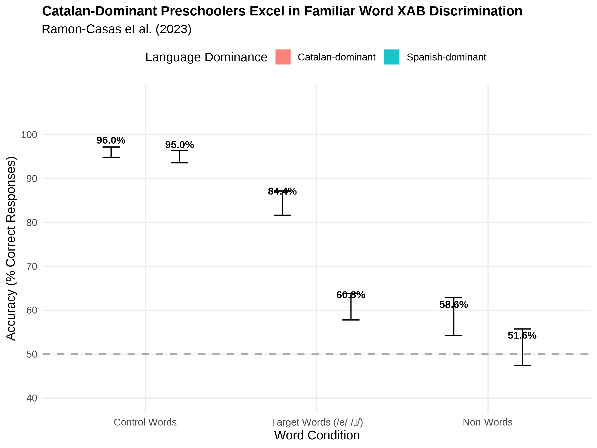
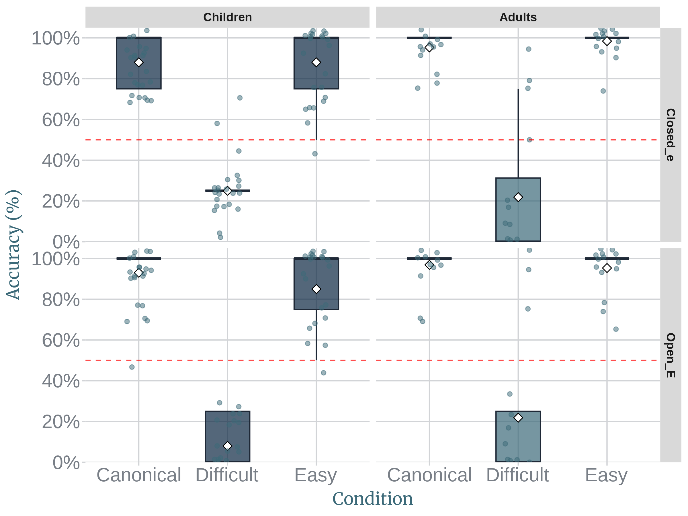
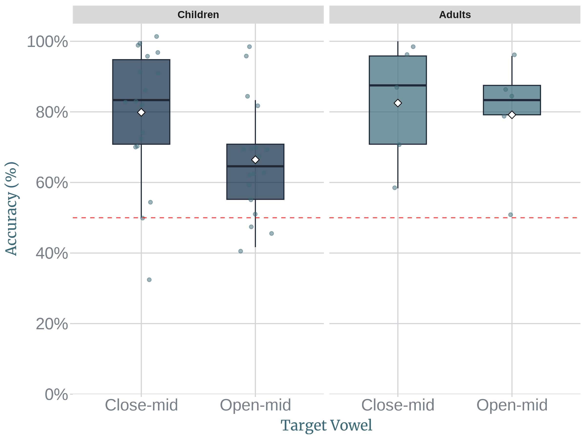
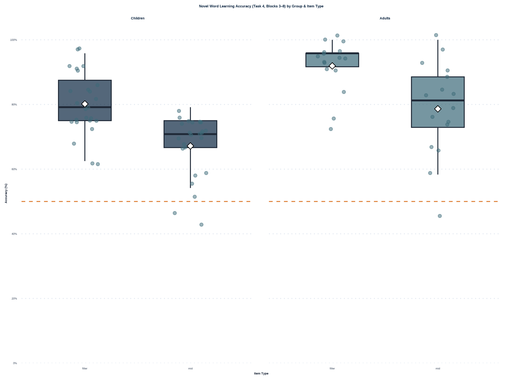

```{r setup-knitr, include=FALSE}
knitr::opts_chunk$set(
  echo = FALSE,
  warning = FALSE,
  message = FALSE,
  dev = "svg",         # Renders as crisp vector graphics
  fig.width = 7,       # Aspect ratio width
  fig.height = 4.2,    # Aspect ratio height
  out.width = "100%",  # Stretches plot to fit slide/column width
  dpi = 300            # Fallback high resolution
)
library(ggplot2)
library(showtext)

# 1. Download and register a Unicode/IPA-compatible font
font_add_google("Noto Sans", "noto")
showtext_auto()  # Enables showtext rendering for all ggplot objects

```


```{css, echo = FALSE, eval = FALSE}

.center2 {
  margin: 0;
  position: absolute;
  top: 50%;
  left: 50%;
  -ms-transform: translate(-50%, -50%);
  transform: translate(-50%, -50%);
}

.regression table {
  font-size: 12px;     
}

.caption {
  font-size: .6rem;
}

.center-text {
  text-align: center;
  font-size: 7rem;
}

@media print {
  body, html, .remark-slides-area, .remark-notes-area {
    height: 100% !important;
    width: 100% !important;
    overflow: visible;
    display: inline-block;
  }
    
  p1 { 
    color: red; 
    top: 15cm !important; 
    position: relative !important; 
    left: 1cm !important;
  }
}
```

```{r xaringan-themer, include=FALSE, warning=FALSE}
library(xaringanthemer)

style_duo(
  # Palette: Oxford Navy & Slate Steel (Formal / Academic)
  primary_color   = "#0A2540", # Oxford Navy
  secondary_color = "#3B6978", # Muted Slate Steel
  text_color      = "#1F2937", # High-contrast Dark Charcoal
  background_color = "#FFFFFF", # Crisp Pure White
  
  # Typography: Classical Academic Serif Headers paired with Clean Professional Body
  header_font_google = google_font("Merriweather", "700"),
  text_font_google   = google_font("Source Sans Pro", "400", "400i", "700"),
  code_font_google   = google_font("Source Code Pro", "400"),
  
  # Sizing & Hierarchical Ratios
  text_font_size      = "0.8rem",
  header_h1_font_size = "1.8em",
  header_h2_font_size = "1.2rem",
  header_h3_font_size = "1.1rem",
  
  # Custom CSS for Professional Structure
  extra_css = list(
    ".remark-slide-content" = list(
      "padding"     = "2.5em 4em 2.5em 4em",
      "line-height" = "1.6"
    ),
    "blockquote" = list(
      "border-left"   = "4px solid #0A2540",
      "background"    = "#F3F4F6",
      "padding"       = "0.8em 1.2em",
      "border-radius" = "0.5px", # Sharp lines look more formal than rounded edges
      "font-style"    = "italic",
      "color"         = "#374151"
    ),
    ".inverse" = list(
      "background-color" = "#0A2540",
      "color"            = "#FFFFFF"
    ),
    ".inverse h1, .inverse h2, .inverse h3" = list(
      "color" = "#FFFFFF"
    )
  )
)

# Global Theme Settings for Plots
theme_keynote <- function() {
  theme_minimal(base_size = 14, base_family = "noto") +
    theme(
      panel.border = element_rect(color = "grey80", fill = NA, linewidth = 0.5),
      panel.grid.minor = element_blank(),
      legend.position = "bottom",
      plot.title = element_text(face = "bold", size = 14),
      plot.subtitle = element_text(size = 11, color = "grey30")
    )
}

group_colors <- c("Catalan-dominant" = "#0072B2", "Spanish-dominant" = "#D55E00")

```


---

## Early bilingual Grammars


* Early bilinguals are individuals who receive regular, continuous exposure to two languages during early childhood, acquiring them either simultaneously from birth or sequentially in their preschool years <small>(De Houwer, 2009; Kehoe, 2021; Mayr et al., 2021; Meisel, 2009)</small>.

* While the two grammars of early bilingual speakers **develop largely independently**, they also **influence each other** throughout life in both childhood and adulthood <small>(e.g., Genesee, 1989; Kehoe, 2021; Mayr et al., 2021; Paradis & Genesee, 1996; Sundara, 2021)</small>.

* This interaction often results in **crosslinguistic transfer patterns**, where speakers apply features or structures from one language when using the other <small>(Amengual, 2023, 2024; Bosch, 2021; James, 2012; Kehoe, 2021; Paradis & Genesee, 1996)</small>.

* Crucially, age of initial exposure alone does not guarantee balanced, native-like competence; instead, an early bilingual's phonetic categories and lexical representations remain dynamic across the lifespan, shaped continuously by **language dominance, cumulative daily exposure, and the quality of environmental input**. <small>(e.g, Amengual & Simonet, 2020; Birdsong & Amengual, 2021; Bosch, 2021; Mayr et al., 2021; Pallier et al., 1997; Ramón-Casas et al., 2023)</small>


---

## Modeling Early Bilingual Sound Systems


* Cross-linguistic transfer in early bilinguals' sound system is not a static default copy of L1 structures into L2; rather, it reflects a **bidirectional and continuous interaction** between two fully co-activated sound systems <small>(e.g., Amengual, 2024; Birdsong & Amengual, 2021; Flege & Bohn, 2021; Grosjean, 2008)</small>.

* Rather than consisting of two isolated compartments, an early bilingual's sound system operates as an **integrated, multi-level architecture** sharing a common cognitive space <small>(e.g., Flege & Bohn, 2021; Natvig, 2021; Zhou & Hamann, 2024)</small>.

* This interaction is **dynamic across the lifespan**, fluctuating continuously according to real-time language modes, shifts in language dominance, and the quality of environmental input <small>(e.g., Amengual & Simonet, 2020; Grosjean, 2011; Simonet & Amengual, 2020)</small>.


---

## Modeling Early Bilingual Sound Systems


* Crucially, empirical findings from early bilinguals demonstrate that underlying phonological contrasts are more likely to remain **stable**, while cross-linguistic interaction operates primarily at the **phonetic level of representation**, where procedural cue-weight mapping and articulatory implementation remain **flexible, gradient, and adaptive** to language mode, daily exposure, and community input <small>(e.g., Amengual, 2016, 2024; Amengual & Simonet, 2020; Natvig, 2021; Ramón-Casas et al., 2023; Repiso-Puigdelliura, 2025; Simonet & Amengual, 2020)</small>.


```{r}
library(ggplot2)
library(dplyr)

# 1. Define the 3 Core Modular Tiers (Natvig, 2021)
levels_df <- tribble(
  ~xmin, ~xmax, ~ymin, ~ymax, ~title, ~spec, ~domain,
  2.3, 5.7, 4.2, 5.0, "1. Phonology (Grammatical Knowledge)", "| Abstract Contrasts |", "Phonology",
  2.3, 5.7, 2.6, 3.4, "2. Phonetics-Phonology Interface", "[ Articulatory Gestures, Completions & Enhancements]", "Interface / Procedural",
  2.3, 5.7, 1.0, 1.8, "3. Phonetics (Physical Realization)", "[[ Gradient Acoustic & Motor Signal Execution]]", "Phonetics"
)

# 2. Grammar & Procedural Mapping Modules (Between Tiers)
grammars_df <- tribble(
  ~x, ~y, ~label,
  4.0, 3.8, "Completions & Enhancements (Dimensions ↔ Gestures)",
  4.0, 2.2, "Phonetic Implementation (Gestures ↔ Physical Signal)"
)

# 3. Process Direction Flow (Perception vs. Production)
flow_arrows <- tribble(
  ~x, ~y, ~xend, ~yend, ~label, ~side,
  # Perception / Categorization (Bottom-Up)
  1.5, 1.2, 1.5, 4.8, "PERCEPTION & CATEGORIZATION\n(Continuous Signal → Abstract Category)", "Perception",
  # Production / Implementation (Top-Down)
  6.5, 4.8, 6.5, 1.2, "PRODUCTION & IMPLEMENTATION\n(Abstract Category → Gestures → Signal)", "Production"
)

# 4. Render Diagram
p_natvig <- ggplot() +
  # Tier Representation Blocks
  geom_rect(data = levels_df, aes(xmin = xmin, xmax = xmax, ymin = ymin, ymax = ymax, fill = domain),
            color = "grey20", linewidth = 0.8, alpha = 0.88) +
  
  # Text Inside Blocks (Title + Specification)
  geom_text(data = levels_df, aes(x = (xmin + xmax) / 2, y = (ymin + ymax) / 2 + 0.12, label = title),
            fontface = "bold", size = 3.9, color = "white") +
  geom_text(data = levels_df, aes(x = (xmin + xmax) / 2, y = (ymin + ymax) / 2 - 0.14, label = spec),
            fontface = "italic", size = 3.1, color = "grey95") +
  
  # Grammar & Interface Mapping Labels
  geom_label(data = grammars_df, aes(x = x, y = y, label = label),
             fill = "white", color = "grey20", size = 3.0, fontface = "bold",
             label.padding = unit(0.22, "lines"), border.color = "grey60") +
  
  # Vertical Directional Flow Arrows
  geom_segment(data = flow_arrows, aes(x = x, y = y, xend = xend, yend = yend, color = side),
               arrow = arrow(length = unit(0.35, "cm")), linewidth = 1.3) +
  geom_text(data = flow_arrows, aes(x = x, y = (y + yend) / 2, label = label, color = side),
            angle = ifelse(flow_arrows$side == "Perception", 90, -90),
            vjust = -0.8, fontface = "bold", size = 3.2) +


  # Color Scales
  scale_fill_manual(values = c(
    "Phonology" = "#0072B2", 
    "Interface / Procedural" = "#009E73", 
    "Phonetics" = "#E69F00"
  )) +
  scale_color_manual(values = c(
    "Perception" = "#0072B2", 
    "Production" = "#D55E00"
  )) +
  
  # Layout Settings
  scale_x_continuous(limits = c(0.5, 7.5)) +
  scale_y_continuous(limits = c(0.4, 5.6)) +
  labs(
    title = "Integrated Multilingual Sound System Architecture",
    caption = "Natvig (2021, Languages) "
  ) +
  theme_void(base_size = 11) +
  theme(
    plot.title = element_text(face = "bold", size = 13, hjust = 0.5, margin = margin(b = 4)),
    plot.subtitle = element_text(size = 9.5, face = "italic", hjust = 0.5, color = "grey30", margin = margin(b = 10)),
    plot.caption = element_text(size = 8, color = "grey50", hjust = 0.95),
    legend.position = "none"
  )

# Display plot in R Markdown slide
p_natvig
```

???


???

* The **Catalan stressed vowel system** includes seven vowels: /i e ɛ a ɔ o u/, contrasting:
  * High-mid: /e, o/
  * Low-mid: /ɛ, ɔ/
* The **lexical distribution** of these mid vowels varies across dialects.


???
Where could transfer occur in the phonetic systems? (Natvig, 2019)


- It could occur at the phonetic-perceptual level of representation (perception)

- It could occur when mapping phonetic categories to gestures (production)

- It could occur at the level of the lexical representation (mapping of phonemes at the level of the phonological word)


- It could occur at the perceptual level: cue-weightings that are influenced by the Spanish grammar, and associate a low-mid vowel to a high mid vowel, Spanish cue-weightings are active when examining Catalan cue-weightings


## Loci of Cross-Linguistic Transfer in BiPhon

.pull-left[
### **1. Prelexical Perception ([AudF] \\(\rightarrow\\) /SF/)**
* **Cue Constraints (`[Acoustics] /Category/`):** 
  * Map continuous auditory dimensions (\\(F1, F2, F3\\), duration) onto discrete surface categories.
  * *L1 Filtering:* L1 cue weights act as an attractor grid (e.g., mapping Catalan \\(/e/\text{--}/\varepsilon/\\) or foreign liquids to L1 target regions).

* **Structural Constraints (`Phonotactics`):**
  * Enforce language-specific syllable well-formedness (e.g., coda restrictions).
  * Conflict between Cue and Structural constraints triggers **perceptual repairs** (e.g., illusory schwa epenthesis in prohibited codas).
]

.pull-right[
### **2. Lexical Encoding (/SF/ \\(\leftrightarrow\\) |UF|)**
* **Faithfulness Constraints (`|UF| /SF/`):**
  * Map surface representations (/SF/) to stored lexical items (|UF|) in long-term memory.

* **Functional Homophony & "Fuzzy" Entries:**
  * When prelexical Cue constraints collapse a non-native contrast into a single /SF/ category (single-category assimilation), the lexical mapping produces **functional homophones**.
  * *Example:* Spanish-dominant bilinguals map both *gall[e]da* and *gall[ɛ]da* to the same underlying entry `|galleda|`.
]


---

## Modeling Ealry Bilingual Sound Systems


-   At the prelexical level, acoustic and phonotactic constraints filter continuous speech into discrete surface representations (/SF/), where L1 perceptual biases can collapse fine phonetic contrasts.
When mapped to the lexicon, these merged surface forms share a single underlying entry (|UF|) <small>(Boersma & Hamann, 2008, 2009b; Boersma, 2011; Zhou & Hamann, 2024)</small> 

```{r biphon-model, echo=FALSE, fig.width=9.5, fig.height=6.5, out.width="90%"}

library(ggplot2)
library(dplyr)

# 1. Define the 5 Core Levels of Representation
levels_df <- tribble(
  ~xmin, ~xmax, ~ymin, ~ymax, ~title, ~spec, ~domain,
  2.3, 5.7, 5.2, 6.0, "Semantic Representation (SemR)", "Meaning & Morphemes", "Phonology",
  2.3, 5.7, 4.0, 4.8, "Underlying Representation (UR)", "| Abstract Phonological Word |", "Phonology",
  2.3, 5.7, 2.8, 3.6, "Surface Representation (SR)", "/ Distinctive Phonological Features /", "Phonology",
  2.3, 5.7, 1.6, 2.4, "Auditory Representation (AudR)", "[ Continuous Acoustic / Formant Space ]", "Phonetics",
  2.3, 5.7, 0.4, 1.2, "Articulatory Representation (ArtR)", "[ Motor Gestures & Muscle Execution ]", "Phonetics"
)

# 2. Grammar Modules / Mapping Constraints (Between Levels)
grammars_df <- tribble(
  ~x, ~y, ~label,
  4.0, 4.9, "Lexical Mapping (UR ↔ SemR)",
  4.0, 3.7, "Phonological Grammar (Faithfulness & Structural / Markedness)",
  4.0, 2.5, "Phonetic-Phonological Grammar (Cue Constraints: AudR ↔ SR)",
  4.0, 1.3, "Sensorimotor Grammar (Effort & Sensorimotor Constraints)"
)

# 3. Process Direction Flow (Comprehension vs. Production)
flow_arrows <- tribble(
  ~x, ~y, ~xend, ~yend, ~label, ~side,
  # Perception / Comprehension (Bottom-Up)
  1.5, 1.8, 1.5, 5.6, "COMPREHENSION / PERCEPTION\n(Bottom-Up Processing)", "Perception",
  # Production (Top-Down)
  6.5, 5.6, 6.5, 0.8, "PRODUCTION\n(Top-Down Processing)", "Production"
)

# Render Diagram
ggplot() +
  # Representation Blocks
  geom_rect(data = levels_df, aes(xmin = xmin, xmax = xmax, ymin = ymin, ymax = ymax, fill = domain),
            color = "grey30", linewidth = 0.7, alpha = 0.85) +
  
  # Text inside Blocks (Title + Specification)
  geom_text(data = levels_df, aes(x = (xmin + xmax) / 2, y = (ymin + ymax) / 2 + 0.12, label = title),
            fontface = "bold", size = 4, color = "white") +
  geom_text(data = levels_df, aes(x = (xmin + xmax) / 2, y = (ymin + ymax) / 2 - 0.15, label = spec),
            fontface = "italic", size = 3.2, color = "grey95") +
  
  # Grammar Mapping Labels (Between Levels)
  geom_label(data = grammars_df, aes(x = x, y = y, label = label),
             fill = "white", color = "grey20", size = 3.1, fontface = "bold",
             label.padding = unit(0.2, "lines"), border.color = "grey70") +
  
  # Vertical Directional Flow Arrows
  geom_segment(data = flow_arrows, aes(x = x, y = y, xend = xend, yend = yend, color = side),
               arrow = arrow(length = unit(0.35, "cm")), linewidth = 1.3) +
  geom_text(data = flow_arrows, aes(x = x, y = (y + yend) / 2, label = label, color = side),
            angle = ifelse(flow_arrows$side == "Perception", 90, -90),
            vjust = ifelse(flow_arrows$side == "Perception", -0.8, -0.8),
            fontface = "bold", size = 3.5) +
  
  # Auditory-Articulatory Loop (Feedback connection)
  geom_curve(aes(x = 5.7, y = 0.8, xend = 5.7, yend = 2.0),
             arrow = arrow(length = unit(0.25, "cm"), ends = "both"),
             color = "#D55E00", curvature = -0.5, linewidth = 0.8, linetype = "dashed") +
  annotate("text", x = 6.4, y = 1.4, label = "Auditory Feedback\n(Sensorimotor Loop)", 
           size = 2.8, color = "#D55E00", fontface = "italic") +

  # Color Manual Scales
  scale_fill_manual(values = c("Phonology" = "#0072B2", "Phonetics" = "#E69F00")) +
  scale_color_manual(values = c("Perception" = "#009E73", "Production" = "#D55E00")) +
  
  # Layout Settings
  scale_x_continuous(limits = c(0.5, 7.5)) +
  scale_y_continuous(limits = c(0.1, 6.5)) +
  labs(
       title = "The Bidirectional Phonology and Phonetics Model (BiPhon)"
  ) +
  theme_void(base_size = 12) +
  theme(
    plot.title = element_text(face = "bold", size = 14, margin = margin(b = 3)),
    plot.subtitle = element_text(size = 10.5, color = "grey30", margin = margin(b = 10)),
    legend.position = "none",
    plot.margin = margin(10, 10, 10, 10)
  )
```

```{r}
library(ggplot2)
library(dplyr)

# 1. Processing Modules (Core BiPhon Auditory-Motor Pipeline)
modules <- tribble(
  ~xmin, ~xmax, ~ymin, ~ymax, ~label,
  1.5, 4.0, 7.0, 8.0, "|Underlying Form|\n(Lexical Storage)",
  1.5, 4.0, 5.0, 6.0, "/Surface Form/\n(Phonological Categories)",
  1.5, 4.0, 3.0, 4.0, "[Auditory Form]\n(Perceptual Input)",
  1.5, 4.0, 1.0, 2.0, "[[Articulatory Form]]\n(Motor Execution)"
)

# 2. Vertical Internal Flow Arrows (Bidirectional)
vertical_arrows <- tribble(
  ~x, ~y, ~xend, ~yend,
  2.75, 6.0, 2.75, 7.0,  # SF <-> UF (Recognition / Phonological Implementation)
  2.75, 4.0, 2.75, 5.0,  # AudF <-> SF (Perception / Phonetic Implementation)
  2.75, 2.0, 2.75, 3.0   # ArtF <-> AudF (Articulation / Sensorimotor)
)

# 3. Loci of Cross-Linguistic Influence (CLI)
transfer_arrows <- tribble(
  ~x, ~y, ~xend, ~yend, ~label,
  4.0, 3.5, 4.8, 3.5, "Locus 1: Auditory Cue Constraints",
  4.0, 5.5, 4.8, 5.5, "Locus 2: Structural / Phonotactic Constraints",
  4.0, 1.5, 4.8, 1.5, "Locus 3: Articulatory Motor Complexity"
)

# 4. Text Annotations for Locus Descriptions
locus_descriptions <- tribble(
  ~x, ~y, ~text,
  4.9, 3.5, "• L1 acoustic cue weighting (spectral F3 vs. closure duration)\n• Drives L2-to-L1 category mapping & individual variability",
  4.9, 5.5, "• L1 syllable-structure restrictions (e.g., ManPhono)\n• Forces position-dependent repairs (e.g. illusory schwa /lə/ in coda)",
  4.9, 1.5, "• Physical difficulty of tongue-tip tap & coarticulation\n• Causes tap deletion in production despite accurate perception"
)

# Render Plot
ggplot() +
  # Draw Modules
  geom_rect(data = modules, aes(xmin = xmin, xmax = xmax, ymin = ymin, ymax = ymax),
            fill = "#0072B2", color = "#1C3D5A", linewidth = 0.6, alpha = 0.9) +
  
  # Module Text Labels
  geom_text(data = modules, aes(x = (xmin + xmax) / 2, y = (ymin + ymax) / 2, label = label),
            fontface = "bold", size = 3.8, color = "white") +
  
  # Vertical Bidirectional Flow Arrows
  geom_segment(data = vertical_arrows, aes(x = x, y = y, xend = xend, yend = yend),
               arrow = arrow(length = unit(0.25, "cm"), ends = "both"),
               color = "grey40", linewidth = 0.9) +
  
  # Horizontal Transfer / Loci Arrows
  geom_segment(data = transfer_arrows, aes(x = x, y = y, xend = xend, yend = yend),
               arrow = arrow(length = unit(0.3, "cm")), color = "#D55E00", linewidth = 1.2) +
  
  # Transfer Arrow Text Labels
  geom_text(data = transfer_arrows, aes(x = xend + 0.1, y = y + 0.22, label = label),
            color = "#D55E00", fontface = "bold", size = 3.5, hjust = 0) +
  
  # Locus Description Bullet Points
  geom_text(data = locus_descriptions, aes(x = x, y = y - 0.15, label = text),
            hjust = 0, vjust = 1, size = 3.2, color = "grey20", lineheight = 0.95) +
  
  # Axis & Plot Formatting
  scale_x_continuous(limits = c(0.5, 9.8)) +
  scale_y_continuous(limits = c(0.2, 8.8)) +
  labs(
    title = "Loci of Cross-Linguistic Influence in BiPhon-HG (Auditory-Motor Core)",
    subtitle = "Core architecture without orthographic/reading grammar (adapted from Zhou & Hamann, 2024)"
  ) +
  theme_void(base_size = 12) +
  theme(
    plot.title = element_text(face = "bold", size = 14, margin = margin(b = 4)),
    plot.subtitle = element_text(size = 10.5, color = "grey30", margin = margin(b = 12)),
    legend.position = "none",
    plot.margin = margin(10, 10, 10, 10)
  )
```

------

### Transfer in the phonological categorization (auditory form to surface form)


**Integrated phonetic space**: L1 and L2 categories co-exist and interact within a shared perceptual space (SLM-r, PAM-L2) (Speech Learning Model [SLM/SLM-r], Flege, 1995; Flege, Aoyama, & Bohn, 2021; Perceptual Assimilation Model of L2 [PAM-L2], Best & Tyler, 2007).

**L1 filtering**: Early-established L1 perceptual boundaries act as attractors, absorbing L2 sounds that fall within the target language tolerance regions (Native Language Magnet Model, Kuhl, 1991, 2004; Kuhl et al., 2008; Pallier, Bosch, & Sebastián-Gallés, 1997; Guion et al., 2000).


Dynamic context-dependency: Perceptual boundaries in early bilinguals are not static; they shift dynamically based on ongoing language use, overall dominance, and language mode (Language Mode Framework, Grosjean, 1998, 2001, 2008; Flege, MacKay, & Meador, 1999; Antoniou et al., 2012).


---
## Modeling Early Bilingual Sound Systems

- Early-established L1 cue weights act as a perceptual filter, collapsing distinct acoustic inputs into a single phonetic category space <small>(Flege, 1995; Flege & Bohn, 2021)</small>. 

```{r slm, echo=FALSE}

#*BiPhon Implementation:In BiPhon <small>(Boersma & Hamann, 2008; Escudero & Boersma, 2004)</small>, this interaction is governed by Cue Constraints** mapping continuous Auditory Forms (\\([AudF]\\)) onto discrete Surface Forms (\\(/SF/\\)).

library(ggplot2)
library(dplyr)
library(stringr)

# Parametric ellipse coordinate generator
make_ellipse <- function(x_center, y_center, x_radius, y_radius, category, model) {
  theta <- seq(0, 2 * pi, length.out = 100)
  data.frame(
    F2 = x_center + x_radius * cos(theta),
    F1 = y_center + y_radius * sin(theta),
    Category = category,
    Model = model
  )
}

# 1. Category Assimilation: L2 /ɛ/ merged into L1 /e/ space -> Composite Diaphone
m1_assim <- make_ellipse(1850, 530, 160, 110, "Composite L1-L2 /e/", "1. Category Assimilation\n(Composite L1-L2 Diaphone)")

# 2. Equivalence Class Emergence: Goodness-of-fit difference detected
m2_l1e   <- make_ellipse(1900, 480, 110, 70, "L1 /e/", "2. Discerning Dissimilarity\n(Equivalence Class Emergence)")
m2_l2eps <- make_ellipse(1760, 620, 100, 70, "L2 /ɛ/ (Equivalence Class)", "2. Discerning Dissimilarity\n(Equivalence Class Emergence)")

# 3. New Category Formation: Distinct L2 category formed + phonetic deflection
m3_l1e   <- make_ellipse(1930, 450, 85, 55, "L1 /e/", "3. New Category Formation\n(Shared Space Deflection)")
m3_l2eps <- make_ellipse(1710, 650, 85, 55, "L2 /ɛ/", "3. New Category Formation\n(Shared Space Deflection)")

df_ellipses <- bind_rows(m1_assim, m2_l1e, m2_l2eps, m3_l1e, m3_l2eps)

# Centroid Labels
df_centers <- tribble(
  ~F2,  ~F1,  ~Label,                   ~Model,
  1850, 530, "L1-L2 [e]",               "1. Category Assimilation\n(Composite L1-L2 Diaphone)",
  1900, 480, "L1 /e/",                  "2. Discerning Dissimilarity\n(Equivalence Class Emergence)",
  1760, 620, "L2 [ɛ]?",                 "2. Discerning Dissimilarity\n(Equivalence Class Emergence)",
  1930, 450, "L1 /e/",                  "3. New Category Formation\n(Shared Space Deflection)",
  1710, 650, "L2 /ɛ/",                  "3. New Category Formation\n(Shared Space Deflection)"
)

# Reference anchors (/i/ and /a/)
df_anchors <- tribble(
  ~F2,  ~F1,  ~Label,
  2150, 320,  "/i/",
  1460, 740,  "/a/"
)

# Render Plot
slm <- ggplot() +
  # Anchor reference vowels
  geom_text(data = df_anchors, aes(x = F2, y = F1, label = Label), 
            color = "grey65", size = 5, fontface = "italic", family = "noto") +

  # Ellipse distributions
  geom_polygon(data = df_ellipses, aes(x = F2, y = F1, fill = Category, color = Category), 
               alpha = 0.35, linewidth = 0.8) +

  # Centroid text
  geom_text(data = df_centers, aes(x = F2, y = F1, label = Label), 
            color = "black", size = 4.2, fontface = "bold", family = "noto") +

  facet_wrap(~ Model) +

  # Standard Phonetic Reversed Axes
  scale_x_reverse(limits = c(2250, 1350), name = "F2 (Hz)  [<- Back  |  Front ->]") +
  scale_y_reverse(limits = c(800, 280),  name = "F1 (Hz)  [<- High  |  Low ->]") +

  scale_fill_manual(values = c("L1 /e/" = "#0072B2", "L2 /ɛ/" = "#D55E00", "L2 /ɛ/ (Equivalence Class)" = "#E69F00", "Composite L1-L2 /e/" = "#707070")) +
  scale_color_manual(values = c("L1 /e/" = "#0072B2", "L2 /ɛ/" = "#D55E00", "L2 /ɛ/ (Equivalence Class)" = "#E69F00", "Composite L1-L2 /e/" = "#333333")) +

  labs(
    title = "SLM-r Mechanisms of Cross-Linguistic Mapping & L1 Modification",
   
    caption = "Based on the Speech Learning Model (SLM / SLM-r; Flege, 1995; Flege & Bohn, 2021)"
  ) +
  theme_minimal(base_size = 12, base_family = "noto") +
  theme(
    panel.border = element_rect(color = "grey80", fill = NA, linewidth = 0.5),
    panel.grid.minor = element_blank(),
    strip.text = element_text(face = "bold", size = 10, family = "noto"),
    legend.position = "bottom"
  )

# Display plot in R Markdown
slm
#ggsave("slm.png", plot = slm, device = ragg::agg_png, width = 8, height = 6, dpi = 300)

# Method A: Display in R Markdown / Quarto / RStudio Viewer
#knitr::include_graphics("slm.png")


```


---
## Shortcomings of these models

-   Models <small>(SLM-r, PAM-L2, L2LP)</small> explain how new L2 categories emerge from L1 categories or cue weightings, but offer few mechanisms for real-time category co-existence in **simultaneous bilinguals**.

-  They treat perception as a fixed trait (AoA, exposure ratio), lacking mechanisms for how online **language mode** <small>(Grosjean, 2008)</small> or working-memory **co-activation** <small>(Green & Abutalebi, 2013)</small> dynamically modulate perception.

-  They presume stable, homogeneous input, ignoring how **community-level input variability** (e.g., regional/accented speech) continuously reshapes sound categorization.

-  They assume prelexical perception directly dictates storage, failing to explain why listeners exhibit **acoustic acuity (XAB)** alongside poor lexical task performance <small>(Amengual, 2016; Darcy et al., 2013; Llompart, 2021)</small>.


---

## Sociolinguistic context in Catalonia (I)

```{r my-image, echo=FALSE, out.width="55%", fig.align="center", fig.cap=""}
knitr::include_graphics("map.png")

```

---

## Sociolinguistic context in Catalonia (II)


```{r habitual, echo=FALSE, fig.width=9.5, fig.height=6.5, out.width="100%"}
# Option A: Embedding via knitr (Recommended for RMarkdown output rendering)
# Ensure the image file 'eulp_language_trends_2003_2023.png' is placed in your working directory.
#STREAMING_CHUNK:Loading required R packages...
library(tidyverse)
library(scales)
#STREAMING_CHUNK:Constructing longitudinal EULP dataset...
#1. Construct Longitudinal EULP Dataset (2003-2023)
eulp_data <- tibble(
Year = rep(c(2003, 2008, 2013, 2018, 2023), times = 5),
Category = factor(
rep(
c("Spanish", "Catalan", "Both (Catalan & Spanish)", "Other Languages", "Other Combinations"),
each = 5
),
levels = c("Spanish", "Catalan", "Both (Catalan & Spanish)", "Other Languages", "Other Combinations")
),
Percentage = c(
# Spanish
47.2, 45.9, 50.7, 48.6, 46.5,
# Catalan
46.0, 35.6, 36.3, 36.1, 32.6,
# Both (Catalan & Spanish)
4.7,  11.9,  6.9,  7.4,  9.4,
# Other Languages
2.0,   4.8,  4.7,  4.3,  4.5,
# Other Combinations (Recorded from 2018 onward)
NA,    NA,   NA,  3.0,  5.6
)
)
#STREAMING_CHUNK:Filtering data and defining color palette...
#Filter out NA rows for plotting continuous line paths
df_plot <- eulp_data %>% filter(!is.na(Percentage))
#Color palette mapping
language_colors <- c(
"Spanish"                  = "#D55E00", # Warm red-orange
"Catalan"                  = "#005580", # Deep navy/teal
"Both (Catalan & Spanish)" = "#009E73", # Bluish green
"Other Languages"          = "#E69F00", # Gold/Yellow
"Other Combinations"       = "#787C82"  # Neutral slate
)
#STREAMING_CHUNK:Building publication-quality ggplot graphic...
#2. Build Publication-Quality ggplot Graphic
p_eulp <- ggplot(df_plot, aes(x = Year, y = Percentage, color = Category, group = Category)) +
#Reference gridlines & zero line
geom_hline(yintercept = 0, color = "#cbd5e1", linewidth = 0.5) +
#Main Trend Lines & Markers
geom_line(linewidth = 1.3, alpha = 0.9) +
geom_point(size = 3.5) +
#Value Annotations on Data Points
geom_text(
aes(label = paste0(sprintf("%.1f", Percentage), "%")),
vjust = -0.9,
size = 3.6,
fontface = "bold",
show.legend = FALSE
) +
#Scales & Axis Configuration
scale_x_continuous(
breaks = c(2003, 2008, 2013, 2018, 2023),
limits = c(2002.5, 2023.5)
) +
scale_y_continuous(
limits = c(0, 60),
breaks = seq(0, 60, by = 10),
labels = function(x) paste0(x, "%")
) +
scale_color_manual(values = language_colors) +
#STREAMING_CHUNK:Configuring labels and theme...
labs(
title = "Evolution of Habitual Language Identification in Catalonia (2003-2023)",
subtitle = "Percentage of population aged 15+ by primary/habitual language (llengua habitual)",
x = "Survey Wave Year",
y = "Percentage of Population (%)",
color = "Language Category",
caption = "Source: Enquesta d'Usos Lingüístics de la Població (EULP 2003, 2008, 2013, 2018, 2023) | IDESCAT"
) +
#Modern Minimalist Styling
theme_minimal(base_size = 13) +
theme(
plot.title = element_text(face = "bold", size = 15, color = "#0f172a", margin = margin(b = 6)),
plot.subtitle = element_text(size = 11, color = "#475569", margin = margin(b = 18)),
plot.caption = element_text(size = 9, color = "#64748b", margin = margin(t = 16)),
axis.title.x = element_text(face = "bold", size = 11, color = "#1e293b", margin = margin(t = 10)),
axis.title.y = element_text(face = "bold", size = 11, color = "#1e293b", margin = margin(r = 10)),
axis.text = element_text(size = 11, color = "#334155"),
panel.grid.major.x = element_blank(),
panel.grid.minor = element_blank(),
panel.grid.major.y = element_line(color = "#f1f5f9", linewidth = 0.8),
legend.position = "top",
legend.title = element_text(face = "bold", size = 11),
legend.text = element_text(size = 10),
legend.key.width = unit(1.2, "cm"),
plot.margin = margin(20, 20, 20, 20)
)
#STREAMING_CHUNK:Displaying and exporting high-resolution graphic...
#3. Display plot in graphics device
print(p_eulp)
#Export High-Resolution PNG for Presentation/Slides
ggsave(
filename = "eulp_language_trends_2003_2023_english.png",
plot = p_eulp,
width = 11,
height = 6.5,
dpi = 300
)


```


???


**Co-Official Status**: Catalan and Spanish are co-official languages in Catalonia, Spain.

**Immersion Schooling Model (Escola en Català)**: Introduced in the 1980s, all children in public schooling receive early, intensive instruction in Catalan regardless of home language.


---


## The Catalan Vowel System


```{r vowel-space-scheme, message=FALSE, warning=FALSE}
library(ggplot2)
library(dplyr)
library(ragg)
# 1. Coordinate data points (Recasens & Espinosa, 2006)
library(dplyr)
library(ggplot2)
library(ragg)

# 1. Coordinate data points (Recasens & Espinosa, 2006)
library(ggplot2)
library(dplyr)
library(showtext)

# 1. Load Noto Sans for full Unicode / IPA character support
font_add_google("Noto Sans", "noto")
showtext_auto()

# Data frames
catalan_vowels <- data.frame(
  vowel = c("i", "e", "ɛ", "a", "ɔ", "o", "u", "ə"),
  F1 = c(320, 480, 660, 740, 710, 540, 390, 560),
  F2 = c(2150, 1900, 1740, 1460, 1170, 1000, 900, 1400),
  sys = "Catalan"
)

spanish_vowels <- data.frame(
  vowel = c("i", "e", "a", "o", "u"),
  F1 = c(320, 560, 730, 490, 370),
  F2 = c(2130, 1820, 1400, 1060, 930),
  sys = "Spanish"
)

# Polygon paths (perimeter ordering)
cat_poly <- catalan_vowels %>% filter(vowel != "ə") %>% slice(c(1:7, 1))
sp_poly  <- spanish_vowels %>% slice(c(1:5, 1))

# 2. Render plot
ggplot() +
  # Polygon boundaries
  geom_path(data = cat_poly, aes(x = F2, y = F1), color = "#005f73", linewidth = 1.2, linetype = "solid") +
  geom_path(data = sp_poly, aes(x = F2, y = F1), color = "#ca6702", linewidth = 1.2, linetype = "dashed") +
  
  # Catalan Vowel Labels (family = "noto", adjusted size)
  geom_text(data = catalan_vowels, aes(x = F2, y = F1, label = vowel), 
            color = "#005f73", fontface = "bold", size = 7.5, family = "noto") +
  
  # Spanish Vowel Labels (family = "noto", adjusted size & offset)
  geom_text(data = spanish_vowels, aes(x = F2 - 45, y = F1 + 20, label = vowel), 
            color = "#ca6702", fontface = "bold", size = 6.0, family = "noto") +
  
  # Phonetic standard reversed axes (High/Front at top-left)
  scale_x_reverse(limits = c(2250, 850), name = "F2 (Hz)  [ Back  |  Front ]") +
  scale_y_reverse(limits = c(800, 280), name = "F1 (Hz)  [ High  |  Low ]") +
  
  labs(
    title = "Catalan vs. Spanish Acoustic Vowel Space",
    subtitle = "Solid line = Catalan | Dashed line = Spanish",
    caption = "Adapted from Recasens & Espinosa (2006)"
  ) +
  theme_minimal(base_size = 13, base_family = "noto") +
  theme(
    plot.title = element_text(face = "bold", size = 15),
    panel.grid.minor = element_blank(),
    panel.border = element_rect(color = "grey80", fill = NA, linewidth = 0.5)
  )
#ggsave("catalan_spanish_vowels.png", plot = p, device = ragg::agg_png, width = 8, height = 6, dpi = 300)

# Method A: Display in R Markdown / Quarto / RStudio Viewer
#knitr::include_graphics("catalan_spanish_vowels.png")


```


---

## Early exposure as a crucial factor for the mid vowel contrast
#### **Pallier, Bosch, & Sebastián-Gallés (1997)**


**Catalan-Dominant** (n = 20): Raised by Catalan-speaking parents; exposed to Catalan from birth.

**Spanish-Dominant** (n = 20): Raised by Spanish-speaking parents; early intensive Catalan immersion started between ages 1–6 (mean age = 4.35 years).


.pull-left[

**Experiment 1: Identification Task**


<small>TasK: Listeners categorized each token as Pere (/e/) or pera (/ɛ/). </small>


```{r identification_curves, echo=FALSE, fig.width=9.5, fig.height=6.5, out.width="80%"}

#<small>Task: 63 randomized trials (7 stimuli x 9 repetitions).F1: Increased from 404Hz (s1, [e]) to 584Hz (s7, [ɛ]) in 30Hz steps.</small>
df_exp1 <- data.frame(
  Stimulus = factor(rep(paste0("s", 1:7), 2), levels = paste0("s", 1:7)),
  Percent_Pera = c(15, 17, 17, 43, 68, 82, 82,
                   54, 55, 48, 52, 44, 47, 36),
  Group = factor(rep(c("Catalan-dominant", "Spanish-dominant"), each = 7))
)

ggplot(df_exp1, aes(x = Stimulus, y = Percent_Pera, group = Group, color = Group, shape = Group)) +
  geom_line(linewidth = 1.2) +
  geom_point(size = 3.5) +
  scale_color_manual(values = group_colors) +
  scale_y_continuous(limits = c(0, 100), labels = function(x) paste0(x, "%")) +
  labs(
    subtitle = "Percentage of 'pera' (/ɛ/) responses across F1 steps",
    x = "Continuum Step (F1: 404 Hz → 584 Hz)",
    y = "Identified as /ɛ/ (%)"
  ) +
  theme_keynote()


#ggsave("exp1_identification.png", plot = exp1_identification, device = ragg::agg_png, width = 8, height = 6, dpi = 300)

#knitr::include_graphics("exp1_identification.png")

```


]


.pull-right[

**Experiment 2: AX Discrimination Task**


<small> Task: Button-press "Same / Different" discrimination.


```{r}
df_exp2 <- data.frame(
  Pair = factor(rep(c("s1-s3", "s2-s4", "s3-s5", "s4-s6", "s5-s7"), 2),
                levels = c("s1-s3", "s2-s4", "s3-s5", "s4-s6", "s5-s7")),
  Percent_Diff = c(20, 25, 65, 35, 15,
                   22, 24, 28, 25, 21),
  Group = factor(rep(c("Catalan-dominant", "Spanish-dominant"), each = 5))
)

ggplot(df_exp2, aes(x = Pair, y = Percent_Diff, group = Group, color = Group, shape = Group)) +
  geom_line(linewidth = 1.2) +
  geom_point(size = 3.5) +
  scale_color_manual(values = group_colors) +
  scale_y_continuous(limits = c(0, 100), labels = function(x) paste0(x, "%")) +
  labs(
    subtitle = "Percentage of 'Different' choices on 2-step pairs",
    x = "Stimulus Pair",
    y = "Discrimination Accuracy (%)"
  ) +
  theme_keynote()

```
]

???
## Bosch & Sebastián-Gallés (2003)


* **3 Home Environment Profiles:**
  * **Catalan Monolinguals:** Continuous exposure to Catalan (target $/e/\text{--}/\varepsilon/$ contrast present) [2].
  * **Spanish Monolinguals:** Continuous exposure to Spanish (contrast absent; single $/e/$ space) [2].
  * **Simultaneous Bilinguals:** Continuous, regular exposure to both Catalan and Spanish from birth [1, 2].

* **Paradigm:** **Head-Turn Preference Procedure (HTPP)** measuring auditory orientation to $/e/\text{--}/\varepsilon/$ minimal pairs (e.g., *['deði]* vs. *['dɛði]*) [2].


```{r developmental-dip-plot, echo=FALSE, fig.width=6.2, fig.height=5.2, out.width="80%", message=FALSE, warning=FALSE}
library(ggplot2)
library(dplyr)

# 1. Dataset representing discrimination performance across age groups
df_dip <- tribble(
  ~Age, ~Group, ~Score, ~Significance,
  4,  "Catalan Monolinguals",       2.20, "p < .05 (Pass)",
  8,  "Catalan Monolinguals",       2.30, "p < .02 (Pass)",
  12, "Catalan Monolinguals",       2.50, "p < .01 (Pass)",
  4,  "Spanish Monolinguals",       2.10, "p < .05 (Pass)",
  8,  "Spanish Monolinguals",       0.20, "p = .32 (Fail)",
  12, "Spanish Monolinguals",       0.10, "p > .20 (Fail)",
  4,  "Catalan–Spanish Bilinguals", 2.15, "p < .05 (Pass)",
  8,  "Catalan–Spanish Bilinguals", 0.15, "p > .50 (DIP)",
  12, "Catalan–Spanish Bilinguals", 2.25, "p < .01 (RE-EMERGE)"
)

# 2. Plotting with ggplot2
ggplot(df_dip, aes(x = Age, y = Score, color = Group, shape = Group, group = Group)) +
  # Chance level reference
  geom_hline(yintercept = 0, linetype = "dotted", color = "grey50", linewidth = 0.7) +
  annotate("text", x = 4.2, y = -0.25, label = "Chance Level (No Discrimination)", 
           fontface = "italic", size = 3, color = "grey40") +
  
  # Lines and Points
  geom_line(linewidth = 1.2) +
  geom_point(size = 3.5) +
  
  # Key Callouts for 8-Month Dip & 12-Month Re-emergence
  annotate("label", x = 8, y = -0.85, label = "Bilingual Dip\n(p > .50)", 
           fill = "#E6F4EA", color = "#009E73", fontface = "bold", size = 3.2, label.size = 0.4) +
  annotate("text", x = 12, y = 2.65, label = "Re-emergence\n(p < .01)", 
           color = "#009E73", fontface = "bold", size = 3.2) +
  annotate("text", x = 8, y = 2.65, label = "Retained\n(p < .02)", 
           color = "#0072B2", fontface = "bold", size = 3.2) +
  annotate("text", x = 8.8, y = -0.3, label = "Loss\n(p = .32)", 
           color = "#D55E00", fontface = "bold", size = 3.2) +

  # Color & Aesthetic Scales
  scale_color_manual(values = c(
    "Catalan Monolinguals" = "#0072B2",       # Blue
    "Spanish Monolinguals" = "#D55E00",       # Red/Vermilion
    "Catalan–Spanish Bilinguals" = "#009E73"  # Teal/Green
  )) +
  scale_shape_manual(values = c(16, 15, 17)) +
  
  # Axes & Labels
  scale_x_continuous(breaks = c(4, 8, 12), labels = c("4 Months\n(Universal)", "8 Months\n(Dip)", "12 Months\n(Recovered)")) +
  scale_y_continuous(limits = c(-1.2, 3.1)) +
  labs(
    subtitle = "Bosch & Sebastián-Gallés (2003)",
    x = "Infant Age",
    y = "Discrimination Performance Index",
    color = "Participant Group",
    shape = "Participant Group"
  ) +
  theme_minimal(base_size = 11, base_family = "sans") +
  theme(
    plot.title = element_text(face = "bold", size = 12),
    plot.subtitle = element_text(face = "italic", color = "grey30", size = 10),
    panel.grid.minor = element_blank(),
    legend.position = "bottom",
    legend.title = element_blank(),
    legend.text = element_text(size = 9)
  )


```

???


* **4 Months (Universal Sensitivity):**
  * Both Catalan and Spanish monolingual infants, as well as Catalan–Spanish bilinguals, successfully discriminate /e/–/ɛ/ (*['deði]* vs. *['dɛði]*).
  * Perception reflects language-general acoustic sensitivity before native-language filtering takes effect.

* **8 Months (Temporary Perceptual Dip):**
  * **Catalan Monolinguals:** Retain discrimination (p < .02).
  * **Spanish Monolinguals:** Fail to discriminate (p = .32) due to lack of contrast in Spanish.
  * **Bilingual Infants:** Show a **temporary loss of discrimination** (p > .50), exhibiting a pattern similar to Spanish monolinguals.

* **12 Months (Re-Emergence):**
  * Bilingual infants recover discrimination of the /e/–/ɛ/ contrast (p < .01).


---

## Early exposure as a crucial factor for the mid vowel contrast

#### **Ramon-Casas et al. (2023)**


* **Sample Size:** $N = 36$ early bilingual preschoolers (M age = 4.5 years; range: 4;0–5;0).
* **Location:** 4 public immersion kindergartens in the Barcelona metropolitan area.
* **Catalan Exposure:** Intensive, continuous exposure (at least 5 days/week since age 3).


```{r ramon-casas-dissociation-plot, echo=FALSE, fig.width=6.5, fig.height=5.2, out.width="70%", message=FALSE, warning=FALSE}
library(ggplot2)
library(dplyr)
library(patchwork)

# 1. Perception Data Frame
df_perception <- tribble(
  ~Task, ~Group, ~Accuracy,
  "Control Words\n(/i/–/a/)", "Catalan-dominant", 96.0,
  "Control Words\n(/i/–/a/)", "Spanish-dominant", 95.0,
  "Target Words\n(/e/–/ɛ/)", "Catalan-dominant", 84.4,
  "Target Words\n(/e/–/ɛ/)", "Spanish-dominant", 60.8,
  "Non-Words\n(/e/–/ɛ/)",    "Catalan-dominant", 58.6,
  "Non-Words\n(/e/–/ɛ/)",    "Spanish-dominant", 51.6
)

# 2. Production Data Frame
df_production <- tribble(
  ~Target, ~Group, ~Accuracy,
  "Target /e/", "Catalan-dominant", 100.0,
  "Target /e/", "Spanish-dominant", 100.0,
  "Target /ɛ/", "Catalan-dominant", 91.0,
  "Target /ɛ/", "Spanish-dominant", 41.3
)


# Panel A: Perception Plot
p1 <- ggplot(df_perception, aes(x = Task, y = Accuracy, fill = Group)) +
  geom_col(position = position_dodge(width = 0.8), width = 0.7, alpha = 0.9) +
  geom_hline(yintercept = 50, linetype = "dashed", color = "grey50") +
  geom_text(
    aes(label = paste0(Accuracy, "%")), 
    position = position_dodge(width = 0.8), 
    vjust = -0.4, size = 2.8, fontface = "bold", family = "noto"
  ) +
  scale_fill_manual(values = c("Catalan-dominant" = "#0072B2", "Spanish-dominant" = "#D55E00")) +
  scale_y_continuous(limits = c(0, 110)) +
  labs(title = "A. Perception (XAB Task)", y = "Accuracy (%)", x = NULL) +
  theme_minimal(base_size = 10, base_family = "noto") +
  theme(legend.position = "none", plot.title = element_text(face = "bold", size = 11))

# Panel B: Production Plot
p2 <- ggplot(df_production, aes(x = Target, y = Accuracy, fill = Group)) +
  geom_col(position = position_dodge(width = 0.8), width = 0.7, alpha = 0.9) +
  geom_text(
    aes(label = paste0(Accuracy, "%")), 
    position = position_dodge(width = 0.8), 
    vjust = -0.4, size = 2.8, fontface = "bold", family = "noto"
  ) +
  scale_fill_manual(values = c("Catalan-dominant" = "#0072B2", "Spanish-dominant" = "#D55E00")) +
  scale_y_continuous(limits = c(0, 110)) +
  labs(title = "B. Production Accuracy", y = "Target-like %", x = NULL) +
  theme_minimal(base_size = 10, base_family = "noto") +
  theme(legend.position = "bottom", legend.title = element_blank(), plot.title = element_text(face = "bold", size = 11))

# Combine Panels with patchwork
# Combine Panels with patchwork
p1 / p2


```


???

* **Perception (XAB Task at 4.5 Years):**
  * **Control Words:** Both Catalan-dominant (**96.0%**) and Spanish-dominant (**95.0%**) preschoolers perform near ceiling.
  * **Target Words (/e/–/ɛ/):** Catalan-dominant children significantly outperform Spanish-dominant peers (**84.4% vs. 60.8%**, $p < .01$).
  * **Non-Words:** Both groups perform near chance (**58.6% vs. 51.6%**), showing that early contrast processing relies on stored whole-word entries rather than abstract rules.


???

# Child Perception & Phonolexical Encoding
**Ramon-Casas et al. (2023)**

.pull-left[


**Participants**: $N = 4.5$-year-old Catalan–Spanish bilinguals in Barcelona immersion kindergartens.


**Task**: Auditory XAB discrimination testing canonical pronunciations vs. /e-ɛ/ mispronunciations.

Unaccented L1 home input (e.g., Catalan-speaking grandparents) significantly decreased mispronunciation acceptance.

Overall correlation was moderate (r = .45), but within-group scores dissociated, confirming auditory perception does not automatically drive motor output.


]

.pull-right[

**Stimulus Types**: Familiar Words: e.g., peix ([peʃ]), llet ([ʎɛt])Non-Words: e.g., dedi ([dedi]) vs. dɛdi ([dɛdi])


```{r}

df_perception <- data.frame(
  Condition = factor(rep(c("Control Words", "Target Words (/e/-/ɛ/)", "Non-Words"), each = 2),
                     levels = c("Control Words", "Target Words (/e/-/ɛ/)", "Non-Words")),
  Group = rep(c("Catalan-dominant", "Spanish-dominant"), times = 3),
  Accuracy = c(96.0, 95.0, 84.4, 60.8, 58.6, 51.6),
  SE = c(5.0/sqrt(18), 6.0/sqrt(18), 11.7/sqrt(18), 12.7/sqrt(18), 18.5/sqrt(18), 17.6/sqrt(18))
)

p1 <- ggplot(df_perception, aes(x = Condition, y = Accuracy, fill = Group)) +
  geom_col(position = position_dodge(0.8), width = 0.7, color = "white", alpha = 0.9) +
  geom_errorbar(aes(ymin = Accuracy - SE, ymax = Accuracy + SE),
                position = position_dodge(0.8), width = 0.2) +
  geom_hline(yintercept = 50, linetype = "dashed", color = "darkgray", linewidth = 0.8) +
  geom_text(aes(label = sprintf("%.1f%%", Accuracy)), 
            position = position_dodge(0.8), vjust = -1.2, size = 3.5, fontface = "bold") +
  scale_fill_manual(values = c("Catalan-dominant" = "#F8766D", "Spanish-dominant" = "#00BFC4")) +
  scale_y_continuous(limits = c(40, 108), breaks = seq(40, 100, 10)) +
  labs(title = "Catalan-Dominant Preschoolers Excel in Familiar Word XAB Discrimination",
       subtitle = "Ramon-Casas et al. (2023)",
       x = "Word Condition", y = "Accuracy (% Correct Responses)", fill = "Language Dominance") +
  theme_minimal(base_size = 12) +
  theme(plot.title = element_text(face = "bold", size = 13),
        legend.position = "top",
        panel.grid.minor = element_blank())


ggsave("p1.png", plot = p1, device = ragg::agg_png, width = 8, height = 6, dpi = 300)




```


]

---

### Is contrast sensitivity reduced or enhanced depending on language mode?


* Spanish-dominant early bilinguals show reduced sensitivity to the /e/–/ɛ/ contrast in static XAB discrimination, whereas Catalan-dominant bilinguals exhibit robust category boundaries <small>(Pallier et al., 1997; Ramón-Casas et al., 2023)</small>.


* Is prelexical sensitivity fixed, or does operating in a **Spanish language mode** temporarily attenuate boundary sharpness ($s$) versus maintaining cooperative co-activation without boundary flattening?


---


class: inverse, center, middle


# Language mode and dominance-related effects in the perception of the mid vowel Catalan contrast


Joint work with Chao Zhou **Universidade Lisboa**

---
## Is Contrast Sensitivity Modulated by Language Mode?


 * Perceptual categories in early bilinguals are not static; they shift dynamically based on real-time activation levels across communicative contexts <small>(Grosjean, 1998, 2008, 2020; Green & Abutalebi, 2013)</small>.

* When a contrast exists in **both** languages (e.g., VOT in /p/-/d/), bilinguals shift category boundaries between monolingual sessions to match target-language phonetic norms <small>(Elman et al., 1977; Flege & Eefting, 1987; Garcia-Sierra et al., 2009; Gonzales & Lotto, 2013)</small>.

* Language mode dynamically reweights acoustic cues (e.g., spectral vs. temporal cues) and induces phonetic convergence under dual-language co-activation or cognate exposure <small>(Amengual et al., 2019; Simonet, 2014; Simonet & Amengual, 2020; Yazawa et al., 2020)</small>.


  * Prior studies evaluated contrasts present in **both** systems (where overlapping categories trigger competitive top-down inhibition).
  
>  * **Question:** Does language mode reduce or enhance sensitivity when a contrast is **only** present in Catalan (/e/-/ɛ/) but absent in Spanish (/e/)? 
---

## Research Questions

> **RQ1**  
> Do bilinguals show a less robust $/e-ɛ/$ contrast (language-specific) than an $/i-e/$ contrast (shared cross-linguistically)?

Hypothesis: Perceptual sensitivity will be lower for $/e-ɛ/$ (present in Catalan, absent in Spanish), whereas $/i-e/$ (present in both systems) will exhibit ceiling-level sensitivity.

> **RQ2**  
> Does language mode dynamically modulate perceptual sensitivity to $/e-ɛ/$?

Hypothesis: Perceiving in a Spanish mode will attenuate contrast sensitivity, while a Catalan mode will enhance category sharpness.

---

## Methodology: Design

.pull-left[
* **Discrimination task:**
  * 4 blocks of 24 AXB trials (96 trials per language mode session).
  * Tested across 2 sessions spaced at least 7 days apart.

* **Picture-Naming Reinforcement:**
  * Prior to each 24-trial block, participants name 10 non-cognate pictures (to maintains activation of the target language mode throughout testing).
]

.pull-right[

* **Continuous Predictors:**
  1. **Dominance Index (BLP):** Ranging from strongly Catalan-dominant (<0) to Spanish-dominant (>0).
  2. **Formant Acuity Task:** Bottom-up sensory threshold along continuous F1/F2 space <small>(Saito et al., 2022)</small>.
]

---

## Methodology: Design


 **Stimuli**  
 13-point vowel continuum between [i], [e], and [ɛ], generated as follows:

 **Endpoints:** recorded from a female Catalan-dominant bilingual speaker. F1 and F2 values defined the continuum endpoints.
 **Synthesis:** source-filter synthesis in Praat  
   
 


```{r}
# HTML5 Audio Player for the stimulus
htmltools::tagList(
  htmltools::tags$audio(
    src = "chain.wav",
    type = "audio/mpeg",
    controls = NA
  )
)
```


<div align="center">
  
  <p style="font-size: 0.8em; color: gray;">Perceptual continuum used in the AXB task.</p>
</div>


---

## Methodology: Design

<!-- Using CSS grid to neatly arrange the 4 images -->
<div style="display: grid; grid-template-columns: 1fr 1fr; gap: 15px; text-align: center;">
  <div></div>
  <div></div>
  <div></div>
  <div></div>
</div>

<br>
<div align="center">
  <audio controls>
    <source src="chain1.mp3" type="audio/mpeg">
  </audio>
</div>


```{r, warning=FALSE, message=FALSE}
library(tidyverse)
library(lme4)
library(lmerTest)
library(mgcv)
library(minpack.lm)
library(broom)
library(viridis)

# Fix for potential macOS/R 4.0+ OpenMP library issues with minpack.lm
Sys.setenv(OMP_NUM_THREADS = 1)

# ── 2. Load & Clean Behavioural Data ─────────────────────────────────────────
data_all <- map_dfr(
  c("data/data_list1_2025_cat_26p.csv",
    "data/data_list1_2025_spa_29p.csv",
    "data/data_list2_2025_cat_24p.csv",
    "data/data_list2_2025_spa_20p.csv"),
  ~ read_csv(.x) %>% mutate(List = if_else(str_detect(.x, "list1"), "List1", "List2"))
) %>%
  rename(
    Keypress    = "Component Name",
    display     = "Spreadsheet: display",
    Participant = "Participant Public ID",
    Step        = "Spreadsheet: steps",
    Mid_step    = "Spreadsheet: step_mid_point",
    Contrast    = "Spreadsheet: contrast",
    Mode        = "Spreadsheet: Mode",
    audio_1     = "Spreadsheet: audio_1",
    audio_2     = "Spreadsheet: audio_2",
    audio_3     = "Spreadsheet: audio_3"
  ) %>%
  mutate(item = paste(audio_1, audio_2, audio_3, sep = "_")) %>%
  select(Keypress, display, Participant, Step, Mid_step, Contrast, Correct, Mode, item, List) %>%
  filter(
    Keypress == "Click Response",
    display %in% paste0("AXB_block", 1:4)
  ) %>%
  mutate(across(c(Step, Contrast, Participant, Mode, item, List), as.factor),
         Mid_step = as.numeric(Mid_step))

# ── 3. Load & Score BLP Questionnaire ────────────────────────────────────────
data_blp <- map_dfr(
  c("data/data_questionnaire_list1.csv", "data/data_questionnaire_list2.csv"),
  read_csv
) %>%
  rename(Question_Key = `Question Key`, Participant_Public_ID = `Participant Public ID`) %>%
  mutate(
    Question_Key = case_match(
      Question_Key,
      "Cantonese_Native_Think"          ~ "Castellà_Native_Think",
      "Cantonese_Native_Think-quantised" ~ "Castellà_Native_Think-quantised",
      "response-8"                        ~ "Català_Word",
      "Catellà_Speak"                     ~ "Castellà_Proficiency",
      .default = Question_Key
    ),
    Question_Key = str_replace_all(Question_Key, "Castella",  "Castellà"),
    Question_Key = str_replace_all(Question_Key, "Espanyol", "Castellà")
  )

reverse_20 <- function(x) ifelse(!is.na(as.numeric(x)), 20 - as.numeric(x), NA)

modules <- list(
  history     = c("AoA", "Comfort", "Ed", "Live", "Family_Years", "Work"),
  use         = c("Friends", "Family_Percent", "School_Percent", "TalkYourself", "Count_Percent"),
  proficiency = c("Proficiency", "Understand", "Read", "Write"),
  attitudes   = c("Speak_Feel", "Culture", "Native_Importance", "Native_Think")
)

score_language_per_participant <- function(data, lang = "Català") {
  hist_regex <- paste0("^", lang, "_(", paste(modules$history, collapse = "|"), "|_Comfort)")
  use_regex  <- paste0("^", lang, "_(", paste(modules$use, collapse = "|"), ")")
  prof_regex <- paste0("^", lang, "_(", paste(modules$proficiency, collapse = "|"), ")")
  att_regex  <- paste0("^", lang, "_(", paste(modules$attitudes, collapse = "|"), ")")

  data %>%
    group_by(Participant_Public_ID) %>%
    group_modify(~ {
      df <- .x

      hist_items <- df %>%
        filter(str_detect(Question_Key, hist_regex), !str_detect(Question_Key, "-quantised$")) %>%
        mutate(Score = case_when(
          str_detect(Question_Key, "AoA|_Comfort") ~ reverse_20(Response),
          TRUE ~ suppressWarnings(as.numeric(Response))
        ))
      hist_adjusted <- sum(hist_items$Score, na.rm = TRUE) * 0.454

      use_items <- df %>%
        filter(str_detect(Question_Key, use_regex), !str_detect(Question_Key, "-quantised$"))
      use_adjusted <- sum(as.numeric(use_items$Response) / 10, na.rm = TRUE) * 1.09

      prof_items <- df %>%
        filter(str_detect(Question_Key, prof_regex), !str_detect(Question_Key, "-quantised$"))
      prof_adjusted <- sum(as.numeric(prof_items$Response), na.rm = TRUE) * 2.27

      att_items <- df %>%
        filter(str_detect(Question_Key, att_regex), !str_detect(Question_Key, "-quantised$"))
      att_adjusted <- sum(as.numeric(att_items$Response), na.rm = TRUE) * 2.27

      tibble(adjusted_total = hist_adjusted + use_adjusted + prof_adjusted + att_adjusted)
    }) %>% 
    ungroup()
}

catalan_scores    <- score_language_per_participant(data_blp, lang = "Català")
castellano_scores <- score_language_per_participant(data_blp, lang = "Castellà")

combined_scores <- catalan_scores %>%
  rename(adjusted_total_cat = adjusted_total) %>%
  left_join(castellano_scores %>% rename(adjusted_total_cas = adjusted_total), by = "Participant_Public_ID") %>%
  mutate(
    Dominance_Index = adjusted_total_cas - adjusted_total_cat,
    Participant     = as.factor(Participant_Public_ID)
  )

demographics <- data_blp %>%
  filter(Question_Key %in% c("response-25", "response-26")) %>%
  select(Participant_Public_ID, Question_Key, Response) %>%
  pivot_wider(names_from = Question_Key, values_from = Response) %>%
  rename(Raw_Age = `response-25`, Raw_Gender = `response-26`) %>%
  mutate(
    Age = readr::parse_number(Raw_Age),
    Gender = factor(case_when(
      str_to_lower(str_trim(Raw_Gender)) %in% c("dona", "femení", "femeni", "fem") ~ "Female",
      str_to_lower(str_trim(Raw_Gender)) %in% c("masculí", "masculi", "home", "h", "m") ~ "Male",
      TRUE ~ "Other"
    ))
  )

combined_scores <- left_join(combined_scores, demographics, by = "Participant_Public_ID")

# ── 4. Acuity & LexTALE ──────────────────────────────────────────────────────
data_acuity <- map_dfr(c("data/Acuity_list1.csv", "data/Acuity_list2.csv"), read_csv) %>%
  rename(Participant = "Participant Public ID", Acuity = "current_step") %>%
  group_by(Participant) %>% slice_tail(n = 1) %>% select(Participant, Acuity)

scores <- map_dfr(c("data/lextale_sp_list1.csv", "data/lextale_sp_list2.csv"), read_csv) %>%
  rename(Participant = "Participant Public ID", type = "Spreadsheet: type") %>%
  filter(type %in% c("word", "non")) %>%
  group_by(Participant) %>%
  summarise(lextale_score = sum(Correct[type == "word"]) - 2 * sum(Correct[type == "non"] == 0))

# ── 5. Merge Data & Recode ───────────────────────────────────────────────────
data_clean <- data_all %>%
  left_join(combined_scores %>% select(Participant, Dominance_Index), by = "Participant") %>%
  left_join(data_acuity, by = "Participant") %>%
  left_join(scores, by = "Participant") %>%
  filter(!Participant %in% c("p108", "p161")) %>%
  mutate(
    Participant = as.factor(Participant),
    Mid_step = case_match(
      Mid_step,
      1.5 ~ 6.5, 6.5 ~ 1.5, 2.5 ~ 5.5, 5.5 ~ 2.5, 3.5 ~ 4.5, 4.5 ~ 3.5,
      12.5 ~ 7.5, 7.5 ~ 12.5, 11.5 ~ 8.5, 8.5 ~ 11.5, 10.5 ~ 9.5, 9.5 ~ 10.5,
      .default = Mid_step
    ),
    dominance_binary = case_when(
      Dominance_Index > 0 ~ "Spanish_dominant",
      Dominance_Index < 0 ~ "Catalan_dominant",
      TRUE ~ NA_character_
    ),
    Dominance_Index_raw = Dominance_Index,
    Dominance_Index = scale(Dominance_Index, scale = FALSE)
  ) %>%
  filter(!is.na(dominance_binary)) %>%
  droplevels() %>%
  mutate(
    dominance_binary = factor(dominance_binary),
    Acuity_z         = as.numeric(scale(Acuity)),
    Mid_step_z       = as.numeric(scale(Mid_step)),
    lextale_z        = as.numeric(scale(lextale_score))
  )

participants <- data_clean %>% distinct(Participant, .keep_all = TRUE)

# Accuracy Summaries
compute_props <- function(df) {
  df %>%
    group_by(Mid_step, Participant, Correct, Contrast, Mode, dominance_binary, Dominance_Index) %>%
    count() %>%
    group_by(Mid_step, Participant, Contrast, Mode, dominance_binary, Dominance_Index) %>%
    mutate(Prop = n / sum(n)) %>%
    filter(Correct == "1") %>%
    ungroup()
}

props_cat <- compute_props(filter(data_clean, Mode == "Catalan"))
props_spa <- compute_props(filter(data_clean, Mode == "Spanish"))
# ── 6. 4PL Nonlinear Fitting ─────────────────────────────────────────────────
data_summarized <- data_clean %>%
  group_by(Participant, Contrast, Mid_step) %>%
  summarise(y = mean(Correct, na.rm = TRUE), .groups = "drop")

fit_4pl_group <- function(df) {
  fit <- tryCatch({
    nlsLM(
      y ~ a1 + (a2 - a1) / (1 + exp(-s * (Mid_step - c))),
      data = df,
      start = list(a1 = min(df$y, na.rm = TRUE), a2 = max(df$y, na.rm = TRUE), 
                   c = mean(range(df$Mid_step, na.rm = TRUE)), s = 1.0),
      lower = c(a1 = 0, a2 = 0, c = min(df$Mid_step), s = -10),
      upper = c(a1 = 1, a2 = 1, c = max(df$Mid_step), s = 10),
      control = nls.lm.control(maxiter = 500)
    )
  }, error = function(e) NULL)
  
  if (!is.null(fit)) {
    pars <- coef(fit)
    tibble(a1 = pars[["a1"]], a2 = pars[["a2"]], c = pars[["c"]], s = pars[["s"]], converged = TRUE)
  } else {
    tibble(a1 = NA, a2 = NA, c = NA, s = NA, converged = FALSE)
  }
}

results_4pl_contrast <- data_summarized %>%
  group_by(Participant, Contrast) %>%
  group_modify(~ fit_4pl_group(.x)) %>%
  ungroup()

# Prepare LMM dataset
participant_metadata <- data_clean %>%
  mutate(Dominance_Index = as.numeric(Dominance_Index)) %>%
  group_by(Participant, Contrast, Mode) %>%
  summarise(Dominance_Index = mean(Dominance_Index, na.rm = TRUE),
            Acuity = mean(Acuity, na.rm = TRUE), .groups = "drop")

df_lmer <- results_4pl_contrast %>%
  filter(converged == TRUE) %>%
  inner_join(participant_metadata, by = c("Participant", "Contrast")) %>%
  mutate(Dominance_Index_z = as.numeric(scale(Dominance_Index)),
         Acuity_z = as.numeric(scale(Acuity)))

lmm_slope <- lmer(s ~ Dominance_Index_z * Contrast + Mode * Contrast + Acuity_z * Contrast + (1 | Participant), data = df_lmer)

# ── 7. GAMM Model ────────────────────────────────────────────────────────────
df_mid_low <- data_clean %>%
  filter(Contrast == "mid_low") %>%
  mutate(across(c(Participant, item, Mode, Contrast), as.factor),
         Dominance_Index_z = as.numeric(scale(Dominance_Index)),
         lextale_score_z   = as.numeric(scale(lextale_score)),
         Acuity_z          = as.numeric(scale(Acuity)))

contrasts(df_mid_low$Mode) <- matrix(c(0.5, -0.5), ncol = 1, dimnames = list(c("Catalan", "Spanish"), c("Catalan_vs_Spanish")))

gam_model_new2 <- gam(
  Correct ~ Mode + List + Dominance_Index_z * Mode + Acuity_z * Mode +
    s(Mid_step, by = Mode, k = 6, bs = "ts") +
    ti(Mid_step, Dominance_Index_z, by = Mode, k = c(6,6), bs = c("ts","ts")) +
    ti(Mid_step, Acuity_z, by = Mode, k = c(6,6), bs = c("ts","ts")) +
    s(Participant, bs = "re") + s(item, bs = "re"),
  family = binomial, method = "REML", select = TRUE, data = df_mid_low
)

# Helper function for GAMM plotting
make_pred_data <- function(df, mode_name, model) {
  newdat <- expand.grid(
    Mid_step = seq(min(df$Mid_step, na.rm = TRUE), max(df$Mid_step, na.rm = TRUE), length.out = 200),
    Acuity_z = c(-1, 0, 1),
    Dominance_Index_z = 0,
    Mode = factor(mode_name, levels = levels(df$Mode)),
    List = factor(levels(df$List)[1], levels = levels(df$List))
  )
  newdat$Participant <- df$Participant[1]
  newdat$item <- df$item[1]

  pred <- predict(model, newdata = newdat, type = "link", se.fit = TRUE, exclude = c("s(Participant)", "s(item)"))

  newdat %>%
    mutate(
      fit_link = pred$fit, se = pred$se.fit,
      fit = plogis(fit_link), lower = plogis(fit_link - 1.96 * se), upper = plogis(fit_link + 1.96 * se),
      Acuity = factor(Acuity_z, levels = c(-1, 0, 1), labels = c("High acuity", "Mean acuity", "Low acuity")),
      Mode = mode_name
    )
}

# ── 6. 4PL Nonlinear Fitting ─────────────────────────────────────────────────
data_summarized <- data_clean %>%
  group_by(Participant, Contrast, Mid_step) %>%
  summarise(y = mean(Correct, na.rm = TRUE), .groups = "drop")

fit_4pl_group <- function(df) {
  fit <- tryCatch({
    nlsLM(
      y ~ a1 + (a2 - a1) / (1 + exp(-s * (Mid_step - c))),
      data = df,
      start = list(a1 = min(df$y, na.rm = TRUE), a2 = max(df$y, na.rm = TRUE), 
                   c = mean(range(df$Mid_step, na.rm = TRUE)), s = 1.0),
      lower = c(a1 = 0, a2 = 0, c = min(df$Mid_step), s = -10),
      upper = c(a1 = 1, a2 = 1, c = max(df$Mid_step), s = 10),
      control = nls.lm.control(maxiter = 500)
    )
  }, error = function(e) NULL)
  
  if (!is.null(fit)) {
    pars <- coef(fit)
    tibble(a1 = pars[["a1"]], a2 = pars[["a2"]], c = pars[["c"]], s = pars[["s"]], converged = TRUE)
  } else {
    tibble(a1 = NA, a2 = NA, c = NA, s = NA, converged = FALSE)
  }
}

results_4pl_contrast <- data_summarized %>%
  group_by(Participant, Contrast) %>%
  group_modify(~ fit_4pl_group(.x)) %>%
  ungroup()

# Prepare LMM dataset
participant_metadata <- data_clean %>%
  mutate(Dominance_Index = as.numeric(Dominance_Index)) %>%
  group_by(Participant, Contrast, Mode) %>%
  summarise(Dominance_Index = mean(Dominance_Index, na.rm = TRUE),
            Acuity = mean(Acuity, na.rm = TRUE), .groups = "drop")

df_lmer <- results_4pl_contrast %>%
  filter(converged == TRUE) %>%
  inner_join(participant_metadata, by = c("Participant", "Contrast")) %>%
  mutate(Dominance_Index_z = as.numeric(scale(Dominance_Index)),
         Acuity_z = as.numeric(scale(Acuity)))

lmm_slope <- lmer(s ~ Dominance_Index_z * Contrast + Mode * Contrast + Acuity_z * Contrast + (1 | Participant), data = df_lmer)

# ── 7. GAMM Model ────────────────────────────────────────────────────────────
df_mid_low <- data_clean %>%
  filter(Contrast == "mid_low") %>%
  mutate(across(c(Participant, item, Mode, Contrast), as.factor),
         Dominance_Index_z = as.numeric(scale(Dominance_Index)),
         lextale_score_z   = as.numeric(scale(lextale_score)),
         Acuity_z          = as.numeric(scale(Acuity)))

contrasts(df_mid_low$Mode) <- matrix(c(0.5, -0.5), ncol = 1, dimnames = list(c("Catalan", "Spanish"), c("Catalan_vs_Spanish")))

gam_model_new2 <- gam(
  Correct ~ Mode + List + Dominance_Index_z * Mode + Acuity_z * Mode +
    s(Mid_step, by = Mode, k = 6, bs = "ts") +
    ti(Mid_step, Dominance_Index_z, by = Mode, k = c(6,6), bs = c("ts","ts")) +
    ti(Mid_step, Acuity_z, by = Mode, k = c(6,6), bs = c("ts","ts")) +
    s(Participant, bs = "re") + s(item, bs = "re"),
  family = binomial, method = "REML", select = TRUE, data = df_mid_low
)

# Helper function for GAMM plotting
make_pred_data <- function(df, mode_name, model) {
  newdat <- expand.grid(
    Mid_step = seq(min(df$Mid_step, na.rm = TRUE), max(df$Mid_step, na.rm = TRUE), length.out = 200),
    Acuity_z = c(-1, 0, 1),
    Dominance_Index_z = 0,
    Mode = factor(mode_name, levels = levels(df$Mode)),
    List = factor(levels(df$List)[1], levels = levels(df$List))
  )
  newdat$Participant <- df$Participant[1]
  newdat$item <- df$item[1]

  pred <- predict(model, newdata = newdat, type = "link", se.fit = TRUE, exclude = c("s(Participant)", "s(item)"))

  newdat %>%
    mutate(
      fit_link = pred$fit, se = pred$se.fit,
      fit = plogis(fit_link), lower = plogis(fit_link - 1.96 * se), upper = plogis(fit_link + 1.96 * se),
      Acuity = factor(Acuity_z, levels = c(-1, 0, 1), labels = c("High acuity", "Mean acuity", "Low acuity")),
      Mode = mode_name
    )
}
```


---

## Participant Profile & Dominance Distribution

* **Participants:** N = 44 early Catalan–Spanish adult bilinguals (29 female / 14 male / 1 other; Mean age = 22.0 years, SD = 5.26, range: 17–37 years).

```{r }

participant_dominance <- data_clean %>% distinct(Participant, Dominance_Index)

ggplot(participant_dominance, aes(x = Dominance_Index, y = "")) +
  geom_vline(xintercept = 0, linetype = "dashed", color = "grey40", linewidth = 0.8) +
  geom_boxplot(fill = "grey92", color = "grey30", alpha = 0.6, outlier.shape = NA, width = 0.3) +
  geom_jitter(color = "#0072B2", height = 0.08, size = 3, alpha = 0.8) +
  labs(
    title = "Language Dominance Index Distribution",
    subtitle = " Catalan-dominant (Negative) | Spanish-dominant (Positive) ",
    x = "Dominance Index", y = ""
  ) +
  theme_classic(base_size = 14) +
  theme(
    plot.title = element_text(face = "bold"),
    axis.text.y = element_blank(), 
    axis.ticks.y = element_blank(), 
    axis.line.y = element_blank()
  )
```

---
# Results

```{r}
props_combined <- bind_rows(
  props_cat %>% mutate(Mode = "Catalan Mode"),
  props_spa %>% mutate(Mode = "Spanish Mode")
)

real_names <- unique(props_combined$dominance_binary)
my_colors  <- setNames(c("#0072B2", "#009E73"), real_names)

ggplot(props_combined, aes(x = Mid_step, y = Prop, color = dominance_binary, fill = dominance_binary)) +
  stat_summary(fun = mean, geom = "line", linewidth = 1.2) +
  stat_summary(fun = mean, geom = "point", size = 2.5) +
  stat_summary(fun.data = mean_se, geom = "ribbon", alpha = 0.2, color = NA) +
  facet_wrap(~ Mode) +
  scale_y_continuous(limits = c(0, 1)) +
  scale_color_manual(values = my_colors) +
  scale_fill_manual(values = my_colors) +
  labs(
    x = "Continuum Step", y = "Mean Proportion Correct",
    color = "Dominance Group", fill = "Dominance Group"
  ) +
  theme_classic(base_size = 14) +
  theme(
    legend.position = "top", 
    strip.background = element_blank(), 
    strip.text = element_text(face = "bold")
  )
```


---

# Results: 4PL Nonlinear Modeling


Perceptual categorization curves were evaluated by fitting a 4PL logistic function:

$$f(x) = a_1 + \frac{a_2 - a_1}{1 + e^{-s(x - c)}}$$

- $a_1, a_2$: Lower and upper asymptotes (constrained within $[0, 1]$).
- $c$: Crossover point (category boundary location).
- $s$: Boundary steepness/slope parameter (higher values = sharper perception).

```{r, out.width = "80%"}
library(ggplot2)

# 1. Define the 4PL Logistic Function
four_pl <- function(x, a1 = 0, a2 = 1, c = 4, s = 1.5) {
  a1 + (a2 - a1) / (1 + exp(-s * (x - c)))
}

# 2. Generate data points across a 7-step acoustic continuum
x_seq <- seq(1, 7, length.out = 300)

df_curves <- data.frame(
  Step = rep(x_seq, 3),
  Profile = factor(
    rep(c(
      "Sharp Boundary (s = 2.5, c = 4.0)",
      "Shallow Boundary (s = 0.7, c = 4.0)",
      "Shifted Boundary Group (s = 2.5, c = 4.8)"
    ), each = 300),
    levels = c(
      "Sharp Boundary (s = 2.5, c = 4.0)",
      "Shallow Boundary (s = 0.7, c = 4.0)",
      "Shifted Boundary Group (s = 2.5, c = 4.8)"
    )
  ),
  Probability = c(
    four_pl(x_seq, a1 = 0.02, a2 = 0.98, c = 4.0, s = 2.5),  # Sharp L1
    four_pl(x_seq, a1 = 0.10, a2 = 0.88, c = 4.0, s = 0.7),  # Shallow
    four_pl(x_seq, a1 = 0.02, a2 = 0.98, c = 4.8, s = 2.5)   # Shifted c
  )
)

# 3. Plot Categorization Curves
ggplot(df_curves, aes(x = Step, y = Probability, color = Profile, linetype = Profile)) +
  # Reference lines for 50% crossover and boundary locations
  geom_hline(yintercept = 0.50, linetype = "dashed", color = "grey70") +
  geom_vline(xintercept = 4.0, linetype = "dotted", color = "#0072B2", alpha = 0.7) +
  geom_vline(xintercept = 4.8, linetype = "dotted", color = "#D55E00", alpha = 0.7) +
  
  # 4PL Curves
  geom_line(linewidth = 1.2) +
  
  # Parameter annotations
  annotate("text", x = 4.1, y = 0.53, label = "c = 4.0", color = "#0072B2", hjust = 0, size = 3.5, fontface = "bold") +
  annotate("text", x = 4.9, y = 0.53, label = "c = 4.8", color = "#D55E00", hjust = 0, size = 3.5, fontface = "bold") +
  
  # Styling
  scale_color_manual(values = c("Native / Sharp Boundary (s = 2.5, c = 4.0)" = "#0072B2",
                                "Heritage / Shallow Boundary (s = 0.7, c = 4.0)" = "#009E73",
                                "Shifted Boundary Group (s = 2.5, c = 4.8)" = "#D55E00")) +
  scale_linetype_manual(values = c("solid", "longdash", "twodash")) +
  scale_x_continuous(breaks = 1:7, labels = paste0("s", 1:7)) +
  scale_y_continuous(limits = c(0, 1), labels = scales::percent) +
  labs(
    title = "4PL Logistic Fit of Perceptual Categorization",
    subtitle = "Modelling Category Boundary Location (c) and Boundary Sharpness (s)",
    x = "Acoustic Continuum Step (e.g., F1 Step 1 [e] → Step 7 [ɛ])",
    y = "Identified as Category B (%)",
    color = "Group Profile",
    linetype = "Group Profile"
  ) +
  theme_minimal(base_size = 12) +
  theme(
    plot.title = element_text(face = "bold", size = 14),
    legend.position = "bottom",
    legend.title = element_blank(),
    panel.grid.minor = element_blank()
  )
```


---

# Results: Crossover Point

```{r category, echo=FALSE, fig.width=9.5, fig.height=6.5, out.width="100%"}
library(ggplot2)
library(dplyr)

# 1. Data preparation and factor labeling
df_plot <- df_lmer %>%
  filter(converged == TRUE) %>%
  mutate(
    Contrast_Label = case_when(
      Contrast %in% c("i_e", "i-e") ~ "/i/ – /e/ (Control Contrast)",
      Contrast %in% c("mid_low", "e_eps", "e-eps") ~ "/e/ – /ɛ/ (Target Contrast)",
      TRUE ~ as.character(Contrast)
    ),
    Mode = factor(Mode, levels = c("Catalan", "Spanish"))
  )

# 2. Render ggplot
category = ggplot(df_plot, aes(x = Dominance_Index, y = c, color = Mode, fill = Mode)) +
  # Zero-dominance boundary line (Catalan-dominant < 0 | Spanish-dominant > 0)
  geom_vline(xintercept = 0, linetype = "dashed", color = "grey60", linewidth = 0.6) +
  
  # Individual subject boundary parameter points
  geom_point(
    alpha = 0.75, 
    size = 2.8, 
    position = position_jitter(width = 1.2, height = 0, seed = 42)
  ) +
  
  # Linear trendlines with 95% confidence intervals per Mode
  geom_smooth(method = "lm", formula = y ~ x, alpha = 0.18, linewidth = 1.1) +
  
  # Facet by phonological contrast
  facet_wrap(~ Contrast_Label, scales = "free_y") +
  
  # Accessible color palette (Catalan = Blue | Spanish = Vermillion)
  scale_color_manual(values = c("Catalan" = "#0072B2", "Spanish" = "#D55E00")) +
  scale_fill_manual(values = c("Catalan" = "#0072B2", "Spanish" = "#D55E00")) +
  
  # Titles and axis formatting
  labs(
    title = "Category Boundary (c) Across Language Dominance & Mode",
    subtitle = "Tracking boundary crossover shifts across Catalan-dominant (<0) and Spanish-dominant (>0) bilinguals",
    x = "Dominance Index (BLP Score: Spanish - Catalan)",
    y = "Category Boundary Location (c Parameter)",
    color = "Language Mode",
    fill = "Language Mode",
    caption = "Calculated from 4PL logistic fits per participant. Dashed line indicates balanced dominance (0)."
  ) +
  
  # Minimal theme styling
  theme_keynote() +
  theme(
    plot.title = element_text(face = "bold", size = 14),
    plot.subtitle = element_text(color = "grey35", size = 11, margin = margin(b = 10)),
    strip.text = element_text(face = "bold", size = 11),
    strip.background = element_rect(fill = "grey95", color = NA),
    panel.grid.minor = element_blank(),
    panel.border = element_rect(color = "grey85", fill = NA, linewidth = 0.6),
    legend.position = "bottom",
    legend.title = element_text(face = "bold")
  )


ggsave("category.png", plot = category, device = ragg::agg_png, width = 8, height = 6, dpi = 300)
category
#knitr::include_graphics("category.png")

```


---

# Results: Boundary Sharpness

Category boundary sharpness was significantly shallower for the target /e/–/ɛ/ contrast compared to the baseline /i/–/e/ contrast (b = -3.80, p < .001).

```{r, out.width="80%"}
slope_wide <- results_4pl_contrast %>%
  filter(converged == TRUE) %>%
  pivot_wider(id_cols = Participant, names_from = Contrast, values_from = s, names_prefix = "slope_") %>%
  mutate(diff_slope = slope_mid_low - slope_i_e) %>%
  drop_na(diff_slope)

slope_plot = ggplot(slope_wide, aes(x = reorder(Participant, diff_slope), y = diff_slope)) +
  geom_col(aes(fill = diff_slope > 0), show.legend = FALSE) +
  geom_hline(yintercept = 0, linetype = "dashed", color = "black", linewidth = 0.8) +
  coord_flip() +
  scale_fill_manual(values = c("TRUE" = "#0072B2", "FALSE" = "#D55E00")) +
  labs(
    title = "Individual Slope Differences (/e/–/ɛ/ minus /i/–/e/)",
    subtitle = "Positive = steeper for /e/–/ɛ/ | Negative = steeper for /i/–/e/",
    x = "Participant", y = "Difference in Slope (s)"
  ) +
  theme_keynote() +
  theme(axis.text.y = element_blank())


ggsave("slope_plot.png", plot = slope_plot, device = ragg::agg_png, width = 8, height = 6, dpi = 300)
slope_plot
#knitr::include_graphics("slope_plot.png")


```


---

# Generalized Additive Mixed Models

Generalized Additive Mixed Models (GAMM) on raw trial-by-trial accuracy. Captures non-linear trajectories across continuum steps while controlling for item and participant variability.
```{r}
library(dplyr)
library(ggplot2)


newdat_cat <- make_pred_data(df_mid_low, "Catalan", gam_model_new2)
newdat_sp  <- make_pred_data(df_mid_low, "Spanish", gam_model_new2)

plotdat <- bind_rows(newdat_cat, newdat_sp)


ggplot(plotdat,
       aes(x = Mid_step,
           y = fit,
           colour = Acuity,
           fill = Acuity,
           group = Acuity)) +

  geom_ribbon(
    aes(ymin = lower, ymax = upper),
    alpha = 0.2,
    colour = NA
  ) +

  geom_line(linewidth = 1.2) +

  facet_wrap(~Mode) +

  scale_y_continuous(limits = c(0, 1)) +

  scale_colour_manual(values = c(
    "High acuity" = "#0072B2",
    "Mean acuity" = "#009E73",
    "Low acuity"  = "#D55E00"
  )) +

  scale_fill_manual(values = c(
    "High acuity" = "#0072B2",
    "Mean acuity" = "#009E73",
    "Low acuity"  = "#D55E00"
  )) +

  labs(
    x = "Mid step",
    y = "Predicted probability of correct response",
    colour = "Acuity",
    fill = "Acuity"
  ) +

  theme_classic(base_size = 14) +

  theme(
    legend.position = "top",
    strip.background = element_blank(),
    strip.text = element_text(face = "bold"),
    panel.spacing = unit(1.2, "lines")
  )
```

---

## Discussion (1)

* Category boundary steepness is greater for the /i/-/e/ contrast than for the /e/-/ɛ/ contrast. Category boundary location and steepness remains stable across Catalan and Spanish language modes and dominance profiles.


* **Application of the Adaptive Control Hypothesis (ACH):** Executive control mechanisms (e.g., inhibition, suppression) are deployed selectively depending on whether cross-linguistic co-activation produces structural conflict.


  * **Shared Contrasts (e.g., VOT):** Yield overlapping categories across languages, forcing competitive top-down inhibition to suppress interference [3, 9].
  * **Unilateral Contrasts (/e/–/ɛ/):** If a contrast exists only in one language, keeping the non-target grammar active in Spanish mode creates **zero category overlap** in the Spanish mid-vowel space.

---

## Discussion (2)

Higher Catalan dominance had a significant linear main effect on overall discrimination accuracy across the entire /e/–/ɛ/ continuum, indicating heightened within-category sensitivity rather than a shifted boundary.


Formant acuity significantly interacted with continuum position specifically in Catalan mode (p = .009), where high-acuity listeners showed higher accuracy in the variable /e/ region.


  * Continuous exposure to variable input permanently updates the perceptual grammar, yielding **heightened within-category sensitivity** (perceptual gradiency) as an adaptive mechanism for flexible word recognition.

---
## Discussion (3)


.pull-left[
* **No "Switching Off":** Category boundary sharpness remains stable across Catalan and Spanish language modes and across dominance levels .
* **Joint Activation:** Early bilinguals retain sensitivity to the unilateral /e/–/ɛ/ contrast even in Spanish mode.
* **Cooperative Control:** Because /e/–/ɛ/ exists exclusively in Catalan, keeping the Catalan grammar active produces zero category overlap in Spanish mode, allowing cooperative co-activation without top-down suppression.
]

.pull-right[


** Long-Term Exposure (Dominance)**

* Catalan dominance drives **within-category gradiency** across the entire continuum.
* Cumulative exposure to Spanish-accented Catalan (*gall[e]da*) reshapes the grammar to retain fine-grained acoustic detail for flexible mapping.


**2. Online Acoustic Density (Acuity)**
* High **Formant Acuity** selectively boosts discrimination in the variable $/e/$ region in Catalan mode.
* **Mechanism:** Catalan mode activates a denser mid-vowel space ($/e/ \text{ vs. } /ɛ/$). High sensory acuity allows listeners to navigate this online density.
]


```{r}
library(ggplot2)
library(dplyr)

# 1. Processing Modules (Core BiPhon Auditory-Motor Pipeline)
modules <- tribble(
  ~xmin, ~xmax, ~ymin, ~ymax, ~label,
  1.5, 4.0, 7.0, 8.0, "|Underlying Form|\n(Lexical Storage)",
  1.5, 4.0, 5.0, 6.0, "/Surface Form/\n(Phonological Categories)",
  1.5, 4.0, 3.0, 4.0, "[Auditory Form]\n(Perceptual Input)",
  1.5, 4.0, 1.0, 2.0, "[[Articulatory Form]]\n(Motor Execution)"
)

# 2. Vertical Internal Flow Arrows (Bidirectional)
vertical_arrows <- tribble(
  ~x, ~y, ~xend, ~yend,
  2.75, 6.0, 2.75, 7.0,  # SF <-> UF (Recognition / Phonological Implementation)
  2.75, 4.0, 2.75, 5.0,  # AudF <-> SF (Perception / Phonetic Implementation)
  2.75, 2.0, 2.75, 3.0   # ArtF <-> AudF (Articulation / Sensorimotor)
)

# 3. Loci of Cross-Linguistic Influence (CLI)
transfer_arrows <- tribble(
  ~x, ~y, ~xend, ~yend, ~label,
  4.0, 3.5, 4.8, 3.5, "Locus 1: Auditory Cue Constraints",
  4.0, 5.5, 4.8, 5.5, "Locus 2: Structural / Phonotactic Constraints",
  4.0, 1.5, 4.8, 1.5, "Locus 3: Articulatory Motor Complexity"
)

# 4. Text Annotations for Locus Descriptions
locus_descriptions <- tribble(
  ~x, ~y, ~text,
  4.9, 3.5, "• L1 acoustic cue weighting (spectral F3 vs. closure duration)\n• Drives L2-to-L1 category mapping & individual variability",
  4.9, 5.5, "• L1 syllable-structure restrictions (e.g., ManPhono)\n• Forces position-dependent repairs (e.g. illusory schwa /lə/ in coda)",
  4.9, 1.5, "• Physical difficulty of tongue-tip tap & coarticulation\n• Causes tap deletion in production despite accurate perception"
)

# Render Plot
ggplot() +
  # Draw Modules
  geom_rect(data = modules, aes(xmin = xmin, xmax = xmax, ymin = ymin, ymax = ymax),
            fill = "#0072B2", color = "#1C3D5A", linewidth = 0.6, alpha = 0.9) +
  
  # Module Text Labels
  geom_text(data = modules, aes(x = (xmin + xmax) / 2, y = (ymin + ymax) / 2, label = label),
            fontface = "bold", size = 3.8, color = "white") +
  
  # Vertical Bidirectional Flow Arrows
  geom_segment(data = vertical_arrows, aes(x = x, y = y, xend = xend, yend = yend),
               arrow = arrow(length = unit(0.25, "cm"), ends = "both"),
               color = "grey40", linewidth = 0.9) +
  
  # Horizontal Transfer / Loci Arrows
  geom_segment(data = transfer_arrows, aes(x = x, y = y, xend = xend, yend = yend),
               arrow = arrow(length = unit(0.3, "cm")), color = "#D55E00", linewidth = 1.2) +
  
  # Transfer Arrow Text Labels
  geom_text(data = transfer_arrows, aes(x = xend + 0.1, y = y + 0.22, label = label),
            color = "#D55E00", fontface = "bold", size = 3.5, hjust = 0) +
  
  # Locus Description Bullet Points
  geom_text(data = locus_descriptions, aes(x = x, y = y - 0.15, label = text),
            hjust = 0, vjust = 1, size = 3.2, color = "grey20", lineheight = 0.95) +
  
  # Axis & Plot Formatting
  scale_x_continuous(limits = c(0.5, 9.8)) +
  scale_y_continuous(limits = c(0.2, 8.8)) +
  labs(
    title = "Loci of Cross-Linguistic Influence in BiPhon-HG (Auditory-Motor Core)",
    subtitle = "Core architecture without orthographic/reading grammar (adapted from Zhou & Hamann, 2024)"
  ) +
  theme_void(base_size = 12) +
  theme(
    plot.title = element_text(face = "bold", size = 14, margin = margin(b = 4)),
    plot.subtitle = element_text(size = 10.5, color = "grey30", margin = margin(b = 12)),
    legend.position = "none",
    plot.margin = margin(10, 10, 10, 10)
  )
```

---

### Phonolexical Encoding in Early Bilinguals

* L1 phonological transfer extends beyond acoustic perception into **phonolexical encoding**. Non-native contrasts which may be mapped onto a single L1 category (single-category assimilation) produce "fuzzy" or imprecise lexical representations in long-term memory.

* Under BiPhon> During lexical acquisition, the lexicon builder takes /SF/ as its input to create |UF| entries. If the perceptual grammar continuously outputs /e/ for both vowels, the lexicon builder receives no evidence to establish two separate underlying lexical forms.


* However, empirical work shows that perception and lexical encoding can decouple, accurate prelexical discrimination does not guarantee distinct lexical encoding  <small>(Darcy et al., 2012, 2013; Darcy & Rothgerber, 2020)</small>.


<small> </small>
---
### Lexical encoding in early bilinguals


**Sebastián-Gallés, Echeverría, & Bosch (2005)**


-/ɛ/ word: galleda ([gəʎɛðə], bucket) mispronounced as * ([gəʎeðə]) 
-/e/ word: galleda ([uʎeɾəs], glasses) mispronounced as *galleda ([uʎɛɾəs]) 

Control Condition: Distractors with non-problematic Spanish/Catalan sound changes (/e/ -> /o/).


```{r sebastian_galles, echo=FALSE, out.width="100%", fig.align="center"}


df_sg2005 <- data.frame(
  Group = factor(
    rep(c("Early Cat-Dom", "Simultaneous", "Early Spa-Dom"), each = 3),
    levels = c("Early Cat-Dom", "Simultaneous", "Early Spa-Dom")
  ),
  Condition = factor(
    rep(c("e-type", "ɛ-type", "Control"), 3),
    levels = c("e-type", "ɛ-type", "Control")
  ),
  A_prime = c(0.874, 0.953, 0.974,
              0.798, 0.813, 0.984,
              0.684, 0.687, 0.967),
  SD = c(0.058, 0.046, 0.013,
         0.112, 0.147, 0.015,
         0.103, 0.116, 0.014)
)
ggplot(df_sg2005, aes(x = Group, y = A_prime, fill = Condition)) +
  geom_bar(stat = "identity", position = position_dodge(width = 0.8), width = 0.7) +
  geom_errorbar(
    aes(ymin = A_prime - SD, ymax = pmin(1.0, A_prime + SD)),
    position = position_dodge(width = 0.8),
    width = 0.25,
    linewidth = 0.5
  ) +
  geom_hline(yintercept = 0.5, linetype = "dashed", color = "red", linewidth = 0.8) +
  annotate("text", x = 0.8, y = 0.53, label = "Chance (0.50)", color = "red", size = 3) +
  scale_fill_manual(values = c("#0072B2", "#D55E00", "#009E73")) +
  scale_y_continuous(limits = c(0, 1.1), breaks = seq(0, 1.0, 0.2)) +
  labs(
    title = "Sebastián-Gallés et al. (2005)",
    subtitle = "Lexical Sensitivity Index (A') with SD Error Bars",
    x = "Bilingual Population Group",
    y = "Sensitivity Index (A')",
    fill = "Stimulus Type"
  ) +
  theme_keynote() +
  theme(axis.text.x = element_text(angle = 15, hjust = 1), base_family = "noto")


#ggsave("sebastian_galles.png", plot = sebastian_galles, device = ragg::agg_png, width = 8, height = 6, dpi = 300)


#knitr::include_graphics("sebastian_galles.png")

```

???


4 Participant Profile Groups (N = 120)

Early Catalan-Dominant: Exposed to Catalan at birth; Spanish acquired early.

Early Spanish-Dominant: Exposed to Spanish at birth; intensive Catalan immersion ≤ 4 years.

Simultaneous Catalan-Dominant: Exposed to both from birth; Catalan-speaking mother.

Simultaneous Spanish-Dominant: Exposed to both from birth; Spanish-speaking mother.


---

### The LD Bottleneck

```{r biphon-mod, echo=FALSE, fig.width=9.5, fig.height=6.5, out.width="100%"}


# 1. Define the 5 Core Levels of Representation
levels_df <- tribble(
  ~xmin, ~xmax, ~ymin, ~ymax, ~title, ~spec, ~domain,
  2.5, 5.5, 5.2, 6.0, "Semantic Representation (SemR)", "Meaning & Morphemes", "Phonology",
  2.5, 5.5, 4.0, 4.8, "Underlying Representation (UR)", "| Abstract Phonological Word |", "Phonology",
  2.5, 5.5, 2.8, 3.6, "Surface Representation (SR)", "/ Distinctive Phonological Features /", "Phonology",
  2.5, 5.5, 1.6, 2.4, "Auditory Representation (AudR)", "[ Continuous Acoustic / Formant Space ]", "Phonetics",
  2.5, 5.5, 0.4, 1.2, "Articulatory Representation (ArtR)", "[ Motor Gestures & Muscle Execution ]", "Phonetics"
)

# 2. Grammar Modules / Mapping Constraints
grammars_df <- tribble(
  ~x, ~y, ~label,
  4.0, 4.9, "Lexical Mapping (UR ↔ SemR)",
  4.0, 3.7, "Faithfulness & Lexical Mapping (SR ↔ UR)",
  4.0, 2.5, "Cue Constraints (AudR ↔ SR)",
  4.0, 1.3, "Sensorimotor Grammar (Effort Constraints)"
)

# 3. Competing Hypotheses Box (The LD Methodological Bottleneck)
hypotheses_df <- tribble(
  ~xmin, ~xmax, ~ymin, ~ymax,
  7.3, 10.3, 3.4, 5.3
)

# Render Diagram
ggplot() +
  # --- Core Representation Blocks ---
  geom_rect(data = levels_df, aes(xmin = xmin, xmax = xmax, ymin = ymin, ymax = ymax, fill = domain),
            color = "grey30", linewidth = 0.7, alpha = 0.85) +
  
  geom_text(data = levels_df, aes(x = (xmin + xmax) / 2, y = (ymin + ymax) / 2 + 0.12, label = title),
            fontface = "bold", size = 3.8, color = "white") +
  geom_text(data = levels_df, aes(x = (xmin + xmax) / 2, y = (ymin + ymax) / 2 - 0.15, label = spec),
            fontface = "italic", size = 3.0, color = "grey95") +
  
  # --- Grammar Mapping Labels ---
  geom_label(data = grammars_df, aes(x = x, y = y, label = label),
             fill = "white", color = "grey20", size = 2.9, fontface = "bold",
             label.padding = unit(0.2, "lines"), border.color = "grey70") +
  
  # --- Highlight Zone: LD Conflation Bottleneck ---
  geom_rect(aes(xmin = 2.3, xmax = 5.7, ymin = 3.6, ymax = 5.0),
            fill = NA, color = "#CC79A7", linetype = "dashed", linewidth = 1.1) +
  
  # --- Bottleneck Callout Panel (Right Side) ---
  geom_rect(data = hypotheses_df, aes(xmin = xmin, xmax = xmax, ymin = ymin, ymax = ymax),
            fill = "#F0E442", alpha = 0.15, color = "#CC79A7", linewidth = 0.9, linetype = "solid") +
  
  annotate("text", x = 8.8, y = 5.1, label = "THE LD BOTTLENECK", fontface = "bold", color = "#882255", size = 3.5) +
  annotate("text", x = 8.8, y = 4.65, label = "Hypothesis A: Non-target category stored in UR: /galleda/", 
           size = 3, hjust = 0.5, fontface = "italic") +
  annotate("text", x = 8.8, y = 3.9, label = "Hypothesis B: Flexible Strategy\n• Canonical UR: /gallɛda/\n•  UR tolerance accommodating\n  Spanish-accented Catalan", 
           size = 3, hjust = 0.5, fontface = "italic") +
  
  # Link Bottleneck Callout to UR Box
  geom_segment(aes(x = 5.7, y = 4.3, xend = 7.3, yend = 4.35),
               color = "#CC79A7", linewidth = 0.8, linetype = "dotted",
               arrow = arrow(length = unit(0.2, "cm"))) +

  # Color Manual Scales
  scale_fill_manual(values = c(
    "Phonology" = "#0072B2", 
    "Phonetics" = "#E69F00"
  )) +
  
  # Layout Settings
  scale_x_continuous(limits = c(1.8, 10.6)) +
  scale_y_continuous(limits = c(0.1, 6.5)) +
  labs(    
    subtitle = "Disambiguating non*target like underlying representations from mapping strategies in bilingual speech perception"
  ) +
  theme_void(base_size = 14, base_family = "noto") +
  theme(
    plot.title = element_text(face = "bold", size = 13, margin = margin(b = 3)),
    plot.subtitle = element_text(size = 9.5, color = "grey30", margin = margin(b = 10)),
    legend.position = "none",
    plot.margin = margin(10, 10, 10, 10)
    
  )


```


???


* **Direction 2: Lexicon -> Representation (The Keynote Question):**
  * Does high mispronunciation acceptance in Lexical Decision (e.g., accepting *gall[e]da* for *gall[ɛ]da*) truly reflect a **representational deficit** ("fuzzy" |UF| entries)?

> **The Methodological Bottleneck:**  
> A single-item Lexical Decision task **conflates** two distinct mechanisms:  
> 1. Structural underspecification in long-term memory ("fuzzy" |UF| entries), vs.  
> 2. An adaptive, task-dependent processing strategy to accommodate Spanish-accented community input.

  * Test **bidirectional decoupling** using a 4-task battery: Prelexical Acuity (XAB) vs. Lexical Acceptance (LD) vs. Lexical Preference (LP) vs. Novel Word Learning (WL).


Moving beyond simple acoustic discrimination, Lexical Decision established that early bilinguals accept mispronounced forms (gall[e]da for gall[ɛ]da). 

>*  High tolerance for mispronunciations cannot distinguish whether listeners suffer from a **representational deficit** ("fuzzy" lexical entries) or are deploying an **adaptive bilingual mode strategy** to accommodate Spanish-accented community input (gall[e]da for gall[ɛ]da).


???

## The Multi-Task Design

Isolated acoustic discrimination proves that listeners **can hear** a contrast, but cannot reveal how those sounds are stored or retrieved in real-time language processing. 

Lexical decision tasks prove that listeners **can accept** mispronunciations, but they cannot distinguish whether this tolerance stems from an underlying representational deficit ('fuzzy' entries) or an adaptive strategy for processing accented community input


---

class: inverse, center, middle

# A multi-task approach to the mid-vowel contrast in Catalan-Spanish bilingual children and adults


Joint work with Miquel Llompart, Miquel Simonet, Mark Amengual and Scott Perry


---

```{r , include=FALSE}


library(dplyr)
library(stringr)
library(tidyr)
library(ggplot2)
library(lme4)
library(sjPlot)
library(readr)
library(readxl)
library(scales)
library(ggeffects)
library(ggplot2)
library(dplyr)
library(xaringanthemer)
library(showtext)

# --- xaringan Plot Theme Extensions ---
# 1. Carregar la font Noto Sans per a un renderitzat Unicode/IPA impecable
font_add_google("Noto Sans", "noto")
showtext_auto()

# 2. Definició de theme_clean_task (integrat amb Noto Sans)
theme_clean_task <- theme_xaringan(background_color = "#FFFFFF") +
  theme(
    legend.position = "none",
    plot.title = element_text(face = "bold", size = 12),
    plot.subtitle = element_text(color = "gray30", size = 10, margin = margin(b = 6)),
    plot.caption = element_text(color = "gray40", size = 8, margin = margin(t = 6)),
    axis.title.x = element_text(margin = margin(t = 6)),
    axis.title.y = element_text(margin = margin(r = 6)),
    panel.grid.minor = element_blank(),
    strip.text = element_text(face = "bold", size = 10)
  )


theme_effect_plot <- theme_clean_task

# --- Data Loading & ID Cleaning ---
excluded_ids <- c("F012_CH", "F004_CH")

# Children Datasets
XAB_ch <- read.csv("combined_file_XAB.csv")
LD_ch  <- read.csv("combined_file_LD.csv")
LP_ch  <- read.csv("combined_file_LP.csv")
WL_ch  <- read.csv("combined_file_WL.csv")

# Adult Datasets
XAB_ad <- read.csv("combined_file_XAB_adults.csv")
LD_ad  <- read.csv("combined_file_LD_adults.csv")
LP_ad  <- read.csv("combined_file_LP_adults.csv")
WL_ad  <- read.csv("combined_file_WL_adults.csv")

# Adult Questionnaire Dataset
responses_adults <- read_excel("responses_adults.xlsx")

# ID Cleaning Function (Supports optional exclusion filtering)
clean_id <- function(df, col_name, filter_excluded = TRUE) {
  df_clean <- df %>%
    mutate(
      extracted_id = str_extract(.data[[col_name]], "[A-Za-z0-9]+_(CH|AD)"),
      number = ifelse(is.na(extracted_id), str_extract(.data[[col_name]], "[A-Za-z0-9_]+"), extracted_id),
      number = str_remove(number, "_def")
    ) %>%
    select(-extracted_id)
  
  if (filter_excluded) {
    df_clean <- df_clean %>% filter(!number %in% excluded_ids)
  }
  
  return(df_clean)
}

# Clean Children Datasets (excluding IDs)
XAB_ch_clean <- clean_id(XAB_ch, ifelse("participant" %in% names(XAB_ch), "participant", "source_file"), filter_excluded = TRUE) %>%
  filter(trial %in% c("experimental", "filler")) %>%
  mutate(trial = factor(trial, levels = c("filler", "experimental")))
LD_ch_clean  <- clean_id(LD_ch, "source_file", filter_excluded = TRUE)
LP_ch_clean  <- clean_id(LP_ch, "source_file", filter_excluded = TRUE)
WL_ch_clean  <- clean_id(WL_ch, "source_file", filter_excluded = TRUE)

# Clean Adult Datasets (retaining all adult IDs)
XAB_ad_clean <- clean_id(XAB_ad, ifelse("participant" %in% names(XAB_ad), "participant", "source_file"), filter_excluded = FALSE) %>%
  filter(trial %in% c("experimental", "filler")) %>%
  mutate(trial = factor(trial, levels = c("filler", "experimental")))
LD_ad_clean  <- clean_id(LD_ad, "source_file", filter_excluded = FALSE)
LP_ad_clean  <- clean_id(LP_ad, "source_file", filter_excluded = FALSE)
WL_ad_clean  <- clean_id(WL_ad, "source_file", filter_excluded = FALSE)

# Clean Adult Questionnaire Dataset (retaining all adult IDs and target column 'Codi estudi')
responses_adults_clean <- clean_id(responses_adults, "Participant", filter_excluded = FALSE)

# --- Covariates & Merging (Children Only) ---
participants <- read.csv("participants_Catalan_Spanish.csv")
participant_pc_scores <- read_csv("participant_pc_scores.csv")

participants_clean <- participants %>%
  mutate(number = str_remove(number, "_def")) %>%
  filter(!number %in% excluded_ids)

participants_calculated <- participants_clean %>%
  mutate(
    Exp_Home      = 100 * `home.current.exposure.Catalan` / (`home.current.exposure.Catalan` + `home.current.exposure.Spanish`),
    Exp_School    = 100 * `school.current.exposure.Catalan` / (`school.current.exposure.Catalan` + `school.current.exposure.Spanish`),
    Exp_Community = 100 * `community.current.exposure.Catalan` / (`community.current.exposure.Catalan` + `community.current.exposure.Spanish`),
    Exp_Holiday   = 100 * `holiday.current.exposure.Catalan` / (`holiday.current.exposure.Catalan` + `holiday.current.exposure.Spanish`),
    Use_Home      = 100 * `home.current.use.Catalan` / (`home.current.use.Catalan` + `home.current.use.Spanish`),
    Use_School    = 100 * `school.current.use.Catalan` / (`school.current.use.Catalan` + `school.current.use.Spanish`),
    Use_Community = 100 * `community.current.use.Catalan` / (`community.current.use.Catalan` + `community.current.use.Spanish`),
    Use_Holiday   = 100 * `holiday.current.use.Catalan` / (`holiday.current.use.Catalan` + `holiday.current.use.Spanish`)
  )

subject_covariates <- participants_calculated %>%
  inner_join(participant_pc_scores, by = "number") %>%
  mutate(
    Age_z           = scale(age_in_months)[,1],
    Exp_Home_z      = scale(Exp_Home)[,1],
    Exp_School_z    = scale(Exp_School)[,1],
    Exp_Community_z = scale(Exp_Community)[,1],
    Exp_Holiday_z   = scale(Exp_Holiday)[,1],
    Use_Home_z      = scale(Use_Home)[,1],
    Use_School_z    = scale(Use_School)[,1],
    Use_Community_z = scale(Use_Community)[,1],
    Use_Holiday_z   = scale(Use_Holiday)[,1]
  )

# Merge Full Datasets (Children)
XAB_ch_full <- inner_join(XAB_ch_clean, subject_covariates, by = "number")
LD_ch_full  <- inner_join(LD_ch_clean,  subject_covariates, by = "number")
LP_ch_full  <- inner_join(LP_ch_clean,  subject_covariates, by = "number")
WL_ch_full  <- inner_join(WL_ch_clean,  subject_covariates, by = "number")

# Merge Full Datasets (Adults with Questionnaire Data)
# If joining 'number' from task files to 'Participant' in responses_adults_clean:
XAB_ad_full <- inner_join(XAB_ad_clean, responses_adults_clean, by = c("number" = "Participant"))
library(stringr)

# 1. Clean the number column to retain only the base ID (e.g., "UPF_001")
LD_ad_clean <- LD_ad_clean %>%
  mutate(number = str_extract(number, "^[A-Za-z]+_\\d+"))

# 2. Re-run the inner join
LD_ad_full <- inner_join(LD_ad_clean, responses_adults_clean, by = c("number" = "Participant"))

# 3. Verify that rows are retained
nrow(LD_ad_full)
library(stringr)

# --- Lexical Preference (LP) ---
LP_ad_clean <- LP_ad_clean %>%
  mutate(number = str_extract(number, "^[A-Za-z]+_\\d+"))

LP_ad_full <- inner_join(LP_ad_clean, responses_adults_clean, by = c("number" = "Participant"))

# --- Word Learning (WL) ---
WL_ad_clean <- WL_ad_clean %>%
  mutate(number = str_extract(number, "^[A-Za-z]+_\\d+"))

WL_ad_full <- inner_join(WL_ad_clean, responses_adults_clean, by = c("number" = "Participant"))

# Verify retained rows
nrow(LP_ad_full)
nrow(WL_ad_full)


# --- Statistical Models: Children (with Covariates) ---
m_XAB_ch <- glmer(
  key_resp.corr ~ Age_z*trial + Exp_Home_z*trial + (1 | number) + (1 | Xfile),
  data = filter(XAB_ch_full), family = binomial(link = "logit"), control = glmerControl(optimizer = "bobyqa")
)
summary(m_XAB_ch)


# 1. Filter out the "Same" condition
LD_ch_filtered <- LD_ch_full %>% 
  filter(Condition != "Same")

# 2. Refit the GLMM model
m_LD_ch <- glmer(
  response_trials.corr ~ Condition * Age_z + Condition * Exp_Home_z + (1 | number) + (1 | Word),
  data = LD_ch_filtered, 
  family = binomial(link = "logit"), 
  control = glmerControl(optimizer = "bobyqa")
)

summary(m_LD_ch)

m_LP_ch <- glmer(
  key_resp.corr ~ target_vowel * Age_z + target_vowel * Exp_Home_z+ (1 | number) + (1 | source_file),
  data = LP_ch_full, family = binomial(link = "logit"), control = glmerControl(optimizer = "bobyqa")
)
summary(m_LP_ch)

m_WL_ch <- glmer(
  correct ~ trial_type * item_type + Age_z + Exp_Home_z + (1 | number) + (1 | source_file),
  data = filter(WL_ch_full, block >= 3), family = binomial(link = "logit"), control = glmerControl(optimizer = "bobyqa")
)
summary(m_WL_ch)


# --- Statistical Models: Adults ---
m_XAB_ad <- glmer(
  key_resp.corr ~ trial+Dominant+(1 | number) + (1 | Xfile),
  data = filter(XAB_ad_full), family = binomial(link = "logit"), control = glmerControl(optimizer = "bobyqa")
)
summary(m_XAB_ad)


m_LD_ad <- glmer(
  response_trials.corr ~ Condition*Item_type + Dominant +(1 | number) + (1 | Word),
  data = LD_ad_full, family = binomial(link = "logit"), control = glmerControl(optimizer = "bobyqa")
)
summary(m_LD_ad)


m_LP_ad <- glmer(
  key_resp.corr ~ target_vowel + Dominant+ (1 | number) + (1 | source_file),
  data = LP_ad_full, family = binomial(link = "logit"), control = glmerControl(optimizer = "bobyqa")
)

summary(m_LP_ad)

m_WL_ad <- glmer(
  correct ~ trial_type * item_type +Dominant+ (1 | number) + (1 | source_file),
  data = filter(WL_ad_full, block >= 3), family = binomial(link = "logit"), control = glmerControl(optimizer = "bobyqa")
)

summary(m_WL_ad)


# --- 1. XAB Dataset ---
XAB_all_full <- bind_rows(
  XAB_ch_full %>% select(number, trial, key_resp.corr, Xfile) %>% mutate(Group = "Children"),
  XAB_ad_full %>% select(number, trial, key_resp.corr, Xfile) %>% mutate(Group = "Adults")
) %>% mutate(Group = factor(Group, levels = c("Children", "Adults")))

# --- 2. Lexical Decision Dataset ---
LD_all_full <- bind_rows(
  LD_ch_full %>% select(number, Condition, Item_type, response_trials.corr, Word) %>% mutate(Group = "Children"),
  LD_ad_full %>% select(number, Condition, Item_type, response_trials.corr, Word) %>% mutate(Group = "Adults")
) %>% mutate(Group = factor(Group, levels = c("Children", "Adults")))

# --- 3. Lexical Preference Dataset ---
LP_all_full <- bind_rows(
  LP_ch_full %>% select(number, target_vowel, key_resp.corr, source_file) %>% mutate(Group = "Children"),
  LP_ad_full %>% select(number, target_vowel, key_resp.corr, source_file) %>% mutate(Group = "Adults")
) %>% mutate(Group = factor(Group, levels = c("Children", "Adults")))

# --- 4. Word Learning Dataset ---
WL_all_full <- bind_rows(
  WL_ch_full %>% select(number, block, trial_type, item_type, correct, source_file) %>% mutate(Group = "Children"),
  WL_ad_full %>% select(number, block, trial_type, item_type, correct, source_file) %>% mutate(Group = "Adults")
) %>% mutate(Group = factor(Group, levels = c("Children", "Adults")))


# Task 1: XAB
m_XAB_all <- glmer(
  key_resp.corr ~ trial * Group + (1 | number) + (1 | Xfile),
  data = filter(XAB_all_full),
  family = binomial(link = "logit"),
  control = glmerControl(optimizer = "bobyqa")
)
summary(m_XAB_all)

# Task 2: Lexical Decision
m_LD_all <- glmer(
  response_trials.corr ~ Condition * Item_type + Group *Condition+ (1 | number) + (1 | Word),
  data = filter(LD_all_full),
  family = binomial(link = "logit"),
  control = glmerControl(optimizer = "bobyqa")
)
summary(m_LD_all)

# Task 3: Lexical Preference
m_LP_all <- glmer(
  key_resp.corr ~ target_vowel + Group + (1 | number) + (1 | source_file),
  data = LP_all_full,
  family = binomial(link = "logit"),
  control = glmerControl(optimizer = "bobyqa")
)
summary(m_LP_all)

# Task 4: Word Learning
m_WL_all <- glmer(
  correct ~ trial_type * item_type * Group + (1 | number) + (1 | source_file),
  data = filter(WL_all_full, block >= 3),
  family = binomial(link = "logit"),
  control = glmerControl(optimizer = "bobyqa")
)
summary(m_WL_all)


library(dplyr)
library(tibble)
library(GGally)
library(corrplot)

# 1. Function to extract participant random intercepts from a model
extract_participant_effects <- function(model, task_name) {
  ranef(model)$number %>%
    rownames_to_column("number") %>%
    rename(!!task_name := `(Intercept)`)
}

# 2. Extract random intercepts for Children
ranef_ch <- extract_participant_effects(m_XAB_ch, "XAB") %>%
  inner_join(extract_participant_effects(m_LD_ch, "LD"), by = "number") %>%
  inner_join(extract_participant_effects(m_LP_ch, "LP"), by = "number") %>%
  inner_join(extract_participant_effects(m_WL_ch, "WL"), by = "number") %>%
  mutate(Group = "Children")

# 3. Extract random intercepts for Adults
ranef_ad <- extract_participant_effects(m_XAB_ad, "XAB") %>%
  inner_join(extract_participant_effects(m_LD_ad, "LD"), by = "number") %>%
  inner_join(extract_participant_effects(m_LP_ad, "LP"), by = "number") %>%
  inner_join(extract_participant_effects(m_WL_ad, "WL"), by = "number") %>%
  mutate(Group = "Adults")

# Combine both groups
all_ranefs <- bind_rows(ranef_ch, ranef_ad)
library(dplyr)
library(purrr)

# 1. Compute participant mean accuracy per task
acc_XAB <- XAB_all_full %>%
  filter(trial == "experimental") %>%
  group_by(number, Group) %>%
  summarise(XAB = mean(key_resp.corr, na.rm = TRUE), .groups = "drop")

acc_LD <- LD_all_full %>%
    filter(Condition == "difficult") %>%
  group_by(number, Group) %>%
  summarise(LD = mean(response_trials.corr, na.rm = TRUE), .groups = "drop")

acc_LP <- LP_all_full %>%
  group_by(number, Group) %>%
  summarise(LP = mean(key_resp.corr, na.rm = TRUE), .groups = "drop")

acc_WL <- WL_all_full %>%
  filter(block >= 3) %>%
      filter(item_type == "mid") %>%
      filter(trial_type == "minimal") %>%

  group_by(number, Group) %>%
  summarise(WL = mean(correct, na.rm = TRUE), .groups = "drop")

# 2. Merge into a single wide dataset
task_performance <- list(acc_XAB, acc_LD, acc_LP, acc_WL) %>%
  reduce(full_join, by = c("number", "Group"))


library(GGally)
library(ggplot2)


# Separate by group
perf_children <- task_performance %>% filter(Group == "Children") %>% select(XAB, LD, LP, WL)
perf_adults   <- task_performance %>% filter(Group == "Adults")   %>% select(XAB, LD, LP, WL)

# Calculate Pearson correlation matrices
cor_ch <- cor(perf_children, use = "pairwise.complete.obs")
cor_ad <- cor(perf_adults,   use = "pairwise.complete.obs")

# Plot correlation matrices
par(mfrow = c(1, 2))
corrplot(cor_ch, method = "circle", type = "upper", title = "Children", mar = c(0,0,2,0), addCoef.col = "black")
corrplot(cor_ad, method = "circle", type = "upper", title = "Adults",   mar = c(0,0,2,0), addCoef.col = "black")
library(corrplot)

# 1. Compute correlation matrices AND p-value matrices
p_ch <- cor.mtest(perf_children, conf.level = 0.95)$p
p_ad <- cor.mtest(perf_adults, conf.level = 0.95)$p

# 2. Plot with Significance Overlays
par(mfrow = c(1, 2))

# Children: Cross out non-significant correlations (p > 0.05)
corrplot(
  cor_ch, 
  method = "circle", 
  type = "upper", 
  title = "Children", 
  mar = c(0, 0, 2, 0), 
  addCoef.col = "black",
  p.mat = p_ch, 
  sig.level = 0.05, 
  insig = "pch" # Options: "pch" (crosses out non-sig), "blank" (hides non-sig), or "label_sig" (shows stars)
)


# 1. Clean & Calculate Relative Catalan Metrics


# 2. Ordinal Conversion & Filtering
participants_ordinal <- participants_clean %>%
  filter(!number %in% c("F012_CH", "F004_CH")) %>%
  select(-child.s.birth.order, -language.concerns.before.age.4) %>%
  mutate(
    across(c(starts_with("frequency.of."), starts_with("pressure.on.caregiver")), ~ case_when(
      . %in% c("frequency-never", "never", "frequency-almost-never", "(almost) never") ~ 1,
      . %in% c("frequency-year", "a few times a year", "frequency-month", "once or twice a month") ~ 2,
      . %in% c("frequency-week", "once or twice a week") ~ 3,
      . %in% c("frequency-week-several", "several times a week") ~ 4,
      . %in% c("frequency-every-day", "every day") ~ 5,
      TRUE ~ suppressWarnings(as.numeric(.))
    )),
    across(starts_with("highest.education.of.caregiver"), ~ case_when(
      . %in% c("education-level-none", "none") ~ 1,
      . %in% c("education-level-primary", "primary school") ~ 2,
      . %in% c("education-level-secondary", "secondary school or equivalent") ~ 3,
      . %in% c("education-level-post-secondary", "post-secondary school training, but not a university degree") ~ 4,
      . %in% c("education-level-university", "university degree") ~ 5,
      TRUE ~ suppressWarnings(as.numeric(.))
    )),
    across(c(contains("number.of.speakers"), contains("speakers.with.high.proficiency")), ~ case_when(
      . %in% c("frequency-number-range-0", "0") ~ 1,
      . %in% c("frequency-number-range-1-2", "1-2") ~ 2,
      . %in% c("frequency-number-range-3-5", "3-5") ~ 3,
      . %in% c("frequency-number-range-6-10", "6-10") ~ 4,
      . %in% c("frequency-number-range-11-plus", "more than 10") ~ 5,
      TRUE ~ suppressWarnings(as.numeric(.))
    )),
    across(starts_with("satisfied.with"), ~ case_when(
      . %in% c("satisfaction-not-at-all", "not at all satisfied") ~ 1,
      . %in% c("satisfaction-not-very", "not very satisfied") ~ 2,
      . %in% c("satisfaction-pretty", "pretty satisfied") ~ 3,
      . %in% c("satisfaction-totally", "totally saisfied", "totally satisfied") ~ 4,
      TRUE ~ suppressWarnings(as.numeric(.))
    )),
    across(contains("child.s.willingness"), ~ case_when(
      . %in% c("frequency-willing-almost-never", "(almost) never willing") ~ 1,
      . %in% c("frequency-willing-rarely", "rarely willing") ~ 2,
      . %in% c("frequency-willing-half", "willing half of the time") ~ 3,
      . %in% c("frequency-willing-often", "often willing") ~ 4,
      . %in% c("frequency-willing-almost-always", "(almost) always willing") ~ 5,
      TRUE ~ suppressWarnings(as.numeric(.))
    ))
  )


```


## Participants Profile

* **Recruitment Sites:** Barcelona Metropolitan Area (undergraduate students) & School in Gràcia, Barcelona (Children).

```{r participant-profile-summary, echo=FALSE, message=FALSE, warning=FALSE}
library(dplyr)
library(stringr)
library(knitr)
library(tibble)

# 1. Process Adult Cohort Data
adults_processed <- responses_adults %>%
  distinct(Participant, .keep_all = TRUE) %>%
  filter(!is.na(Participant) & Participant != "") %>%
  mutate(
    Age = suppressWarnings(as.numeric(str_extract(as.character(Edat), "\\d+"))),
    Age = ifelse(is.na(Age) & "Quin any vas néixer?" %in% names(.), 
                 2026 - as.numeric(str_extract(as.character(`Quin any vas néixer?`), "\\d{4}")), Age),
    Gender_raw = as.character(`Sexe/Gènere:`),
    Gender = case_when(
      str_detect(str_to_lower(Gender_raw), "dona|femení|female|f") ~ "Female",
      str_detect(str_to_lower(Gender_raw), "home|masculí|male|m") ~ "Male",
      TRUE ~ "Other"
    ),
    Dominance = as.character(Dominant)
  )

adult_stats <- adults_processed %>%
  summarise(
    Cohort = "Adults",
    `Target Population` = "Early Catalan–Spanish adult bilinguals (Barcelona Metro)",
    `N (Total)` = n(),
    `Gender (F/M)` = paste0(sum(Gender == "Female", na.rm = TRUE), " F / ", 
                            sum(Gender == "Male", na.rm = TRUE), " M"),
    `Age Range` = paste0(round(min(Age, na.rm = TRUE), 1), " – ", 
                         round(max(Age, na.rm = TRUE), 1), " yrs"),
    `Mean Age (SD)` = paste0(round(mean(Age, na.rm = TRUE), 1), " (±", 
                             round(sd(Age, na.rm = TRUE), 1), ") yrs"),
    `Questionnaire Subset` = paste0(
      sum(str_detect(Dominance, "(?i)cat"), na.rm = TRUE), " Catalan-dom / ",
      sum(str_detect(Dominance, "(?i)cas|esp|spa"), na.rm = TRUE), " Spanish-dom"
    )
  )

# 2. Process Child Cohort Data
children_stats <- tibble(
  Cohort = "Children",
  `Target Population` = "Catalan–Spanish child bilinguals (Barcelona – Gràcia)",
  `N (Total)` = 40,
  `Gender (F/M)` = "20 F / 20 M",
  `Age Range` = "7.50 – 12.45 yrs",
  `Mean Age (SD)` = "—",
  `Questionnaire Subset` = "N = 25 parent questionnaires (Individual Differences subset)"
)

# 3. Combine into unified summary table
participant_summary <- bind_rows(adult_stats, children_stats)

# Render HTML table for xaringan / Quarto / R Markdown slides
knitr::kable(
  participant_summary, 
  format = "html", 
  align = "llccccc",
  col.names = c("Cohort", "Target Population", "N", "Gender", "Age Range", "Mean Age (SD)", "Questionnaire / Language Profile")
)


```

???

40 Catalan–Spanish bilinguals from a school in Barcelona (Gràcia) )(20 F, 20 M) participated in the experimental session, 7.5 - 12.45, 25 parents responded the questionnaire (individual differences will be run with the subset of participants) 

```{r participant-summary, echo=FALSE, message=FALSE}


library(dplyr)


# 1. Clean hidden spaces/formatting from all column names
names(participants) <- trimws(names(participants))

excluded_ids <- c("F012_CH", "F004_CH")

# 2. Clean data types and filter safely
p_clean <- participants %>%
  mutate(
    age_in_years = as.numeric(age_in_years),
    age_in_months = as.numeric(age_in_months),
    gender = as.character(gender)
  ) %>%
  dplyr::filter(!number %in% excluded_ids)

# 3. Create summary table
age_summary <- p_clean %>%
  summarise(
    N = n(),
    Gender = paste0(sum(gender == "gender-female", na.rm = TRUE), " F, ", 
                    sum(gender == "gender-male", na.rm = TRUE), " M"),
    `Age (Years)` = paste0(round(mean(age_in_years, na.rm = TRUE), 2), " \u00B1 ", 
                           round(sd(age_in_years, na.rm = TRUE), 2)),
    `Range (Years)` = paste0(round(min(age_in_years, na.rm = TRUE), 2), " - ", 
                             round(max(age_in_years, na.rm = TRUE), 2)),
    `Age (Months)` = paste0(round(mean(age_in_months, na.rm = TRUE), 1), " \u00B1 ", 
                            round(sd(age_in_months, na.rm = TRUE), 1)),
    `Range (Months)` = paste0(round(min(age_in_months, na.rm = TRUE), 1), " - ", 
                              round(max(age_in_months, na.rm = TRUE), 1))
  )

print(age_summary)
knitr::kable(age_summary, format = "html", align = "c")
```


```{r, warning =FALSE}
library(dplyr)
library(tidyr)
library(ggplot2)
participants_clean <- participants %>%
  mutate(number = str_remove(number, "_def")) %>%
  mutate(
    Exp_Home      = (home.current.exposure.Catalan / (home.current.exposure.Catalan + home.current.exposure.Spanish)) * 100,
    Use_Home      = (home.current.use.Catalan / (home.current.use.Catalan + home.current.use.Spanish)) * 100,
    Exp_School    = (school.current.exposure.Catalan / (school.current.exposure.Catalan + school.current.exposure.Spanish)) * 100,
    Use_School    = (school.current.use.Catalan / (school.current.use.Catalan + school.current.use.Spanish)) * 100,
    Exp_Community = (community.current.exposure.Catalan / (community.current.exposure.Catalan + community.current.exposure.Spanish)) * 100,
    Use_Community = (community.current.use.Catalan / (community.current.use.Catalan + community.current.use.Spanish)) * 100,
    Exp_Holiday   = (holiday.current.exposure.Catalan / (holiday.current.exposure.Catalan + holiday.current.exposure.Spanish)) * 100,
    Use_Holiday   = (holiday.current.use.Catalan / (holiday.current.use.Catalan + holiday.current.use.Spanish)) * 100
  ) %>%
  mutate(
    age.of.first.words.years = coalesce(as.numeric(age.of.first.words..years.), 0) + (coalesce(as.numeric(age.of.first.words..months.), 0) / 12),
    age.of.first.sentence.years = coalesce(as.numeric(age.of.first.sentence..years.), 0) + (coalesce(as.numeric(age.of.first.sentence..months.), 0) / 12),
    age.of.first.exposure.Catalan.years = coalesce(as.numeric(age.of.first.exposure.to.Catalan.years), 0) + (coalesce(as.numeric(age.of.first.exposure.to.Catalan.months), 0) / 12),
    age.of.first.exposure.Spanish.years = coalesce(as.numeric(age.of.first.exposure.to.Spanish.years), 0) + (coalesce(as.numeric(age.of.first.exposure.to.Spanish.months), 0) / 12)
  ) %>%
  select(
    number, respondent_id, gender, country.of.birth, country.of.residence,
    number.of.siblings, child.s.birth.order, language.concerns.before.age.4,
    age.of.first.exposure.Catalan.years, age.of.first.exposure.Spanish.years,
    Exp_Home, Use_Home, Exp_School, Use_School, Exp_Community, Use_Community, Exp_Holiday, Use_Holiday,
    starts_with("frequency.of."), starts_with("highest.education.of."), starts_with("number.of.speakers"),
    starts_with("speakers.with.high"), starts_with("satisfied.with"), starts_with("pressure.on.caregiver"),
    starts_with("child.s.willingness")
  )
# 1. Reshape exposure & use variables into long format
context_df <- participants_clean %>%
  select(
    number, 
    Exp_School, Use_School,
    Exp_Community, Use_Community,
    Exp_Holiday, Use_Holiday, Exp_Home, Use_Home
  ) %>%
  pivot_longer(
    cols = -number,
    names_to = c("Metric", "Context"),
    names_sep = "_",
    values_to = "Percentage"
  ) %>%
  mutate(
    Metric = ifelse(Metric == "Exp", "Exposure", "Use"),
    Context = factor(Context, levels = c("School", "Community", "Holiday", "Home"))
  )

# 2. Render distribution plot
context_df=ggplot(context_df, aes(x = Context, y = Percentage, fill = Metric)) +
  geom_boxplot(alpha = 0.7, outlier.shape = NA, position = position_dodge(width = 0.8)) +
  geom_point(
    aes(color = Metric),
    position = position_jitterdodge(dodge.width = 0.8, jitter.width = 0.15),
    size = 1.8,
    alpha = 0.6
  ) +
  scale_y_continuous(limits = c(0, 100), labels = function(x) paste0(x, "%")) +
  scale_fill_manual(values = c("Exposure" = "#23395b", "Use" = "#c87d55")) +
  scale_color_manual(values = c("Exposure" = "#14213d", "Use" = "#8c4422")) +
  labs(
    title = "Relative Catalan to Spanish Exposure vs. Use by Context",
    x = "Context Setting",
    y = "Relative Catalan (%)",
    fill = "Metric Type",
    color = "Metric Type"
  ) +
  theme_minimal(base_size = 13) +
  theme(
    legend.position = "top",
    plot.title = element_text(face = "bold", size = 14),
    panel.grid.minor = element_blank()
  )


context_df

ggsave("context_df.png", plot = context_df, device = ragg::agg_png, width = 8, height = 6, dpi = 300)


library(dplyr)
library(stringr)
library(tidyr)
library(ggplot2)
library(lme4)
library(sjPlot)
library(readr)
library(readxl)
library(scales)
library(ggeffects)

# --- xaringan Plot Theme Extensions ---
theme_clean_task <- theme_xaringan(background_color = "#FFFFFF") +
  theme(
    legend.position = "none",
    plot.title = element_text(face = "bold", size = 12),
    plot.subtitle = element_text(color = "gray30", size = 10, margin = margin(b = 6)),
    plot.caption = element_text(color = "gray40", size = 8, margin = margin(t = 6)),
    axis.title.x = element_text(margin = margin(t = 6)),
    axis.title.y = element_text(margin = margin(r = 6)),
    panel.grid.minor = element_blank(),
    strip.text = element_text(face = "bold", size = 10)
  )

theme_effect_plot <- theme_clean_task

# --- Data Loading & ID Cleaning ---
excluded_ids <- c("F012_CH", "F004_CH")

# Children Datasets
XAB_ch <- read.csv("combined_file_XAB.csv")
LD_ch  <- read.csv("combined_file_LD.csv")
LP_ch  <- read.csv("combined_file_LP.csv")
WL_ch  <- read.csv("combined_file_WL.csv")

# Adult Datasets
XAB_ad <- read.csv("combined_file_XAB_adults.csv")
LD_ad  <- read.csv("combined_file_LD_adults.csv")
LP_ad  <- read.csv("combined_file_LP_adults.csv")
WL_ad  <- read.csv("combined_file_WL_adults.csv")

# Adult Questionnaire Dataset
responses_adults <- read_excel("responses_adults.xlsx")

# ID Cleaning Function (Supports optional exclusion filtering)
clean_id <- function(df, col_name, filter_excluded = TRUE) {
  df_clean <- df %>%
    mutate(
      extracted_id = str_extract(.data[[col_name]], "[A-Za-z0-9]+_(CH|AD)"),
      number = ifelse(is.na(extracted_id), str_extract(.data[[col_name]], "[A-Za-z0-9_]+"), extracted_id),
      number = str_remove(number, "_def")
    ) %>%
    select(-extracted_id)
  
  if (filter_excluded) {
    df_clean <- df_clean %>% filter(!number %in% excluded_ids)
  }
  
  return(df_clean)
}

# Clean Children Datasets (excluding IDs)
XAB_ch_clean <- clean_id(XAB_ch, ifelse("participant" %in% names(XAB_ch), "participant", "source_file"), filter_excluded = TRUE) %>%
  filter(trial %in% c("experimental", "filler")) %>%
  mutate(trial = factor(trial, levels = c("filler", "experimental")))
LD_ch_clean  <- clean_id(LD_ch, "source_file", filter_excluded = TRUE)
LP_ch_clean  <- clean_id(LP_ch, "source_file", filter_excluded = TRUE)
WL_ch_clean  <- clean_id(WL_ch, "source_file", filter_excluded = TRUE)

# Clean Adult Datasets (retaining all adult IDs)
XAB_ad_clean <- clean_id(XAB_ad, ifelse("participant" %in% names(XAB_ad), "participant", "source_file"), filter_excluded = FALSE) %>%
  filter(trial %in% c("experimental", "filler")) %>%
  mutate(trial = factor(trial, levels = c("filler", "experimental")))
LD_ad_clean  <- clean_id(LD_ad, "source_file", filter_excluded = FALSE)
LP_ad_clean  <- clean_id(LP_ad, "source_file", filter_excluded = FALSE)
WL_ad_clean  <- clean_id(WL_ad, "source_file", filter_excluded = FALSE)

# Clean Adult Questionnaire Dataset (retaining all adult IDs and target column 'Codi estudi')
responses_adults_clean <- clean_id(responses_adults, "Participant", filter_excluded = FALSE)

# --- Covariates & Merging (Children Only) ---
participants <- read.csv("participants_Catalan_Spanish.csv")
participant_pc_scores <- read_csv("participant_pc_scores.csv")

participants_clean <- participants %>%
  mutate(number = str_remove(number, "_def")) %>%
  filter(!number %in% excluded_ids)

participants_calculated <- participants_clean %>%
  mutate(
    Exp_Home      = 100 * `home.current.exposure.Catalan` / (`home.current.exposure.Catalan` + `home.current.exposure.Spanish`),
    Exp_School    = 100 * `school.current.exposure.Catalan` / (`school.current.exposure.Catalan` + `school.current.exposure.Spanish`),
    Exp_Community = 100 * `community.current.exposure.Catalan` / (`community.current.exposure.Catalan` + `community.current.exposure.Spanish`),
    Exp_Holiday   = 100 * `holiday.current.exposure.Catalan` / (`holiday.current.exposure.Catalan` + `holiday.current.exposure.Spanish`),
    Use_Home      = 100 * `home.current.use.Catalan` / (`home.current.use.Catalan` + `home.current.use.Spanish`),
    Use_School    = 100 * `school.current.use.Catalan` / (`school.current.use.Catalan` + `school.current.use.Spanish`),
    Use_Community = 100 * `community.current.use.Catalan` / (`community.current.use.Catalan` + `community.current.use.Spanish`),
    Use_Holiday   = 100 * `holiday.current.use.Catalan` / (`holiday.current.use.Catalan` + `holiday.current.use.Spanish`)
  )

subject_covariates <- participants_calculated %>%
  inner_join(participant_pc_scores, by = "number") %>%
  mutate(
    Age_z           = scale(age_in_months)[,1],
    Exp_Home_z      = scale(Exp_Home)[,1],
    Exp_School_z    = scale(Exp_School)[,1],
    Exp_Community_z = scale(Exp_Community)[,1],
    Exp_Holiday_z   = scale(Exp_Holiday)[,1],
    Use_Home_z      = scale(Use_Home)[,1],
    Use_School_z    = scale(Use_School)[,1],
    Use_Community_z = scale(Use_Community)[,1],
    Use_Holiday_z   = scale(Use_Holiday)[,1]
  )

# Merge Full Datasets (Children)
XAB_ch_full <- inner_join(XAB_ch_clean, subject_covariates, by = "number")
LD_ch_full  <- inner_join(LD_ch_clean,  subject_covariates, by = "number")
LP_ch_full  <- inner_join(LP_ch_clean,  subject_covariates, by = "number")
WL_ch_full  <- inner_join(WL_ch_clean,  subject_covariates, by = "number")

# Merge Full Datasets (Adults with Questionnaire Data)
# If joining 'number' from task files to 'Participant' in responses_adults_clean:
XAB_ad_full <- inner_join(XAB_ad_clean, responses_adults_clean, by = c("number" = "Participant"))
library(stringr)

# 1. Clean the number column to retain only the base ID (e.g., "UPF_001")
LD_ad_clean <- LD_ad_clean %>%
  mutate(number = str_extract(number, "^[A-Za-z]+_\\d+"))

# 2. Re-run the inner join
LD_ad_full <- inner_join(LD_ad_clean, responses_adults_clean, by = c("number" = "Participant"))

# 3. Verify that rows are retained
nrow(LD_ad_full)
library(stringr)

# --- Lexical Preference (LP) ---
LP_ad_clean <- LP_ad_clean %>%
  mutate(number = str_extract(number, "^[A-Za-z]+_\\d+"))

LP_ad_full <- inner_join(LP_ad_clean, responses_adults_clean, by = c("number" = "Participant"))

# --- Word Learning (WL) ---
WL_ad_clean <- WL_ad_clean %>%
  mutate(number = str_extract(number, "^[A-Za-z]+_\\d+"))

WL_ad_full <- inner_join(WL_ad_clean, responses_adults_clean, by = c("number" = "Participant"))

# Verify retained rows
nrow(LP_ad_full)
nrow(WL_ad_full)


# --- Statistical Models: Children (with Covariates) ---
m_XAB_ch <- glmer(
  key_resp.corr ~ Age_z*trial + Exp_Home_z*trial + (1 | number) + (1 | Xfile),
  data = filter(XAB_ch_full), family = binomial(link = "logit"), control = glmerControl(optimizer = "bobyqa")
)
summary(m_XAB_ch)


m_LD_ch <- glmer(
  response_trials.corr ~ Condition * Age_z + Condition *Exp_Home_z + (1 | number) + (1 | Word),
  data = LD_ch_full, family = binomial(link = "logit"), control = glmerControl(optimizer = "bobyqa")
)
summary(m_LD_ch)

m_LP_ch <- glmer(
  key_resp.corr ~ target_vowel * Age_z + target_vowel * Exp_Home_z+ (1 | number) + (1 | source_file),
  data = LP_ch_full, family = binomial(link = "logit"), control = glmerControl(optimizer = "bobyqa")
)
summary(m_LP_ch)

m_WL_ch <- glmer(
  correct ~ trial_type * item_type + Age_z + Exp_Home_z + (1 | number) + (1 | source_file),
  data = filter(WL_ch_full, block >= 3), family = binomial(link = "logit"), control = glmerControl(optimizer = "bobyqa")
)
summary(m_WL_ch)

```


---
## Multitask battery

| Level | Experimental Paradigm | Core Question |
| :--- | :--- | :--- |
| **1. Acoustic-perceptual ** | XAB Discrimination | Evaluates bottom-up, prelexical acoustic-phonetic discrimination |
| **2.1 Lexical encoding** | Lexical Decision | Examines whether acoustic-phonetic differences are functionally encoded into real-word representations stored in long-term memory |
| **2.2 Lexical encoding** | Lexical Preference |Disentangles underlying phonolexical representations from functional tolerance for accented speech.|
| **3. Learning** | Novel Word Learning | Assesses whether acoustic detail is retained for lexical storage under higher referential and cognitive load. |


---

## Multitask battery

```{r}
library(ggplot2)
library(dplyr)
library(showtext)

library(ggplot2)
library(dplyr)

# 1. Define the 5 Core Levels of Representation
levels_df <- tribble(
  ~xmin, ~xmax, ~ymin, ~ymax, ~title, ~spec, ~domain,
  2.5, 5.5, 5.2, 6.0, "Semantic Representation (SemR)", "Meaning & Morphemes", "Phonology",
  2.5, 5.5, 4.0, 4.8, "Underlying Representation (UR)", "| Abstract Phonological Word |", "Phonology",
  2.5, 5.5, 2.8, 3.6, "Surface Representation (SR)", "/ Distinctive Phonological Features /", "Phonology",
  2.5, 5.5, 1.6, 2.4, "Auditory Representation (AudR)", "[ Continuous Acoustic / Formant Space ]", "Phonetics",
  2.5, 5.5, 0.4, 1.2, "Articulatory Representation (ArtR)", "[ Motor Gestures & Muscle Execution ]", "Phonetics"
)

# 2. Grammar Modules / Mapping Constraints
grammars_df <- tribble(
  ~x, ~y, ~label,
  4.0, 4.9, "Lexical Mapping (UR ↔ SemR)",
  4.0, 3.7, "Faithfulness & Lexical Mapping (SR ↔ UR)",
  4.0, 2.5, "Cue Constraints (AudR ↔ SR)",
  4.0, 1.3, "Sensorimotor Grammar (Effort Constraints)"
)

# 3. Competing Hypotheses Box (The LD Methodological Bottleneck)
hypotheses_df <- tribble(
  ~xmin, ~xmax, ~ymin, ~ymax,
  7.3, 10.3, 3.4, 5.3
)

# Render Diagram
ggplot() +
  # --- Core Representation Blocks ---
  geom_rect(data = levels_df, aes(xmin = xmin, xmax = xmax, ymin = ymin, ymax = ymax, fill = domain),
            color = "grey30", linewidth = 0.7, alpha = 0.85) +
  
  geom_text(data = levels_df, aes(x = (xmin + xmax) / 2, y = (ymin + ymax) / 2 + 0.12, label = title),
            fontface = "bold", size = 3.8, color = "white") +
  geom_text(data = levels_df, aes(x = (xmin + xmax) / 2, y = (ymin + ymax) / 2 - 0.15, label = spec),
            fontface = "italic", size = 3.0, color = "grey95") +
  
  # --- Grammar Mapping Labels ---
  geom_label(data = grammars_df, aes(x = x, y = y, label = label),
             fill = "white", color = "grey20", size = 2.9, fontface = "bold",
             label.padding = unit(0.2, "lines"), border.color = "grey70") +
  
  # --- Highlight Zone: LD Conflation Bottleneck ---
  geom_rect(aes(xmin = 2.3, xmax = 5.7, ymin = 3.6, ymax = 5.0),
            fill = NA, color = "#CC79A7", linetype = "dashed", linewidth = 1.1) +
  
  # --- Bottleneck Callout Panel (Right Side) ---
  geom_rect(data = hypotheses_df, aes(xmin = xmin, xmax = xmax, ymin = ymin, ymax = ymax),
            fill = "#F0E442", alpha = 0.15, color = "#CC79A7", linewidth = 0.9, linetype = "solid") +
  
  annotate("text", x = 8.8, y = 5.1, label = "THE LD BOTTLENECK", fontface = "bold", color = "#882255", size = 3.5) +
  annotate("text", x = 8.8, y = 4.65, label = "Hypothesis A: Representational Deficit\n• Fuzzy/Merged UR: |gall[e/ɛ]da|\n• Non-target category stored in LTM", 
           size = 2.7, hjust = 0.5, fontface = "italic") +
  annotate("text", x = 8.8, y = 3.9, label = "Hypothesis B: Flexible Strategy\n• Canonical UR: |gallɛda|\n• Broad SR → UR tolerance accommodating\n  community Spanish accent", 
           size = 2.7, hjust = 0.5, fontface = "italic") +
  
  # Link Bottleneck Callout to UR Box
  geom_segment(aes(x = 5.7, y = 4.3, xend = 7.3, yend = 4.35),
               color = "#CC79A7", linewidth = 0.8, linetype = "dotted",
               arrow = arrow(length = unit(0.2, "cm"))) +

  # Color Manual Scales
  scale_fill_manual(values = c(
    "Phonology" = "#0072B2", 
    "Phonetics" = "#E69F00"
  )) +
  
  # Layout Settings
  scale_x_continuous(limits = c(1.8, 10.6)) +
  scale_y_continuous(limits = c(0.1, 6.5)) +
  labs(
    title = "The Lexical Decision Bottleneck in BiPhon Architecture",
    subtitle = "Disambiguating underlying representation deficits from mapping strategies in bilingual speech perception"
  ) +
  theme_void(base_size = 12) +
  theme(
    plot.title = element_text(face = "bold", size = 13, margin = margin(b = 3)),
    plot.subtitle = element_text(size = 9.5, color = "grey30", margin = margin(b = 10)),
    legend.position = "none",
    plot.margin = margin(10, 10, 10, 10)
  )


```

---
## Task: XAB task

.pull-left[
* XAB task with 30 target trials of Catalan mid-vowel minimal pairs (e.g., pem--pɛm) and 16 control filler trials (e.g., tis--tas)
* Stimuli recorded with a Zoom H4n recorder by a native speaker of Central Catalan.
]

.pull-right[
```{r ldt-img, echo=FALSE, out.width="100%", fig.align="center"}
knitr::include_graphics("xab.png")
```

]

---

## Task: Novel word learning task

.pull-left[
**Experimental Design**
* Learned **8 novel words** paired with unfamiliar objects across 8 blocks.
* **Stimulus Contrasts**:
  * 2 /e/–/ɛ/ target minimal pairs (e.g., /pemu/ /pɛmu/)
  * 2 /i/–/a/ control minimal pairs (e.g., /tisu/ /tasu/)
]

.pull-right[
```{r , echo=FALSE, out.width="100%", fig.align="center"}
knitr::include_graphics("wl.png")
```


```{r , echo=FALSE, out.width="100%", fig.align="center"}


htmltools::tagList(
  htmltools::tags$p(
    htmltools::tags$strong("[e]")  ),
  htmltools::tags$audio(
    src = "pemu_1.wav",
    type = "audio/wav",
    controls = NA,
    style = "width: 50%; margin-top: 5px;"
  )
)
```
]

```{r , echo=FALSE, out.width="100%", fig.align="center", eval = FALSE}

htmltools::tagList(
  htmltools::tags$p(
    htmltools::tags$strong("[ɛ]")  ),
htmltools::tags$audio(
  src = "peemu_2.wav",
  type = "audio/wav",
  controls = NA,
  style = "width: 50%; margin-top: 15px;"
))
```


---
## Task: Lexical Decision Task

.pull-left[
### Methodology
* **Design:** Latin square with 3 counterbalanced lists.
* **Trials:** 72 per list
  * 24 targets
  * 48 fillers (28 words, 20 pseudowords) 


**Conditions**


```{r , echo=FALSE, out.width="100%", fig.align="center"}
library(ggplot2)
library(dplyr)
library(showtext)

library(ggplot2)
library(dplyr)
library(patchwork)
library(showtext)

font_add_google("Noto Sans", "noto")
showtext_auto()

# 1. Target /e/ Words (e.g., ocell [useʎ])
e_words <- tribble(
  ~x, ~y, ~Vowel, ~Type, ~Color,
  1, 2, "/i/", "Easy Nonword\n(ocill [usiʎ])", "#1976D2",
  3, 2, "/e/", "Canonical Target\n(ocell [useʎ])", "#388E3C",
  5, 2, "/ɛ/", "Difficult Nonword\n(ocell [usɛʎ])", "#E65100"
)

# 2. Target /ɛ/ Words (e.g., barreja [bə'rɛʒə])
eps_words <- tribble(
  ~x, ~y, ~Vowel, ~Type, ~Color,
  1, 2, "/e/", "Difficult Nonword\n(barreja [bə'reʒə])", "#E65100",
  3, 2, "/ɛ/", "Canonical Target\n(barreja [bə'rɛʒə])", "#388E3C",
  5, 2, "/a/", "Easy Nonword\n(barraja [bə'raʒə])", "#1976D2"
)

# Panel 1: /e/ Words
p1 <- ggplot(e_words, aes(x = x, y = y)) +
  geom_point(aes(color = Color), size = 22, show.legend = FALSE) +
  geom_text(aes(label = Vowel), color = "white", fontface = "bold", size = 5, family = "noto") +
  geom_text(aes(y = y - 0.6, label = Type), size = 3.1, fontface = "bold", color = "#1F2937", family = "noto") +
  annotate("segment", x = 2.4, xend = 1.6, y = 2, yend = 2, color = "#1976D2", arrow = arrow(length = unit(0.2, "cm")), linewidth = 1) +
  annotate("text", x = 2.0, y = 2.25, label = "Non-Mid Swap\n(Easy)", color = "#1976D2", fontface = "bold", size = 2.9, family = "noto") +
  annotate("segment", x = 3.6, xend = 4.4, y = 2, yend = 2, color = "#E65100", arrow = arrow(length = unit(0.2, "cm")), linewidth = 1) +
  annotate("text", x = 4.0, y = 2.25, label = "Mid-Vowel Swap\n(Difficult)", color = "#E65100", fontface = "bold", size = 2.9, family = "noto") +
  scale_color_identity() + scale_x_continuous(limits = c(0, 6)) + scale_y_continuous(limits = c(0.8, 2.8)) +
  labs(title = "Target /e/ Words (e.g., ocell [useʎ])") +
  theme_void(base_family = "noto") +
  theme(plot.title = element_text(face = "bold", size = 11, color = "#0A2540", hjust = 0.5))

# Panel 2: /ɛ/ Words
p2 <- ggplot(eps_words, aes(x = x, y = y)) +
  geom_point(aes(color = Color), size = 22, show.legend = FALSE) +
  geom_text(aes(label = Vowel), color = "white", fontface = "bold", size = 5, family = "noto") +
  geom_text(aes(y = y - 0.6, label = Type), size = 3.1, fontface = "bold", color = "#1F2937", family = "noto") +
  annotate("segment", x = 2.4, xend = 1.6, y = 2, yend = 2, color = "#E65100", arrow = arrow(length = unit(0.2, "cm")), linewidth = 1) +
  annotate("text", x = 2.0, y = 2.25, label = "Mid-Vowel Swap\n(Difficult)", color = "#E65100", fontface = "bold", size = 2.9, family = "noto") +
  annotate("segment", x = 3.6, xend = 4.4, y = 2, yend = 2, color = "#1976D2", arrow = arrow(length = unit(0.2, "cm")), linewidth = 1) +
  annotate("text", x = 4.0, y = 2.25, label = "Non-Mid Swap\n(Easy)", color = "#1976D2", fontface = "bold", size = 2.9, family = "noto") +
  scale_color_identity() + scale_x_continuous(limits = c(0, 6)) + scale_y_continuous(limits = c(0.8, 2.8)) +
  labs(title = "Target /ɛ/ Words (e.g., barreja [bə'rɛʒə])") +
  theme_void(base_family = "noto") +
  theme(plot.title = element_text(face = "bold", size = 11, color = "#0A2540", hjust = 0.5))

p1 + p2 + plot_annotation(
  title = "Auditory Lexical Decision Task: Vowel Substitution Architecture",
  theme = theme(plot.title = element_text(face = "bold", size = 13, color = "#0A2540", hjust = 0.5))
)

```
]

.pull-right[


```{r , echo=FALSE, out.width="25%", fig.align="center"}

htmltools::tagList(
  htmltools::tags$p(
    htmltools::tags$strong("Canonical: barr[ɛ]ja")  ),
htmltools::tags$audio(
  src = "barreja_canonical.wav",
  type = "audio/wav",
  controls = NA,
  style = "width: 50%; margin-top: 15px;"
))
```


```{r , echo=FALSE, out.width="25%", fig.align="center"}
htmltools::tagList(
  htmltools::tags$p(
    htmltools::tags$strong("Non-canonical easy: barr[a]ja")  ),

htmltools::tags$audio(
  src = "barreja_easy.wav",
  type = "audio/wav",
  controls = NA,
  style = "width: 50%; margin-top: 15px;"
))
```


```{r , echo=FALSE, out.width="25%", fig.align="center"}

htmltools::tagList(
  htmltools::tags$p(
    htmltools::tags$strong("Non-canonical difficult: barr[e]ja")  ),
htmltools::tags$audio(
  src = "barreja_difficult.wav",
  type = "audio/wav",
  controls = NA,
  style = "width: 50%; margin-top: 15px;"
))
```

]


---

## Predictions: Lexical Decision Task

.pull-left[
**1. Phonetic-Lexical Uncertainty**

* **Symmetric performance**: Equal failure rate in rejecting nonwords across both mid-vowels.
* Nonwords with **[e]** and **[ɛ]** disrupt lexical access equally for both canonical /e/ and /ɛ/ targets.
]

.pull-right[
**2. Adaptation-Based Tolerance**

* **Asymmetric performance**: Rejection accuracy depends on the canonical vowel category:
  * **Canonical /e/** $\rightarrow$ **Higher rejection rate** ([ɛ] does *not* activate /e/-words).
  * **Canonical /ɛ/** $\rightarrow$ **Lower rejection rate** ([e] *may* activate /ɛ/-words).
]


---

## Task: Lexical preference task

24 target words (from Lexical Decision Task) in 2 orders (AB and BA)

.pull-left[


```{r , echo=FALSE, out.width="100%", fig.align="center"}
knitr::include_graphics("lex_preference.png")
```
]

.pull-right[

```{r , echo=FALSE, out.width="100%", fig.align="center"}

htmltools::tagList(
  htmltools::tags$p(
    htmltools::tags$strong("Canonical: barr[ɛ]ja")  ),
htmltools::tags$audio(
  src = "barreja_canonical.wav",
  type = "audio/wav",
  controls = NA,
  style = "width: 50%; margin-top: 15px;"
))
```

```{r , echo=FALSE, out.width="100%", fig.align="center"}

htmltools::tagList(
  htmltools::tags$p(
    htmltools::tags$strong("Non-canonical difficult: barr[ɛ]ja")  ),
htmltools::tags$audio(
  src = "barreja_difficult.wav",
  type = "audio/wav",
  controls = NA,
  style = "width: 50%; margin-top: 15px;"
))
```


]

---
### Task 1: XAB Discrimination Performance

GLMM Model: Significant negative effect for experimental /e/–/ɛ/ trials (beta = -2.055, z = -7.398, p < 0.001).

```{r xab_combined, echo=FALSE, out.width="100%", fig.align="center"}
XAB_combined <- bind_rows(
  XAB_ch_full %>%
    group_by(number, trial) %>%
    summarise(accuracy = mean(key_resp.corr, na.rm = TRUE), .groups = "drop") %>%
    mutate(Group = "Children"),
  XAB_ad_full %>%
    group_by(number, trial) %>%
    summarise(accuracy = mean(key_resp.corr, na.rm = TRUE), .groups = "drop") %>%
    mutate(Group = "Adults")
) %>%
  mutate(Group = factor(Group, levels = c("Children", "Adults")))

xab_combined=ggplot(XAB_combined, aes(x = trial, y = accuracy, fill = Group)) +
  geom_boxplot(alpha = 0.7, outlier.shape = NA, width = 0.5) +
  stat_summary(fun = mean, geom = "point", shape = 23, size = 2.5, fill = "white", color = "black") +
  geom_jitter(width = 0.15, size = 1.5, alpha = 0.5) +
  geom_hline(yintercept = 0.5, linetype = "dashed", color = "red", alpha = 0.7) +
  facet_wrap(~ Group) +
  scale_y_continuous(labels = scales::percent, limits = c(0, 1.05), breaks = seq(0, 1, by = 0.2), expand = c(0, 0)) +
  scale_x_discrete(labels = c("filler" = "Filler", "experimental" = "Experimental")) +
  scale_fill_manual(values = c("Children" = "#0A2540", "Adults" = "#3B6978")) +
  labs(
    title = "XAB Discrimination Performance",
    subtitle = "Participant accuracy by trial type (diamonds = group mean)",
    x = "Trial Type",
    y = "Accuracy (%)"
  ) +
  theme_clean_task +
  theme(legend.position = "none")

ggsave("xab_combined.png", plot = xab_combined, device = ragg::agg_png, width = 8, height = 6, dpi = 300)


#knitr::include_graphics("xab_combined.png")
xab_combined
```


---

### Task 2: Lexical Decision Accuracy

GLMM Model: Difficult condition leads to a sig. decrease in accuracy (beta = -3.768, z = -9.431, p < 0.001). /ɛ/ is particularly vulnerable to misidentification in difficult contexts (beta = -1.377, z = -2.455, p = 0.0141).

```{r ld_combined, echo=FALSE, out.width="100%", fig.align="center"}
LD_combined <- bind_rows(
  LD_ch_full %>%
    filter(Condition != "Same") %>%
    group_by(number, Condition, Item_type) %>%
    summarise(accuracy = mean(response_trials.corr, na.rm = TRUE), .groups = "drop") %>%
    mutate(Group = "Children"),
  LD_ad_full %>%
    filter(Condition != "Same") %>%
    group_by(number, Condition, Item_type) %>%
    summarise(accuracy = mean(response_trials.corr, na.rm = TRUE), .groups = "drop") %>%
    mutate(Group = "Adults")
) %>%
  mutate(Group = factor(Group, levels = c("Children", "Adults")))

ld_combined =ggplot(LD_combined, aes(x = Condition, y = accuracy, fill = Group)) +
  geom_boxplot(alpha = 0.7, outlier.shape = NA, width = 0.5) +
  stat_summary(fun = mean, geom = "point", shape = 23, size = 2.5, fill = "white", color = "black") +
  geom_jitter(width = 0.15, size = 1.5, alpha = 0.5) +
  geom_hline(yintercept = 0.5, linetype = "dashed", color = "red", alpha = 0.7) +
  facet_grid(Item_type ~ Group) +
  scale_y_continuous(labels = scales::percent, limits = c(0, 1.05), breaks = seq(0, 1, by = 0.2), expand = c(0, 0)) +
  scale_x_discrete(labels = c("canonical" = "Canonical", "difficult" = "Difficult", "easy" = "Easy")) +
  scale_fill_manual(values = c("Children" = "#0A2540", "Adults" = "#3B6978")) +
  labs(
    title = "Lexical Decision Accuracy",
    subtitle = "Participant accuracy across conditions, item types, and groups",
    x = "Condition",
    y = "Accuracy (%)"
  ) +
  theme_clean_task +
  theme(legend.position = "none")

ggsave("ld_combined.png", plot = ld_combined, device = ragg::agg_png, width = 8, height = 6, dpi = 300)
#
ld_combined
```


---
### Task 3: Lexical Preference Performance

GLMM Model:  /ɛ/ sig. lower performance compared to close /e/ (beta = -0.679, z = -4.541, p < 0.001). 


```{r lp_combined, echo=FALSE, out.width="100%", fig.align="center"}
LP_combined <- bind_rows(
  LP_ch_full %>%
    group_by(number, target_vowel) %>%
    summarise(accuracy = mean(key_resp.corr, na.rm = TRUE), .groups = "drop") %>%
    mutate(Group = "Children"),
  LP_ad_full %>%
    group_by(number, target_vowel) %>%
    summarise(accuracy = mean(key_resp.corr, na.rm = TRUE), .groups = "drop") %>%
    mutate(Group = "Adults")
) %>%
  mutate(Group = factor(Group, levels = c("Children", "Adults")))

lp_combined=ggplot(LP_combined, aes(x = target_vowel, y = accuracy, fill = Group)) +
  geom_boxplot(alpha = 0.7, outlier.shape = NA, width = 0.5) +
  stat_summary(fun = mean, geom = "point", shape = 23, size = 2.5, fill = "white", color = "black") +
  geom_jitter(width = 0.15, size = 1.5, alpha = 0.5) +
  geom_hline(yintercept = 0.5, linetype = "dashed", color = "red", alpha = 0.7) +
  facet_wrap(~ Group) +
  scale_y_continuous(labels = scales::percent, limits = c(0, 1.05), breaks = seq(0, 1, by = 0.2), expand = c(0, 0)) +
  scale_x_discrete(labels = c("close" = "Close-mid", "open" = "Open-mid")) +
  scale_fill_manual(values = c("Children" = "#0A2540", "Adults" = "#3B6978")) +
  labs(
    subtitle = "Participant accuracy by target vowel contrast (diamonds = group mean)",
    x = "Target Vowel",
    y = "Accuracy (%)"
  ) +
  theme_clean_task +
  theme(legend.position = "none")

ggsave("lp_combined.png", plot = lp_combined, device = ragg::agg_png, width = 8, height = 6, dpi = 300)
#
lp_combined
```


---

### Task 4: Word Learning Accuracy (Blocks 3–8)

GLMM Model: Mid vowels more difficult to distinguish than /i-a/ (beta = -1.074, z = -6.063, p < 0.001). Non-minimal trials significantly improve learning (beta = 1.221, z = 5.369, p < 0.001).Adults show significantly higher learning accuracy overall ($\beta = 0.916, z = 2.983, p = 0.00285$).

```{r xl_combined, echo=FALSE, out.width="80%", fig.align="center"}
WL_combined <- bind_rows(
  WL_ch_full %>%
    filter(block >= 3) %>%
    group_by(number, trial_type, item_type) %>%
    summarise(accuracy = mean(correct, na.rm = TRUE), .groups = "drop") %>%
    mutate(Group = "Children"),
  WL_ad_full %>%
    filter(block >= 3) %>%
    group_by(number, trial_type, item_type) %>%
    summarise(accuracy = mean(correct, na.rm = TRUE), .groups = "drop") %>%
    mutate(Group = "Adults")
) %>%
  mutate(Group = factor(Group, levels = c("Children", "Adults")))

wl_combined=ggplot(WL_combined, aes(x = trial_type, y = accuracy, fill = Group)) +
  geom_boxplot(alpha = 0.7, outlier.shape = NA, width = 0.5) +
  stat_summary(fun = mean, geom = "point", shape = 23, size = 2.5, fill = "white", color = "black") +
  geom_jitter(width = 0.15, size = 1.5, alpha = 0.5) +
  geom_hline(yintercept = 0.5, linetype = "dashed", color = "red", alpha = 0.7) +
  facet_grid(item_type ~ Group, labeller = labeller(item_type = c("filler" = "Filler (i-a)", "mid" = "Mid Vowel (/e-ɛ/)"))) +
  scale_y_continuous(labels = scales::percent, limits = c(0, 1.05), breaks = seq(0, 1, by = 0.2), expand = c(0, 0)) +
  scale_x_discrete(labels = c("minimal" = "Minimal", "nonminimal" = "Non-minimal")) +
  scale_fill_manual(values = c("Children" = "#0A2540", "Adults" = "#3B6978")) +
  labs(
    title = "Word Learning Accuracy (Blocks 3–8)",
    subtitle = "Participant accuracy across trial types, item types, and groups",
    x = "Trial Type",
    y = "Accuracy (%)"
  ) +
  theme_clean_task +
  theme(legend.position = "none")


ggsave("wl_combined.png", plot = wl_combined, device = ragg::agg_png, width = 8, height = 6, dpi = 300)
#
wl_combined
```

---
## Correlation across tasks

```{r, warning = FALSE, message = FALSE}
library(GGally)
library(ggplot2)

ggpairs(
  task_performance, 
  columns = c("XAB", "LD", "LP", "WL"),
  mapping = ggplot2::aes(color = Group, fill = Group),
  title = "Cross-Task Performance Correlations by Age Group",
  upper = list(
    continuous = wrap("cor", size = 3.8, alignPercent = 0.8)
  ),
  lower = list(
    continuous = wrap("smooth", alpha = 0.3, size = 0.8, se = TRUE)
  ),
  diag = list(
    continuous = wrap("densityDiag", alpha = 0.7)
  )
) +
  scale_color_manual(values = c("Children" = "#0A2540", "Adults" = "#3B6978")) +
  scale_fill_manual(values = c("Children" = "#0A2540", "Adults" = "#3B6978")) +
  theme_clean_task +
  theme(
    strip.background = element_rect(fill = "#F4F6F8", color = NA),
    strip.text = element_text(face = "bold", color = "#0A2540", size = 10),
    panel.grid.minor = element_blank(),
    legend.position = "bottom"
  )


```

???

Strongest Overall Correlation: XAB and LP showed the highest overall cross-task performance correlation ($r = 0.424^*$), maintaining consistent positive trends in both children ($r = 0.392$) and adults ($r = 0.308$).   Pronounced Age Divergence (LP vs. WL): Performance between LP and WL revealed a strong positive relationship in adults ($r = 0.816$), whereas children displayed almost no correlation ($r = 0.075$).   Opposing Trends by Age (XAB vs. WL): The relationship between XAB and WL varied by developmental group, displaying a slight negative correlation in children ($r = -0.182$) compared to a moderate positive correlation in adults ($r = 0.338$).   Low Inter-Task Association for LD: The LD task demonstrated minimal correlation with other tasks overall, ranging from $r = 0.071$ (with XAB) to $r = 0.156$ (with WL). 


---
# Effects of exposure


---
# Discussion (I)

  * The source of the effect is primarily **lexical rather than prelexical**: participants show robust prelexical sensitivity in XAB, but make very little use of it when rejecting altered word forms in Lexical Decision (LD).

  * High mispronunciation acceptance in LD is **difficult to reconcile with genuinely "fuzzy" phonolexical representations**.
      * Instead, it reflects **greater lexical tolerance through adaptation to variable community input**.

  * Participants exploit the contrast when choosing between alternatives in Lexical Preference (LP).
  * LP bypasses functional tolerance to directly index the robustness of stored phonolexical representation.

  * Adults directly leverage phonolexical fidelity for novel word learning ($r = 0.816$), whereas children show no such coupling ($r = 0.075$), revealing that representation-to-learning integration is an emergent developmental milestone.
  
  


---

# Individual effects
```{r}
library(ggplot2)
library(ggeffects)
library(patchwork)

# Presentation Palette (Expanded to 4 colors to match up to 4 group levels)
COLOR_PRIMARY   <- "#0A2540"
COLOR_SECONDARY <- "#3B6978"
COLOR_TREND     <- "#D97706" 
COLOR_ALT       <- "#B45309"

PALETTE_4 <- c(COLOR_PRIMARY, COLOR_SECONDARY, COLOR_TREND, COLOR_ALT)

# ==============================================================================
# 1. SIGNIFICANT EFFECTS (p < .05) - Solid Lines
# ==============================================================================

# --- Panel A: XAB (Age x Trial Interaction, p = .049) ---
pred_xab <- ggpredict(m_XAB_ch, terms = c("Age_z [-2:2, by=0.5]", "trial"))

p_xab <- ggplot(pred_xab, aes(x = x, y = predicted, color = group)) +
  geom_line(linewidth = 1.2, linetype = "solid") +
  geom_ribbon(aes(ymin = conf.low, ymax = conf.high, fill = group), alpha = 0.15, color = NA) +
  scale_color_manual(values = PALETTE_4, name = "Trial Type") +
  scale_fill_manual(values = PALETTE_4, name = "Trial Type") +
  labs(
    title = "A. Acoustic Discrimination (XAB)",
    subtitle = "Significant: Age x Trial Interaction (p = .049)",
    x = "Age (z-score)",
    y = "Predicted Accuracy"
  ) +
  theme_minimal(base_size = 11) +
  theme(legend.position = "bottom", plot.title = element_text(face = "bold"))

# --- Panel B: LP (Age x Target Vowel Interaction, p = .005) ---
pred_lp_age <- ggpredict(m_LP_ch, terms = c("Age_z [-2:2, by=0.5]", "target_vowel"))

p_lp_age <- ggplot(pred_lp_age, aes(x = x, y = predicted, color = group)) +
  geom_line(linewidth = 1.2, linetype = "solid") +
  geom_ribbon(aes(ymin = conf.low, ymax = conf.high, fill = group), alpha = 0.15, color = NA) +
  scale_color_manual(values = PALETTE_4, name = "Target Vowel") +
  scale_fill_manual(values = PALETTE_4, name = "Target Vowel") +
  labs(
    title = "B. Lexical Preference (LP)",
    subtitle = "Significant: Age x Vowel Interaction (p = .005)",
    x = "Age (z-score)",
    y = "Predicted Accuracy"
  ) +
  theme_minimal(base_size = 11) +
  theme(legend.position = "bottom", plot.title = element_text(face = "bold"))


# ==============================================================================
# 2. MARGINAL TRENDS (p ≈ .05 - .06) - Dashed Lines
# ==============================================================================

# --- Panel C: LP (Home Catalan Exposure Main Effect, p = .051) ---
pred_lp_exp <- ggpredict(m_LP_ch, terms = "Exp_Home_z [-2:2, by=0.5]")

p_lp_exp <- ggplot(pred_lp_exp, aes(x = x, y = predicted)) +
  geom_line(linewidth = 1.2, color = COLOR_TREND, linetype = "dashed") +
  geom_ribbon(aes(ymin = conf.low, ymax = conf.high), fill = COLOR_TREND, alpha = 0.12) +
  labs(
    title = "C. Lexical Preference (LP)",
    subtitle = "Marginal Trend: Catalan Home Exposure (p = .051)",
    x = "Catalan Home Exposure (z-score)",
    y = "Predicted Accuracy"
  ) +
  theme_minimal(base_size = 11) +
  theme(plot.title = element_text(face = "bold", color = "gray20"))

# --- Panel D: LD (Exposure x Condition Interaction, p = .062) ---
pred_ld_exp <- ggpredict(m_LD_ch, terms = c("Exp_Home_z [-2:2, by=0.5]", "Condition"))

p_ld_exp <- ggplot(pred_ld_exp, aes(x = x, y = predicted, color = group)) +
  geom_line(linewidth = 1.2, linetype = "dashed") +
  geom_ribbon(aes(ymin = conf.low, ymax = conf.high, fill = group), alpha = 0.12, color = NA) +
  scale_color_manual(values = PALETTE_4, name = "Condition") +
  scale_fill_manual(values = PALETTE_4, name = "Condition") +
  labs(
    title = "D. Lexical Decision (LD)",
    subtitle = "Marginal Trend: Difficult x Exposure (p = .062)",
    x = "Catalan Home Exposure (z-score)",
    y = "Predicted Accuracy"
  ) +
  theme_minimal(base_size = 11) +
  theme(legend.position = "bottom", plot.title = element_text(face = "bold", color = "gray20"))


# ==============================================================================
# 3. COMPOSITE SLIDE LAYOUT (2x2 Grid)
# ==============================================================================

slide_composite <- (p_xab | p_lp_age) / (p_lp_exp | p_ld_exp) +
  plot_annotation(
    title = "Age and Catalan Home Exposure Effects in Children",
    subtitle = "Solid lines indicate significant effects (p < .05); Dashed lines indicate marginal trends (p = .05–.06)",
    theme = theme(
      plot.title = element_text(size = 16, face = "bold", color = COLOR_PRIMARY),
      plot.subtitle = element_text(size = 11, color = "gray30")
    )
  )

# Print slide plot
print(slide_composite)

# Save high-res PNG for slide presentation
ggsave("children_effects_and_trends.png", slide_composite, width = 11, height = 7.5, dpi = 300)
```
